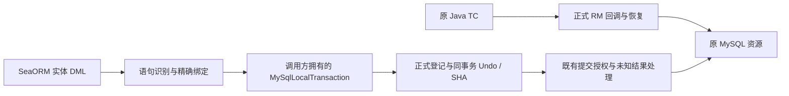

# SeaORM MySQL AT

将 SeaORM 1.1.19 的实体 DML 构建结果交给正式 `MySqlLocalTransaction`，保持原 SQL 与有序精确绑定。支持已验收的 `Entity::insert`、`Entity::update_many`、`Entity::delete_many` 构建器及 MySQL `Statement`；不内插参数。



调用方先构建语句，再在自己的正式本地事务上执行：

```rust
let statement = SeaOrmMySqlStatement::from_query(&query)?;
let affected_rows = statement.execute(&mut local).await?;
```

执行后将同一个 `local` 交给 `MySqlDataSourceManager::prepare_transaction`，继续使用原登记、Undo、提交授权、报告和恢复接口。适配器没有独立连接池或提交入口；默认有变化 COMMIT 门禁和 `experimental_changed_commit` 规则保持生效。

值转换保留整数、字节、文本、NULL、精确十进制和 chrono 日历/时间点。JSON null 保留为 JSON 文本 `null`，与 SQL NULL 区分；JSON 序列化及树深/节点有预算，超深拒绝输入使用迭代释放。DECIMAL 展开前检查指数/精度，时间亚微秒输入拒绝，未认证类型返回静态脱敏错误。

该接口当前返回影响行数。SeaORM 原生 `ConnectionTrait`/`exec`、完整读查询和模型返回、生成 ID、关联加载、迁移及 2.x 接口仍待接入；完整 ORM 要求保持开放。[规格](../../docs/phase-2/seaorm-mysql-contract.md)和[实际证据](../../docs/phase-2/evidence/seaorm-mysql/README.md)。
