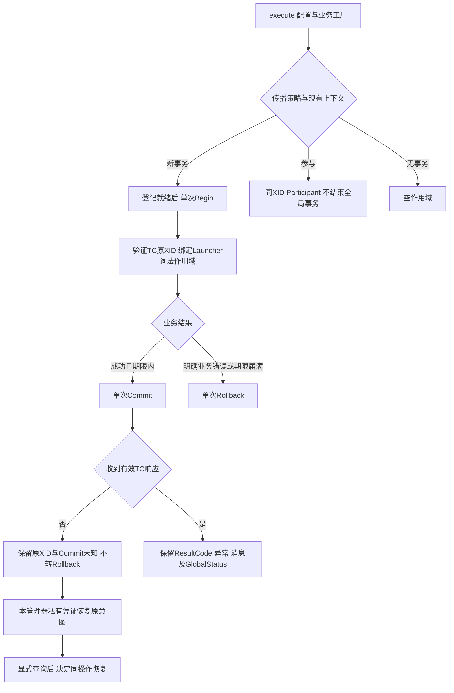

# seata-tm：正式全局事务 API

当前[WP03组合验收](../../docs/phase-1/evidence/tm-gate/README.md)通过：28项TM测试、87项传输回归及另2项驱动辅助unit在Rust1.99/最低1.85各通过；19隔离变异均被实际断言捕获。原JavaTC六基础场景及三真实TM响应丢失场景通过。[WP03门禁](../../docs/phase-1/wp03-tm-gate.json)已验证，下一步正式RM控制面；本模块不实现RM、SQL/Undo或TC持久重试调度。

`TransactionManager::builder(connection, identity)`拥有原生TM登记池，每个代际按精确application/service-group登记后才发送业务。`request_timeout`包含获取连接和单次传输等待；`registration_timeout`是登记预算。`TransactionConfig::transaction_timeout`独立配置TC事务期限，只接受正的精确signed-i32毫秒数，默认60秒。名称及XID有UTF-8字节预算、不做trim/标准化；XID不由客户端生成。

推荐使用`manager.execute(config, factory)`。业务future工厂在最终事务上下文内才构造；成功值与`TransactionCompletion`分开返回。Launcher业务成功后只提交一次，确定业务错误或期限届满后只回滚一次。`TransactionError::Business`同时保留原业务错误和可选回滚结果；未知Commit直接返回带原XID的错误，绝不落入Rollback分支。

| 传播 | 已有事务 | 无事务 |
|---|---|---|
| Required | 同XID Participant | 新Launcher |
| RequiresNew | 暂停外层、新Launcher、退出恢复 | 新Launcher |
| Supports | 同XID Participant | 无事务 |
| NotSupported | 暂停外层、无事务、退出恢复 | 无事务 |
| Mandatory | 同XID Participant | 执行前拒绝 |
| Never | 执行前拒绝 | 无事务 |

`RootContext`按future每次poll绑定不可变快照。嵌套返回、错误、panic及取消都会恢复外层；spawn任务不隐式继承。显式跨任务传递`RootContext::capture()`及`RootContext::scope`时始终降为Participant，保持已知原期限，不借传播升级全局决策权。panic/取消不启动无所有者的网络清理，TC仍负责持久事务期限和恢复。

需要手动控制时，`begin(&config)`返回原XID的`GlobalTransaction`，不在返回后留下隐式环境绑定；`transaction.scope(factory)`只负责词法上下文，自动业务期限和结束行为由`execute`负责。`commit/rollback`保留有效TC前缀与状态，Participant返回明确参与标记而不伪造TC应答。`get_status`或`reconcile`仅查询一次，不自动轮询或重放。Success不保证物理清理完成，AsyncCommitting保持可见；Finished不证明历史Commit，重试超时/stop状态须保留供运维处置。

作用域结束错误含XID但内部句柄已释放时，可将原未知结束错误交给同一管理器的`recover_unknown`。它需要实际Launcher结束路径签发的`RecoveryToken`，私有绑定管理器、原XID及原Commit/Rollback；公开诊断字段可读但不是授权。伪造错误、改操作/XID或换管理器均被拒绝。恢复不申请新TC期限，查询前不发送结束请求，查询失败/取消会撤销旧重试许可；不能把原未知Commit改为Rollback。该内存来源证明不宣称跨进程持久恢复。

Failed Begin保留完整报告字段，但报告XID不会绑定为Launcher。`TmError`区分本地写前失败、TC明确Failed、协议失败及写后未知；Failed响应的状态与可选消息/异常码不会被丢弃。Debug只显示元数据，仍需注意原JavaTC可能记录extraData；测试仅使用既有公共fixture。

基础Java功能运行使用空全局事务，包含Begin/Commit、业务失败Rollback、三种参与传播、RequiresNew/NotSupported、参与方不结束全局、业务期限；七个事务最终均查询到Finished。只读收尾查询等待Java异步清理，不重发事务，也不从Finished倒推历史结果。

后续正式TM真实故障驱动分别丢弃原TC成功Begin/Commit/Rollback响应。Begin不构造业务、无XID、不再次发起；两个结束模式从原作用域错误恢复，只在查询后显式重复同操作，实际15/15仍保留原未知。Rollback同时保留业务错误，真实RM回调在原连接按完整身份回包，内存动作各一次并释放测试锁。原始帧唯一应答及查询时序有独立破坏控制，额外原响应投递或旧在途查询不能冒充恢复证据。RM动作是测试模拟；持久RM幂等/SQL补偿、跨进程恢复、生产认证/TLS及完整V1仍须完成，外部TC风险未接受，共享锁继续延期。

## 应用停机准入

TransactionAdmission 为应用提供共享的正数容量与关闭边界。业务工厂构造及 TM 调用前取得 TransactionPermit，持有到整个作用域完成或持久交接之后。close 拒绝所有克隆的新准入；drain 同时关闭入口并有界等待已接纳许可释放。超时返回当时在途数量，保留原作用域和关闭状态。调用方在排空失败时仍应持有 TM/RM 所有者，按明确策略继续等待或持久交接，不能因错误提前 Drop 所有者。

[接口示例](src/api/transaction_admission.rs)以业务工厂避免准入前执行，并以可选所有者槽位保证排空超时不取走 TM。RAII 许可释放只证明本地作用域退出，未知全局结果仍需按原身份记录和恢复。组件不会强制拦截所有直接 TM 调用，应用必须统一入口接入；它不注册 OS 信号，也不代表部署验收。双版本组件和真实 TCP 证据见[验收记录](../../docs/phase-2/evidence/transaction-admission/README.md)。
