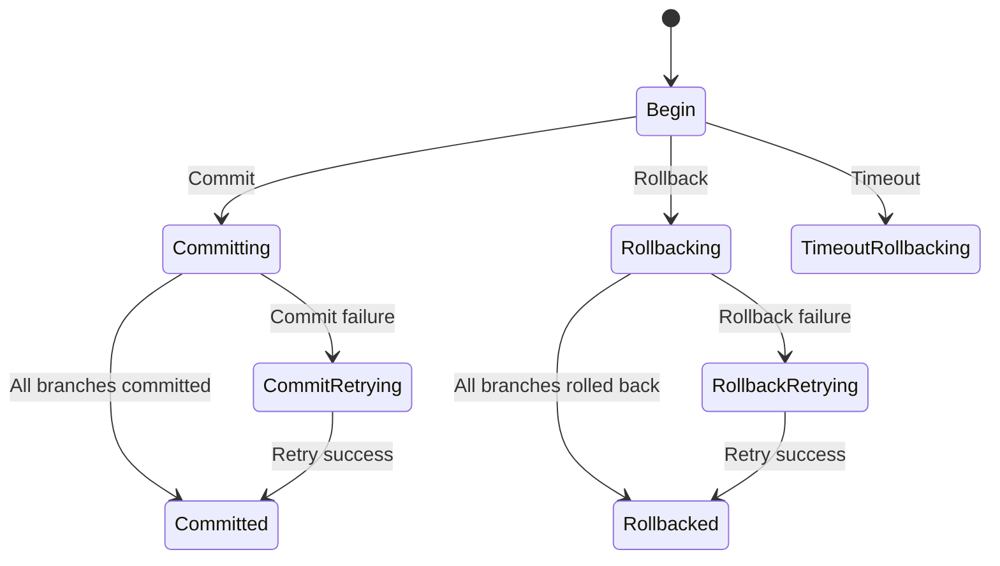
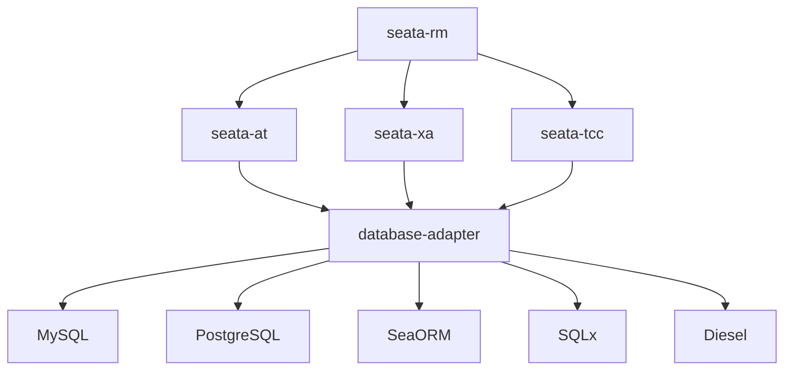
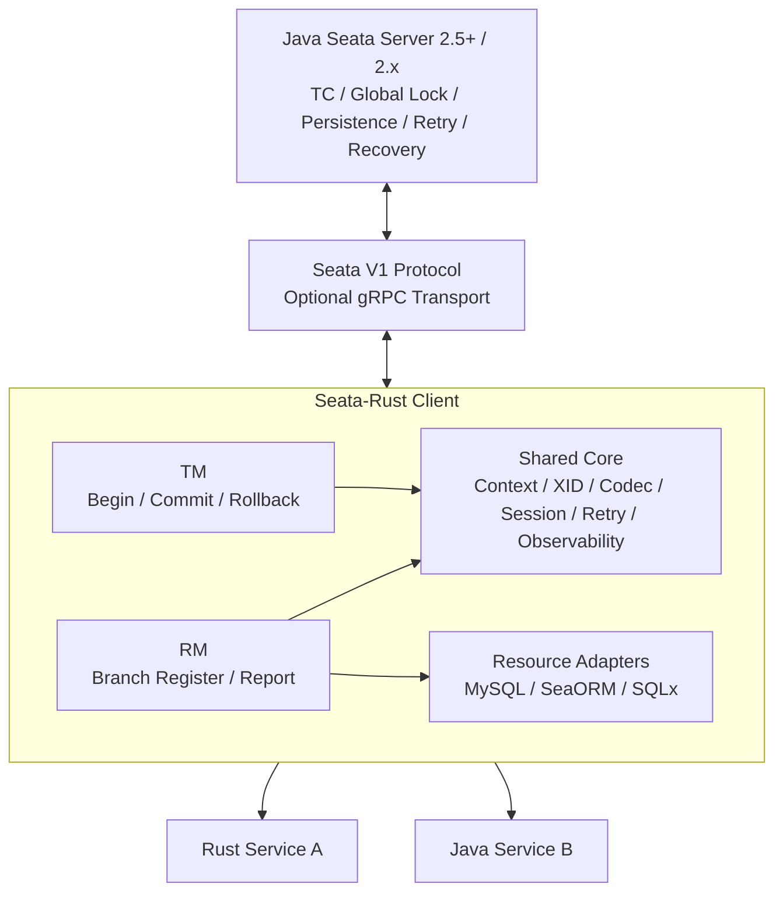
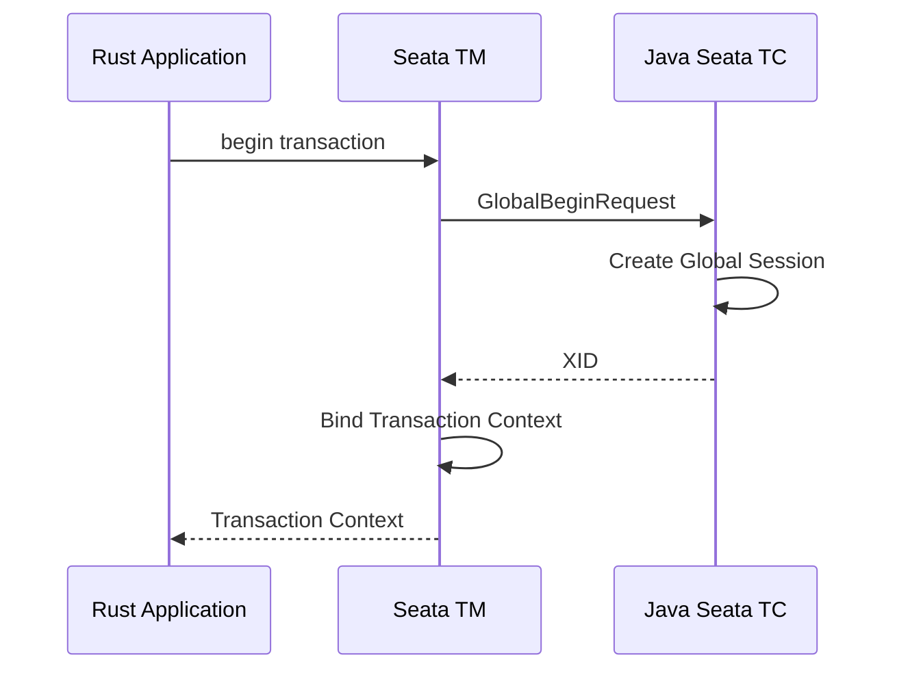
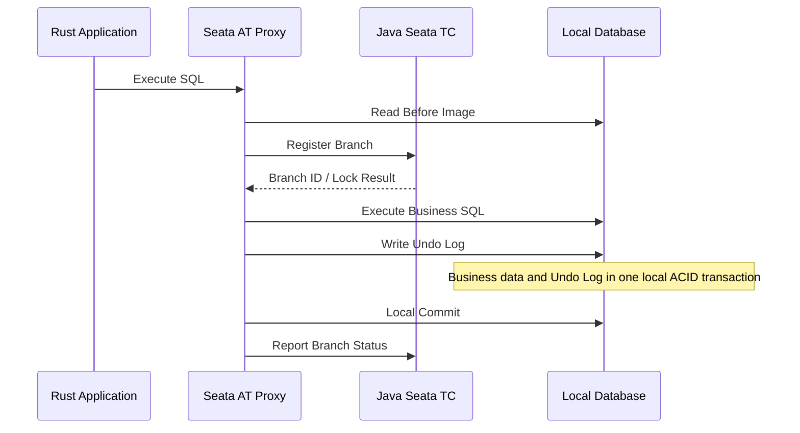
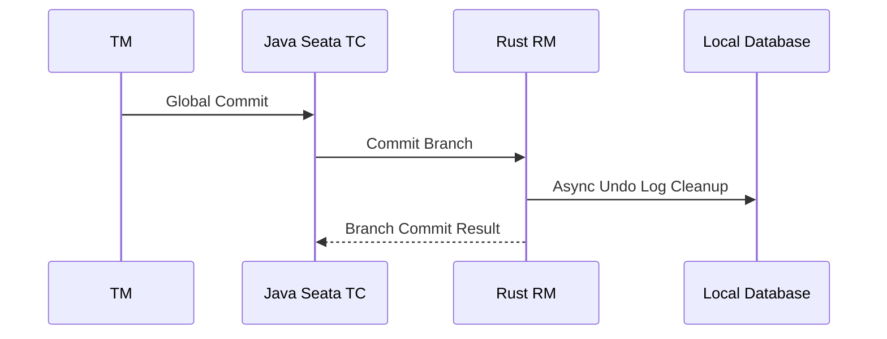
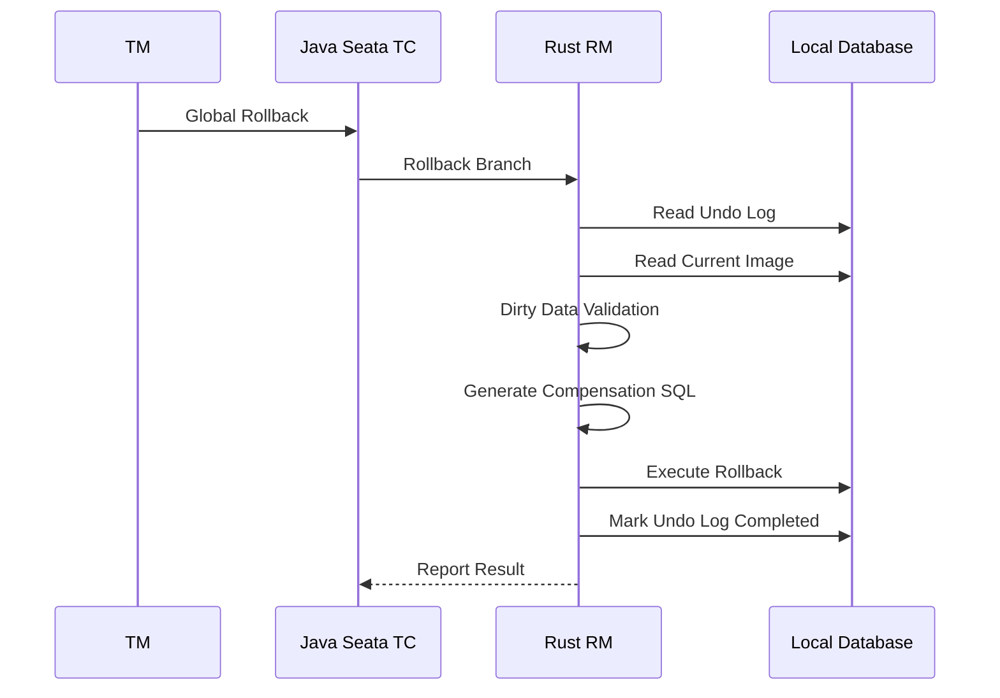
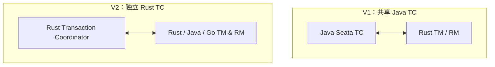
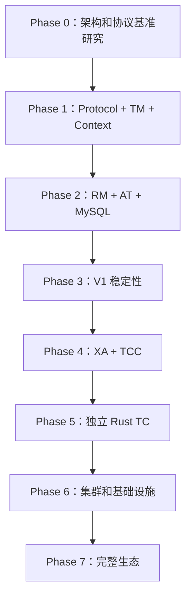
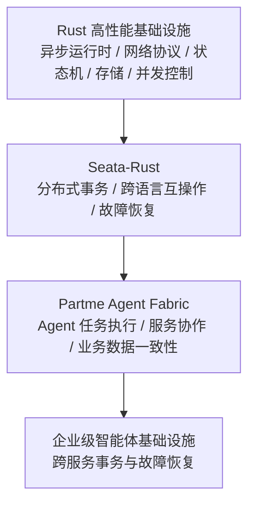

# Seata-Rust：架构与演进路线规划

> **Rust Distributed Transaction Infrastructure**
>
> 项目定位：Apache Seata 生态中的 Rust 原生分布式事务实现。首先兼容 Java Seata Server，随后逐步建立独立的 Rust Transaction Coordinator，最终发展为具有完整事务模式、独立运行能力和多语言互操作能力的事务基础设施。


- Repository: [easy-4-rust/seata-rust](https://github.com/easy-4-rust/seata-rust)
- Status: Architecture planning
- Initial implementation strategy: Seata-Go style — Rust TM/RM + Java Seata TC
- Long-term strategy: Native Rust TC + Java/Go/Rust interoperability

---

## 目标与基本原则

这个项目应当作为独立基础设施项目规划，而不是把 RSeata 简单移植或改名。

路线有三个重要原则：

1. **第一阶段不重复造轮子**：优先复用 Java Seata 已经成熟的 TC。
2. **Rust 先实现客户端侧能力**：构建自己的 TM、RM、数据库代理、事务上下文和协议适配层。
3. **第二阶段逐步实现 Rust TC**：将 TC、持久化、恢复、集群、注册发现等能力迁移到 Rust，最终不再依赖 Java Server。

> **核心架构判断：Seata-Rust V1 应该是一个 Seata-Go 风格的 Rust 客户端，而不是一开始就实现 Rust TC。**
>
> 这样既能快速获得可用性，也能让第一阶段的研发成果直接成为第二阶段的基础。

## 一、三个参考项目的关系

不要把三个项目看成三个平行实现，应明确它们各自承担的角色。

| 项目 | 定位 | 对 Seata-Rust 的价值 |
|---|---|---|
| [Apache Seata Java 2.x](https://github.com/apache/incubator-seata/tree/2.x) | 核心参考实现 | 事务协议、状态机、TC、RM、TM、事务模式、存储与集群能力的权威参考 |
| [Apache Seata-Go v2](https://github.com/apache/incubator-seata-go) | 官方多语言实现 | 学习另一种语言如何实现 TM/RM、兼容 Java TC 和实现多语言互操作 |
| [RSeata](https://github.com/oulover/rseata) | Rust 代码资产 | 提供 Rust 代码起点，复核 TC、TM、RM、SeaORM、Undo Log 和事务状态管理 |
| **Seata-Rust** | Rust 原生分布式事务基础设施 | 先兼容 Java TC，再建立独立 Rust TC，最终扩展完整 Seata 生态能力 |

### 1.1 版本基准

| 项目 | 研究基准 |
|---|---|
| Java Seata | 2.x 主分支，重点核对 2.5.x/2.6.x |
| Seata-Go | v2.1.0 稳定版本及 master 后续变化 |
| RSeata | master，版本 0.1.2 |
| Rust | Rust 1.90+ |
| 第一阶段 Server | Java Seata 2.5.0+ |

Seata-Go 官方 v2.1.0 已覆盖 AT、TCC、SAGA、XA，并要求 Seata Server 2.5.0+。它不只是一个简单的 AT 客户端。具体兼容范围仍应以对应 Release、源码和集成测试为准。

## 二、协议兼容：整个项目最重要的技术决策

不能认为只要实现了 TC/TM/RM，就能连接 Java Seata。真正的互操作需要同时兼容：

- 网络传输协议。
- RPC 消息编码。
- 请求和响应消息类型。
- 事务上下文。
- XID 格式。
- Branch Type。
- Global Status。
- Branch Status。
- 注册、报告、提交、回滚等操作语义。
- 序列化及版本兼容。

### 2.1 Seata-Go 的通信方式

Seata-Go v2 源码包含：

```text
pkg/
├── protocol/
│   ├── branch/
│   ├── codec/
│   ├── connection/
│   ├── grpc/
│   └── message/
├── remoting/
├── tm/
└── rm/
```

其中 `pkg/protocol/message` 定义 Seata V1 消息类型、消息头、请求和响应模型。消息头涉及：

- Magic Code：`0xDA 0xDA`
- Version
- Request Type
- Message ID
- Serialization Type
- Body Length

Seata-Go 并非只能使用 Getty；其后续版本还增加了 gRPC 传输支持。协议层不应绑定某一种传输方式。

### 2.2 Seata-Rust 协议设计建议

```text
seata-rust/
└── crates/
    ├── seata-protocol/
    │   ├── protocol-model/
    │   ├── protocol-codec/
    │   ├── protocol-version/
    │   ├── protocol-message/
    │   └── protocol-error/
    ├── seata-transport/
    │   ├── transport-trait/
    │   ├── transport-seata-v1/
    │   ├── transport-getty-compatible/
    │   └── transport-grpc/
    └── seata-client/
        ├── tm/
        ├── rm/
        └── context/
```

说明：

- `transport-getty-compatible` 指 Rust 实现与 Getty 所使用的 Seata V1 消息传输协议兼容，不需要移植 Getty 本身。
- V1 先完成 Seata V1 协议兼容，再将 gRPC 作为可选传输适配器。
- Seata 协议与原生 gRPC 并不能简单画等号。
- RSeata 当前 Tonic gRPC 实现可以保留为内部或可选传输，但不能直接当作 Java Seata 协议兼容层。

## 三、逐模块功能差异矩阵

以下矩阵用于规划和审计。需要区分官方声明、源码存在和经过互操作/故障测试验证的能力；目录或 feature 存在不代表功能已经生产就绪。

处理方式：

- 🟢 **直接兼容**：保持 Java Seata 的协议和语义，Rust 实现适配。
- 🔵 **Rust 重写**：重新实现语言相关或运行时相关逻辑。
- 🟡 **重新设计**：借鉴原理，但不照搬 Java 实现。
- 🔴 **风险待验证**：当前 RSeata 不能直接认定已经实现正确。

### 3.1 TC — Transaction Coordinator

| 功能模块 | Java Seata 2.x | Seata-Go v2 | RSeata | Seata-Rust 决策 |
|---|---|---|---|---|
| 全局事务管理 | 完整实现 | 复用 Java TC | 有基础实现 | V1 协议兼容 |
| 分支事务管理 | 完整实现 | 复用 Java TC | 有基础实现 | V1 协议兼容 |
| 全局事务状态机 | 完整实现 | 使用 Java TC | 有状态模型 | Rust 重写 |
| 分支事务状态机 | 完整实现 | 使用 Java TC | 有状态模型 | Rust 重写 |
| XID 管理 | 完整实现 | 兼容 | 有实现 | 直接兼容 |
| Branch ID 分配 | 完整实现 | 兼容 | 有实现 | 直接兼容 |
| 全局锁管理 | 成熟实现 | 复用 | 需核查 | Rust 重写 |
| 分支注册 | 完整实现 | 复用 | 有实现 | V1 兼容 |
| 分支结果报告 | 完整实现 | 复用 | 有实现 | V1 兼容 |
| 超时检测 | 完整实现 | 复用 | 有基础代码 | Rust 重写 |
| 提交重试 | 完整实现 | 复用 | 需核查 | Rust 重写 |
| 回滚重试 | 完整实现 | 复用 | 需核查 | Rust 重写 |
| 事务恢复 | 完整实现 | 复用 | 高风险 | Rust 重写 |
| 事务持久化 | 多种实现 | 复用 | 内存存储可见 | Rust 重写 |
| TC 集群 | 支持 | 复用 | 未验证 | 后续实现 |
| 注册发现 | 多种实现 | 多种实现 | 未充分验证 | 后续实现 |
| 事务审计 | 有相关能力 | 有相关能力 | 部分实现 | Rust 重写 |

#### 全局事务状态机

不能只定义几个简单的枚举：

```rust
enum GlobalStatus {
    Begin,
    Committing,
    Committed,
    Rollbacking,
    Rollbacked,
}
```

Java Seata 有更完整的状态生命周期，包括重试、超时回滚、异步提交等状态，例如：

- Committing
- CommitRetrying
- Rollbacking
- RollbackRetrying
- TimeoutRollbacking
- TimeoutRollbackRetrying

实际状态集合和转移关系必须以 Java Seata 2.x 对应分支源码为准，尤其要区分同步提交、异步提交、超时回滚和重试状态，不能将示意图直接当作完整状态机。

建议建立明确的事件驱动状态转移模型：



Rust 模型建议：

```rust
pub struct GlobalTransaction {
    pub xid: Xid,
    pub status: GlobalStatus,
    pub timeout: Duration,
    pub branches: Vec<BranchId>,
    pub version: u64,
}

pub enum GlobalTransactionEvent {
    Begin,
    RegisterBranch,
    Commit,
    Rollback,
    Timeout,
    BranchCommitted,
    BranchRolledBack,
    Retry,
    Recover,
}

pub struct TransactionTransition {
    pub from: GlobalStatus,
    pub event: GlobalTransactionEvent,
    pub to: GlobalStatus,
}
```

需要额外建立：

- 非法状态转移拒绝机制。
- 状态版本控制。
- 事件持久化。
- 重复事件幂等。
- 并发状态更新保护。
- 崩溃恢复时的状态重建。

可以借鉴 Partme Quant 的 Rust 状态机设计方法，但不要直接复用其交易业务状态。

### 3.2 TM — Transaction Manager

| 功能模块 | Java | Go | RSeata | Rust 决策 |
|---|---|---|---|---|
| Global Begin | 完整 | 有实现 | 有实现 | Rust 重写 |
| Global Commit | 完整 | 有实现 | 有实现 | Rust 重写 |
| Global Rollback | 完整 | 有实现 | 有实现 | Rust 重写 |
| XID Context | 完整 | 有实现 | 有实现 | 直接兼容 |
| 嵌套事务 | 有相关处理 | 有相关处理 | 待验证 | 兼容语义 |
| 事务超时 | 完整 | 有实现 | 待验证 | Rust 重写 |
| 事务传播 | 多种集成 | 多种集成 | Tonic | Rust 重写 |
| 事务钩子 | 完整 | 有实现 | 有基础实现 | Rust 重写 |
| 异常处理 | 完整 | 有实现 | 待验证 | Rust 重写 |
| 本地事务边界 | 完整 | 有实现 | SeaORM | Rust 重写 |

建议提供声明式 API：

```rust
#[seata::global_transaction]
async fn create_order() -> Result<()> {
    // 本地业务
    // 跨服务 RPC
    // 其他分支事务
    Ok(())
}
```

同时提供显式 API：

```rust
let tx = client.begin(options).await?;

let result = execute_business().await;

match result {
    Ok(value) => {
        tx.commit().await?;
        Ok(value)
    }
    Err(error) => {
        tx.rollback().await?;
        Err(error)
    }
}
```

Rust 特有问题是异步任务、Tokio 多线程调度、事务上下文的生命周期管理：

- 不能简单模仿 Java ThreadLocal。
- 可以使用 `tokio::task_local!` 或显式 Context 传递。
- 提供与 `tracing` Span 的关联支持。
- 防止事务上下文意外泄漏到不相关的异步任务。

### 3.3 RM — Resource Manager

| 功能模块 | Java | Go | RSeata | Rust 决策 |
|---|---|---|---|---|
| RM 初始化 | 完整 | 有实现 | 有实现 | Rust 重写 |
| 资源注册 | 完整 | 有实现 | 有实现 | 协议兼容 |
| Branch Register | 完整 | 有实现 | 有实现 | 协议兼容 |
| Branch Report | 完整 | 有实现 | 有实现 | 协议兼容 |
| Branch Commit | 完整 | 有实现 | 有实现 | Rust 重写 |
| Branch Rollback | 完整 | 有实现 | 有实现 | Rust 重写 |
| AT SQL 拦截 | JDBC | database/sql | SeaORM | Rust 重写 |
| SQL 解析 | 完整 | 有实现 | sqlparser | 重新验证 |
| 前后镜像 | 完整 | 有实现 | 有实现 | Rust 重写 |
| Undo Log | 完整 | 有实现 | 有实现 | 协议语义兼容 |
| 全局锁检查 | 完整 | 有实现 | 待核查 | Rust 重写 |
| 本地事务控制 | JDBC | SQL 驱动 | SeaORM | Rust 重写 |
| XA Resource | 有实现 | 有实现 | 有实现基础 | Rust 重写 |
| TCC Resource | 有实现 | 有实现 | 未见实现 | 后续实现 |
| RM 重连恢复 | 完整生态 | 有专门实现 | 待核查 | Rust 重写 |

Java AT 的关键不是简单记录 Undo Log，而是确保业务数据与回滚日志在同一个本地 ACID 事务中提交，并在全局锁保护下处理写隔离。这是 Seata-Rust 最需要保持正确性的地方。

### 3.4 数据库适配层

数据库适配层应独立设计，不要让 Seata-Rust 绑定 SeaORM。

| 适配能力 | Java | Go | RSeata | Seata-Rust |
|---|---|---|---|---|
| MySQL | 成熟 | 支持 | 已有适配 | V1 |
| PostgreSQL | 支持 | 支持 | Cargo 有 feature 声明，实际能力待验证 | V1.x |
| SeaORM | 非核心 | 非核心 | 已有适配 | V1 |
| Diesel | 非核心 | 非核心 | feature 尚未形成完整适配 | V2 |
| SQLx | 非核心 | 非核心 | 依赖底层 SQLx | V1 |
| 原生 SQL | JDBC | database/sql | 需核查 | V1 |
| 批量 SQL | 支持 | 有实现 | 需核查 | 后续完善 |
| 复合主键 | 支持 | 有专门处理 | 需核查 | 必须验证 |

建议的依赖关系：



**SQLx、SeaORM、Diesel 应当是适配器，而不是事务核心的组成部分。** 这样 ORM 生态变化不会影响 TC/TM/RM 核心实现。

### 3.5 事务模式

| 事务模式 | Java Seata | Seata-Go v2.1 | RSeata | Seata-Rust 路线 |
|---|---|---|---|---|
| AT | 成熟 | 支持 | 声明支持 | V1 优先 |
| XA | 成熟 | 支持 | 声明支持 | V1.x |
| TCC | 成熟 | 支持 | 规划中 | V1.x |
| Saga | 成熟 | 支持 | 未实现 | V2 |
| 自定义事务模式 | 扩展能力 | 有扩展基础 | 未验证 | V3 |

AT、XA、TCC 属于不同的资源协调模型，不能只用一个通用的 `commit()` 和 `rollback()` 来掩盖各自语义：

- AT：Undo Log 补偿。
- XA：数据库 Prepare / Commit / Rollback。
- TCC：Try / Confirm / Cancel。
- Saga：正向事务和补偿事务。

## 四、RSeata 现有代码审计结论

不建议直接推倒 RSeata 重写，也不建议原封不动地继续开发。应先进行架构保留和代码质量审计。

目前已检查部分确认的情况：

| 位置 | 已发现情况 | 处理建议 |
|---|---|---|
| `rseata-core/src/store` | 有内存 Session Store | 必须增加持久化实现 |
| `memery_transaction_store_manager.rs` | SessionCondition 查询目前返回全部会话 | 修复 |
| `rseata-core/src/session` | 有全局及分支 Session 模型 | 对照 Java 状态模型 |
| `rseata-tc/src/grpc_service` | 有独立 gRPC 服务 | 保留为内部或可选传输 |
| `rseata-tm` | 有事务管理器实现 | 对照 Go TM 重构 |
| `rseata-db-proxy/src/sea_orm` | 有 AT/XA 相关适配目录 | 分开审计两种模式 |
| `rseata-micro` | 有 gRPC 传播能力 | 增加协议兼容传播 |
| `Cargo.toml` | Diesel/PostgreSQL feature 已声明 | 核实实际实现，不以 feature 存在作为支持证据 |

RSeata 的 `FIXES_SUMMARY.md` 也将 Undo Log 完整性、XA 两阶段提交和测试覆盖列为后续改进事项。因此当前 RSeata 可以作为代码参考，但还不能作为 Seata-Rust 的完整基础。

### 4.1 代码资产分类

| 分类 | 代码或能力 | 处理方式 |
|---|---|---|
| 🟢 保留/改造 | Session 模型、基础 XID 类型、Tonic 服务端、SeaORM 接口适配、已有 SQL 镜像和 Undo Log 代码 | 逐项验证后继承 |
| 🟡 重构 | Transaction Store、Global/Branch 状态机、TM 事务生命周期、RM 注册与报告、数据库代理、异步上下文 | 按官方语义重建 |
| 🔴 重新实现 | Seata V1 协议编码、Java TC 兼容通信、可靠持久化、故障恢复引擎、全局锁一致性、生产级重试机制 | 不直接继承当前实现 |

以上是已检查部分的初步审计，不是对整个仓库逐行测试后的最终结论。后续必须以实际源码和测试为准。

## 五、Seata-Rust V1：按照 Seata-Go 的路线实现

**V1 核心目标：Rust TM + Rust RM + Java Seata TC，先实现一个真正可以投入业务使用的多语言分布式事务客户端。**

### 5.1 V1 整体架构



V1 不需要自己实现 TC 的全局锁、持久化、恢复等功能，因为这些能力暂时由 Java TC 提供。但是 Rust RM 必须能够正确响应 TC 的二阶段指令。

### 5.2 V1 功能范围

| 优先级 | 功能 | 验收标准 |
|---|---|---|
| P0 | XID | 能与 Java TC 正常交互 |
| P0 | Protocol Codec | 编码、解码与 Go 实现一致 |
| P0 | TM Begin | 创建全局事务 |
| P0 | XID Propagation | 跨 Rust/Java RPC 传播 |
| P0 | RM Register | 注册分支事务 |
| P0 | AT MySQL | 本地业务数据与 Undo Log 原子提交 |
| P0 | Global Commit | TC 可以正常完成 AT 提交 |
| P0 | Global Rollback | TC 可以正确触发 AT 补偿 |
| P0 | Retry / Idempotency | 二阶段重复请求安全 |
| P1 | XA MySQL | 正确完成两阶段提交 |
| P1 | TCC | 实现 Try / Confirm / Cancel |
| P1 | PostgreSQL AT/XA | 逐步接入 |
| P2 | Saga | 状态机和补偿引擎 |

AT 优先，是因为它能充分验证数据库代理、事务传播、Undo Log 和全局锁之间的协作关系。Go 官方 v2.1.0 已经覆盖四种事务模式，后续可作为能力对照基准，不要求 Rust 第一版就实现全部功能。

### 5.3 第一版核心 Crates

不要沿用 RSeata 现有模块名称和依赖关系，重新规划 Cargo Workspace：

```text
seata-rust/
├── crates/
│   ├── seata-core/
│   ├── seata-protocol/
│   ├── seata-transport/
│   ├── seata-client/
│   ├── seata-tm/
│   ├── seata-rm/
│   ├── seata-at/
│   ├── seata-xa/
│   ├── seata-tcc/
│   ├── seata-saga/
│   ├── seata-datasource/
│   ├── seata-db-mysql/
│   ├── seata-db-postgres/
│   ├── seata-orm-seaorm/
│   ├── seata-orm-sqlx/
│   ├── seata-orm-diesel/
│   ├── seata-context/
│   ├── seata-macros/
│   ├── seata-observability/
│   └── seata-testkit/
├── server/
│   └── seata-server/
├── examples/
│   ├── rust-order-service/
│   ├── rust-user-service/
│   ├── java-rust-mixed/
│   └── at-mysql/
├── tests/
│   ├── compatibility/
│   ├── integration/
│   ├── failure-injection/
│   └── conformance/
├── docs/
└── Cargo.toml
```

`server/seata-server` 第一阶段可以不实现，目录只是预留第二阶段的位置。

| Crate | 责任 |
|---|---|
| seata-core | XID、事务类型、基础模型、错误 |
| seata-protocol | Seata 消息、编码、解码 |
| seata-transport | 网络通信和连接管理 |
| seata-client | 客户端统一入口 |
| seata-tm | 全局事务管理 |
| seata-rm | 分支事务管理 |
| seata-at | AT 事务引擎 |
| seata-xa | XA 事务引擎 |
| seata-tcc | TCC 资源管理 |
| seata-saga | Saga 执行引擎 |
| seata-datasource | 数据源抽象 |
| seata-db-mysql | MySQL 实现 |
| seata-db-postgres | PostgreSQL 实现 |
| seata-context | 事务上下文和传播 |
| seata-macros | 声明式事务宏 |
| seata-observability | Metrics、Tracing、Audit |
| seata-testkit | 协议兼容与测试工具 |

`seata-client` 不应该把 AT、XA、TCC 全部写成一个庞大的模块。各事务模式应当拥有自己的执行引擎，通过统一 Branch Resource 接口接入 RM。

### 5.4 Rust 的安全与性能设计

| 领域 | 设计 |
|---|---|
| 内存安全 | 所有权、生命周期、避免共享可变状态 |
| 并发安全 | Tokio + Arc + 原子操作 + 锁粒度控制 |
| 状态安全 | 强类型状态机，禁止非法转移 |
| SQL 安全 | 参数化执行，禁止字符串拼接 |
| 网络安全 | TLS、连接认证、超时控制 |
| 数据安全 | Undo Log 校验、敏感数据保护 |
| 幂等安全 | Branch ID + 操作类型 + 状态版本 |
| 可观测性 | OpenTelemetry + tracing |
| 性能 | 批量请求、连接复用、异步处理、零拷贝编码优化 |

**原则：不要为了追求零拷贝牺牲协议正确性。** 先完成字节级兼容和边界检查，再做性能优化。

## 六、V1 核心事务执行链路

### 6.1 Global Transaction Begin



TM 必须处理：

- 请求超时。
- 重复 Begin。
- TC 不可用。
- XID 绑定。
- 嵌套事务。
- 事务超时。

### 6.2 AT Phase 1：分支注册和本地事务



关键顺序：

- Undo Log 和业务数据必须处于同一个本地事务。
- 全局锁必须在业务本地事务提交前成功取得。
- 如果全局锁获取失败，不能把业务数据提交出去。

### 6.3 AT Phase 2：Global Commit



AT 提交阶段不应该再重复执行已经提交的业务 SQL，而是完成 Undo Log 清理及相应资源状态处理。

### 6.4 AT Phase 2：Global Rollback



必须保证：

1. Undo Log 对应的原始事务身份正确。
2. 当前数据库镜像符合预期。
3. 回滚操作具有幂等性。
4. 回滚执行和 Undo Log 状态更新具备正确的本地事务边界。
5. 回滚失败可以被 TC 重新调度。

不能简单地将 Undo Log 读取出来，然后直接覆盖数据库记录。

## 七、第二阶段：独立 Rust TC

当 V1 稳定运行后，开始实现自己的 TC。不要推倒 V1，而是替换 TC Endpoint。



V2 的 TC 不只是一个 gRPC Server，至少需要：

| 模块 | 责任 |
|---|---|
| Global Session Manager | 全局事务会话 |
| Branch Session Manager | 分支事务会话 |
| Lock Manager | 全局锁 |
| Transaction Store | 持久化 |
| Transaction Recovery | 故障恢复 |
| Timeout Manager | 超时扫描 |
| Retry Scheduler | 重试调度 |
| Session Lifecycle | 生命周期 |
| Cluster Manager | 集群管理 |
| Registry | 服务发现 |
| Configuration | 配置 |
| Audit | 审计 |
| Metrics | 监控 |

### 7.1 持久化方案

建议抽象存储接口：

```rust
#[async_trait]
pub trait TransactionStore: Send + Sync {
    async fn save_global(
        &self,
        session: &GlobalSession,
    ) -> Result<()>;

    async fn save_branch(
        &self,
        session: &BranchSession,
    ) -> Result<()>;

    async fn load_global(
        &self,
        xid: &Xid,
    ) -> Result<Option<GlobalSession>>;

    async fn load_branches(
        &self,
        xid: &Xid,
    ) -> Result<Vec<BranchSession>>;

    async fn recover_pending(
        &self,
    ) -> Result<Vec<GlobalSession>>;
}
```

第一版 Rust TC 建议支持：

- MySQL/PostgreSQL 持久化。
- 单机运行。
- 服务重启恢复。
- 事务超时。
- 提交与回滚重试。

之后再引入 Raft 或其他共识方案。不建议一开始就实现复杂的分布式共识，先把单节点持久化和恢复正确性验证透。

## 八、第三阶段：逐步覆盖 Java Seata 2.x 完整能力

Seata-Go 是第一阶段的路线参考，Java Seata 2.x 才是最终功能对照基准。

最终 Seata-Rust 应该具备：

| 领域 | 最终能力 |
|---|---|
| Transaction Core | 完整事务生命周期和状态机 |
| TM | 全局事务管理、嵌套、超时、传播 |
| RM | AT、XA、TCC、Saga 资源管理 |
| TC | 完整事务协调、全局锁、恢复、重试 |
| Storage | 文件、数据库等存储扩展 |
| Cluster | 多节点、高可用、故障切换 |
| Discovery | Nacos、Etcd、Consul 等适配 |
| Configuration | 配置中心及动态配置 |
| Database | MySQL、PostgreSQL 等 |
| ORM | SeaORM、SQLx、Diesel |
| RPC | Tonic、HTTP/2、其他协议适配 |
| Observability | Metrics、Tracing、Audit |
| Management | CLI、管理 API、事务查询 |
| Extension | 自定义 Branch Resource、存储和传输扩展 |

需要区分：

- **功能兼容**：Rust TC 能完成相同的事务功能。
- **协议兼容**：Java、Go 客户端能够使用 Rust TC，且事务语义一致。

最终应该同时达到这两个目标。

## 九、兼容性与正确性测试体系

不能让 Seata-Rust 成为一个看起来功能很多，但事务出错时无法保证数据安全的项目。测试体系必须先于功能扩展。

### 9.1 跨语言兼容测试

| TM | RM | TC | 验证场景 |
|---|---|---|---|
| Java | Java | Java | 基准 |
| Go | Go | Java | 官方基准 |
| Rust | Rust | Java | V1 |
| Rust | Java | Java | 跨语言分支 |
| Java | Rust | Java | 跨语言分支 |
| Go | Rust | Java | 多语言分支 |
| Rust | Rust | Rust | V2 |
| Java | Rust | Rust | V2 兼容 |
| Go | Rust | Rust | V2 兼容 |

每一个场景都要验证：

- Begin。
- XID 传播。
- Branch Register。
- Branch Report。
- Commit。
- Rollback。
- Timeout。
- Retry。
- Duplicate Request。
- Process Crash。
- Reconnect。

### 9.2 故障注入测试

| 故障 | 预期结果 |
|---|---|
| TC Begin 后宕机 | 事务状态可恢复 |
| Branch Register 后 RM 宕机 | TC 能识别未完成分支 |
| 本地 SQL 执行后网络断开 | 不产生无法恢复的数据状态 |
| Undo Log 写入失败 | 本地业务事务回滚 |
| Global Lock 获取失败 | 不提交本地事务 |
| TC Commit 请求重复 | 不重复执行错误的业务操作 |
| RM Rollback 请求重复 | 幂等回滚 |
| Rollback 执行中宕机 | 重启后继续恢复 |
| Undo Log 已清理但响应丢失 | 正确识别已完成状态 |
| TC 重启 | 恢复未完成事务 |
| RM 重连 | 恢复资源注册 |
| 多事务并发修改 | 不出现脏写 |

### 9.3 AT 模式必须验证的 SQL

不能只用简单 INSERT、UPDATE、DELETE，还需要：

- 单主键、复合主键。
- NULL 字段。
- Decimal。
- JSON。
- Binary。
- 时间字段。
- 批量 INSERT。
- 批量 UPDATE。
- 多表关联。
- SQL 别名。
- 子查询。
- 乐观锁字段。
- 并发更新。
- 不支持的 SQL 拒绝策略。

SQL 解析器必须明确哪些 SQL 支持自动补偿，哪些必须拒绝或要求显式处理。

## 十、OpenSpec 开发计划

建议分成八个阶段，而不是一次性开发所有功能。



### Phase 0：架构和协议基准研究

- Java Seata 2.x 源码映射。
- Seata-Go v2 源码映射。
- RSeata 代码审计。
- 协议字段和状态机对照。
- ADR 架构决策。
- 兼容性测试规范。

### Phase 1：Protocol + TM + Context

- Seata V1 消息编解码。
- 网络连接管理。
- XID。
- Global Begin/Commit/Rollback。
- Context Propagation。
- Java TC 互操作测试。

### Phase 2：RM + AT + MySQL

- RM 注册。
- SQL 拦截。
- 前后镜像。
- Undo Log。
- 全局锁。
- AT 提交和回滚。

### Phase 3：V1 稳定性

- 故障恢复行为。
- 重试。
- 幂等。
- 并发。
- 压力测试。
- 跨语言集成测试。

### Phase 4：XA + TCC

- XA Resource。
- 两阶段提交。
- TCC Resource。
- Fence。
- 空回滚。
- 悬挂处理。

### Phase 5：独立 Rust TC

- Session Store。
- Lock Manager。
- Recovery Engine。
- Retry Scheduler。
- Timeout Manager。
- Java / Go / Rust 客户端兼容。

### Phase 6：集群和基础设施

- 集群管理。
- 注册发现。
- 配置中心。
- 多存储适配。
- 管理 API。
- 监控审计。

### Phase 7：完整生态

- Saga。
- PostgreSQL。
- 更多 ORM。
- 更多 RPC。
- CLI。
- 插件扩展。
- 与 Java Seata 2.x 完整功能对照。

## 十一、V1 Definition of Done

V1 是否完成由硬性验收指标决定，而不是模块数量。

- [ ] Rust TM 能连接 Java Seata 2.5+ TC。
- [ ] Rust RM 能注册和报告分支事务。
- [ ] Rust XID 与 Java / Go 兼容。
- [ ] Rust 服务与 Java 服务可以组成同一个全局事务。
- [ ] MySQL AT INSERT / UPDATE / DELETE 正确。
- [ ] AT Undo Log 与业务数据原子提交。
- [ ] AT Commit 和 Rollback 正确。
- [ ] 全局锁冲突和并发更新正确。
- [ ] 重复提交、回滚请求具有幂等性。
- [ ] TC / RM 网络断开及重连测试通过。
- [ ] 进程崩溃后的事务行为得到验证。
- [ ] 兼容性测试和故障注入测试通过。

> 这只是规划验收清单，不代表目前已经通过。

## 十二、重要架构决策

| 决策 | 建议 |
|---|---|
| 项目性质 | 独立 Rust 开源项目 |
| V1 架构 | Seata-Go 模式 |
| V1 TC | 复用 Java Seata |
| V1 协议 | Java Seata 兼容协议 |
| V1 数据库 | MySQL |
| V1 事务模式 | AT 优先，XA/TCC 后续 |
| V2 架构 | 独立 Rust TC |
| V2 持久化 | 数据库持久化 + 恢复 |
| V2 客户端 | Rust / Java / Go |
| 最终目标 | Java Seata 2.x 主要能力及协议生态覆盖 |
| 性能策略 | 先正确性，再基准测试，再优化 |

三个原则：

1. **不要让 Rust TC 成为 V1 的阻塞项。** 只要 Rust TM/RM 能与 Java TC 正常工作，就已经是一个有实际价值的产品。
2. **不要把协议和业务执行引擎耦合。** 以后 Rust TC、Java TC 之间的切换，不应该要求重写数据库代理。
3. **不要为了兼容而继承 Java 的所有设计缺陷。** 协议层保持兼容，内部实现可以采用 Rust 更适合的并发模型、状态机、持久化和安全机制。

## 十三、项目组织与工程规范

Seata-Rust 应作为独立仓库，不放在 Agent Fabric 内部。

建议组织结构：

```text
partme-ai/
├── agentscope-runtime-rust
├── agentscope-extensions-*
└── ...

full-stack-rust/
└── seata-rust
```

项目工程规范：

- 仓库：`easy-4-rust/seata-rust`
- License：Apache-2.0
- 技术规范：Rust Workspace + Cargo Features
- 设计方法：DDD + SDD + TDD
- 开发管理：OpenSpec
- 代码质量：CodeGuard + ArchGuard
- CI：编译、测试、协议兼容、覆盖率、安全审计

注意：Apache Seata 的 Apache-2.0 许可并不意味着可以忽略 NOTICE、许可证头和第三方依赖义务。若复用代码或协议定义，应当单独审查来源及许可证。

## 十四、项目价值与长期方向

Seata-Rust 不只是多一个 Rust 项目，它能形成一个技术能力闭环：



它可以成为独立开源工程代表作：展示协议、分布式系统、数据库、并发、安全和跨语言架构方面的综合工程能力。

### 最终建议

**先把 Phase 0 做扎实，再进入 V1 编码。不要先从 RSeata 的现有代码开始修补。先建立 Java Seata 2.x 的协议和状态机基准，再决定每个模块是继承、重构还是重写。**

Phase 0 最重要的交付物是：

**Seata-Rust Architecture & Compatibility Specification**

应包含：

1. 逐文件源码映射。
2. 消息协议字段矩阵。
3. 状态转移矩阵。
4. TC/TM/RM 时序图。
5. ADR 架构决策。
6. V1 OpenSpec 任务。

这样后续无论交给 Codex、Kimi 还是 ZCode，都能遵循同一套架构基准，不会各自实现出不同的 Seata。

---

## 参考仓库与源码入口

| 顺序 | 项目/模块 | 链接 |
|---|---|---|
| 1 | Java Seata core | [apache/incubator-seata/tree/2.x/core](https://github.com/apache/incubator-seata/tree/2.x/core) |
| 2 | Java Seata server | [apache/incubator-seata/tree/2.x/server](https://github.com/apache/incubator-seata/tree/2.x/server) |
| 3 | Go TM | [incubator-seata-go/pkg/tm](https://github.com/apache/incubator-seata-go/tree/master/pkg/tm) |
| 4 | Go RM | [incubator-seata-go/pkg/rm](https://github.com/apache/incubator-seata-go/tree/master/pkg/rm) |
| 5 | Go Protocol | [incubator-seata-go/pkg/protocol](https://github.com/apache/incubator-seata-go/tree/master/pkg/protocol) |
| 6 | Rust TC | [oulover/rseata/rseata-tc](https://github.com/oulover/rseata/tree/master/rseata-tc) |
| 7 | Rust Store | [oulover/rseata/store](https://github.com/oulover/rseata/tree/master/rseata-core/src/store) |
| 8 | Rust DB Proxy | [oulover/rseata/db-proxy](https://github.com/oulover/rseata/tree/master/rseata-db-proxy) |

> **文档状态：** 初始架构规划。矩阵中的“完整/支持/有实现”等描述是当前研究基线，不等于 Seata-Rust 已实现或通过测试。正式开发前，应将每一项绑定到具体源码文件、版本/commit、测试用例和验收证据。
