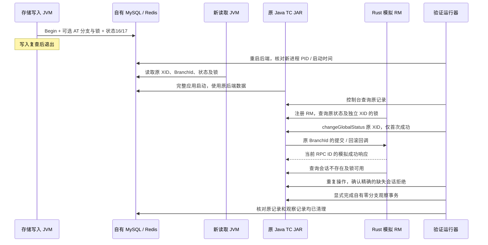

# MySQL / Redis retry-timeout restart and operator retry — 2026-11-12

Final run `run_20261112_152511_3907a673` passes **eight scoped integration cases**, four per backend. Real seeded states survive an actual backend process restart; a fresh reader and the unchanged full Java TC observe the original records. Console manual retry completes original simulated branches and removes the target sessions. These are injected persisted states, not naturally generated timeouts or real business SQL/Undo Log compensation.

| Backend | Original status | Original branches | Before retry | After actual console retry |
|---|---|---|---|---|
| MySQL |16 /17|1 each| Original XID/status/BranchId, stored lock unavailable | Original BranchCommit/BranchRollback callback; one simulated action; session absent, lock available |
| MySQL |16 /17|0 each| Original XID/status, no branch/lock | Session absent; zero RM actions |
| Redis |16 /17|1 each| Same original identity and stored lock after Redis restart | Same actual callback/action/session/lock checks |
| Redis |16 /17|0 each| Same original identity, no branch/lock | Session absent; zero RM actions |

Each backend uses XIDs `127.0.0.1:28091:920000` through `...:920003` in its own fresh database/runtime. Nonempty BranchIds are930000/930001. The same numeric identities across stores are deliberate; no store data is reused between runs.

## Authoritative artifacts and process evidence

Java pin: `cba73e180fd8896a99df6415b859d275122feaa7`. Original TC JAR SHA-256: `aef2e8386c97deb78b45c6ad662ad601447def6f5c23537b7d5b1a314654c5d5`. Existing JDBC8.0.33 SHA-256: `e2a3b2fc726a1ac64e998585db86b30fa8bf3f706195b78bb77c5f99bf877bd9`. No production Java source/JAR is patched.

Cached image IDs are frozen in the runner and `container-before.json`; no image pull or tool installation occurred. MySQL's process PID changed44274→45267; Redis45611→45738, with new StartedAt values. Container IDs stayed the same across each restart, and bind data stayed on D. Both final containers are verified exited; no reset or container/data deletion was performed. Ports28091/28093/28094 were released.

The fixture runs one freshly compiled helper class with the original TC JAR's own dependency cohort. A real StandardEnvironment bridges the explicitly validated D/E JSON configuration into the JAR's Spring configuration SPI before manager initialization. This is configuration setup, not a mocked manager or a full Spring application in the seed/inspect stages. The later native/console TC stage is the complete original application startup.

Before and after fresh Maven execution,2122 tracked production source/resource/POM files in the actual build tree are compared with the pin, allowing only CRLF/LF changes. A real negative control changed the D-owned FILE filter17→16, which was rejected; exact original bytes were restored and all2122 reverified. The final copied helper class and fresh Java report hashes are in `result.json` and `manifest.json`.

## Outcome evidence and cleanup

The client sends no GlobalCommit/GlobalRollback/BranchRegister for an old target. Only the external operator API performs the original retry. Native status16/17 and independent contender lock queries are checked before readiness. Nonempty callbacks validate original XID/BranchId/resource/AT/applicationData and use the TC's current RPC ID. The final Finished15 is treated as absence, never standalone commit/rollback proof; actual operator success, callback processing and console/backend removal are independently required.

The second manual retry returns HTTP500 with an empty body on this pinned Netty path. Every case also records freshly appended owned-TC logs containing the current XID and the exact missing-session IllegalArgumentException, followed by another empty console query. Generic500,404, malformed bodies or another transaction's logs cannot pass the Python negative controls.

Ordinary no-branch observer rollbacks return11 but persist status4 under DB/Redis DELAY_HANDLE_SESSION. The runner proves each cleanup XID belongs to its current client's two distinct lock observations, is not the old target, and has actual status4/zero branches. It then explicitly invokes TC `sendCommitOrRollback` for those observers and requires absence. This is explicit fixture teardown, not automatic cleanup, and never removes an incomplete original target. Final MySQL global/branch/lock counts are0/0/0; Redis has no global or branch keys. Two actual simulated branch actions occur per backend, none for the empty cases.

## Tests, review and retained failed attempts

- Rust98/98, formatting and Clippy warnings-denied pass; new status/identity tests first produced two actual assertion failures.
- Fresh Java selected3/3 pass before the final run. The added real ChannelManager regression first rejected old client port0; the fixture now uses a valid old port1 and actual reconnect-channel fallback. Earlier input-guard RED had2 failures.
- Python5/5 pass. Exact repeat-rejection signature had an actual failing positive control before implementation; wrong status/body/XID and unsafe cleanup identities are negative controls.
- The updated Bash wrapper is syntax-checked only on Windows; no fresh-clone Bash/remote CI run is claimed.
- Independent read-only review found two P2 evidence gaps (generic-error acceptance and unchecked build provenance); both were fixed and re-reviewed. Runtime cohort/environment and observer teardown changes were also re-reviewed without new findings.

All earlier attempts are retained with their actual status:

| Run suffix | Actual result |
|---|---|
| `144448_208e9f08` | Formatter/source equality preflight stopped before any backend |
| `145131_17d0e6ac` | Invalid old client port0 prevented callback; operator HTTP200 alone correctly did not pass |
| `145951_32d20f18` | Four MySQL target cases passed; all-store check caught8 observer records |
| `150500_2068d812` | Observer guard caught persisted4 versus incorrectly expected11; no cleanup command issued |
| `151013_223fb5ce` | Complete MySQL path passed; Redis fixture exposed mixed test-classpath Jedis3.8/7 ABI mismatch |
| `151511_93bfda2c` | Original-JAR standalone fixture lacked its required Spring Environment; harness bootstrap failed |
| `152121_c0b97ba3` | Formatter/source equality preflight stopped before any backend |
| `152511_3907a673` | Final original-JAR cohort/configuration, both stores and all8 cases passed |

The Jedis ABI diagnosis is recorded with actual javap output: test-suite Jedis3.8 hset returns Long, the original JAR's Jedis7 method returns long. Those harness failures are not reported as upstream Redis failures.

## Remaining limits and secondary observation

REC-TIMEOUT-005–007 pass for these seeded-record/store-restart/simulated-RM assertions.008–009 remain partial because real business compensation, durable RM replay and crash/retry races are absent.010 covers branch-empty record completion and safe repeated rejection; it does not claim a repeated successful HTTP no-op or arbitrary concurrency safety. FILE16/17 external recovery issues and live RAFT recovery remain open.

**JAVA-METRICS-RETRY-001 remains OPEN:** in the final seeded timeout manual-reentry runs, each TC logs four MetricsSubscriber errors because GlobalTransactionEvent.getEndTime() is null. Core callbacks/state transitions still pass. The raw logs preserve this observed side issue; no metrics correctness, natural scheduler equivalence or production-readiness claim follows.

Reproduction: [runner instructions](../../../../tools/java-tc-integration/backend_recovery/README.md). `manifest.json` binds raw logs, reports, source inventories and artifact hashes. The full Phase0–7 goal remains active; this test tool is not the formal Rust TM/RM implementation.
