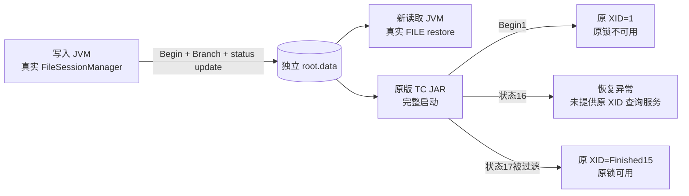

# FILE retry-timeout persisted-record diagnostic — 2026-11-12

Two full runs reproduce the pinned Java TC's differing restore behavior for retry-timeout records. **The diagnostic succeeds at reproducing failures; REC-TIMEOUT-001–002 recovery acceptance remains open.** No upstream production code or JAR is patched.

| Seeded status | New FILE reader: sessions / branches | Unchanged full TC JAR | Native old-XID query | Separate contender lock query |
|---|---|---|---|---|
| Begin1 (positive control) |1 /1| Starts | Begin1 | false: old branch lock restored |
| CommitRetryTimeout16 |1 /1| Exits -1, `ShouldNeverHappenException: NOT properly handled CommitRetryTimeout` | Unavailable | Unavailable |
| RollbackRetryTimeout17 |0 /0| Starts | Finished15 | true: old lock absent |

Issues: **JAVA-FILE-RETRY-TIMEOUT-001** (retained16 prevents startup) and **JAVA-FILE-RETRY-TIMEOUT-002** (17 is filtered, losing session/branch lookup and lock restoration). Finished15 is an observation of absence, never proof that rollback compensation occurred.

## Reproduction chain



The seed helper uses the real pinned `FileSessionManager` to write GLOBAL_ADD(Begin), BRANCH_ADD(AT/PhaseOne_Done) and GLOBAL_UPDATE(1/16/17). It never crafts or edits FILE bytes. The writer closes/flushed storage and exits; a distinct reader JVM reloads it, validates original branch identity and records the actual filter/switch behavior. The raw seed is copied before inspection; the runner requires identical bytes after inspection. A third JVM then starts the original full TC against that directory, using FILE sync configuration, auth disabled and port28091.

These are injected persisted-state fixtures, not naturally scheduled retry timeouts or crash/power-loss tests. The inspector deliberately calls the reload switch with `acquireLock=false`; **actual lock restoration is tested separately through full TC startup and native Rust lock queries**. Original transactions are never ended or re-registered by the query probe; only a new contender transaction is created and cleaned up.

Java pin: `cba73e180fd8896a99df6415b859d275122feaa7`. JAR SHA-256: `AEF2E8386C97DEB78B45C6AD662AD601447DEF6F5C23537B7D5B1A314654C5D5`. The runner compares five relevant Java production sources with their pinned Git blobs, normalizing only CRLF to LF. This normalization was required because Maven Spotless emits Windows line endings; no other text changes are accepted.

## Executed runs and tests

- `run_20261112_141507_7ff0e651`: initial three-scenario full-JAR diagnostic, all expected observations reproduced.
- `run_20261112_141913_1d63f1a8`: final runner after independent review, all three observations reproduced with `D:\codex-builds\seata file retry timeout\...`. It first recompiles its two owned helper classes and executes fresh five-process tests, then records the fresh XML/hash and runs the three full-JAR cases. The prior-report reuse issue found by review is resolved.

Final identities use XIDs `127.0.0.1:28091:900001`, `...:900016`, `...:900017`, and BranchIds910001/910016/910017 in separate fresh directories. Each seed is342 bytes. Final TC PIDs58760/9352/18012 differ from their writer/reader JVMs. All owned processes exited, the port was released and cleanup errors were empty.

Initial RED: Java three missing-persistence assertions failed, plus missing-store/reuse checks exposed the unfinished helper; Rust two new query/trace assertions failed. Final initial combined Java target140/140 (prior135 +5new),91-module BUILD SUCCESS; the final runner independently rebuilt/reran the focused5/5 after the review fix and child-home isolation change. Rust96/96 passes with Clippy warnings denied and formatting checked. No new Go payload comparison is needed or claimed for unchanged fixtures. Bash reproduction wrapper has syntax-only verification on Windows.

`manifest.json` binds sources, raw seed bytes, logs, test reports and artifact hashes. Binary seed files have Git `text` disabled. Earlier evidence remains unchanged; initial failures and the review finding are retained rather than relabeled as passes.

```powershell
# First overlay these two Java files into the owned pinned build tree, as verify.sh does:
# FileRetryTimeoutStoreProbe.java and FileRetryTimeoutProcessTest.java
& ./tools/java-tc-integration/scripts/run-file-retry-timeout.ps1 `
    -JavaBuild 'D:\codex-builds\seata-java-exact-overlay-20261112' `
    -RuntimeBase 'D:\codex-builds\seata file retry timeout'
```

The runner requires the existing JDK17/Maven, the owned pinned build tree, its current source overlays, and the verified prebuilt JAR. It installs nothing, uses fresh directories and performs no storage reset. A failed fresh Maven run prevents any live diagnostic startup. It may remove only its two generated helper `.class` leaf files to force recompilation.

## Still unverified

Console query/manual retry, natural timeout generation, real RM/Undo Log compensation, remaining branch replay safety, RAFT leader recovery and DB/Redis restart are not covered. Lock state for status16 cannot be observed over native RPC because startup fails. REC-TIMEOUT-003–010 remain distinct work. No deletion/retention policy is silently chosen for a future Rust TC, and no production recovery success is claimed.
