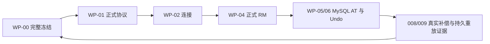
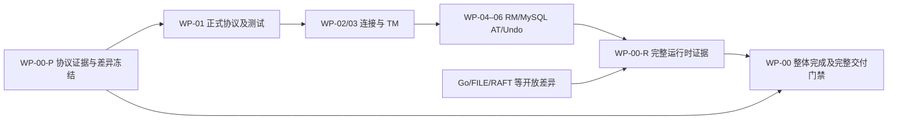

# WP-00 分阶段冻结提案（待确认，未生效）

状态：**Proposed**。本文不修改现有[验收清单](v1-implementation-acceptance-checklist.md)的有效依赖，也不宣称WP-00或总体交付完成。用户确认前，不依据本提案开始依赖该调整的正式协议组件。

## 当前依赖问题

WP-01明确依赖整个WP-00。WP-00等待REC-TIMEOUT-008–009真实Undo补偿/持久重放调查与冻结；这些能力又需要后续WP-04–06的正式RM和MySQL AT实现。独立模拟RM探针能够调查TC行为，却不能补足真实资源原子性、持久幂等或Undo验收。

箭头表示实施前置依赖向后推进；最后一条闭环使得只增加诊断探针也无法完成生产实现。FILE/RAFT上游恢复缺陷与固定Go差异也不能通过修改原始样例或把诊断标绿消除。

## 建议的最小调整

只调整实施顺序，保留原来的完整验收目标：

1. 建立WP-00-P协议冻结子门禁：固定Java/Go提交；逐消息记录已认证字段/字节、明确差异及不支持项；保留原样例和来源哈希；落实已确认的ADR-0003/0007/0008；为目标API列出正常与拒绝测试。
2. WP-01改为依赖WP-00-P，不再等待WP-00全部运行时退出项。可以创建正式Cargo workspace、协议类型及严格编解码，并逐项执行原WP-01验收。新增组件不因为参考实现存在缺陷而获得兼容性豁免。
3. WP-02/03在正式协议验收通过后推进；WP-04–06具备真实资源能力后，补足008–009、故障重放与补偿测试。
4. WP-00-R运行时冻结继续维护全部未通过项：Go失败码/合并缺口、FILE/RAFT恢复异常、真实Undo与持久重放、自然超时、状态/空报告/指标及认证边界。每项仍须修复/适配并取得原要求范围的证据，或通过单独明确评审作出后续决定；本提案不预先批准任何豁免。
5. 只有WP-00-P与WP-00-R的原要求全部满足时，才将WP-00整体标记完成。完整V1/生产交付与Phase4–7仍按原验收，不删除功能、不降低测试要求，不把阶段性可用等同完整兼容。

## 确认后将修改的内容

- 在`v1-implementation-acceptance-checklist.md`为WP-00增加P/R子门禁，并仅将WP-01的直接前置改为WP-00-P；保留现有各测试、验收和总体目标。
- 同步`validation-ledger.md`、`wp00-freeze-readiness-audit.md`与`delivery-progress.md`的依赖和状态；未完成项保持开放。
- 以现有Markdown/ADR为规格事实源；不安装工具、不初始化Spec Kit/OpenSpec、不切换分支。正式Cargo组件在用户确认后才按调整后的顺序实施。

该调整涉及已确认的实施前置和验收阶段，按用户提供的项目规则需要明确确认；“继续实现”或单次诊断通过不替代这项具体确认。
