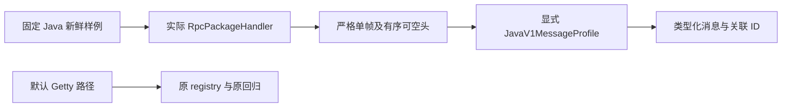

# 显式 Java V1 Getty 候选：帧阶段

延续 [合并消息计划](go-java-v1-merge-profile-plan.md) 第二阶段及已确认 ADR-0008。规格事实源仍为 WP-00 验收、原协议契约及 ADR；不修改尚未确认的分阶段冻结提案，不创建正式 Rust workspace。

候选 0004 依赖 0001–0003。在独立固定 Go 源码副本中为实际 RpcPackageHandler 增加显式 PayloadCodec 入口，默认单例和默认 codec registry 保持原行为。新增有序、可空头字段表示，避免 map 将 null、空串或字段顺序合并。默认入口遇到新增头字段表示时明确拒绝，防止静默丢失。

验收行为：

1. 原版实际 Getty 在六个 Java 合并帧上缺少正文，在不足固定头时不能安全等待；先记录行为失败，再实现。
2. 显式入口验证 magic、V1、16 字节固定头、长度关系、帧类型 0–4、Seata serializer=1 与无压缩=0；帧上限 8MiB，头上限 32767 字节（候选限制）。完整头有效但数据不足时返回 nil/0/nil，完整数据只消费一帧。
3. 普通消息通过严格载荷候选处理，仅传入当前帧正文；空正文、未知类型与载荷错误必须返回错误并保留原因。心跳仅允许空正文，Ping/Pong 与帧类型一致。
4. 头字段按有符号 short 长度及 UTF-8 检查；空 key 可用，null key、重复 key、非法长度/UTF-8 明确拒绝。保留 value=null 与 value=""，保留输入顺序；同时提供非 null 字段的原生 HeadMap 视图。两种表示冲突时拒绝。
5. 重放新鲜 Java 原九个控制帧；复用新鲜 29 普通、38 合并、250 异常载荷构造的测试帧检查实际入口，但不将工具组帧宣称为 Java 帧编码证据。覆盖截断、连续帧、边界、错误传播、调用方不变与默认入口回归。
6. 对原 codec/bytes/errors、message、Getty 包执行受影响回归；保留补丁和全部源文件身份、真实失败/通过日志。条件允许时再验证未改动 Java TC 上的注册和合并事务往返，未执行时不宣称已通过。

通过本候选不意味着默认 Go 客户端已经自动选择适配，不替代真实 RM/Undo、完整 WP-00 或生产 Rust 验收。
