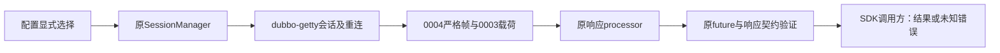

# 原 SDK 会话与合并响应候选

延续 [运行时缺口核对](go-getty-runtime-gap-audit.md)、0001–0004和已确认ADR-0008。该增量是固定Go独立副本的兼容性候选；不改变WP-00/正式Rust的现行依赖、不初始化规格体系。

验收行为：

1. 先使用固定源码/0004副本重现真实SDK对合并请求的失败，以及请求/结果数量失配的风险；不得以新API缺失的编译错误代替行为失败。
2. 新增默认关闭的 `java-v1-profile` 配置，在SessionManager初始化时捕获选择；真实dubbo-getty新连接和重连安装严格帧处理器。默认单例/registry不自动启用；显式模式拒绝Getty额外压缩，防止与V1无压缩契约冲突。
3. SDK已有 `SendSyncRequest(MergedWarpMessage)` 能收到完整60容器。原processor若没有旧版逐子请求缓存，应按外层ID交付完整结果，而不是丢弃；保留旧逐子请求路径并在索引前校验数量、ID唯一性和结果类型，失败不产生部分完成或panic。
4. 发送前快照合并请求的预期响应类型；同步/异步等待路径验证结果数量和类型。有效但不一致的响应表示事务结果未知，使用独立错误类型，不谎称业务已拒绝，也不重发事务。普通消息保持原路径。
5. 实际SDK通过原registry、InitGetty、SessionManager、dubbo-getty event loop、OnMessage、原response processor和future完成调用。用未修改Java TC验证注册、异构合并结果、原XID查询/回滚/结束；通过受控TCP转发验证真实重连、心跳、碎片/重复/晚到与错误ID或不一致结果。
6. 回归原codec/bytes/errors/message/Getty/config/response processor以及0001–0004测试；保留候选依赖、完整源码闭包、测试输入、真实运行/清理和审查证据。原版缺口、全客户端/MySQL AT/生产Rust和完整Phase0–7保持开放。

Go API新增字段/方法仅为可审查候选；不将其等同于正式Rust公开API。121/V2、自动聚合发送策略、生产认证、真实RM/Undo和故障补偿不由本增量自动认证。
