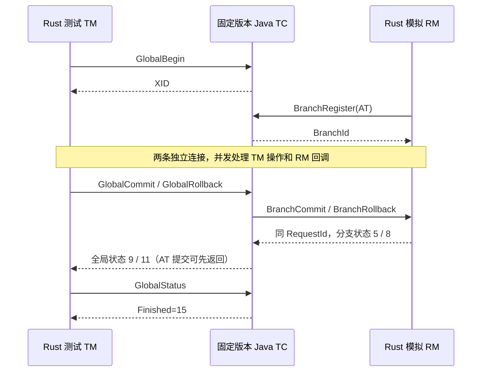

# Branch callback evidence — 2026-11-12

Local dirty validation checkout based on `130ad634279cef10cd2998fc3bfae82996224d66`. Java TC is pinned to `cba73e180fd8896a99df6415b859d275122feaa7`; this run reused the successful 2026-11-11 server JAR, SHA-256 `AEF2E8386C97DEB78B45C6AD662AD601447DEF6F5C23537B7D5B1A314654C5D5`. No new Java build or remote CI execution is claimed.

Configuration: JDK 17.0.12, FILE sessions/locks, auth disabled, port 28091, runtime data under `D:\codex-builds\seata-phase09-branches-20261112`.

| Scenario | TC-issued XID | TC-issued BranchId | RM response | TM response / final query |
|---|---|---|---|---|
| Commit | `198.18.0.1:28091:4045076255862636545` | `4045076255862636546` | BranchCommitResponse, requestId=1, PhaseTwo_Committed=5 | Committed=9 / Finished=15 |
| Rollback | `198.18.0.1:28091:4045076255862636547` | `4045076255862636548` | BranchRollbackResponse, requestId=2, PhaseTwo_Rollbacked=8 | Rollbacked=11 / Finished=15 |

`branches.txt` records the client. `tc-stdout.log` independently records BranchRegister, both received branch responses with matching identities, and successful branch commit/rollback processing. This cross-check matters because AT commit is asynchronous and a TM success response alone does not prove callback success.



Files:

- `red.txt`: first tests fail on missing callback and BranchId handling.
- `red-lifecycle.txt`: the real TCP concurrency test fails before lifecycle implementation.
- `red-reused-xid.txt`: regression exposes a second branch registration when TC repeats its XID; the fixed probe refuses it before sending.
- `rust-tests.txt`, `rust-fmt.txt`, `rust-clippy.txt`: final local checks.
- `application.yml`, `run-live.ps1`: exact configuration and runnable probe wrapper.
- `live-result.json`: process/JAR/config metadata, probe exit=0, port released=true.
- `manifest.json`: source and evidence hashes.
- `server-acceptance.txt`: matching server response and branch completion lines.
- `initial-live/`: successful first live run before strengthening the distinct-XID assertion; the top-level logs record the final implementation rerun.

Reproduce after preserving a copy of this directory (the runner replaces its logs):

```powershell
& ./docs/phase-0/evidence/local-phase09-branches/run-live.ps1
```

The runner starts the pinned built JAR, waits for its owned listener, runs `--branches`, then stops only its own TC process in `finally`. Windows Stop-Process is forced termination; no graceful shutdown or recovery evidence is inferred.

Scope: native V1 registration, branch registration, simulated AT phase-two callbacks and status queries. Database AT compensation, Undo Log atomicity, duplicate callbacks, response loss/retry, authentication, long-lived RM behavior and FILE restart remain unverified. The full Java combined-suite discrepancy is still unresolved. No commit, push or workflow change was made.
