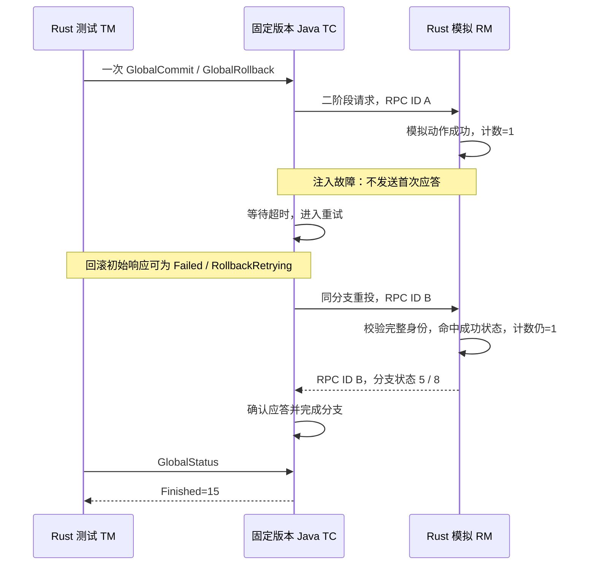

# RM callback response-loss evidence — 2026-11-12

Base checkout `130ad634279cef10cd2998fc3bfae82996224d66` plus local changes. Java TC source `cba73e180fd8896a99df6415b859d275122feaa7`; this run reused the prior built JAR with SHA-256 `AEF2E8386C97DEB78B45C6AD662AD601447DEF6F5C23537B7D5B1A314654C5D5`. No new upstream build or remote CI result is claimed.

Configuration: JDK 17.0.12, FILE sessions/locks, auth disabled, port 28091. Test-only callback timeout=1000 ms; committing/async committing/rollbacking retry periods=1000 ms. Runtime files are under `D:\codex-builds\seata-phase09-callback-loss-20261112`.

| Scenario | TC-issued XID | BranchId | Callback RPC IDs | Simulated successful actions | Initial TM outcome / final query |
|---|---|---|---|---|---|
| Commit | `198.18.0.1:28091:4045076258168659969` | `4045076258168659970` | 1 dropped → 2 acknowledged | 1 | Success, Committed=9 / Finished=15 |
| Rollback | `198.18.0.1:28091:4045076258168659971` | `4045076258168659972` | 3 dropped → 4 acknowledged | 1 | **Failed**, RollbackRetrying=5 / Finished=15 |

“Dropped” means the RM test action completed but the first response bytes were withheld from TCP. The client did not resend GlobalCommit, GlobalRollback or BranchRegister. The TC itself timed out and redelivered on the same RM connection. The callback state validates XID, BranchId, operation, AT type, resource and applicationData on every delivery; the terminal branch status remains 5 for commit and 8 for rollback, while each response echoes the current RPC ID.

`tc-stdout.log` confirms receipt and successful processing of both final branch responses. It also records the rollback timeout and Failed/RollbackRetrying response. Do not infer success just from a Finished query, a TM commit response or a client write.



## Tests and diagnostic history

- `red-state.txt`: four missing state/deduplication behaviors failed before implementation.
- `red-loss.txt`: first-response-withholding/redelivery test failed before implementation.
- `red-rollback-outcome.txt`: real observed Failed/RollbackRetrying response rejected by the old success-only helper.
- `initial-failed/`: first real fault-injection attempt. Both TC redeliveries occurred, but the probe correctly stopped on the previously unhandled failed rollback outcome; this failed run is not counted as passing.
- `rust-tests.txt`: final 29 tests passed; covers same/new RPC duplicate delivery, conflicting identity, failed simulated action, withheld response, absent/fake redelivery, and opt-in failed rollback status handling. Existing default branch concurrency tests remain green.
- `rust-checks.json`, `rust-fmt.txt`, `rust-clippy.txt`: exit codes 0.
- `callback-loss.txt`, `tc-stdout.log`, `tc-stderr.log`: final successful client/server run.
- `server-acceptance.txt`: selected timeout, initial outcome and accepted response/completion lines.
- `live-result.json`: pinned source, JAR/config hashes, probe exit 0, process identity and released port.
- `manifest.json`: source and evidence hashes.

## Reproduce

Preserve a copy of this directory first: the wrapper replaces its current logs.

```powershell
& ./docs/phase-0/evidence/local-phase09-callback-loss/run-live.ps1
```

The wrapper verifies the pinned source SHA, starts the built TC, verifies ownership of its listener, invokes `--callback-loss`, and stops its own TC process in `finally`. Raw server receipt/completion lines must be checked as part of acceptance. Windows Stop-Process is forced termination; graceful shutdown and recovery are not proved.

## Limits

The single-action counter and cached terminal outcome exist only in this process and model successful simulated actions. A failing action may have partial real-world effects; this test does not address that problem. No database/Undo Log operation is executed. The test handles one lost response followed by one redelivery per branch, not arbitrary duplicate streams or RM reconnects. FILE restart, authentication, TM/BranchRegister response loss, database compensation and the full Java combined-suite discrepancy remain open. This narrows INT-010 to a covered case; it does not close INT-011–014 or Phase 0.
