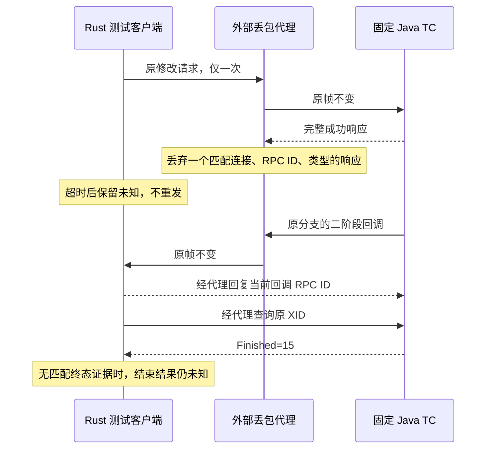

# Live external response loss — 2026-11-12

INT-013–014 pass for the three bounded, same-connection scenarios below. A loopback TCP proxy discards exactly one complete successful native V1 response from the unchanged pinned Java TC. It forwards every other frame unchanged. The client sends the target mutation once and records an unknown outcome; the proxy's hidden response is never supplied to the client.

Java commit: `cba73e180fd8896a99df6415b859d275122feaa7`; prebuilt server JAR SHA-256: `AEF2E8386C97DEB78B45C6AD662AD601447DEF6F5C23537B7D5B1A314654C5D5`. JDK17.0.12, auth disabled, FILE sync, TC28091/proxy28092. The runner checks the source/artifact pin and owns only processes it starts.

## Executed runs

- `run_20261112_135013_29785ef9`: all three initial live cases passed using default runtime paths.
- `run_20261112_135813_4840ac50`: all three cases passed with final runner metadata/cleanup and a runtime path containing spaces, `D:\codex-builds\seata response loss\...`. This is the final-code run. Client/proxy exit codes are0; TC/proxy listeners are released and cleanup errors are empty.

Final run identities:

| Lost response | Original XID suffix (prefix `198.18.0.1:28091:`) | BranchId | TC callback RPC ID | Client result |
|---|---|---|---|---|
| BranchRegister12 | `4045076355646328833` | `4045076355646328834` |1| Unknown registration, identity subsequently learned from validated callback; rollback cleanup |
| GlobalCommit8 | `4045076355646328836` | `4045076355646328837` |2| Finished15 query; end result remains unknown |
| GlobalRollback10 | `4045076355646328839` | `4045076355646328840` |3| Finished15 query; end result remains unknown |

Each case has one BranchRegister, one original end request, one discarded response, one callback/reply pair and one successful simulated action. A separate contender XID queries the same `orders:1` lock: false before end, true after cleanup. TC logs independently confirm successful processing of the callback for the original XID/BranchId. Contender cleanup is a separate transaction, never a replay of the target.



For lost registration, the client knows XID/resource/AT type and a nonempty applicationData nonce **before** sending. It initially has no BranchId. A matching rollback callback supplies the identity; a mismatched nonce, XID, resource, type or conflicting BranchId cannot trigger the simulated action. The proxy's recorded BranchId is compared only by the runner after the client exits. This covers one pending branch with a unique nonce, not ambiguous concurrent registrations.

For lost Commit/Rollback, the observer sees the discarded success, but the client does not. Both final live queries return Finished15, which does not identify commit versus rollback. ADR-0008 therefore requires retaining uncertainty. Unit tests separately show a matching Committed9/Rollbacked11 query can establish a result and a later Finished does not erase that previously obtained evidence. No live terminal-query observation is claimed here.

## Tests, negative controls and reproduction

`rust-red.txt` preserves two actual failing assertions before implementing response-loss retention and the nonce check. `proxy-red.txt` preserves five failing tests before the external proxy existed. Final Rust93/93 and Python5/5 pass; the latter includes a real local two-connection TCP test proving the response is withheld and the proxy exits. Delivered responses, invalid envelopes and write failures cannot masquerade as a successful injected-loss test. Rust formatting and Clippy with warnings denied pass. `manifest.json` binds final source and raw evidence hashes; earlier evidence directories remain untouched.

```powershell
$env:CARGO_TARGET_DIR='D:\cargo-target\seata-phase09'
$env:TEMP='D:\Temp'; $env:TMP='D:\Temp'
$env:PYTHONDONTWRITEBYTECODE='1'
cargo test --manifest-path tools/java-tc-integration/rust-client/Cargo.toml
cargo fmt --manifest-path tools/java-tc-integration/rust-client/Cargo.toml -- --check
cargo clippy --manifest-path tools/java-tc-integration/rust-client/Cargo.toml --all-targets -- -D warnings
python -m unittest discover -s tools/java-tc-integration/response_loss -p test_proxy.py -v
& ./tools/java-tc-integration/scripts/run-response-loss.ps1
& ./tools/java-tc-integration/scripts/run-response-loss.ps1 -RuntimeBase 'D:\codex-builds\seata response loss'
```

The runner requires the already-built pinned JAR and the existing local JDK/Python paths documented in its source. It installs nothing. Each invocation creates fresh runtime/evidence directories without resetting older data. Do not connect to the proxy to check readiness: its two accepted sockets are reserved for TM/RM; readiness checks use the listener's owning PID.

## Boundary

The three cases demonstrate conservative handling and cleanup under one externally discarded successful response. They do not resolve the Commit/Rollback business outcome when only Finished is observable, nor prove reconnect handling, delayed stale responses, durable RM idempotency, database/Undo Log compensation, live authentication, timeout recovery or production readiness. The new Rust objects are test-harness helpers, not the formal TM API. Phase0 and the full Phase0–7 delivery remain open.
