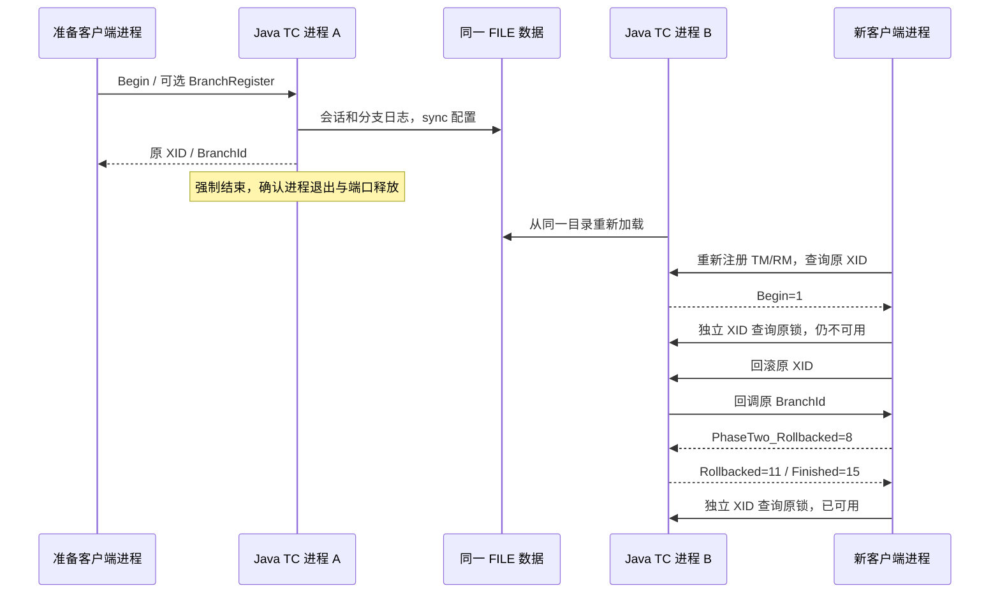

# FILE forced-process restart — 2026-11-12

The runner is [run-file-restart.ps1](../../../../tools/java-tc-integration/scripts/run-file-restart.ps1). It uses the pinned Java commit `cba73e180fd8896a99df6415b859d275122feaa7` and enforces the prebuilt JAR SHA-256 `AEF2E8386C97DEB78B45C6AD662AD601447DEF6F5C23537B7D5B1A314654C5D5`. JDK 17.0.12, auth disabled, native port 28091, FILE flush mode `sync`. No Java tracked source or previous runtime data is modified/reset.

## Runs

- `run_20261112_112139_5f67dc1b`: both cases passed using default paths.
- `run_20261112_112529_554566dc`: expected regression reproduction with a runtime path containing spaces. The old unquoted JVM argument handling failed startup (`ClassNotFoundException: phase09`). The failed result is preserved, not counted as successful recovery.
- `run_20261112_112604_b9368e3a`: final full rerun after fixing quoting, **both cases passed** with `D:\codex-builds\seata phase09 restart\...`.

The final run used these identities:

| Case | Original XID | Original BranchId | Before / after TC PID | Result |
|---|---|---|---|---|
| Begin only | `198.18.0.1:28091:4045076318255378433` | none | 71992 / 25876 | old XID Begin=1 → rollback=11 → Finished=15 |
| AT branch | `198.18.0.1:28091:4045076318342127617` | `4045076318342127618` | 60716 / 69304 | old XID Begin=1; original BranchId callback; rollback=11 → Finished=15 |

For the AT case, a distinct contender XID queried the same `orders:1` lock: **false before crash → false after restart → true after rollback**. The target branch was not re-registered after restart. Only the contender's no-branch sessions were newly created and cleaned up. Server logs confirm rollback of the original BranchId.



## Evidence and reproduction

Each run has `result.json`, separate `begin/` and `branch/` client/server logs, exact configuration and a copy of the versioned TC identity record. `disk-after-crash.json` records FILE byte count/hash **after the old process exits and before the next starts**. The final cases had root.data lengths 129 and 774 bytes respectively. A fresh directory is created for each run, with no reset or reuse of older sessions.

`red.txt` records missing record/lock decoder behavior; `red-cli.txt` records the initially unsupported prepare entrypoint. `rust-tests.txt` records 34 passing tests; formatting/Clippy exit 0. `manifest.json` binds implementation/evidence hashes. `latest_run.json` points at the last executed run rather than replacing previous evidence.

```powershell
& ./tools/java-tc-integration/scripts/run-file-restart.ps1
# Path-with-spaces regression (fresh run directories are always generated):
& ./tools/java-tc-integration/scripts/run-file-restart.ps1 -RuntimeBase 'D:\codex-builds\seata phase09 restart'
```

The probe supports separate phases through `--prepare-restart-begin`, `--prepare-restart-branch`, `--resume-restart` and `SEATA_IT_RESTART_RECORD`. The record is create-only and contains original identity, not TC session contents. Resume queries the old transaction before any end operation and never recreates the target branch.

## Boundary

INT-011–012 pass **for normal FILE Begin/Registered records and process termination/restart**. This does not prove retry-timeout status recovery, corruption tolerance, operating-system/power-loss durability, other stores, durable Rust RM idempotency, database compensation or production readiness. The test does not implement Rust TC or alter its retry responsibilities. No commit, branch switch, push or remote workflow change was performed.
