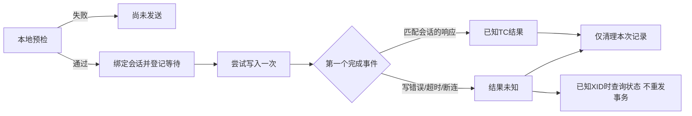

# SDK 在途结果与连接归属候选

延续已接受 ADR-0008、SDK 0005 与 Java 前导分片候选，事实源仍为现有 WP/Markdown/ADR。只在新 D 盘副本新增 0006，不修改原始 Java/Go、前五补丁、旧候选或原证据，不改变 WP-00/正式 Rust 的依赖门禁。

可观察验收行为：

1. 显式 Java V1 同步请求在确定尚未发送时（已关闭会话、预检编码失败）返回 LocalFailureBeforeSend；开始调用 WritePkg 后的写错误、超时或断连返回 UnknownOutcome，不能把零返回字节数当作未生效证明。错误含请求 ID、可用 errors.Is/As 保留原因，不打印业务正文。
2. 为发送前注册的等待记录绑定实际会话；关闭/错误只完成该会话的在途请求。另一个会话的响应不得完成同 ID 等待者。发送与关闭竞态必须保守分类，响应、超时和关闭只能有一个完成结果。
3. 成功或明确 TC 拒绝响应保持原正文语义；未知结果不自动重发 Begin/Commit/Rollback。晚到/重复不复活缓存、不改变已发布结果；清理只删除本次所有的记录，保留其他请求。
4. 先在 0005 副本用原 API 行为测试确认缺失，再实现最小候选；默认未启用模式保持原路径。自动聚合旧子项/异步业务 API、完整客户端和生产 Rust 的剩余缺口继续列出，不把同步增量冒充全部交付。
5. 回归既有 235 项 Go、Java617/Rust117 绑定输入与来源；新鲜真实 TC/SDK 验证已发送 Begin/Commit/Rollback 的响应丢失、断连后的状态查询、原 XID 清理及零事务重发。未知 Begin 的 XID 从受控 TC 观察取得只能作为测试恢复证据，不能声称 SDK 有通用 Begin 幂等恢复机制。
6. 逐项绑定新补丁、源文件、执行测试、故障代理和 TC/SDK 实际事件；审查并记录清理。Java overlay 仅使用已认证的候选 class 来源，原 JAR 哈希不变。通过不关闭完整 WP-00、生产认证/Undo 或 Phase1–7。

