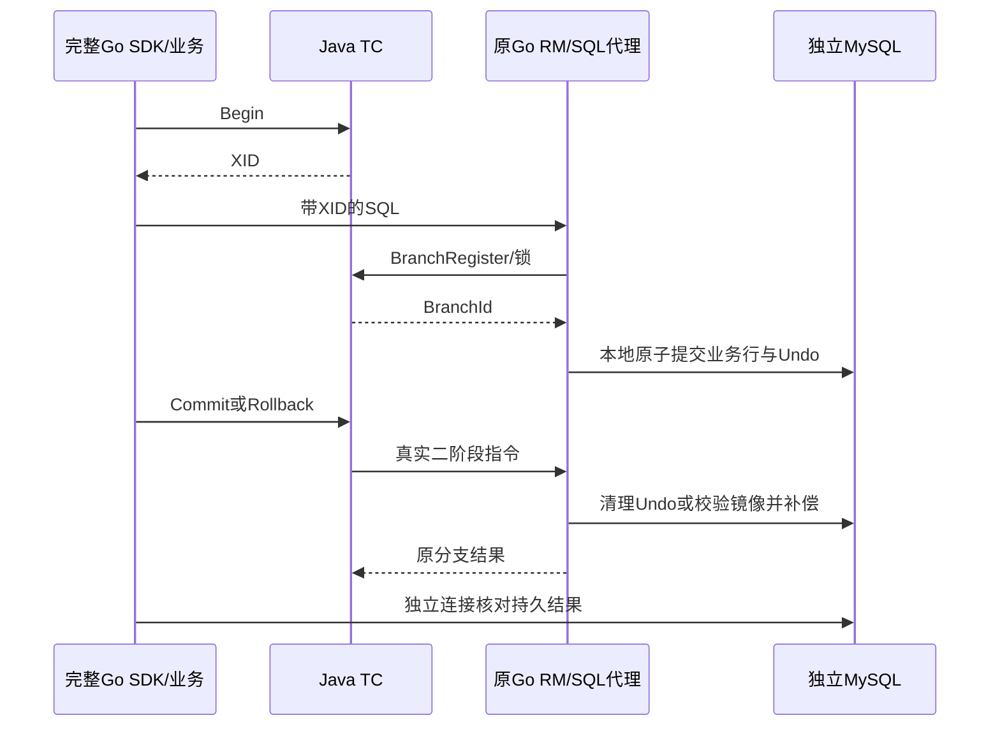

# 完整 Go SDK 与真实 MySQL AT 基线

目标是推进现有 Phase0/WP-00、真实资源注册和 REC-TIMEOUT-008–009 的基线调查。使用固定 Go 源码的独立副本及已验证0001–0006候选；Java原JAR配独立前导分片class overlay，不改原始源码、旧候选或既有证据。它不是生产Rust实现，也不调整待确认的WP-00冻结依赖。

1. 先检查完整 `client.InitPath`、TM/RM初始化、session-open资源钩子、SQL代理与Undo路径；以真实配置文件启动，不手工只注册几个响应processor替代完整客户端。
2. 使用已缓存且固定digest的MySQL镜像，所有业务/Undo/TC运行数据落入独立D盘目录，只绑定loopback端口。只操作本次拥有的容器、数据库、表、事务与进程，不复用/清空外部数据。
3. 正常回滚：原TM建立全局事务，真实SQL代理修改业务行；在全局结束前用独立连接证明业务行及同一XID/BranchId的Undo原子落库，再通过原RM处理真实TC回调恢复业务行。
4. 正常提交：真实业务修改保留，实际二阶段清理最终删除Undo；TC状态与数据库状态分别核对，不能仅凭HTTP200或Finished推断业务结果。
5. 再扩展资源重注册、重复二阶段、RM/数据库重启与持久重放。重复回滚可能生成防悬挂记录，须根据固定源语义验证，不把业务不再改变等同Undo表必空。
6. 真实失败先记录，再决定最小候选修复；不得把手工修改行、合成Undo或模拟RM响应计作真实AT。新故障重试/回滚策略必须遵守ADR-0008，TC拥有事务重试；原TM/SQL适配器若不同，应明确暴露差异并验证修复。
7. 逐项冻结输入、依赖、执行二进制、实际注册/分支/回调帧、SQL快照和清理；审查与回归范围按实际受影响模块扩大。008–009、完整客户端与完整计划只有达到原范围证据才可标记完成。

