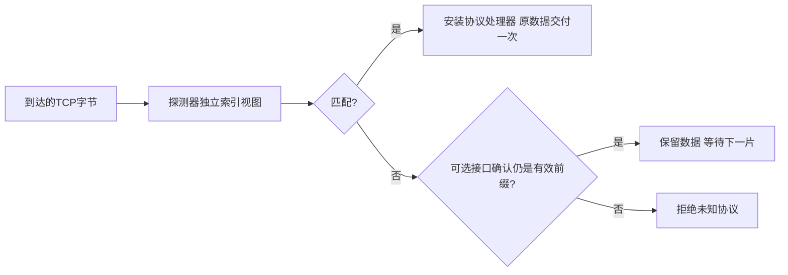

# JAVA-V1-PREFACE-001 独立Java候选计划

继续WP-00及[JAVA-V1-PREFACE-001](java-v1-preface-fragmentation.md)。现有Markdown规格/ADR为事实源；不更改未批准的冻结依赖，不修改原Java/Go参考源码或原TC JAR。

1. 用不依赖新接口的48项Netty测试复现原行为：Seata、七种HTTP方法、HTTP/2的各分片位置/逐字节输入，非零readerIndex及改变readerIndex/mark的旧探测器；同时保留完整输入、未知前缀、超限和旧boolean探测器控制。先记录真实行为失败，再实现候选。
2. 原ProtocolDetector保持不变，新增可选IncrementalProtocolDetector表达“当前为可能的有效前缀但尚未足够”。Seata/HTTP/HTTP2分别按自己的前缀与原识别阈值等待；已不可能匹配的前缀及时关闭，不能统一等24字节掩盖问题。
3. ProtocolDetectHandler给每个探测器独立索引视图，不重置或消费原输入；匹配后原数据只交付一次。内置探测器以readerIndex为起点，避免使用绝对0。保留8MiB上限与原boolean扩展的默认行为。
4. 按项目Java规则使用SLF4J/Lombok日志、Objects判空和中文说明。原core未引入Lombok；候选仅增加固定1.18.36的provided/optional编译依赖（本地已有缓存），不改变运行时JAR依赖。
5. 固定提交的全新D盘副本执行既有475项Java与新增48项、受影响原协议测试；审计全部原生产源/POM/resources，仅允许列明的四个类、core POM及新增接口差异。原构建/原JAR保持哈希不变。
6. 从候选构建提取精确class集，借独立PropertiesLauncher overlay启动原JAR，记录每个候选class实际加载来源。用原SDK remoting验证双向强制分片、两连接/心跳、17请求/响应、未知结果/重复/晚到、原XID回滚；验证实际HTTP/1和HTTP/2前缀分片，不冒充其业务端点认证。
7. 原JAR继续复现单字节拒绝，候选通过只记为独立修复证据；源/补丁/测试/overlay字节及实际执行文件全部绑定，完成审查与回归后归档。完整WP-00、生产Rust及Phase1–7不会因候选通过自动完成。

本次Seata分片认证明确为V1。V0的原下游解码器会在不足完整14字节头时读取失败，属于继承问题；V2没有专门分片用例。既有V0/V1/V2相关测试需要回归，但回归通过不等于这两种版本的新分片认证。Seata可选等待判断须先于magic匹配，至少等齐供版本选择器读取的3字节；原boolean magic判断含义保持不变。

