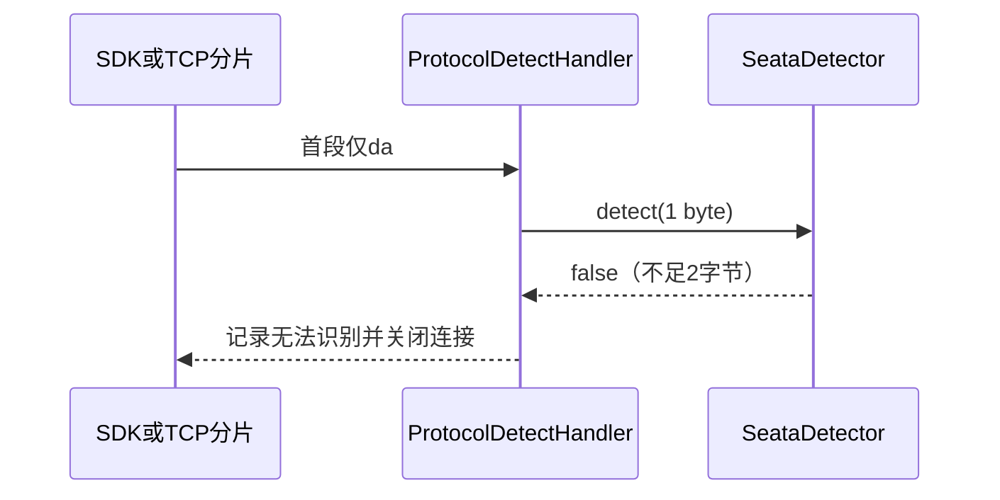

# JAVA-V1-PREFACE-001：首个magic字节分片被拒绝（OPEN）

固定Java提交 `cba73e180fd8896a99df6415b859d275122feaa7`，未修改JAR SHA256 `aef2e8386c97deb78b45c6ad662ad601447def6f5c23537b7d5b1a314654c5d5`。

实际SDK首次会话试验向TC分三段发送注册帧，第一段只有 `da`；TC记录 `Can not recognize protocol ... preface = [-38]` 并关闭连接，SDK未完成注册。失败尝试 `D:/codex-builds/sdk-loop-quick-20261112_205343` 保留实际Go/TC日志及代理完整帧。它不是新API编译失败，也不是注册业务拒绝。

源码事实：`core/.../rpc/netty/ProtocolDetectHandler.java` 遍历探测器；全部返回false后，立即清空输入并关闭连接。`core/.../protocol/detector/SeataDetector.java` 在可读字节不足两个magic字节时返回false；探测接口没有区分“不匹配”与“数据尚不足”。

后续SDK场景将完整帧转发给TC，仅故意拆分TC→SDK方向，并如实记录该限制。SDK接收方向分片/连续帧通过，不证明固定TC支持任意首包分片；该问题不因代理缓存而关闭。实际网络仍可能将一次write拆分，因此一次完整发送成功不是通用规避保证。

SDK场景结束后另外建立直接TC连接、仅发送 `da`，核对EOF及原TC日志并保存探测器源码/哈希，作为新鲜负向证据。不得修改原JAR、把负向复现标成协议兼容通过，或据此豁免WP-00退出条件。需要独立的Java修复候选与碎片/未知协议/超大帧回归，当前保持OPEN。

## 独立候选验证（2026-11-12）

[候选计划](java-preface-candidate-plan.md)与[六文件补丁](../../compatibility/seata-java/README.md)已实现。原公共ProtocolDetector保持不变，新增可选接口区分有效但不足的前缀；每个探测器使用独立只读索引视图，内置判断从readerIndex开始，匹配后原数据只交付一次。Seata须等待magic与版本共3字节，仅等两个magic会在原版本选择器越界。未知载荷日志改为只记长度。

新48项测试在原版29失败/19控制通过，候选全部通过；原版已有569项回归和候选完整617项/27套均实际执行。Rust117、Go235、Python7通过，554个固定夹具冻结并显式固定Rust输入目录。原JAR再现首字节拒绝，独立class overlay从该次构建提取，5个主类实际来源已核对；候选真实SDK双向强制分片17请求/17响应、双连接心跳、重复/晚到/未知结果及原XID回滚通过，零事务重发。HTTP逐字节输入只认证正常404与HTTP/2 SETTINGS。[证据](evidence/local-java-preface-candidate/README.md)。

原始源码/JAR未修改，未合入或发布，故本问题对原制品仍OPEN。新增Seata分片认证限V1；V0下游不足完整头时的继承问题与V2专门分片测试未完成。该候选不关闭完整客户端、真实RM/Undo、生产Rust或WP-00门禁。
