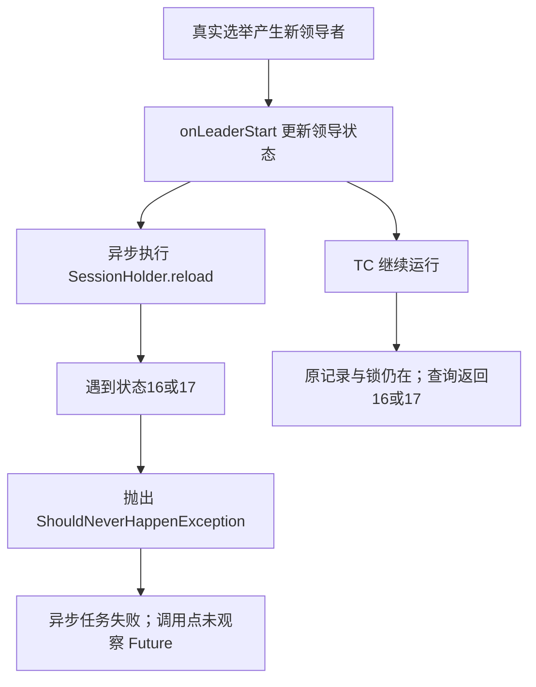

# RAFT recovery runtime findings

Authority: original Java TC commit `cba73e180fd8896a99df6415b859d275122feaa7`, unchanged executable JAR, and [three-cohort live evidence](evidence/local-raft-retry-timeout/README.md). These are controlled injected-state observations, not production incidents.

## JAVA-RAFT-RELOAD-001 — retry-timeout states fail asynchronous leader reload

Status: **OPEN; reproduced** for CommitRetryTimeout16 and RollbackRetryTimeout17.

Both states remain stored and visible after actual quorum elections and old-node snapshot reload. Original XID, AT branch identity/resource/lock key, and lock occupancy agree across replicas, console and native V1 queries. The new leader remains running and answers requests. This retention must not be confused with successful reload: each timeout cohort emits the original `ShouldNeverHappenException` at both leadership transitions, four exact events total.

The original `RaftStateMachine.onLeaderStart` updates leadership then submits `SessionHolder.reload` using `CompletableFuture.runAsync`; its returned future is not observed at that call site. The original reload switch throws `NOT properly handled CommitRetryTimeout` or `NOT properly handled RollbackRetryTimeout`. Standard JDK exception events preserve the original reload and async caller stack after the corresponding pre-stop timestamp. Startup logs alone would miss that distinction.

REC003/004 now have actual replication, snapshot, leader-change, original-state, lock and operator-visible evidence. Safe recovery acceptance remains open because the reload task fails; this increment does not execute manual retries or real compensation. Rust TC must not copy this unhandled branch. Rust V1 clients must retain the explicit authoritative timeout state and avoid competing automatic mutation retries, consistent with ADR-0008.

## Other observed RAFT runtime issues

`JAVA-RAFT-METADATA-001` is open: final cohort logs contain Jackson failures constructing `PutNodeMetadataResponse` during inter-node metadata exchange. `JAVA-RAFT-LOGGING-001` is open: Sofa logging initialization references the unavailable Logback `ContextInitializer.configureByResource(URL)` method and falls back to the application logger. The unchanged original JAR and dependency cohort are hash checked; the helper is only one external class. These observations do not establish the full root cause or a repair.

The manifest records log-string occurrence counts, not distinct incident counts. Neither issue prevented the covered consensus/state/query checks from completing. Metadata correctness, logging compatibility and production cluster readiness are not certified by those checks. No dependency, original class or JAR was patched.

## Evidence boundary

Begin1 controls recover differently: the branch-bearing original becomes RollbackRetrying5 with its lock because the fixture supplies no RM callback; the branch-empty original finishes and disappears. Those observations demonstrate a working normal reload path, not successful business compensation.

Natural timeout generation, console retry after RAFT failover, durable RM effects/replay, network partitions, corrupt snapshots and Rust TC implementation remain separate work. The full Phase0–7 objective remains active.
