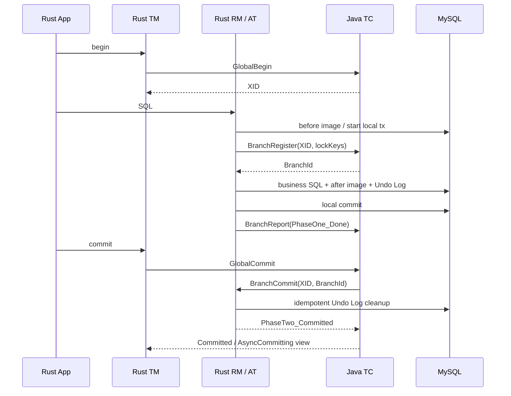
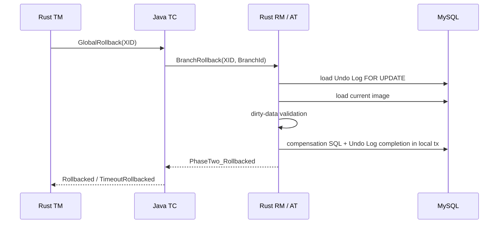

# Phase 0 — TM → TC → RM Method-Level Call Chains & Failure Matrix

## WP04 formal RM implementation contract (2026-11-13)

Continue the original WP04 checklist after its dependencies' gates. Native identity/resource readiness remains the existing transport layer. `seata-rm` adds owned RM lifecycle, typed outbound calls and resource callback dispatch; it does not claim a production SQL engine before WP05/06.

- Resources are keyed by exact `(BranchType, resource_id)`. A catalog publishes the handler before announcing its registration revision, rejects replacement by a different handler and reuses the existing reconnect/ready policy. BranchRegister/BranchReport/LockQuery preserve all request/response fields and distinguish local pre-send, explicit TC Failed, protocol failure and sent-without-result. No operation is automatically replayed; a lost BranchRegister does not invent a BranchId.
- Callbacks validate nonempty bounded XID, positive exact i64 BranchId, type/resource and nullable application data; Some-empty application data is rejected at the high-level API so a caller cannot confuse it with Java's zero-length-to-None projection. The original request capability supplies connection, signed ID and headers on reply. Resource lookup failures explicitly report failure/retryable status; identity/operation conflicts cannot acknowledge success or execute another action.
- A versioned, bounded append-only branch journal stores full original identity, Commit/Rollback intent and Pending/RetrySafe/Completed/Rejected state. Whole-file cooperative exclusive ownership, sequence, CRC32 and `sync_all` protect state before actions/replies. Duplicate identity changes, corrupt/truncated records, unsupported versions and exhausted budgets fail closed; no unsafe eviction/truncation silently removes deduplication history. Filesystem paths are supplied explicitly and never derived from XID/resource text.
- Per-key leases belong to the shared store, so separate dispatchers using that store cannot execute a branch concurrently. Durable Pending is written before invoking an adapter. Confirmed Applied is persisted before acknowledging completion; completed/rejected duplicates replay only their exact original phase result. Cancelling/panicking an action leaves Pending, including when the resource may already have committed.
- Pending recovery calls the resource adapter's explicit recovery method. Applied can complete; authoritative NotApplied permits another attempt only if no previous in-flight attempt can later apply; Unknown/errors preserve Pending and produce retryable status without replay. Adapters must implement durable, fenced recovery rather than interpreting an absent row as proof that an earlier commit cannot still occur. The MySQL atomic business/Undo implementation remains WP05/06.
- Adapter completion/NoEffect/rejection is a resource fact, not something a journal marker by itself can prove. Process-restart tests must exercise an effect before loss of the RM completion acknowledgement and verify reconciliation/no repeated effect. A file-backed test resource may demonstrate the generic contract, but cannot certify SQL/Undo atomicity.
- Runtime work and per-key waits are bounded; shutdown owns and joins/aborts its tasks and closes native sockets. No mutex spans resource/network await. Flat branch callback batches must be validated before any effects; unsupported/malformed shapes fail before partial execution. The full Java RM gate still requires real branches, phase-two statuses, duplicates and reconnect; checkboxes are completed only against actual evidence.

The file journal uses pinned fs2 whole-file locks and crc32fast CRC32 from existing local archives. These are cooperative locking and accidental-corruption checks, not an authentication mechanism. See [fs2 FileExt](https://docs.rs/fs2/0.4.3/fs2/trait.FileExt.html) and [crc32fast 1.5.0 manifest/MSRV](https://docs.rs/crate/crc32fast/1.5.0/source/Cargo.toml.orig). Existing external-TC risks, shared-lock deferral and later production gates are unchanged.

Networking realization (2026-11-14): `ResourceManager` owns the registered RM pool and a bounded callback JoinSet; `ResourceClient` clones cannot outlive its closed calling capability. BranchRegister/BranchReport/LockQuery send once, retain the complete original request and Failed response, and never manufacture a branch ID. A Java-absent BranchReport resource/application-data field remains absent. The existing registration readiness contract stays authoritative: callbacks received during initialization remain in its bounded session queue and execute only after the full current revision is accepted; registry additions do not allow business frames or early resource effects. Callback budgets start before borrowed-field validation, apply to the whole flat batch and do not restart for each child. Shutdown closes the calling pool synchronously, cancels/joins callback tasks, retains panic errors including cleanup panics, joins network owners and waits under a bounded deadline for journal leases/uncancellable disk work to drain. A failed drain cannot claim successful complete cleanup. None of these choices completes the real Java RM Gate or SQL/Undo.

## WP03 formal Rust implementation contract (2026-11-13)

Continue the existing WP03 checklist and approved ADR-0008; this section selects implementation details, without changing the original acceptance criteria. Java `DefaultTransactionManager`, `DefaultGlobalTransaction`, `GlobalTransactionRole`, `Propagation` and `RootContext` at the pinned oracle are source references. Java's configured client retry loops are deliberately not copied: approved ADR-0008 keeps durable retries at TC and requires explicit reconciliation of uncertainty.

- `seata-tm` owns a registered TM pool configured with the exact application/service-group identity. Its builder separates the transport request budget from each transaction's positive, exact-millisecond, signed-i32 TC timeout. Transaction names and XIDs are bounded, nonempty and preserved, never locally synthesized or normalized.
- Task-local context is immutable and scoped to each future poll. Required joins an existing XID as Participant; RequiresNew temporarily suspends it and launches a distinct transaction; Supports joins if present; NotSupported suspends it; Mandatory/Never reject an invalid presence/absence before business/network work. Outer context is restored after nested success, error, panic, dropped or cancelled future. Spawned tasks do not inherit context implicitly; explicit captured propagation always grants Participant, never global decision ownership.
- Successful Begin must return a present valid XID before the business callback is constructed or polled. Failed Begin keeps exact optional response fields; sent-without-authoritative-response is Unknown with operation and no invented XID. No automatic second Begin is permitted.
- Commit/Rollback/Status preserve ResultCode, exception code, optional message and GlobalStatus together. A Failed call is a typed explicit TC rejection, not proof that the global transaction is unchanged or absent; its returned status remains available. Local pre-send, protocol failure and unknown-after-write retain distinct information. Success only acknowledges the observed status, not necessarily physical cleanup. Finished never proves historical Commit.
- Scoped execution commits once after business success and rolls back once after definite business error/deadline. It never converts an uncertain Commit to Rollback or automatically resubmits a transaction. Business error and rollback failure are both returned. Transaction and transport deadlines remain distinct; expiry cannot return business success or start Commit. Rust panic/cancellation restores local context synchronously, without spawning unowned network cleanup; TC retains durable timeout/recovery ownership.
- An explicit transaction handle retains its original XID after an unknown end operation. A different end operation is blocked, and another same-operation send requires an explicit status reconciliation first. A status observation of Finished preserves the previous uncertainty. Retry-timeout states are exposed for operator handling and do not start a local retry loop. Participant handles never send global second phase.
- After scoped execution returns an unknown end error and drops its local handle, the same manager can reconstruct a restricted recovery handle from a private proof issued by the actual Launcher end call. The proof binds the manager identity, original XID and Commit/Rollback intent; changing public diagnostic fields, fabricating errors or using another manager cannot grant recovery. No new TC lifetime is granted and a same-operation retry still requires status reconciliation. Begin/status-query errors or a Participant context cannot grant this recovery role.

Implementation order: (1) fail-first configuration/XID/context tests and typed models; (2) real TCP registered-TM Begin/Commit/Rollback/Status and no-replay tests; (3) nested propagation/business/error/cancellation tests; (4) pinned JavaTC live gate and response-loss reconciliation, dual Rust versions and read-only review. Checkboxes are completed only with corresponding actual evidence; the full WP03 gate remains open until Java integration covers its stated scope.

Remaining WP03 fault acceptance uses the formal TM `execute` and same-manager `recover_unknown` APIs, with an independent loopback proxy withholding exactly one actual successful Begin/Commit/Rollback response. Begin must not construct business or receive an observer's XID. End-operation errors retain original identity/intent; a matching simulated RM callback may complete one in-memory action, and the client must query before any explicit same-operation duplicate. A definitive matching status can end reconciliation without a duplicate; Finished alone retains uncertainty. Rollback business failure and rollback response uncertainty must both remain visible. Raw observer verification binds registration, signed wire IDs, XID/BranchId, branch nonce/resource/lock, callback/reply and status sequence. Simulated RM behavior is not production SQL/Undo acceptance.

> **Status: source-derived call-chain map.**
>
> V1 implementation reference: Seata-Go v2. Compatibility authority: pinned Java Seata 2.x. RSeata is not used as the V1 execution baseline.

## 1. Roles and execution ownership

| Role | Owns | Does not own in V1 |
|---|---|---|
| TM | application transaction boundary, XID context, begin/commit/rollback intent | global session persistence, global locks, retry scheduler |
| TC (Java) | global/branch session, branch ID, lock manager, global state machine, retries, timeout, recovery | Rust local SQL transaction |
| RM | local resource registration, branch phase 1, branch report, phase-2 commit/rollback execution | global transaction decision |

V1 topology:

```text
Rust Application
  ├─ TM ───── native Seata protocol ───── Java TC
  └─ RM ───── native Seata protocol ───── Java TC
                                         └─ branch instruction ─── Rust RM
Rust RM ─── database adapter ─── MySQL local transaction
```

## 1.1 Java TC native request ingress and exception handling

The Java server's inbound method layer is not just a direct call to `DefaultCore`:

```text
Netty remoting server / request dispatcher
  -> TransactionMessageHandler dispatches request by message body type
  -> DefaultCoordinator (extends AbstractTCInboundHandler)
  -> AbstractTCInboundHandler.handle(request, RpcContext)
  -> exceptionHandleTemplate(callback, request, response)
  -> DefaultCoordinator.doGlobalBegin / doGlobalCommit / doGlobalRollback /
     doGlobalStatus / doGlobalReport / doBranchRegister / doBranchReport / doLockCheck
  -> DefaultCore / branch-type Core
  -> response object (ResultCode + message + status / XID / BranchId)
```

The pinned `AbstractTCInboundHandler` creates a typed response for each request and wraps execution in `exceptionHandleTemplate`. GlobalCommit, GlobalRollback and GlobalStatus additionally override exception callbacks to call `checkTransactionStatus`; if a GlobalSession still exists, the response status is replaced with the persisted current status, otherwise it is set to Finished. This is important: a TC business exception may still return the authoritative current status, rather than only a generic error.

Source: [AbstractTCInboundHandler.java](https://github.com/apache/incubator-seata/blob/cba73e180fd8896a99df6415b859d275122feaa7/server/src/main/java/org/apache/seata/server/AbstractTCInboundHandler.java).

The Rust protocol client must preserve both the result/error fields and the status field. Do not discard a status because ResultCode is failure, and do not interpret a success ResultCode as proof that the requested global transition completed.

## 2. TM: GlobalBegin call chain

### 2.1 Seata-Go reference path

```text
Application
  -> tm.WithGlobalTx(ctx, GtxConfig, business)
  -> tm.Begin(ctx, gc)
  -> tm.BeginNewGtx(ctx, gc)          [launcher path]
  -> GlobalTransactionManager.Begin
  -> configured TM client
       -> Getty/native Seata or gRPC transport
       -> GlobalBeginRequest
  -> TC response GlobalBeginResponse
  -> bind XID / transaction role / transaction name / time info to context
  -> execute business callback
```

Primary Go sources:
- `pkg/tm/transaction_executor.go`
- `pkg/tm/context.go`
- `pkg/tm/transaction/getty/getty_global_transaction.go`
- `pkg/tm/transaction/grpc/grpc_global_transaction.go`
- `pkg/protocol/message/request_message.go`
- `pkg/protocol/codec/global_begin_request_codec.go`
- `pkg/protocol/codec/global_begin_response_codec.go`

### 2.2 Java TC path

```text
DefaultCoordinator.doGlobalBegin(...)
  -> DefaultCore.begin(applicationId, txServiceGroup, name, timeout)
  -> create GlobalSession(status=Begin)
  -> generate XID using Java XID.generateXID(transactionId)
  -> SessionManager.onBegin / persist session
  -> GlobalBeginResponse(XID)
```

The Java TM's corresponding request path is:
`DefaultTransactionManager.begin -> syncCall(GlobalBeginRequest) -> GlobalBeginResponse.Xid`.

### 2.3 Rust ownership

Rust TM must:
- create a launcher transaction scope;
- send GlobalBegin with the correct application and service-group metadata;
- use the XID returned by TC unchanged;
- bind context to the async task/request scope;
- distinguish begin failure from begin timeout with unknown outcome;
- never synthesize a Java-compatible-looking XID locally.

## 3. TM: GlobalCommit / GlobalRollback call chain

### 3.1 Go TM path

```text
WithGlobalTx business callback returns
  -> deferred CommitOrRollback(ctx, success)
  -> inspect transaction role
  -> Launcher:
       GlobalTransactionManager.Commit(ctx, xid)
       or GlobalTransactionManager.Rollback(ctx, xid)
  -> configured transport client
  -> GlobalCommitRequest / GlobalRollbackRequest
  -> decode response GlobalStatus
  -> return status/error to caller
  -> clear transaction context
```

Participant role does not own the global second phase. Go's executor explicitly ignores participant-side second-phase commit/rollback.

### 3.2 Java TC path

```text
DefaultCoordinator.doGlobalCommit / doGlobalRollback
  -> DefaultCore.commit(xid) / rollback(xid)
  -> find GlobalSession
  -> lockAndExecute(session)
  -> close session (prevent new branches)
  -> validate current status / timeout
  -> set Committing or Rollbacking
  -> DefaultCore.doGlobalCommit / doGlobalRollback
  -> per-branch mode core
  -> finish state or enqueue retry
  -> return GlobalStatus
```

### 3.3 Rust requirements

- A response status is not always a final physical cleanup guarantee (AsyncCommitting).
- If request timeout occurs after send, the outcome is **unknown**, not “failed”; query GlobalStatus before choosing a new action.
- Do not retry GlobalBegin automatically after a timeout without an idempotency/correlation strategy; the first begin may have succeeded and created an orphan global session.
- Do not turn a failed Commit into an automatic Rollback unless the Java TM/Go contract and current TC status prove that this is valid.
- Always preserve the XID until status reconciliation and cleanup are complete.

## 4. RM: registration and phase-1 call chain

### 4.1 Go AT phase 1

```text
database/sql application call
  -> ATConn.ExecContext / QueryContext
  -> create or reuse AT transaction context
  -> SQL parser + AT executor selection
  -> capture before image
  -> build lock keys
  -> ATResourceManager / RM BranchRegister
  -> send BranchRegisterRequest(XID, BranchType, ResourceId, LockKey, ApplicationData)
  -> receive BranchId
  -> execute local business SQL
  -> capture after image
  -> write Undo Log using same local DB transaction
  -> local Commit
  -> BranchReport(PhaseOne_Done)
```

The pinned Go AT transaction's `doCommit` ordering is important:
1. `beforeCommit()`
2. `register()`
3. obtain UndoLogManager
4. `FlushUndoLog()`
5. `commitOnLocal()`
6. `report(true)`

A failure before local commit must not leave business data committed without the corresponding Undo Log.

### 4.2 Java TC branch registration

```text
DefaultCoordinator.doBranchRegister
  -> DefaultCore.branchRegister
  -> branch-type core
  -> find GlobalSession
  -> globalSessionStatusCheck (must still be active)
  -> create BranchSession / allocate BranchId
  -> acquire/check global lock using lock keys
  -> SessionManager.onAddBranch / persist branch
  -> attach branch to GlobalSession
  -> return BranchId
```

A closed/non-active global session must reject late branch registration. Lock conflict is a business transaction failure, not a successful registration with a warning.

### 4.3 Branch report

```text
Rust RM phase 1 finishes
  -> BranchReportRequest(XID, BranchId, Status, ApplicationData, BranchType)
  -> Java DefaultCoordinator.doBranchReport
  -> DefaultCore.branchReport
  -> locate GlobalSession and BranchSession
  -> update application data and branch status
  -> persist/lifecycle callback
  -> BranchReportResponse
```

## 5. TC → RM phase-2 instruction path

### 5.1 Java TC sends branch commit/rollback

```text
DefaultCore.doGlobalCommit / doGlobalRollback
  -> choose ordered / reverse-ordered BranchSession list
  -> branch-type core
  -> AbstractCore.branchCommit / branchRollback
  -> construct BranchCommitRequest / BranchRollbackRequest
  -> RemotingServer.sendSyncRequest(resourceId, clientId, request)
  -> wait for RM response
  -> interpret BranchStatus
  -> remove branch, retry, or end global transaction
```

The branch request includes XID, BranchId, BranchType, ResourceId and ApplicationData. TC's decision and retry policy remain authoritative in V1.

### 5.2 Rust RM inbound path

```text
Seata TCP frame decoder
  -> correlate request ID / decode message body
  -> dispatch BranchCommitRequest / BranchRollbackRequest
  -> RM inbound processor
  -> locate registered Resource by ResourceId + BranchType
  -> invoke mode handler
       AT: delete Undo Log / finish AT commit
       AT rollback: validate before/after image, compensate, mark/delete Undo Log
       XA: commit or rollback prepared XA branch
       TCC: invoke Confirm or Cancel
  -> map result to Java BranchStatus
  -> send BranchCommitResponse / BranchRollbackResponse
```

Go reference interfaces:
- `pkg/rm/rm_api.go`: ResourceManagerInbound / Outbound
- `pkg/datasource/sql/at_resource_manager.go`
- `pkg/remoting/processor/client/rm_branch_commit_processor.go`
- `pkg/remoting/processor/client/rm_branch_rollback_processor.go`

Java client inbound processors:
- `core/.../RmBranchCommitProcessor.java`
- `core/.../RmBranchRollbackProcessor.java`

## 6. End-to-end execution diagrams

### 6.1 Successful Rust TM + Rust RM + Java TC AT transaction



### 6.2 Rollback



## 7. Exception and uncertain-outcome matrix

| Failure point | What is known? | Correct V1 behavior | Unsafe behavior to avoid |
|---|---|---|---|
| GlobalBegin rejected by TC | No XID returned; business failure | return typed begin error | run business callback without a global transaction |
| GlobalBegin network timeout after send | TC may have created session; outcome unknown | mark begin outcome unknown; reconcile by request/session strategy or surface safely | blindly issue a second Begin |
| XID received, local context bind fails | TC session exists | attempt explicit rollback if communication available; retain XID for reconciliation | discard XID and continue |
| BranchRegister lock conflict | TC rejected branch | roll back local transaction; do not commit business SQL | continue phase 1 without branch registration |
| BranchRegister timeout after send | TC may have registered branch and lock | reconcile branch/global state; use idempotent registration strategy | register duplicate branch without reconciliation |
| Before-image/SQL parse failure | local phase 1 not complete | roll back local DB transaction; report failure if branch exists | write partial Undo Log or continue unsupported SQL |
| Undo Log flush fails | local transaction incomplete | local rollback | commit business row without Undo Log |
| Local DB commit returns definite failure | phase 1 not committed | report phase-1 failure / roll back | report PhaseOne_Done |
| Local DB commit result ambiguous (connection lost) | commit may have succeeded | inspect local transaction/Undo Log state and reconcile; never infer from socket error alone | repeat SQL blindly |
| BranchReport response lost | local phase 1 may be committed; TC may or may not have recorded report | retain branch identity; report/reconcile idempotently | delete Undo Log or release required state |
| GlobalCommit response lost | TC may have committed/started async commit | query GlobalStatus | issue GlobalRollback immediately |
| TC sends BranchCommit, RM crashes before work | TC does not know whether RM acted | durable/idempotent phase-2 handler; return status on redelivery | in-memory-only deduplication |
| RM commits cleanup but response is lost | branch work may already be done | repeated commit must be safe; return completed status | treat duplicate as fatal |
| BranchRollback dirty-data check fails | compensation unsafe | return correct unretryable rollback status / manual intervention | overwrite current data with before image |
| BranchRollback response lost | rollback may be complete | idempotent replay + status/Undo Log reconciliation | reapply compensation without checking completion |
| XA commit/rollback returns XAER_NOTA | resource no longer knows branch | implement Java's bounded XAER_NOTA semantics | map every XAER_NOTA to success immediately |
| TC restart during commit/rollback | persisted session is authoritative | Java TC recovers and retries; Rust RM must handle duplicate instruction | assume in-memory client state is enough |
| RM reconnect | prior resources/branch instructions may remain | re-register resources and continue phase-2 handling | reuse stale connection IDs |

## 8. Exception mapping requirements

Rust should expose typed categories rather than flattening all failures into `anyhow::Error` at the public API boundary:

| Category | Examples | Retry guidance |
|---|---|---|
| Protocol | invalid frame, unsupported message type, malformed payload, unknown status code | do not retry unchanged bytes |
| Transport | connect refused, EOF, timeout, TLS failure | request-specific; outcome may be unknown |
| TC business rejection | no active global session, lock conflict, branch not found | usually not transport retry |
| Local SQL | constraint, deadlock, serialization, connection loss | DB-specific; distinguish definite/ambiguous commit |
| Undo Log | serialization, persistence, image mismatch | never silently ignore |
| Phase-2 retryable | temporary RM/database unavailable | TC drives retry |
| Phase-2 unretryable | dirty data, unsupported compensation, terminal mode error | manual resolution |
| Context | missing XID, wrong role, scope leak | fail fast |

## 9. Rust V1 implementation boundary

- TM owns transaction scope and request intent.
- RM owns resource registration and local branch execution.
- Protocol/transport own byte encoding, request IDs, heartbeat, connection and reconnect.
- TC owns global status, branch IDs, locks, retry scheduling and durable recovery.
- Database adapters own local ACID boundaries and SQL dialect behavior.
- Observability must not change business outcome.

A generic `CoordinatorClient` trait may hide transport selection, but must not erase the distinction between definite rejection and unknown outcome.

## 10. Source mapping still to close

- [ ] Exact Java request processor exception-to-ResultCode mapping for every request type.
- [ ] Exact Go transport timeout and future-completion semantics for all transports.
- [ ] RM resource registration reconnect and duplicate resource behavior.
- [ ] AT phase-2 cleanup and rollback transaction boundaries per database.
- [ ] XA recovery and TCC fence behavior.
- [ ] Saga branch execution and global report path.
- [ ] Request ID collision, duplicate response and late response behavior.
