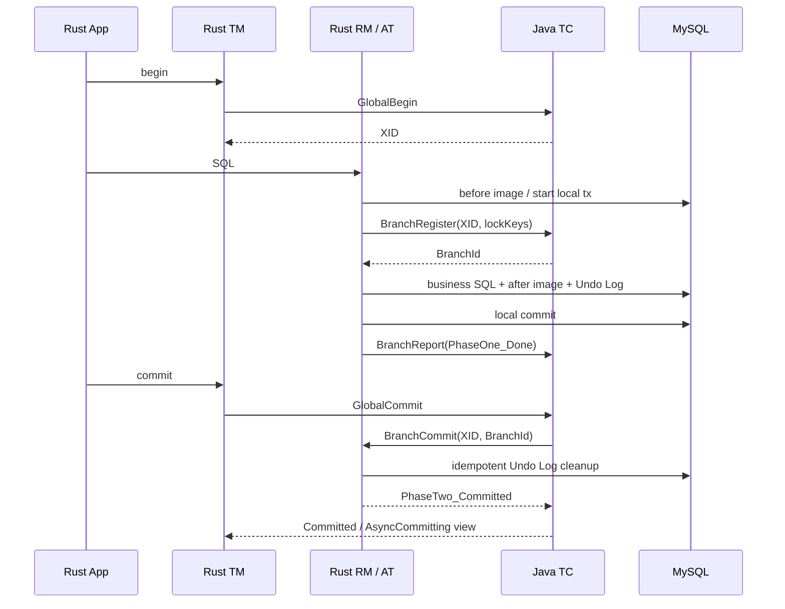
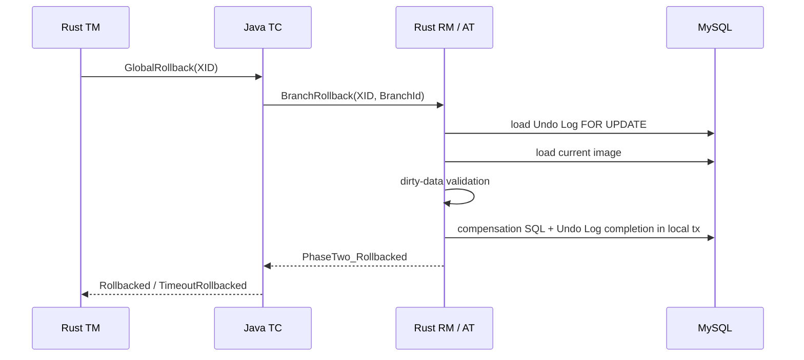

# Phase 0 — TM → TC → RM Method-Level Call Chains & Failure Matrix

> **Status: source-derived call-chain map.**
>
> V1 implementation reference: Seata-Go v2. Compatibility authority: pinned Java Seata 2.x. RSeata is not used as the V1 execution baseline.

## 1. Roles and execution ownership

| Role | Owns | Does not own in V1 |
|---|---|---|
| TM | application transaction boundary, XID context, begin/commit/rollback intent | global session persistence, global locks, retry scheduler |
| TC (Java) | global/branch session, branch ID, lock manager, global state machine, retries, timeout, recovery | Rust local SQL transaction |
| RM | local resource registration, branch phase 1, branch report, phase-2 commit/rollback execution | global transaction decision |

V1 topology:

```text
Rust Application
  ├─ TM ───── native Seata protocol ───── Java TC
  └─ RM ───── native Seata protocol ───── Java TC
                                         └─ branch instruction ─── Rust RM
Rust RM ─── database adapter ─── MySQL local transaction
```

## 2. TM: GlobalBegin call chain

### 2.1 Seata-Go reference path

```text
Application
  -> tm.WithGlobalTx(ctx, GtxConfig, business)
  -> tm.Begin(ctx, gc)
  -> tm.BeginNewGtx(ctx, gc)          [launcher path]
  -> GlobalTransactionManager.Begin
  -> configured TM client
       -> Getty/native Seata or gRPC transport
       -> GlobalBeginRequest
  -> TC response GlobalBeginResponse
  -> bind XID / transaction role / transaction name / time info to context
  -> execute business callback
```

Primary Go sources:
- `pkg/tm/transaction_executor.go`
- `pkg/tm/context.go`
- `pkg/tm/transaction/getty/getty_global_transaction.go`
- `pkg/tm/transaction/grpc/grpc_global_transaction.go`
- `pkg/protocol/message/request_message.go`
- `pkg/protocol/codec/global_begin_request_codec.go`
- `pkg/protocol/codec/global_begin_response_codec.go`

### 2.2 Java TC path

```text
DefaultCoordinator.doGlobalBegin(...)
  -> DefaultCore.begin(applicationId, txServiceGroup, name, timeout)
  -> create GlobalSession(status=Begin)
  -> generate XID using Java XID.generateXID(transactionId)
  -> SessionManager.onBegin / persist session
  -> GlobalBeginResponse(XID)
```

The Java TM's corresponding request path is:
`DefaultTransactionManager.begin -> syncCall(GlobalBeginRequest) -> GlobalBeginResponse.Xid`.

### 2.3 Rust ownership

Rust TM must:
- create a launcher transaction scope;
- send GlobalBegin with the correct application and service-group metadata;
- use the XID returned by TC unchanged;
- bind context to the async task/request scope;
- distinguish begin failure from begin timeout with unknown outcome;
- never synthesize a Java-compatible-looking XID locally.

## 3. TM: GlobalCommit / GlobalRollback call chain

### 3.1 Go TM path

```text
WithGlobalTx business callback returns
  -> deferred CommitOrRollback(ctx, success)
  -> inspect transaction role
  -> Launcher:
       GlobalTransactionManager.Commit(ctx, xid)
       or GlobalTransactionManager.Rollback(ctx, xid)
  -> configured transport client
  -> GlobalCommitRequest / GlobalRollbackRequest
  -> decode response GlobalStatus
  -> return status/error to caller
  -> clear transaction context
```

Participant role does not own the global second phase. Go's executor explicitly ignores participant-side second-phase commit/rollback.

### 3.2 Java TC path

```text
DefaultCoordinator.doGlobalCommit / doGlobalRollback
  -> DefaultCore.commit(xid) / rollback(xid)
  -> find GlobalSession
  -> lockAndExecute(session)
  -> close session (prevent new branches)
  -> validate current status / timeout
  -> set Committing or Rollbacking
  -> DefaultCore.doGlobalCommit / doGlobalRollback
  -> per-branch mode core
  -> finish state or enqueue retry
  -> return GlobalStatus
```

### 3.3 Rust requirements

- A response status is not always a final physical cleanup guarantee (AsyncCommitting).
- If request timeout occurs after send, the outcome is **unknown**, not “failed”; query GlobalStatus before choosing a new action.
- Do not retry GlobalBegin automatically after a timeout without an idempotency/correlation strategy; the first begin may have succeeded and created an orphan global session.
- Do not turn a failed Commit into an automatic Rollback unless the Java TM/Go contract and current TC status prove that this is valid.
- Always preserve the XID until status reconciliation and cleanup are complete.

## 4. RM: registration and phase-1 call chain

### 4.1 Go AT phase 1

```text
database/sql application call
  -> ATConn.ExecContext / QueryContext
  -> create or reuse AT transaction context
  -> SQL parser + AT executor selection
  -> capture before image
  -> build lock keys
  -> ATResourceManager / RM BranchRegister
  -> send BranchRegisterRequest(XID, BranchType, ResourceId, LockKey, ApplicationData)
  -> receive BranchId
  -> execute local business SQL
  -> capture after image
  -> write Undo Log using same local DB transaction
  -> local Commit
  -> BranchReport(PhaseOne_Done)
```

The pinned Go AT transaction's `doCommit` ordering is important:
1. `beforeCommit()`
2. `register()`
3. obtain UndoLogManager
4. `FlushUndoLog()`
5. `commitOnLocal()`
6. `report(true)`

A failure before local commit must not leave business data committed without the corresponding Undo Log.

### 4.2 Java TC branch registration

```text
DefaultCoordinator.doBranchRegister
  -> DefaultCore.branchRegister
  -> branch-type core
  -> find GlobalSession
  -> globalSessionStatusCheck (must still be active)
  -> create BranchSession / allocate BranchId
  -> acquire/check global lock using lock keys
  -> SessionManager.onAddBranch / persist branch
  -> attach branch to GlobalSession
  -> return BranchId
```

A closed/non-active global session must reject late branch registration. Lock conflict is a business transaction failure, not a successful registration with a warning.

### 4.3 Branch report

```text
Rust RM phase 1 finishes
  -> BranchReportRequest(XID, BranchId, Status, ApplicationData, BranchType)
  -> Java DefaultCoordinator.doBranchReport
  -> DefaultCore.branchReport
  -> locate GlobalSession and BranchSession
  -> update application data and branch status
  -> persist/lifecycle callback
  -> BranchReportResponse
```

## 5. TC → RM phase-2 instruction path

### 5.1 Java TC sends branch commit/rollback

```text
DefaultCore.doGlobalCommit / doGlobalRollback
  -> choose ordered / reverse-ordered BranchSession list
  -> branch-type core
  -> AbstractCore.branchCommit / branchRollback
  -> construct BranchCommitRequest / BranchRollbackRequest
  -> RemotingServer.sendSyncRequest(resourceId, clientId, request)
  -> wait for RM response
  -> interpret BranchStatus
  -> remove branch, retry, or end global transaction
```

The branch request includes XID, BranchId, BranchType, ResourceId and ApplicationData. TC's decision and retry policy remain authoritative in V1.

### 5.2 Rust RM inbound path

```text
Seata TCP frame decoder
  -> correlate request ID / decode message body
  -> dispatch BranchCommitRequest / BranchRollbackRequest
  -> RM inbound processor
  -> locate registered Resource by ResourceId + BranchType
  -> invoke mode handler
       AT: delete Undo Log / finish AT commit
       AT rollback: validate before/after image, compensate, mark/delete Undo Log
       XA: commit or rollback prepared XA branch
       TCC: invoke Confirm or Cancel
  -> map result to Java BranchStatus
  -> send BranchCommitResponse / BranchRollbackResponse
```

Go reference interfaces:
- `pkg/rm/rm_api.go`: ResourceManagerInbound / Outbound
- `pkg/datasource/sql/at_resource_manager.go`
- `pkg/remoting/processor/client/rm_branch_commit_processor.go`
- `pkg/remoting/processor/client/rm_branch_rollback_processor.go`

Java client inbound processors:
- `core/.../RmBranchCommitProcessor.java`
- `core/.../RmBranchRollbackProcessor.java`

## 6. End-to-end execution diagrams

### 6.1 Successful Rust TM + Rust RM + Java TC AT transaction



### 6.2 Rollback



## 7. Exception and uncertain-outcome matrix

| Failure point | What is known? | Correct V1 behavior | Unsafe behavior to avoid |
|---|---|---|---|
| GlobalBegin rejected by TC | No XID returned; business failure | return typed begin error | run business callback without a global transaction |
| GlobalBegin network timeout after send | TC may have created session; outcome unknown | mark begin outcome unknown; reconcile by request/session strategy or surface safely | blindly issue a second Begin |
| XID received, local context bind fails | TC session exists | attempt explicit rollback if communication available; retain XID for reconciliation | discard XID and continue |
| BranchRegister lock conflict | TC rejected branch | roll back local transaction; do not commit business SQL | continue phase 1 without branch registration |
| BranchRegister timeout after send | TC may have registered branch and lock | reconcile branch/global state; use idempotent registration strategy | register duplicate branch without reconciliation |
| Before-image/SQL parse failure | local phase 1 not complete | roll back local DB transaction; report failure if branch exists | write partial Undo Log or continue unsupported SQL |
| Undo Log flush fails | local transaction incomplete | local rollback | commit business row without Undo Log |
| Local DB commit returns definite failure | phase 1 not committed | report phase-1 failure / roll back | report PhaseOne_Done |
| Local DB commit result ambiguous (connection lost) | commit may have succeeded | inspect local transaction/Undo Log state and reconcile; never infer from socket error alone | repeat SQL blindly |
| BranchReport response lost | local phase 1 may be committed; TC may or may not have recorded report | retain branch identity; report/reconcile idempotently | delete Undo Log or release required state |
| GlobalCommit response lost | TC may have committed/started async commit | query GlobalStatus | issue GlobalRollback immediately |
| TC sends BranchCommit, RM crashes before work | TC does not know whether RM acted | durable/idempotent phase-2 handler; return status on redelivery | in-memory-only deduplication |
| RM commits cleanup but response is lost | branch work may already be done | repeated commit must be safe; return completed status | treat duplicate as fatal |
| BranchRollback dirty-data check fails | compensation unsafe | return correct unretryable rollback status / manual intervention | overwrite current data with before image |
| BranchRollback response lost | rollback may be complete | idempotent replay + status/Undo Log reconciliation | reapply compensation without checking completion |
| XA commit/rollback returns XAER_NOTA | resource no longer knows branch | implement Java's bounded XAER_NOTA semantics | map every XAER_NOTA to success immediately |
| TC restart during commit/rollback | persisted session is authoritative | Java TC recovers and retries; Rust RM must handle duplicate instruction | assume in-memory client state is enough |
| RM reconnect | prior resources/branch instructions may remain | re-register resources and continue phase-2 handling | reuse stale connection IDs |

## 8. Exception mapping requirements

Rust should expose typed categories rather than flattening all failures into `anyhow::Error` at the public API boundary:

| Category | Examples | Retry guidance |
|---|---|---|
| Protocol | invalid frame, unsupported message type, malformed payload, unknown status code | do not retry unchanged bytes |
| Transport | connect refused, EOF, timeout, TLS failure | request-specific; outcome may be unknown |
| TC business rejection | no active global session, lock conflict, branch not found | usually not transport retry |
| Local SQL | constraint, deadlock, serialization, connection loss | DB-specific; distinguish definite/ambiguous commit |
| Undo Log | serialization, persistence, image mismatch | never silently ignore |
| Phase-2 retryable | temporary RM/database unavailable | TC drives retry |
| Phase-2 unretryable | dirty data, unsupported compensation, terminal mode error | manual resolution |
| Context | missing XID, wrong role, scope leak | fail fast |

## 9. Rust V1 implementation boundary

- TM owns transaction scope and request intent.
- RM owns resource registration and local branch execution.
- Protocol/transport own byte encoding, request IDs, heartbeat, connection and reconnect.
- TC owns global status, branch IDs, locks, retry scheduling and durable recovery.
- Database adapters own local ACID boundaries and SQL dialect behavior.
- Observability must not change business outcome.

A generic `CoordinatorClient` trait may hide transport selection, but must not erase the distinction between definite rejection and unknown outcome.

## 10. Source mapping still to close

- [ ] Exact Java request processor exception-to-ResultCode mapping for every request type.
- [ ] Exact Go transport timeout and future-completion semantics for all transports.
- [ ] RM resource registration reconnect and duplicate resource behavior.
- [ ] AT phase-2 cleanup and rollback transaction boundaries per database.
- [ ] XA recovery and TCC fence behavior.
- [ ] Saga branch execution and global report path.
- [ ] Request ID collision, duplicate response and late response behavior.
