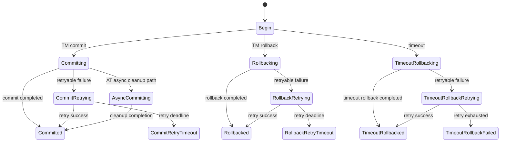
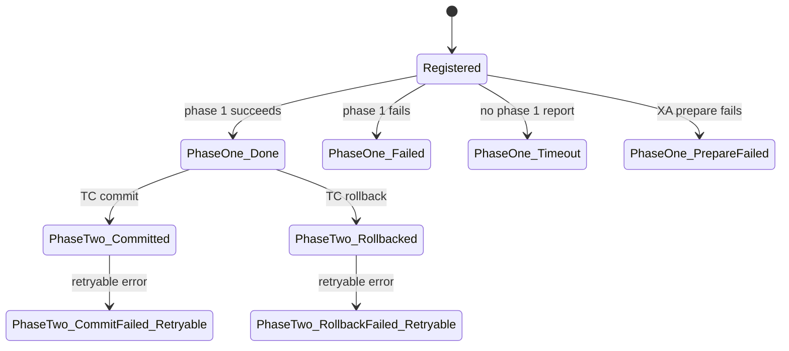

# Phase 0 — Transaction State Machine Specification

> **Status: Draft semantic baseline**
>
> This document captures the state codes and semantics visible in the pinned source snapshots. It does not yet claim that every legal transition edge has been fully extracted. The complete transition relation must be derived from Java session lifecycle and coordinator code before V1/V2 implementation.

## 1. State model boundaries

Keep these state machines separate:

1. **Global transaction state** — the lifecycle of one XID at TC.
2. **Branch transaction state** — the lifecycle of one registered branch resource.
3. **Mode-specific resource state** — AT Undo Log, XA resource branch, TCC fence/action state, Saga state-machine execution.
4. **Client transaction role/context** — launcher/participant and XID propagation; this is not the TC global status.

Do not collapse these into one enum or one generic `commit/rollback` state machine.

## 2. GlobalStatus canonical source codes

Java Seata 2.x `GlobalStatus` and Seata-Go v2 define the same 0..20 code family. RSeata's internal Rust `GlobalStatus` also defines 0..20 with the same ordering.

| Code | Status | Source meaning / category |
|---:|---|---|
| 0 | UnKnown | Ambiguous/pre-begin state |
| 1 | Begin | Phase 1; can accept branch registration |
| 2 | Committing | Phase 2 commit in progress |
| 3 | CommitRetrying | Retrying a recoverable commit failure |
| 4 | Rollbacking | Phase 2 rollback in progress |
| 5 | RollbackRetrying | Retrying a recoverable rollback failure |
| 6 | TimeoutRollbacking | Rollback due to global timeout |
| 7 | TimeoutRollbackRetrying | Retrying timeout rollback |
| 8 | AsyncCommitting | AT asynchronous commit state; server may treat it as committed for TM/RM clients while cleanup continues |
| 9 | Committed | Commit completed |
| 10 | CommitFailed | Commit failed terminal state |
| 11 | Rollbacked | Rollback completed |
| 12 | RollbackFailed | Rollback failed terminal state |
| 13 | TimeoutRollbacked | Timeout rollback completed |
| 14 | TimeoutRollbackFailed | Timeout rollback failed |
| 15 | Finished | Ambiguous/non-session state; also used in Saga global reporting semantics |
| 16 | CommitRetryTimeout | Commit retries exceeded configured retry time |
| 17 | RollbackRetryTimeout | Rollback retries exceeded configured retry time |
| 18 | Deleting | Global transaction is being deleted |
| 19 | StopCommitOrCommitRetry | Operator stop state for commit / commit retry |
| 20 | StopRollbackOrRollbackRetry | Operator stop state for rollback / rollback retry |

Source links:
- [Java GlobalStatus.java](https://github.com/apache/incubator-seata/blob/cba73e180fd8896a99df6415b859d275122feaa7/common/src/main/java/org/apache/seata/core/model/GlobalStatus.java)
- [Go global status constants](https://github.com/apache/incubator-seata-go/blob/82570d905919c1c66bb025a3a5979f25390de498/pkg/protocol/message/constant.go)
- [RSeata GlobalStatus](https://github.com/oulover/rseata/blob/c6062776c72a2490f62f8ebb25012c60884f62bd/rseata-core/src/types.rs)

### 2.1 Source-defined status classifications

Java's GlobalStatus helper methods establish these classifications:

- One-phase timeout family: TimeoutRollbacking, TimeoutRollbackRetrying, TimeoutRollbacked, TimeoutRollbackFailed.
- Two-phase success family: Committed, Rollbacked, TimeoutRollbacked, Deleting.
- Two-phase heuristic family: Finished.

These classifications are not interchangeable with a simple terminal/non-terminal predicate. Preserve the exact helper semantics when implementing the canonical domain model.

### 2.2 High-level lifecycle (not a complete edge whitelist)



This diagram is an orientation aid, not an approved transition table. In particular, terminal failure states, operator stop states, Saga behavior, async AT completion, session deletion and recovery re-entry require method-level extraction from the pinned Java `GlobalSession`, `DefaultCore`, `DefaultCoordinator`, retry processors and storage recovery code.

## 3. BranchStatus canonical source codes

Java Seata 2.x exposes the following branch statuses. Go's branch package uses codes 0..10 for its client-facing branch model and therefore does not currently expose every Java status in the same way.

| Java code | Java status | Meaning |
|---:|---|---|
| 0 | Unknown | Unknown branch state |
| 1 | Registered | Registered at TC |
| 2 | PhaseOne_Done | Phase 1 completed successfully |
| 3 | PhaseOne_Failed | Phase 1 failed |
| 4 | PhaseOne_Timeout | Phase 1 was not reported before timeout |
| 5 | PhaseTwo_Committed | Phase 2 commit succeeded |
| 6 | PhaseTwo_CommitFailed_Retryable | Commit failed; retryable |
| 7 | PhaseTwo_CommitFailed_Unretryable | Commit failed; not retryable |
| 8 | PhaseTwo_Rollbacked | Phase 2 rollback succeeded |
| 9 | PhaseTwo_RollbackFailed_Retryable | Rollback failed; retryable |
| 10 | PhaseTwo_RollbackFailed_Unretryable | Rollback failed; not retryable |
| 11 | PhaseTwo_CommitFailed_XAER_NOTA_Retryable | XAER_NOTA commit failure; retryable |
| 12 | PhaseTwo_RollbackFailed_XAER_NOTA_Retryable | XAER_NOTA rollback failure; retryable |
| 13 | PhaseOne_RDONLY | Phase 1 determined branch was read-only |
| 14 | STOP_RETRY | Operator stop retry |
| 15 | PhaseOne_PrepareFailed | XA prepare failed; notify TC to roll back |

Sources:
- [Java BranchStatus.java](https://github.com/apache/incubator-seata/blob/cba73e180fd8896a99df6415b859d275122feaa7/core/src/main/java/org/apache/seata/core/model/BranchStatus.java)
- [Go branch model](https://github.com/apache/incubator-seata-go/blob/82570d905919c1c66bb025a3a5979f25390de498/pkg/protocol/branch/branch.go)
- [RSeata internal branch model](https://github.com/oulover/rseata/blob/c6062776c72a2490f62f8ebb25012c60884f62bd/rseata-core/src/branch/mod.rs)

### 3.1 Branch lifecycle orientation



The full branch transition table must include XAER_NOTA, read-only branches, STOP_RETRY, TCC and Saga-specific behavior. Do not treat the orientation diagram as exhaustive.

## 4. BranchType values and mode dispatch

| BranchType | Java ordinal | Go code | RSeata internal discriminant | RSeata proto value |
|---|---:|---:|---:|---:|
| AT | 0 | 0 | 1 | 0 |
| TCC | 1 | 1 | 2 | 1 |
| SAGA | 2 | 2 | 3 | 2 |
| XA | 3 | 3 | 4 | 3 |
| SAGA_ANNOTATION | 4 | not in Go branch enum shown | not present | not present |

Java dispatches branch operations through a branch-type-specific core (AT/TCC/XA/SAGA). Rust should use a domain enum whose wire mapping is explicit and independent of its Rust discriminant.

## 5. Transaction context and roles

Seata-Go's context model includes:

- XID and XID copy.
- Transaction name.
- Global status.
- Transaction role (Launcher / Participant / Unknown).
- timeout/time information.
- TCC BusinessActionContext and fence-related values.

Its transaction executor distinguishes the Launcher, which owns the global second phase, from a Participant, which does not independently commit or roll back the global transaction. It also supports propagation modes such as NotSupported, Supports and RequiresNew.

Rust must not translate Java ThreadLocal or Go context values into an unscoped global variable. Use explicit context propagation and a well-defined async task scope. Nested transaction semantics and context isolation require conformance tests.

Source:
- [Go context.go](https://github.com/apache/incubator-seata-go/blob/82570d905919c1c66bb025a3a5979f25390de498/pkg/tm/context.go)
- [Go transaction executor](https://github.com/apache/incubator-seata-go/blob/82570d905919c1c66bb025a3a5979f25390de498/pkg/tm/transaction_executor.go)

## 6. XID semantics

Java XID format is:

```text
<server-ip>:<server-port>:<transaction-id>
```

TC generates the XID and returns it from GlobalBegin. The Rust TM must preserve it unchanged. RSeata's current `hex(transaction_id):transaction_service_group` generator is not compatible and must not be used in V1.

## 7. Confirmed state-model compatibility hazards

### 7.1 RSeata Protobuf GlobalStatus is not aligned

RSeata internal GlobalStatus matches Java codes 0..20. Its Protobuf enum omits AsyncCommitting and assigns Committed=8, CommitFailed=9, Rollbacked=10, etc. Java/Go assign AsyncCommitting=8, Committed=9, CommitFailed=10, Rollbacked=11.

**Impact:** sending internal `status.code()` directly into the current Protobuf enum field changes the meaning of states from code 8 onward. A versioned explicit mapping is required.

### 7.2 RSeata Protobuf BranchStatus order is not aligned

RSeata internal BranchStatus uses Registered=1, PhaseOneDone=2, PhaseOneFailed=3, PhaseOneTimeout=4, PhaseTwoCommitted=5, etc. Its Protobuf enum starts with Normal=0, then PhaseOne_Failed=1, PhaseOne_Timeout=2, PhaseOne_Done=3, PhaseTwo_Committed=4, etc. Java/Go use a different order and a wider status set.

**Impact:** direct casts can cause wrong branch outcomes. Replace with explicit conversions and reject unsupported values.

### 7.3 RSeata internal BranchType mapping is unsafe

RSeata internal `BranchType` is 1..4, but the proto enum is 0..3. Its `From<i32>` maps 1 to AT and defaults unknown values to AT. This makes the conversion lossy and potentially changes TCC/SAGA/XA into a different mode.

**Impact:** no direct cast or default-to-AT fallback is acceptable at a protocol boundary.

## 8. V1 state-machine rules

1. V1 Rust TM/RM does not own TC's global state transitions; Java TC remains authoritative.
2. Rust RM must accept the branch instruction and return the correct Java BranchStatus numeric code.
3. Rust TM must preserve TC-returned XID and interpret returned GlobalStatus using Java codes.
4. Unknown codes must be surfaced as protocol errors, not silently mapped to a default state.
5. Rust domain enums must not be serialized by their ordinal/discriminant.
6. Mode-specific state (AT Undo Log, XA prepare state, TCC fence, Saga state machine) must not be collapsed into GlobalStatus or BranchStatus.

## 9. Required state-machine work before Phase 0 exit

- [ ] Extract all Java GlobalSession status mutation methods and their caller paths.
- [ ] Extract DefaultCoordinator commit/rollback decision branches, retry behavior and async AT commit behavior.
- [ ] Extract BranchSession status transition and cleanup behavior.
- [ ] Extract Java AT/XA/TCC/Saga mode-specific branch status usage.
- [ ] Compare Go's role/context/propagation behavior against Java TM.
- [ ] Define canonical Rust enums and exhaustive Java wire-code mapping.
- [ ] Add golden tests for every supported status code and unknown-code rejection.
- [ ] Add transition tests for success, retry, timeout, duplicate callback and process recovery.

Until these items are closed, this document is a source-backed status baseline, not a complete formal transition specification.