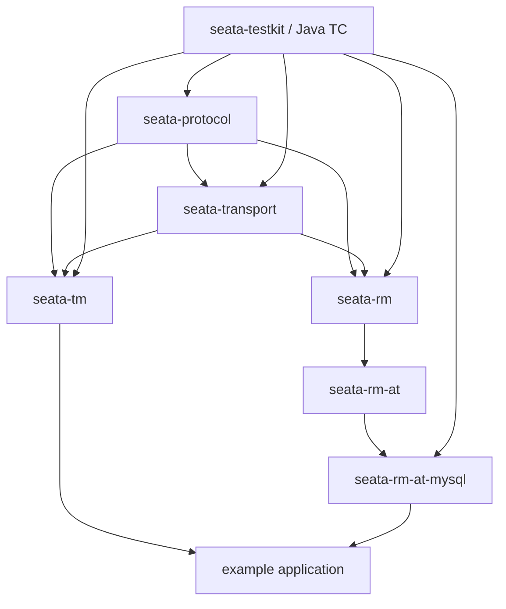

# Seata-Rust V1 — Implementation Acceptance Checklist and Dependency Plan

> **Status:** Proposed implementation baseline, derived from Phase 0 source audits.
>
> This document is an OpenSpec-ready task breakdown in Markdown. It does not authorize skipping Phase 0 test gates. It contains no production implementation code.

## 1. V1 product boundary

V1 is a Java TC-compatible client stack:

- Rust TM initiates and ends global transactions.
- Rust RM registers resources, registers/reports branches, answers TC phase-2 instructions and executes local branch work.
- Java Seata 2.x TC owns global sessions, branch IDs, global locks, transaction state machine, retry scheduling, timeout and recovery.
- Initial production mode: MySQL + AT.
- Native Seata V1 TCP protocol is the target transport.

V1 does **not** implement Rust TC, durable global session storage, global lock manager, TC retry scheduler, XA, TCC, Saga, or Java's complete server administration API.

## 2. Architecture package map

| Package / crate | Owns | Depends on |
|---|---|---|
| `seata-protocol` | explicit wire enums, V1 frame, head map, message codecs, serializer IDs, strict decode errors | domain types |
| `seata-transport` | TCP connection lifecycle, request IDs, pending futures, timeout, late/duplicate response handling, heartbeat, reconnect | seata-protocol |
| `seata-tm` | global transaction API, launcher/participant role, async context propagation, begin/commit/rollback/status reconciliation | protocol, transport |
| `seata-rm` | RM registration, resource registry, branch register/report, TC phase-2 inbound dispatch, response mapping | protocol, transport |
| `seata-rm-at` | AT branch lifecycle and resource-manager contract | rm, protocol |
| `seata-rm-at-mysql` | MySQL SQL interception, before/after image, lock keys, Undo Log, compensation and phase-2 cleanup | rm-at, database driver |
| `seata-testkit` | Java TC harness, deterministic fake TC, fault injection, fixtures and assertions | all client crates |
| examples | end-to-end business examples | tm, rm-at-mysql |

Package names are proposed logical boundaries; final Cargo workspace names can be adjusted by ADR without changing ownership contracts.

## 3. Dependency graph

## 4. Work packages and acceptance gates

### WP-00 — Freeze compatibility evidence

**Depends on:** Phase 0 research.

- [ ] Execute pinned Go payload harness and record output.
- [ ] Execute pinned Java V1 frame harness and record output.
- [ ] Fix any mismatching candidate vectors from actual encoder output.
- [ ] Complete Java request exception matrix tests.
- [ ] Run Java retry-timeout recovery investigation REC-TIMEOUT-001–010 or explicitly document blocked cases.
- [ ] Decide ADR-0008 and record approval.
- [ ] Freeze fixture hashes and upstream commit manifest.

**Gate:** no implementation task may call a source-derived candidate vector “golden” until the pinned Go/Java runtime has generated or accepted it.

### WP-01 — Protocol domain and wire model

**Depends on:** WP-00.

- [ ] Define domain enums independent from Java ordinal values.
- [ ] Define explicit conversion tables for MessageType, RequestType, SerializerType, CompressorType, BranchType, BranchStatus, GlobalStatus, ResultCode and TransactionExceptionCode.
- [ ] Model Java-nullable fields explicitly where source proves null/unset semantics.
- [ ] Implement strict big-endian primitive and length-prefixed UTF-8 codecs.
- [ ] Implement message-specific codecs for the V1 allowlist.
- [ ] Implement V1 16-byte frame header and optional HeadMap.
- [ ] Enforce fullLength/headLength/bodyLength invariants and configured max frame size.
- [ ] Reject truncated strings, unknown enum codes, invalid frame lengths, unknown serializers/compressors and unsupported message types.
- [ ] Add byte-for-byte tests for all certified vectors and negative malformed inputs.

**Gate:** Rust codec must match certified Java and Go bytes for every supported request/response. No lossy enum cast or permissive partial read.

### WP-02 — Native transport and correlation

**Depends on:** WP-01.

- [ ] TCP connect and connection pool with explicit lifecycle.
- [ ] Frame decoder handles partial and coalesced TCP reads.
- [ ] Request ID allocator prevents in-flight collisions across wraparound.
- [ ] Pending request map owns exactly one completion per request.
- [ ] Distinguish pre-send failure from write-attempted unknown outcome.
- [ ] Timeout removes waiter but records late-response observability.
- [ ] Late and duplicate responses cannot complete a new request after ID reuse.
- [ ] Heartbeat and idle connection detection.
- [ ] Reconnect with bounded backoff and connection generation.
- [ ] RM resource re-registration runs on every newly authenticated session.
- [ ] Shutdown closes sockets and resolves pending requests with typed outcomes.
- [ ] Test NET-001–NET-012.

**Gate:** no pending-future leak, no request ID cross-completion, no false “definite failure” after a write may have reached TC.

### WP-03 — Rust TM

**Depends on:** WP-02.

- [ ] Public transaction API and builder/config.
- [ ] Launcher/Participant roles and propagation contract.
- [ ] Async task-scoped XID context with nested scope isolation.
- [ ] GlobalBegin request, returned XID validation and binding.
- [ ] GlobalCommit / GlobalRollback requests and typed response handling.
- [ ] GlobalStatus query and unknown-outcome reconciliation.
- [ ] Begin timeout does not trigger blind second Begin.
- [ ] Commit timeout does not immediately trigger Rollback.
- [ ] Participant never drives global second phase.
- [ ] Context cleanup on success, error, panic and cancellation.
- [ ] Transaction deadline and transport timeout are separate settings.
- [ ] Error types distinguish definite rejection, definite result, unknown outcome, local pre-send failure and protocol failure.

**Gate:** TM integration tests against Java TC cover begin, commit, rollback, timeout, response loss, nested propagation and participant behavior.

### WP-04 — Rust RM control plane

**Depends on:** WP-02.

- [ ] RegisterTM/ RegisterRM message support if shared runtime requires TM and RM identity; keep control-plane response model distinct from transaction ResultCode.
- [ ] Resource registry keyed by resource ID and branch type.
- [ ] Register cached resources after every reconnect; readiness only after required registrations succeed.
- [ ] BranchRegister and BranchReport outbound calls.
- [ ] GlobalLockQuery response distinguishes lockable=false from malformed/transport error.
- [ ] Inbound BranchCommit and BranchRollback dispatch by resource ID and branch type.
- [ ] Unknown resource returns an explicit Java-compatible failure/status.
- [ ] Duplicate phase-2 instructions are idempotent.
- [ ] Durable branch completion marker or database transaction makes repeated work safe.
- [ ] Preserve application data and TC-issued XID/BranchId exactly.

**Gate:** Java TC can register Rust RM, create a branch, send phase-2 instructions and receive correct BranchStatus responses under duplicate delivery and reconnect.

### WP-05 — MySQL AT phase 1

**Depends on:** WP-04 and a chosen MySQL driver.

- [ ] Establish local transaction boundary.
- [ ] SQL parser/classifier with explicit supported SQL matrix.
- [ ] Resolve table metadata and primary keys.
- [ ] Capture before image.
- [ ] Generate canonical lock keys and register branch before committing business changes.
- [ ] Execute business SQL.
- [ ] Capture after image.
- [ ] Generate Undo Log with deterministic serialization and checksum.
- [ ] Insert Undo Log in the same local DB transaction as business SQL.
- [ ] Commit local DB transaction.
- [ ] Report PhaseOne_Done only after local commit is known successful.
- [ ] On definite local failure, rollback and report phase-1 failure where branch registration succeeded.
- [ ] On ambiguous DB commit result, reconcile local state and Undo Log; never replay SQL blindly.
- [ ] Define unsupported SQL behavior as fail-closed.

**Gate:** integration tests prove business data + Undo Log atomicity for supported SQL; crash/fault injection proves no committed business row without Undo Log.

### WP-06 — MySQL AT phase 2

**Depends on:** WP-05.

- [ ] Commit path performs safe Undo Log cleanup.
- [ ] Rollback path loads Undo Log under appropriate lock.
- [ ] Verify current image against after image (dirty-data check).
- [ ] Generate compensation SQL from before image.
- [ ] Delete/mark Undo Log in the same local transaction as compensation.
- [ ] Repeated commit and rollback are safe.
- [ ] Missing Undo Log behavior is explicit and compatible with Java TC retry semantics.
- [ ] Map retryable and unretryable failures to Java BranchStatus values.
- [ ] Fault injection covers DB disconnect before/during/after local commit.
- [ ] Test duplicate and out-of-order phase-2 instruction.

**Gate:** real Java TC + Rust RM + MySQL tests complete both commit and rollback and prove idempotency under response loss.

### WP-07 — Production readiness

**Depends on:** WP-01 through WP-06.

- [ ] Metrics for connection state, pending requests, late responses, retries, branch state and unknown outcomes.
- [ ] Structured logs include XID, BranchId, resource ID and request ID without leaking credentials.
- [ ] Config validation for TC endpoints, application ID, service group, timeouts and pool limits.
- [ ] Graceful shutdown with in-flight transaction policy.
- [ ] TLS/authentication policy aligned with Java TC deployment.
- [ ] Compatibility matrix against pinned Java TC versions.
- [ ] Load and fault-injection tests.
- [ ] Security review of SQL parser, Undo Log serialization and dynamic SQL.
- [ ] Publish supported-feature matrix and operational recovery guide.

**Gate:** all required integration tests, coverage gates, security checks and failure-injection suites pass; limitations are documented.

## 5. V1 supported feature matrix

| Capability | V1 decision | Acceptance |
|---|---|---|
| Native Seata V1 protocol | Required | Java/Go byte compatibility |
| Rust TM | Required | Java TC integration |
| Rust RM | Required | Java TC registration and phase 2 |
| MySQL AT | Required first production mode | Atomic Undo Log and compensation |
| Other AT databases | Defer | Separate adapter projects after MySQL |
| XA | Defer | Separate recovery and resource-manager specification |
| TCC | Defer | Confirm/Cancel + fence semantics |
| Saga | Defer | State machine and compensation model |
| Rust TC | Defer to V2 | Separate durable coordinator roadmap |
| Java V2 protocol | Defer | Not needed for V1 selected baseline |
| Go custom gRPC protocol | Defer | Not native Java V1 wire contract |
| RSeata custom Protobuf service | Do not use for V1 | Independent contract |

## 6. OpenSpec task slicing

Each WP should be split into small independently reviewable changes. Each change must include:
- source references and pinned commits;
- API/data model change;
- failure and cancellation behavior;
- unit tests;
- cross-language or integration test where relevant;
- observability impact;
- explicit non-goals;
- migration and compatibility notes.

Do not create one mega-task for “implement Seata-Rust”. The protocol and transport are foundational; TM/RM should depend on their certified contracts; AT must not begin until RM's branch lifecycle is stable.

## 7. Phase 0 exit criteria before WP-01 implementation

- [ ] Golden vector scripts executed and outcomes recorded.
- [ ] Java V1 frame decoder/encoder test passed.
- [ ] Java TC request exception mapping reviewed against runtime tests.
- [ ] Retry-timeout recovery ambiguity either resolved by Java tests or explicitly accepted as a known external TC limitation.
- [ ] V1 message allowlist and non-goals approved.
- [ ] ADR-0008 accepted or superseded.
- [ ] Rust public error and optional-field semantics approved.

**Important:** V1 is a client implementation that relies on Java TC. Do not accidentally implement TC responsibilities inside Rust TM/RM to work around missing Java TC behavior.
