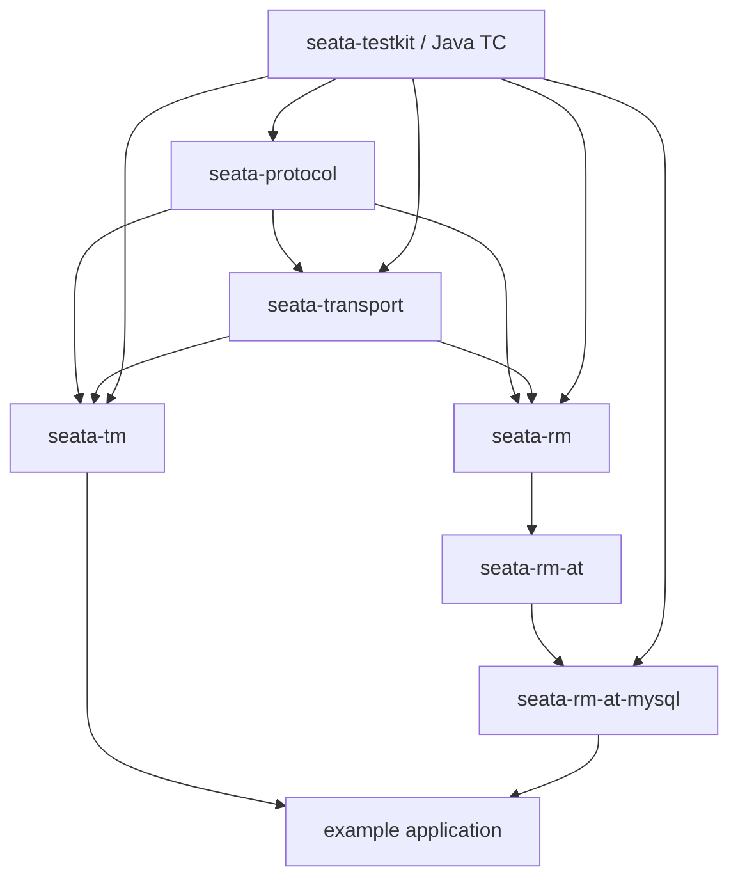

# Seata-Rust V1 — Implementation Acceptance Checklist and Dependency Plan

> **Status:** Proposed implementation baseline, derived from Phase 0 source audits.
>
> This document is an OpenSpec-ready task breakdown in Markdown. It does not authorize skipping Phase 0 test gates. It contains no production implementation code.

> **Current sequence (2026-11-13):** the user explicitly approved V2 and the initial V1 scope. WP-00-P and the WP-01 protocol-component Gate for the approved Java-authority/explicit-Go-adapter profile are verified; WP-02 is next. Full WP-00-R, original Go default compatibility and all release requirements remain open. Dated pending/probe-only statements below describe historical evidence epochs.

## 1. V1 product boundary

V1 is a Java TC-compatible client stack:

- Rust TM initiates and ends global transactions.
- Rust RM registers resources, registers/reports branches, answers TC phase-2 instructions and executes local branch work.
- Java Seata 2.x TC owns global sessions, branch IDs, global locks, transaction state machine, retry scheduling, timeout and recovery.
- Initial production mode: MySQL + AT.
- Native Seata V1 TCP protocol is the target transport.

V1 does **not** implement Rust TC, durable global session storage, global lock manager, TC retry scheduler, XA, TCC, Saga, or Java's complete server administration API.

## 2. Architecture package map

| Package / crate | Owns | Depends on |
|---|---|---|
| `seata-protocol` | explicit wire enums, V1 frame, head map, message codecs, serializer IDs, strict decode errors | domain types |
| `seata-transport` | TCP connection lifecycle, request IDs, pending futures, timeout, late/duplicate response handling, heartbeat, reconnect | seata-protocol |
| `seata-tm` | global transaction API, launcher/participant role, async context propagation, begin/commit/rollback/status reconciliation | protocol, transport |
| `seata-rm` | RM registration, resource registry, branch register/report, TC phase-2 inbound dispatch, response mapping | protocol, transport |
| `seata-rm-at` | AT branch lifecycle and resource-manager contract | rm, protocol |
| `seata-rm-at-mysql` | MySQL SQL interception, before/after image, lock keys, Undo Log, compensation and phase-2 cleanup | rm-at, database driver |
| `seata-testkit` | Java TC harness, deterministic fake TC, fault injection, fixtures and assertions | all client crates |
| examples | end-to-end business examples | tm, rm-at-mysql |

Package names are proposed logical boundaries; final Cargo workspace names can be adjusted by ADR without changing ownership contracts.

## 3. Dependency graph

## 4. Work packages and acceptance gates

### WP-00 — Freeze compatibility evidence

**Depends on:** Phase 0 research.

- [x] Execute pinned Go payload harness and record output — Run #42 plus local exact-source 2026-11-12 (29 payloads, 6 frames); supplemental failure diagnostics retain three open differences.
- [x] Execute pinned Java V1 frame harness and record output — Run #42 plus local combined target reports; six frame cases passed.
- [ ] Fix any mismatching candidate vectors from actual encoder output.

  2026-11-13 [fresh original-corpus revalidation](evidence/local-wp00-vector-audit/README.md): original29 payloads/six frames, document25 rows and binary fixtures match; Go29/6, Java35 existing assertion bodies (direct invocation, not JUnit engine), Rust117 pass with exact semantic-mutant failures. This verifies the original corpus only. The unqualified task remains unchecked while supplemental divergences and complete candidate coverage remain open; no dependency or acceptance scope is reduced.
- [x] Complete the selected Java request exception matrix tests and runtime-output comparison — handler72/auth7 within Java135/135; all78 serialized outputs compared with Rust/Go, null-report diagnostic separately recorded. This completes validation coverage, not fixes for known Go/null-report/state issues; Phase0 remains open.
- [x] Run Java retry-timeout recovery investigation REC-TIMEOUT-001–010 or explicitly document blocked cases — 2026-11-13 [item-by-item investigation closure](wp00-recovery-investigation-closure.md); includes reproduced original failures and explicitly unexecuted/blocked cases. This completes the investigation task, not safe-recovery acceptance or WP-00.

  Historical 2026-11-12 update: FILE001–002 failures reproduced; DB005–006/Redis007 pass for eight seeded-record/simulated-resource cases;010 covers empty-record cleanup and safe repeat rejection. [Real RAFT003–004 investigation](evidence/local-raft-retry-timeout/README.md) covers three cohorts, six leader transitions and three snapshot reloads;16/17 retained records/locks remain queryable, but four original async reload exceptions leave safe recovery OPEN (JAVA-RAFT-RELOAD-001). Durable replay/Undo scope008–009, natural deadlines and JAVA-METRICS-RETRY-001 were open at that time. [Backend evidence](evidence/local-backend-retry-timeout/README.md). The task was unchecked at that date; the 2026-11-13 closure above updates investigation bookkeeping while retaining all unresolved recovery requirements.
- [x] Decide ADR-0008 and record approval — explicit user confirmation 2026-11-12; implementation/validation requirements remain separate.
- [x] Freeze fixture hashes and upstream commit manifest — original29 at `tests/fixtures/protocol/v1/manifest.json`; supplemental failure pairs separately classified under `failure_variants/manifest.json`. This freezes tested inputs, not unresolved interoperability claims.

**Control envelope increment:** nine fresh Java cases and typed Rust probe checks now cover heartbeat and59/60 merges. Three heartbeat frames match original Go Getty bytes; six merge cases expose missing Go codecs (GO-V1-MERGE-001), not interoperability. Selected Java163/Rust114/Python5 passed; [evidence](evidence/local-control-envelopes/README.md). New fixture hashes/case classifications are separate from the original29/six-frame corpus. [Freeze-readiness audit](wp00-freeze-readiness-audit.md) records remaining dependencies without changing this gate.

**Control envelope increment:** nine fresh Java cases and typed Rust probe checks now cover heartbeat and59/60 merges. Three heartbeat frames match original Go Getty bytes; six merge cases expose missing Go codecs (GO-V1-MERGE-001), not interoperability. Selected Java163/Rust114/Python5 passed; [evidence](evidence/local-control-envelopes/README.md). New fixture hashes/case classifications are separate from the original29/six-frame corpus. [Freeze-readiness audit](wp00-freeze-readiness-audit.md) records remaining dependencies without changing this gate.

#### WP-00-P — Protocol evidence required to start implementation

This is an implementation prerequisite, not a waiver of any original WP-00 or release requirement. All original WP-00 tasks and its Gate still apply to overall completion.

- [x] Record pinned Java/Go versions, per-message authority, certified fields/bytes, unresolved divergences and explicit unsupported inputs.
- [x] Freeze original and supplemental fixtures with source/execution hashes; never relabel diagnostics as interoperable golden vectors.
- [x] Apply Accepted ADR-0003/0007/0008 to the planned domain/wire conversions, message-specific optionality and typed outcome taxonomy.
- [x] Link observable success/failure/malformed cases for the target API; keep every original WP-01 acceptance item unchanged.
- [x] Record the initial peer profile explicitly: Java authority, with validated adapters where required; preserve full Go compatibility as an outstanding final requirement, without silent dialect guessing or exemptions.

**Start gate:** WP-00-P must be verified before WP-01 starts. Completing P does not complete WP-00, certify production behavior or authorize release.

Verification: [protocol start record](wp00-protocol-start-verification.json), 2026-11-13. This is only the approved implementation-start gate.

#### WP-00-R — Remaining runtime and full compatibility evidence

All original unresolved WP-00 requirements remain here: supplemental Go failures/merges and full candidate coverage, reference FILE/RAFT defects, status/null-report/metrics/authentication boundaries, and actual production Rust resource atomicity, Undo, durable replay and fault matrices. Each original acceptance condition must be met or receive a separate explicit decision; this split grants no exceptions.

Original investigation results retain their actual scopes. Reference Go/Java evidence is not production Rust evidence. Deferred shared-lock work remains incomplete. WP-00 is complete only after both P and R and every original WP-00 requirement are satisfied; WP-01–07 and the full architecture roadmap remain required.

**Gate:** no implementation task may call a source-derived candidate vector “golden” until the pinned Go/Java runtime has generated or accepted it.

### WP-01 — Protocol domain and wire model

**Depends on:** WP-00-P. Full WP-00 and release acceptance remain required.

- [x] Define domain enums independent from Java ordinal values — formal seata-protocol, no repr/ordinal wire casts; [foundation verification](../phase-1/evidence/protocol-foundation/README.md).
- [x] Define explicit conversion tables for MessageType, RequestType, SerializerType, CompressorType, BranchType, BranchStatus, GlobalStatus, ResultCode and TransactionExceptionCode — nine explicit bidirectional Java V1 maps with known/unknown-code tests.
- [x] Model Java-nullable fields explicitly where source proves null/unset semantics — ordinary DTOs, unset result array, report255/0, raw registration version, nullable ordered HeadMap and RPC body; [formal frame verification](../phase-1/evidence/protocol-frame/README.md).
- [x] Implement strict big-endian primitive and length-prefixed UTF-8 codecs — public bounded WireReader/WireWriter, UTF-8 byte limits, signed lengths, explicit nullable-header rule and typed failures. Twelve formal tests pass on Rust1.99/1.85; this does not complete message/field-model or frame acceptance.
- [x] Implement message-specific codecs for the V1 allowlist — 25 ordinary plus59/60 models and strict bounded codecs; [formal merge verification](../phase-1/evidence/protocol-merge/README.md). This closes the implementation task, not the complete frame/vector gate or original Go compatibility gaps.
- [x] Implement V1 16-byte frame header and optional HeadMap — separate Java-equivalent encoder/decoder objects, ordered nullable values and bodyless outer heartbeat.
- [x] Enforce fullLength/headLength/bodyLength invariants and configured max frame size — explicit frame/head/entry/payload limits, signed-short head boundary and remaining-frame encode budget.
- [x] Reject truncated strings, unknown enum codes, invalid frame lengths, unknown serializers/compressors and unsupported message types — typed strict failures; known unsupported capabilities distinguished from unknown codes.
- [x] Add byte-for-byte tests for all certified vectors and negative malformed inputs — original29 payload/six frames,425 historical Java records,44 merges/nine control frames,78 independent handler sidecars and37 new actual Java frames;74 formal tests onRust1.99/1.85. Diagnostic-only Go differences and the unencodable null-report case remain diagnostics, not certified positive vectors.

2026-11-13 ordinary-payload increment: formal25 message DTOs/codecs now preserve per-field Java optionality, report255/0 and registration raw/default-version semantics, with strict bounded encode/decode. Original29 payloads and425 existing actual Java records are checked against independently constructed domain expectations. Nullable, allowlist-codec and complete-vector tasks remain unchecked because approved59/60 models, frame/HeadMap/heartbeat and their full malformed/vector gates are still pending. This does not reduce the27-type allowlist or complete WP-01.

Later 2026-11-13 merge increment:59/60 implemented and checked against44 existing actual Java merge payloads;61 formal tests pass onRust1.99/1.85 with explicit byte/batch/tree/depth limits. The message-codec task is now checked above. Nullable remains unchecked until the remaining HeadMap model is complete; all frame/full-length/complete-vector tasks and the overall Gate remain open. Original Go registry gaps stay inWP00-R.

Later 2026-11-13 frame increment: all nine implementation tasks are now checked from [74-test formal evidence](../phase-1/evidence/protocol-frame/README.md). This is implementation/fixture verification, not automatic passage of the Gate below. The current formal packet newly executes Rust and reuses its separately frozen37-frame original-Java run. Original Go default failed-response/59/60 differences remain open; the complete formal peer-profile comparison, including validated explicit Go adapters, must be closed before claiming WP-01 acceptance. TCP streams and live formal-client behavior are not certified by this packet. FullWP00-R and release conditions remain unchanged.

**Gate:** Rust codec must match certified Java and Go bytes for every supported request/response. No lossy enum cast or permissive partial read.

Gate verification 2026-11-13: [formal peer-profile evidence](../phase-1/evidence/protocol-peer-profile/README.md) and [machine-readable status](../phase-1/wp01-protocol-gate.json). All628 certified positive contexts (27 types,576payloads/52frames) independently match actual Java fields/rules and both real Rust/explicit-Go-adapter encodings;2050 malformed inputs fail complete-input acceptance. Formal74 tests plus one verification-helper test pass onRust1.99/1.85;12 actual-output corruption controls and read-only review pass. This verifies the approved initial peer profile and unblocks WP-02. It does not certify original Go default paths, close their known differences, accept external TC risks or complete fullV1/WP00-R; those original requirements remain unchanged.

### WP-02 — Native transport and correlation

**Depends on:** WP-01.

- [x] TCP connect and connection pool with explicit lifecycle — fixed per-endpoint raw slots, multiplexed selection, bounded inbound forwarding, explicit shutdown/Drop and owned supervisors verified in [pool evidence](../phase-1/evidence/transport-pool/README.md). Connected does not mean authenticated/resource-ready; that remains below.
- [x] Frame decoder handles partial and coalesced TCP reads — formal incremental decoder verified on46 certified frames, arbitrary control splits/one-byte fragments and bounded coalesced draining; [transport foundation](../phase-1/evidence/transport-foundation/README.md). This is byte-stream unit verification, not a claim of a live TCP session.
- [x] Request ID allocator prevents in-flight collisions across wraparound — per-connection non-clonable allocator issues eachsigned-i32 ID at most once, quota exhaustion requires rotation. Real concurrent signed-wrap calls and two active sockets sharing wire IDs now verify pending/generation integration; automatic reconnection remains separate.
- [x] Pending request map owns exactly one completion per request — atomic remove/oneshot handoff, deadline/cancel/close arbitration and type/batch guard; [single-session evidence](../phase-1/evidence/transport-session/README.md).
- [x] Distinguish pre-send failure from write-attempted unknown outcome — per-entry marker checked at the first write poll, local refused/invalid/queued-timeout versus observed-write timeout/closure.
- [x] Timeout removes waiter but records late-response observability — absolute deadline checked at receive arbitration, cancellation cleanup, unmatched/late counts, no unbounded tombstone store.
- [x] Late and duplicate responses cannot complete a new request after ID reuse — no reuse in one socket; independent generation/table for each socket, including simultaneous equal wire IDs.
- [x] Heartbeat and idle connection detection — opt-in writer-idle nativePING, full-valid-frame reader-idle closure, no pending heartbeat futures, shared non-reused IDs and owned-worker cancellation; [47-test heartbeat evidence](../phase-1/evidence/transport-heartbeat/README.md). Business/PONG writes refresh writer idle; skipped queued requests and partial incoming bytes do not.
- [x] Reconnect with bounded backoff and connection generation — old session withdrawn/joined before replacement, capped positive exponential delays, reset only after stable duration, independent new identity, no hidden business replay; ID quota exhaustion triggers generation rotation while preserving the rejected call's local error.
- [x] RM resource re-registration runs on every newly authenticated session — registered pools require native identified confirmation for the full current typed-resource snapshot; each new generation repeats it, dynamic additions invalidate stale readiness and partial failures preserve per-resource results. [76-test component gate and six pinned JavaTC cases](../phase-1/evidence/session-registration/README.md). This confirms configured hook acceptance, not production authentication/TLS or RM callback execution.
- [x] Shutdown closes sockets and resolves pending requests with typed outcomes — explicit shutdown joins workers, owner Drop aborts them, pending errors retain each write marker; real peer EOF and unpolled guard/poison cleanup tested.
- [x] Test NET-001–NET-012 — [formal transport component gate](../phase-1/evidence/transport-recovery/README.md): NET001–009 component regressions and three actual pinned JavaTC response-loss scenarios use formal transport APIs. In-memory branch actions establish the transport/fault-driver boundary; production TM/RM, durable idempotency and SQL/Undo recovery remain subsequent work packages.

**Gate:** no pending-future leak, no request ID cross-completion, no false “definite failure” after a write may have reached TC.

2026-11-13 current status: twelve implementation tasks checked (12/12); [WP02 component Gate](../phase-1/wp02-transport-gate.json) verified for the approved initial peer profile. [Combined evidence](../phase-1/evidence/transport-recovery/README.md) verifies87 formal transport tests plus3 driver-unit tests onRust1.99/1.85,14 isolated behavior mutations and13 Python observer tests. Six native-registration and three actual JavaTC response-loss cases bind the same128 compiled inputs, actual class/config origins and cleanup. NET010 retains unknown Commit on Finished15/15; NET011 makes no second Begin; NET012 learns a missing BranchId only from a matching legitimate callback after explicit same-XID cancellation. The full-client, production TM/RM, durable branch recovery, SQL/Undo, production auth/TLS and later work-package gates remain open. Prior checkpoints retain their historical scope; original Go default compatibility/WP00-R, external-TC risk and deferred shared-lock requirements are unchanged. Next: WP03 formal TM API and task-scoped context.

### WP-03 — Rust TM

**Depends on:** WP-02.

- [x] Public transaction API and builder/config.
- [x] Launcher/Participant roles and propagation contract.
- [x] Async task-scoped XID context with nested scope isolation.
- [x] GlobalBegin request, returned XID validation and binding.
- [x] GlobalCommit / GlobalRollback requests and typed response handling.
- [x] GlobalStatus query and unknown-outcome reconciliation.
- [x] Begin timeout does not trigger blind second Begin.
- [x] Commit timeout does not immediately trigger Rollback.
- [x] Participant never drives global second phase.
- [x] Context cleanup on success, error, panic and cancellation.
- [x] Transaction deadline and transport timeout are separate settings.
- [x] Error types distinguish definite rejection, definite result, unknown outcome, local pre-send failure and protocol failure.

**Gate:** TM integration tests against Java TC cover begin, commit, rollback, timeout, response loss, nested propagation and participant behavior.

2026-11-13 current status: implementation tasks12/12 and **WP03 Gate verified for the approved initial TM profile**. [Combined evidence](../phase-1/evidence/tm-gate/README.md) binds28 formal TM tests plus87 transport regressions and2 separate driver-unit tests onRust1.99/1.85;19 actual assertion-failing isolated controls;13 observer and7 proxy tests. Six earlier pinned JavaTC basic cases plus three newly executed formal-TM Begin/Commit/Rollback response-loss cases cover the complete stated Gate. Raw evidence verifies no second Begin/business start, original same-manager XID/intent recovery, status request initiated after the lost response and completed before any explicit same-operation duplicate, and15/15 retaining unknown for both end operations. Rollback preserves the business error. The RM branch actions used in the fault driver are in-memory simulations; this Gate does not complete RM/SQL/Undo, production auth, cross-process recovery, original Go defaults/WP00-R or fullV1/release. External-TC risk remains unaccepted and shared lock deferred. Next: WP04 formal RM control plane. [Machine-readable status](../phase-1/wp03-tm-gate.json).

### WP-04 — Rust RM control plane

**Depends on:** WP-02.

- [x] RegisterTM/ RegisterRM message support if shared runtime requires TM and RM identity; keep control-plane response model distinct from transaction ResultCode.
- [x] Resource registry keyed by resource ID and branch type.
- [x] Register cached resources after every reconnect; readiness only after required registrations succeed.
- [x] BranchRegister and BranchReport outbound calls.
- [x] GlobalLockQuery response distinguishes lockable=false from malformed/transport error.
- [x] Inbound BranchCommit and BranchRollback dispatch by resource ID and branch type.
- [x] Unknown resource returns an explicit Java-compatible failure/status.
- [x] Duplicate phase-2 instructions are idempotent.
- [x] Durable branch completion marker or database transaction makes repeated work safe.
- [x] Preserve application data and TC-issued XID/BranchId exactly.

**Gate:** Java TC can register Rust RM, create a branch, send phase-2 instructions and receive correct BranchStatus responses under duplicate delivery and reconnect.

**Historical foundation checkpoint (2026-11-13; superseded below):** formal `seata-rm` now provides an exact resource catalog, shared-store branch dispatch and versioned bounded file journal. [Foundation evidence](../phase-1/evidence/rm-foundation/README.md) executes23RM+189existing workspace tests per Rust1.99/1.85,12 actual owned process children and5 compiled assertion-failing controls. Forced process exit after durable fixture effect verifies recovery and no repeated effect; the fixture does not prove SQL/Undo atomicity. Owned RM networking, outbound calls, native batch/original-origin replies and the real Java RM duplicate/reconnect Gate remain open. No full WP04 checkbox/Gate is completed from this foundation alone. [Partial status](../phase-1/wp04-rm-foundation.json).

**Historical runtime component checkpoint (2026-11-14; superseded below):** [new evidence](../phase-1/evidence/rm-runtime/README.md) now executes45RM+189existing tests per Rust1.99/1.85,52 test artifacts,12 actual restart children and11 compiled target-assertion controls. Owned registered RM lifecycle, typed outbound calls, exact original-origin replies, flat callback batches, deadlines and failure cleanup are verified with a synthetic TC. Registration-loop bytes and the approved only-after-ready callback rule are unchanged. The pinned real Java TC RM duplicate/reconnect Gate is the next required step; complete WP04 acceptance remains OPEN. [Current component status](../phase-1/wp04-rm-component.json).

**2026-11-14 final WP04 status:** ten original implementation items10/10 and **Java RM Gate verified for the approved initial profile**. [Combined evidence](../phase-1/evidence/rm-gate/README.md) and [machine status](../phase-1/wp04-rm-gate.json) bind the unchanged234-test dual-Rust component result (45RM),52 artifacts,11 implementation assertion controls and12 actual restart children to six newly executed original JavaTC scenarios. Normal/duplicate/reconnect commit and rollback preserve exact original identities and durable completion; resource effects occur once, original BranchRegister/Report/global end requests are not replayed, TC owns retries. Separate RM/TM raw observers and original TC logs bind order and each claimed status;38 Python tests,10 actual observer-assertion controls and2 driver tests on each Rust version pass, with readonly review and cleanup. The original unknown rollback result remains unknown despite its late Failed/Retrying response and later Finished; exact client timeout timing is not independently proved. The resource fixtures do not prove SQL/Undo atomicity, adapter late-commit fencing or production authentication. WP05/06, WP00-R, original Go defaults, fullV1/release and every later Phase remain open. External TC risk remains unaccepted; shared lock stays deferred. Next: WP05 MySQL AT phase one.

### WP-05 — MySQL AT phase 1

**Depends on:** WP-04 and a chosen MySQL driver.

- [ ] Establish local transaction boundary.
- [ ] SQL parser/classifier with explicit supported SQL matrix.
- [ ] Resolve table metadata and primary keys.
- [ ] Capture before image.
- [ ] Generate canonical lock keys and register branch before committing business changes.
- [ ] Execute business SQL.
- [ ] Capture after image.
- [ ] Generate Undo Log with deterministic serialization and checksum.
- [ ] Insert Undo Log in the same local DB transaction as business SQL.
- [ ] Commit local DB transaction.
- [ ] Report PhaseOne_Done only after local commit is known successful.
- [ ] On definite local failure, rollback and report phase-1 failure where branch registration succeeded.
- [ ] On ambiguous DB commit result, reconcile local state and Undo Log; never replay SQL blindly.
- [ ] Define unsupported SQL behavior as fail-closed.

**Gate:** integration tests prove business data + Undo Log atomicity for supported SQL; crash/fault injection proves no committed business row without Undo Log.

**2026-11-14 partial update:** [selected SQL recognition evidence](../phase-2/evidence/at-sql/README.md) now executes18 new SQL tests within252 full workspace tests on each Rust1.99/1.85;56 actual artifacts,10 compiled target-assertion controls and12 actual restart children. Complete-input/unsupported matrix, WHERE parameter order, pre-AST budgets, bare MySQL builtin classification, parser token loss and a pinned DIV panic path have explicit regressions. This is recognition evidence only: no real MySQL/SQLx, metadata/images/Undo or local atomicity proof; all fourteen tasks and this Gate remain open. Eight Java objects are PARTIAL and85 source test files only inventoried, with concrete-case parity/differential not run. [Partial machine status](../phase-2/wp05-at-sql-component.json).

**2026-11-14 metadata foundation update:** [real MySQL evidence](../phase-2/evidence/mysql-foundation/README.md) verifies SQLx0.8.6/local transactions, exact metadata/PK order, MDL, unsafe-table and visibility rejection, bounded response loss. Each Rust1.99/1.85 executes259 workspace tests plus8 real MySQL cases;66 workspace and2 separate live artifacts,4 target-assertion controls and12 existing RM file-recovery children. MySQL8.4.13/lower_case_table_names2 only; no business SQL, row images, Undo atomicity or new Java/Go differential. Six Java objects PARTIAL,189 test files inventoried,7 assets copied. All fourteen tasks and this Gate remain open. [Partial status](../phase-2/wp05-mysql-foundation.json).

**2026-11-14 row value model update:** [bounded exact values](../phase-2/evidence/row-image/README.md) verify Field/Row/TableRecords, precise integers/DECIMAL/binary/NULL, complete ordered schema, independent PK order and atomic row/payload limits. Rust1.99/1.85 each execute273 workspace tests;68 artifacts,10 compiled target-assertion controls and12 existing RM restart children. Physical MySQL column constraints, SQLx row decoding, before/after images and Undo remain incomplete. Nine Java objects PARTIAL,189 test files inventoried,7 assets copied; no new Java/Go/MySQL execution. All fourteen tasks and this Gate remain open. [Partial status](../phase-2/wp05-row-value-model.json).

**2026-11-14 before-image partial update:** [physical domains and UPDATE/DELETE before image](../phase-2/evidence/mysql-row/README.md) execute282 workspace tests and19 real MySQL cases on each Rust1.99/1.85, with8 pure and5 real target-assertion controls,72 workspace and4 positive live artifacts, and12 existing RM restart children. Original parameter slicing/native DECIMAL, exact values, preflight budget, independent PK order, held locks and cancellation release have evidence. Exact inter-query insert/growth schedule, INSERT images, business SQL/after image/Undo and fullGate remain incomplete. Nine Java objects PARTIAL/two method references/189 test files inventoried/seven assets copied; no new Java/Go execution. All fourteen tasks remain open. [Partial status](../phase-2/wp05-mysql-before-image.json).

**2026-11-15 inter-query schedule supplement:** [new real schedule evidence](../phase-2/evidence/mysql-image-race-gate/README.md) holds the original102B full-value PREPARE before forwarding. Independent row growth and phantom insert both fail1205, original image remains1row/1byte, then both writes succeed after rollback. One new positive case per Rust plus two targeted real assertion controls pass;223 old Rust files/Cargo unchanged,282+19 and13 original controls inherited, not rerun. Archived evidence remains complete after D runtime cleanup; dependency cache restored by locked checksums, old executables not restored. INSERT/business/after/Undo/fullGate and all fourteen tasks remain open. [Partial status](../phase-2/wp05-mysql-image-race.json).

**2026-11-15 bounded DML/images partial update:** [new execution evidence](../phase-2/evidence/mysql-execution-gate/README.md) freshly runs291 workspace and37 actual MySQL cases per Rust1.99/1.85;80 workspace and8 live positive artifacts,5 pure and6 live implementation-weakening controls,12 existing RM file-recovery children. Explicit PK INSERT uses native typed temporary assignment (CAST literal regression fixed); UPDATE captures after by original keys, DELETE is empty; failures,128/16MiB quotas,cancellation/deadline and namespace/permission limits verified. Memory Undo only: no public COMMIT, Java format interop, durable Undo, BranchRegister or unknown-commit recovery.14 Java objects remain PARTIAL and189 test files inventoried. All fourteen original tasks remain open. [Partial state](../phase-2/wp05-mysql-execution.json).

**2026-11-15 native type/Java format partial update:** [native identity evidence](../phase-2/evidence/mysql-type-gate/README.md) freshly executes297 workspace+38 real MySQL cases per Rust1.99/1.85;84 workspace+10 positive live artifacts,2 pure+2 actual targeted controls,12 existing RM recovery children. Native18 subtypes/tiny display retained with old constructor None. Bound original Java8.0.27/Jackson2.18.3 selected format profiles each6tables;16 exact generated goldens,18 selected source files/32classes/335runtime inputs checked,default bytes/Empty subclass retained. Java5.1.42 fails2 connections on removed query_cache_size; not full Maven environment, source-case parity or Rust codec interop. No atomic Undo/public COMMIT; all fourteen tasks and WP06 remain open.

**2026-11-16 selected codec update:** [Final codec component](../phase-2/evidence/undo-codec-gate/README.md) freshly executes316 workspace tests per Rust1.99/1.85 and the affected actual codec case per version (two JDBC profiles/four business logs each), with40/40 actual Java bidirectional document matches and12 new RM children. The prior full gate313+39 is preserved:38 unaffected DB cases per version and5 pure/1 real binary-corruption control are explicitly inherited; final production changes only strict_json resource checks. Empty-container depth and fixed Jackson numeric-read limits have behavior RED/GREEN; original node preflight was correct and exact40/39 boundary is now tested. Readonly final review found no remainingP1/P2. Literal pinned Git resources are now stored separately from prior CRLF checkout copies.189 files/1135 method declarations remain MISSING with unresolved runner expansion; original JUnit/full Maven environment, atomic Undo persistence, TC registration and unknown-commit recovery remain open. All fourteen WP05 tasks and WP06 remain open. [Partial machine status](../phase-2/wp05-undo-codec.json).

**2026-11-16 lock-key partial update:** [Selected lock-key gate](../phase-2/evidence/lock-key-gate/README.md) freshly executes325 tests per Rust1.99/1.85,1029 original Java/Rust key comparisons, each real JDBC profile9 lock logs plus4 codec logs, and40/40 document comparisons. Java HashMap PRIMARY iteration is distinct from SQL primary-index order; source-config mixing and atomic output budgets are guarded. Eight pure and one actual native inverse-order controls,96 artifacts,12 RM children and3 owned containers have matching evidence; readonly review has noP1/P2. Original38 unaffected DB scenarios are explicitly inherited. Source JUnit/object parity, actual TC coverage/registration, atomic Undo and public COMMIT remain open; origin-method recording-backend diagnostics are not a network TC gate or risk acceptance. All original fourteen WP05 tasks and WP06 remain OPEN. [State](../phase-2/wp05-global-lock-keys.json).

**2026-11-18 WP05 lock coverage update.** The fixed Java TC DB store preserved a single lock under the same resource ID. Two JDBC resource IDs for the same MySQL row acquired separate locks. Distinct composite primary keys collided under the original lock-key format. The two Rust toolchains also verified the fixed MySQL storage limits and the nonmatching business and TC collations. Full TC lock safety, external TC risk acceptance, public first-phase business COMMIT, and the WP05 acceptance gates remain open. [Registration lifecycle](../phase-2/wp05-tc-lock-native-registration.json) · [Storage boundaries](../phase-2/wp05-tc-lock-storage-boundaries.json) · [Identity boundaries](../phase-2/wp05-tc-lock-identity-boundaries.json)

**2026-11-25 WP05 independent-process report claim update.** Two actual recovery child processes released at one barrier race the same persisted 007 row on an isolated real MySQL 8.4.13 database. Rust 1.99/1.85 each pass 1/1: one `PhaseOneDone` report, one `AlreadyStarted`, persisted `report_started=1`, one business row and one Normal Undo. The controlled RM peer accepts either registration order and rejects a second business frame. Both strict target Clippy checks and formatting pass; the owned container was removed. [Logs and boundary](../phase-2/evidence/mysql-report-process-race/README.md). At this stage the fixed original Java TC race, TM restart, external lock coverage and WP05/WP06 production gates remained open; the original TC race was subsequently covered below.

**2026-11-25 WP05 original TC independent-process supplement.** The same two-process 007 claim is now exercised through the pinned original Java TC, fixed Connector/J and real MySQL 8.4.13. Rust 1.99/1.85 each pass 1/1: two distinct recovery PIDs yield one sent report and one `AlreadyStarted`; raw RM/TM frames and independent SQL checks prove one successful `PhaseOneDone`, one GlobalCommit, one matched successful BranchCommit callback, `report_started=1`, and final global/branch/lock/business/undo/witness/terminal counts `0/0/0/1/0/1/1`. Both versions of the prior single-process dual-pool case also rerun successfully. [Original TC raw evidence](../phase-2/evidence/java-tc-changed-commit-report/README.md). The TM Launcher remains alive in the parent process, and external-writer lock safety plus the full WP05/WP06 production gates remain open.

**2026-11-25 TM durable-origin schema increment.** The separate 008 MySQL table has a real red/green test for invalid `send_started` without an end intent, full 32767-byte native XID storage, digest collision rejection, bounded source fields, and two-connection intent/send CAS. Rust 1.99/1.85 each pass 1/1 on isolated MySQL 8.4.13. [Schema evidence](../phase-2/evidence/tm-launcher-schema/README.md). The formal TM now offers a separate `begin_durable` path backed by 008 source insert, end intent and send marker CAS; [joint MySQL/TCP and original Java TC evidence](../phase-2/evidence/tm-launcher-store/README.md) passes both toolchains. The original Java TC Commit and Rollback reply-loss paths each show exactly one request and a retained 008 send marker; a separate child process exits after marker persistence and before sending to a controlled TCP peer. This increment does not grant cross-process Launcher authority. Owner-stop attestation, full TM reconstruction, remaining end fault states, and the full WP05/WP06 gates remain open.

**2026-11-25 TM source read increment.** The 008 store now exposes a read-only snapshot that checks the complete XID after digest lookup and validates source identity/state; absent digest and forged same-digest/different-XID cases are distinct. MySQL server time determines whether the source deadline passed. Rust 1.99/1.85 each pass both live source/snapshot and forged digest tests. [Live evidence](../phase-2/evidence/tm-launcher-store/README.md). A snapshot grants no Launcher/end capability; owner-stop attestation and trusted takeover remain open.

**TM launcher database roles.** The MySQL 8.4.13 fixture applies the production role SQL after migrations 008 and 009. Rust 1.99 and 1.85 each passed the Begin-to-Commit test with separate writer and observer accounts. MySQL rejects writes by the observer and rejects source deletion and owner mutation by the writer. The runtime CAS still enforces one-way end state changes. Trusted owner-stop attestation and takeover remain open. [Live evidence](../phase-2/evidence/tm-launcher-store/README.md#mysql-launcher-角色验收).

**TM original TC status observation.** A fresh MySQL snapshot can query the original XID through a new TM manager after checking deadline, business intent, endpoint and registration identity. Both Rust toolchains pass the controlled peer test and the pinned Java TC Commit and Rollback reply-loss cases. The raw traces show one End and one Status request per run, with the status query using a separate connection and preserving `AsyncCommitting` or `Rollbacking`. Trusted owner-stop attestation and cross-process takeover remain open. [Status evidence](../phase-2/evidence/tm-launcher-store/README.md#新-tm-管理器查询原-tc).

**TM supervised process exit.** Both toolchains passed the MySQL and controlled TCP case with a monitor holding the original child handle. The child announced its instance before Begin. The monitor issued proof after exit, and its original issuer verified the instance against the launcher row. The test rejects verification while the child is alive, an unrelated issuer or instance, and an exit without a report. Epoch transfer and cross-host attestation remain open. [Live evidence](../phase-2/evidence/tm-launcher-store/README.md#本机进程退出证明).

**TM owner epoch transfer.** The supervised MySQL 8.4.13 case passed on Rust 1.99 and 1.85. Two requests using the same proven stopped owner compete for one epoch transfer. The database persists the replacement instance exactly once and preserves the original intent and unopened send marker. The preceding negative checks cover an unrelated monitor, Finished, database expiry after the status query reached the peer, and denied marker updates by the recovery account. Recovered sending and cross-host authentication remain open. [Evidence](../phase-2/evidence/tm-launcher-store/README.md#本机代际更新).

**TM recovered single end send.** Both Rust toolchains passed real MySQL and controlled TCP tests for one recovered Commit and one recovered Rollback with reply loss. Independent SQL shows epoch 2 and the original operation with the send marker committed before the frame reaches the peer. Reply loss remains unknown. The transferred handle is consumed, and the original in-memory recovery path denies the error. The pinned Java TC independent-process acceptance and cross-host attestation remain open. [Live evidence](../phase-2/evidence/tm-launcher-store/README.md#新代际单次发送).

**Pinned Java TC independent-process TM recovery.** Rust 1.99 and 1.85 each pass the supervised Commit and Rollback reply-loss profiles. The old TM persists the intent and exits. A different process claims epoch 2, observes Begin twice, and sends the original end once. Independent MySQL results show epoch 2, a set send marker and zero remaining TC global, branch and lock rows. The Rollback reply-loss case remains unknown at the TM. These profiles contain no AT business branch. AT terminal state and cross-host stop attestation remain open. [Raw evidence](../phase-2/evidence/tm-launcher-store/README.md#固定-java-tc-下的独立-tm-进程接管).

**Pinned Java TC supervised TM recovery with a real AT branch.** The feature-gated changed-commit profile passed Commit and Rollback reply-loss on Rust 1.99 and 1.85. Each run records one phase-one success report, one recovered global end and one matching Java TC phase-two callback on the new RM connection. Commit retains the business row and clears Undo. Rollback removes the business row and normal Undo, retains the original branch fence, and rejects a late normal insert with MySQL 1062. TC global, branch and lock rows are empty at the end. Cross-host stop attestation and the full WP05/WP06 gates remain open. [Live evidence](../phase-2/evidence/tm-launcher-store/README.md#固定-java-tc-下带真实-at-分支的接管).

**Portable TM stop attestation.** Both Rust toolchains passed the signed recovery path through real MySQL and the controlled peer. The old process monitor signs only its confirmed exit. The receiving verifier uses a pinned Ed25519 key, trust scope and an expiring challenge bound to the old and replacement TM instances. Invalid proofs are refused and concurrent valid claims still advance the epoch once. Cross-host transport and deployment verification remain open. [Live evidence](../phase-2/evidence/tm-launcher-store/README.md#可传输的停止签名).

**TM stop attestation exchange.** Both Rust toolchains passed a fixed-width challenge/response over loopback TCP between independent signer and recovery processes. A signer rejects proof requests for another instance. The receiver rejects an invalid header, truncated response, forged signature or timeout. The same exchange feeds the successful real MySQL Commit and Rollback reply-loss recovery fixtures. Authenticated transport provisioning, key rotation and distinct-host acceptance remain open. [Live evidence](../phase-2/evidence/tm-launcher-store/README.md#停止签名交换).

**Mutual TLS for TM stop attestation.** The TLS 1.3 adapters require client certificate authentication, server name verification, application protocol negotiation and pinned leaf certificates. Both Rust toolchains passed the TCP fixture with valid identities and rejected a different client certified by the same CA, an incorrect server certificate pin or name, a missing client certificate and a stalled handshake. The Rust 1.85 pinned Java TC AT Commit takeover regression also passed. Certificate provisioning, signing key rotation and distinct-host deployment acceptance remain open. [Live evidence](../phase-2/evidence/tm-launcher-store/README.md#停止证明双向-tls).

**TM stop signing key rotation.** The deployment authority can replace the trusted keyset atomically. TLS tests accept both preconfigured keys during overlap and reject the retired key for an outstanding challenge. Real MySQL tests retire the old key while TC status is pending. Verification under the row lock refuses the stale claim, and concurrent valid claims with the new key still advance the epoch once. Commit and Rollback reply-loss scenarios pass on both Rust toolchains. Distinct-host configuration distribution and deployment acceptance remain open. [Evidence](../phase-2/evidence/tm-launcher-store/README.md#停止签名公钥轮换).

**Isolated TM signer and recovery nodes.** Two Linux containers on a private Docker network passed the TLS and signing key rollover fixture. The runner provisions separate read-only credential bundles, publishes no host ports, and verifies three accepted proofs and one rejected retired signature. The containers, network and ephemeral credential directory are removed after the run. Separate hosts and a joint test with MySQL/Java TC remain open. [Deployment fixture evidence](../phase-2/evidence/tm-stop-nodes/README.md).

**Attested AT recovery across the container boundary.** The fixed Java TC and real MySQL AT fixture passes Commit and Rollback reply loss with Rust 1.99 and 1.85 on the Windows recovery side. A Linux signer container supervises the original process and produces the stop proof over mutual TLS. The recovery path verifies the proof, claims epoch 2 and sends one End for the original XID. Independent RM frames and MySQL observations confirm one original callback, the expected business and Undo outcomes, zero remaining TC sessions, branches and locks, and fixture cleanup. Production provisioning and distinct-host acceptance remain open. [Combined evidence](../phase-2/evidence/tm-stop-nodes/README.md#远程签发与原-java-tc-的联合-at-联试).

**Durable TM stop trust scope.** Migration 010 records the owner's stop trust scope with its launcher epoch. Remote transfer requires the recorded scope to match the verifier and compares it again under the row lock. MySQL 8.4.13 tests on Rust 1.99 and 1.85 reject a valid proof from another scope, a source without a scope and a stale snapshot. A successful claim records the replacement owner's scope. Existing 008/009 sources retain their owner state on migration. Upgrade all privileged recovery binaries before enabling scoped writes. Production trust configuration distribution, distinct-host acceptance and the full WP05/WP06 gates remain open. [MySQL evidence](../phase-2/evidence/tm-launcher-store/README.md#持久化停止签名信任域) · [Joint AT evidence](../phase-2/evidence/tm-stop-nodes/README.md#010-信任域绑定回归).

**Existing TM launcher role upgrade.** Both Rust toolchains verified the 010 grants on MySQL 8.4.13 with the original 009 accounts. Before the grants, MySQL refused both new column operations. After applying the script twice, the existing writer could insert a scoped source and the existing recovery account could update its ownership fields. Read-only access and the writer/recovery separation remained in force. The original source retained its owner and null scope. [Upgrade test evidence](../phase-2/evidence/tm-launcher-store/README.md#既有账号增量授权).

**MySQL lock checks across separate pools.** A pool used to start the business transaction can independently require the original TC lock-table length and collation checks. Both Rust toolchains use distinct pools to verify local rejection of incompatible keys, the original TC's normal lock conflict response for compatible keys, and final lock cleanup. Coverage for external writers and the public business COMMIT path remains open. [Fixed Java TC evidence](../phase-2/tc-lock-coverage-contract.md#跨连接池准备时保留已启用的锁校验).

**Physical MySQL identity at a shared JDBC address.** Two real MySQL instances used the same schema, JDBC URL, and resource binding. Both Rust toolchains verified that the original pool refuses sessions routed to the second instance and that cross-instance preparation emits zero BranchRegister requests to a controlled peer. Each run verifies zero business, Undo, and recovery records after rejection. External writer lock coverage and production failover remain open. [Physical identity evidence](../phase-2/tc-lock-coverage-contract.md#同一-jdbc-资源的物理实例一致性).

**Original Java and Rust mutual exclusion.** Both Rust toolchains verify that the pinned TC rejects the contender in either direction for the identical JDBC resource and row key. This includes a single integer key and the tested BIGINT/VARCHAR compound key under the original TC collation. The compound-key cases preserve Java key ordering, exact integers above the JavaScript safe range, and both neighboring rows. A new contender can register after the owner releases the lock. Other key classes, external writers, and production admission remain open. [Integer key](../phase-2/tc-lock-coverage-contract.md#原-java-at-持锁时-rust-竞争同一行) · [Compound key](../phase-2/tc-lock-coverage-contract.md#混合类型复合主键的双向竞争).

**DECIMAL cross-client lock keys.** The pinned Java TC verifies both hold directions on both Rust toolchains for tested DECIMAL(38,8) and DECIMAL(30,20) keys. Wire evidence preserves the exact large decimal including its declared scale and the small decimal in Java scientific notation. Independent MySQL observations verify that both records one scale unit away retain their original values. [DECIMAL lock cases](../phase-2/tc-lock-coverage-contract.md#decimal-主键的双向竞争).

**Binary cross-client lock keys.** On both Rust toolchains, Java and Rust register the same single-byte VARBINARY key and conflict in both directions while the owner holds the lock. The Rust ownership case also rejects a real update of a two-byte key before registration. The original RM stream contains only the single-byte branch, and the two-byte business row retains its balance. [Binary lock cases](../phase-2/tc-lock-coverage-contract.md#varbinary-主键的排他锁边界).

**TINYINT(1) JDBC profile compatibility.** Eight matching-profile runs verify both hold directions for Boolean value 1 and numeric value 2. The Boolean-profile Rust path rejects a real update of physical value 2 before registration. The two mismatched-profile runs reproduce two accepted locks for physical value 1 on the same JDBC resource, with Java registering `true` and Rust registering `1`. Cross-client profile admission remains open. [TINYINT(1) evidence](../phase-2/tc-lock-coverage-contract.md#tinyint1-的-jdbc-配置与锁键).

**Opt-in Rust TINYINT(1) profile binding.** Migration 011 lets a deployment declare the mapping on the existing JDBC resource binding row. Four pinned Java TC and MySQL runs cover both toolchains and each pool enabling the guard independently. A mismatch and an unset mapping each produce zero BranchRegister requests. After explicit provisioning a fresh Rust XID registers once. An independent connection receives MySQL 1205 when it attempts to update the mapping while the business transaction is still prepared. Original Java client configuration remains a deployment admission requirement. [Mapping guard evidence](../phase-2/tc-lock-coverage-contract.md#rust-写入器的-tinyint1-映射绑定).

**Cross-table multi-row lock rejection.** With Java holding one row, the pinned TC rejects the Rust branch requesting three locks across two tables. Before the rejected Rust XID ends, independent SQL verifies zero registered branches for that XID and no partial locks. A new XID acquires the free subset while Java still holds its lock. Another new XID acquires the complete bundle once Java releases it. Rust 1.99 and 1.85 both pass raw-frame and real MySQL observations. [Lock bundle evidence](../phase-2/tc-lock-coverage-contract.md#跨行跨表登记的冲突原子性).

**Concurrent overlapping lock bundles.** On Rust 1.99 and 1.85, two pinned Java TC workers reach their shared lock key after each inserts its private key in an uncommitted batch. The pinned TC accepts one complete bundle and returns `LockKeyConflict` to the other XID. Independent SQL verifies one branch, two winning locks and zero residual losing locks while the losing XID is still active. The original rollback callback leaves one fence and preserves all balances. Writer admission and public business COMMIT remain open. [Concurrent registration evidence](../phase-2/tc-lock-coverage-contract.md#重叠锁批次的并发登记).

**Lost MySQL acknowledgment for the 007 report claim.** With the pinned Java TC and MySQL 8.4.13, Rust 1.99 and 1.85 each observe a durable claim marker and an undelivered original MySQL COMMIT OK. The original XID remains Registered at the branch level and receives no BranchReport. A recovery attempt returns `AlreadyStarted`. One original GlobalRollback compensates the business row, retains the branch fence and clears the TC rows. The separate pre-send process-exit variant is recorded below. [Live evidence](../phase-2/evidence/java-tc-changed-commit-report/README.md#007-报告门闩-commit-回包丢失).

**Recovery process exits after confirming the 007 report claim.** Rust 1.99 and 1.85 each receive the original MySQL COMMIT OK on the child connection. The runner holds the pinned Java TC's successful RM registration response and terminates the independent child before it emits BranchReport. The surviving process gets `AlreadyStarted`, and one original GlobalRollback compensates the branch, leaves its fence and clears the TC rows. [Live evidence](../phase-2/evidence/java-tc-changed-commit-report/README.md#007-门闩确认后发包前退出).

**Opt-in admission for pinned Java AT writers.** The Java transaction guard checks the actual MySQL server UUID and schema, the original JDBC resource ID and the effective Connector/J TINYINT(1) mapping before DML. Both Rust toolchains verify that a mismatched mapping, a JDBC alias and a wrong server UUID leave no business changes, Undo or branch registration. The matching Java and Rust writers read the same 005/011 binding and contend on the same original lock key. Deployment privilege isolation and full writer admission remain open. [Admission evidence](../phase-2/tc-lock-coverage-contract.md#java-写入器事务准入).

**Separate MySQL writer accounts and table-scoped trigger visibility.** The pinned Java TC and both Rust toolchains verify one Java update and two Rust updates under distinct authenticated accounts using the same read-only 005/011 binding. MySQL denies binding modification, ALTER and temporary-table shadowing to both writers and denies a business update to the observer. The metadata regression accepts a direct target-table TRIGGER grant while rejecting unseen or present triggers and preserving cross-schema foreign-key checks. Rust still requires global PROCESS. [Role-isolation evidence](../phase-2/tc-lock-coverage-contract.md#分离写入账号的现场验证).

**Restricted writer changed COMMIT and 006/007 visibility.** Both Rust toolchains reject a 006 lookup without sufficient trigger metadata visibility. After the direct table grant, the same Rust account commits actual business and Undo, persists the witness and report claim, and sends one original success report. The Java writer conflicts while the branch owns the lock and succeeds with a fresh XID after the original TC callback releases it. [Transaction and permission evidence](../phase-2/mysql-first-phase-commit-contract.md#006007-授权检查).

**Definer-scoped MySQL constraint reads.** Rust 1.99 and 1.85 each detect hidden triggers and inbound cross-schema foreign keys through a locked-account routine and reject partial revocation of its metadata privileges. The pinned Java TC receives the original successful report and completes the Rust branch even though the runtime writer has neither global PROCESS nor TRIGGER privileges. Direct metadata reads remain supported. [Metadata evidence](../phase-2/mysql-foundation-contract.md#受信数据库约束通道).

**Armed recovery after the business owner exits with COMMIT held.** Rust 1.99 and 1.85 each run against the pinned Java TC. The proxy holds the original business COMMIT after 006 is durable. After the real child and its physical MySQL session exit, the surviving process confirms `NotAppliedFenced`. The original TC receives zero reports and completes one rollback callback on the replacement RM connection. [Live evidence](../phase-2/evidence/java-tc-changed-commit-report/README.md#006-已持久化且业务-commit-被截留后进程退出).

**Armed recovery after MySQL commits and the business owner exits before receiving OK.** Rust 1.99 and 1.85 each run against the pinned Java TC and MySQL 8.4.13. An independent connection sees the business row, Normal Undo and 004 witness before the runner terminates the business child with the original OK held. After the original MySQL session closes, recovery returns `Applied`. The replacement RM sends one `PhaseOne_Done` report and completes one BranchCommit callback. The original business row survives, the Undo row is removed and all TC rows clear. [Live evidence](../phase-2/evidence/java-tc-changed-commit-report/README.md#业务-commit-已持久化且-ok-交付前进程退出).

**Business owner exits while MySQL is still executing COMMIT.** Rust 1.99 and 1.85 each pass with the pinned Java TC and an isolated MySQL 8.4.13 instance. Independent SQL sees the same physical MySQL session executing the original COMMIT before terminating the business child and again after reaping it. Once that session closes, independent SQL sees the business row, Normal Undo and 004 witness committed together. Recovery returns `Applied`, the replacement RM sends one `PhaseOne_Done` report, and the original TC completes one BranchCommit callback. All TC rows clear. [Live evidence](../phase-2/evidence/java-tc-changed-commit-report/README.md#mysql-执行原业务-commit-期间进程退出).

**Lost confirmation for the recovery fence.** Rust 1.99 and 1.85 each pass with the pinned Java TC and MySQL 8.4.13. When the original fence COMMIT OK is held and the connection closes, recovery returns `FenceCommitOutcomeUnknown` for the original identity. Independent SQL sees one durable fence, zero business rows and zero first-phase witness. Explicit reobservation returns `NotAppliedFenced` without another fence COMMIT. The original TC receives no BranchReport and completes rollback with one durable branch terminal commit. [Live evidence](../phase-2/evidence/java-tc-changed-commit-report/README.md#undo-围栏-commit-确认丢失).

**First-phase recovery query times out on the original 004 row.** Rust 1.99 and 1.85 each pass with the pinned Java TC and MySQL 8.4.13. The server records an actual primary-key row wait and an execution error. Recovery remains unknown with no write to the Undo fence. After releasing the row lock, explicit reobservation creates one durable fence and returns `NotAppliedFenced`. The original TC completes rollback with zero BranchReports and one durable terminal commit. [Live evidence](../phase-2/evidence/java-tc-changed-commit-report/README.md#004-恢复查询超时).

**Lost original 006 COMMIT confirmation.** Rust 1.99 and 1.85 each pass with the pinned Java TC and MySQL 8.4.13. Independent SQL sees the durable 006 row before the relay disconnects the control session with the original OK held. Rust returns the arming error with the original receipt and confirms rollback on the original business connection. That connection sends zero COMMIT requests. Explicit recovery uses the original 006 row, creates one fence and completes one durable rollback terminal with zero BranchReports. [Live evidence](../phase-2/evidence/java-tc-changed-commit-report/README.md#006-控制提交确认丢失).

**The original 006 COMMIT is intercepted before it reaches MySQL.** Rust 1.99 and 1.85 each pass with the pinned Java TC and MySQL 8.4.13. An independent session sees no durable 006. The original business session sends zero COMMIT requests and confirms rollback. Recovery returns `MissingAttempt`, writes no fence and sends no BranchReport. A later BranchRollback from the original TC atomically writes the fence and terminal marker. All TC rows clear and 006 remains empty. [Live evidence](../phase-2/evidence/java-tc-changed-commit-report/README.md#006-控制提交请求未到达-mysql).

**Recovery runs while the original MySQL business transaction still owns the 004 row lock.** Rust 1.99 and 1.85 each pass both outcomes with the pinned Java TC and MySQL 8.4.13. Independent SQL identifies the waiting recovery session and the original blocking session. The same recovery call returns `NotAppliedFenced` after the original transaction rolls back, or `Applied` after it commits. The first case sends zero BranchReports. The second sends one success report. Both finish the original TC branch and clear its locks. [Live evidence](../phase-2/evidence/java-tc-changed-commit-report/README.md#原业务会话持锁时并发恢复).

**No-change business scope with the pinned Java TC.** Rust 1.99 and 1.85 each pass with default features after a real zero-match UPDATE. The original MySQL connection sends exactly one COMMIT. Delivering its OK yields a confirmed local result and one original GlobalCommit. Dropping the real OK yields an unknown local result and one original GlobalRollback. Both retain the original XID through global end, emit no branch registration, report or callback, and preserve the existing business row. Independent SQL verifies empty branch, lock, Undo and recovery tables. [Live evidence](../phase-2/evidence/java-tc-changed-commit-report/README.md#无变化本地提交与确认丢失).

**Single-slot pool after a no-change COMMIT deadline.** Rust 1.99 and 1.85 each pass with default features, the pinned Java TC and MySQL 8.4.13. The relay holds the real MySQL OK while the original physical session remains active. Rust times out, the old connection sends cleanup ROLLBACK and QUIT, and independent SQL confirms retirement. The same pool opens a distinct physical connection, updates one row in a new local transaction and confirms its rollback. The original TM completes the original GlobalRollback with no branch operations. [Live evidence](../phase-2/evidence/java-tc-changed-commit-report/README.md#无变化-commit-超时后的连接池回收).

**Two-slot pool after a changed COMMIT deadline.** Rust 1.99 and 1.85 each pass with the pinned Java TC and MySQL 8.4.13. The relay holds the real original business COMMIT OK. Rust retains the original receipt and observes an unknown result. Independent SQL confirms the old physical session is gone. The same pool holds two distinct new leases simultaneously and rolls both back. The original branch recovers as `Applied`, confirms its report claim once, sends one BranchReport and completes the original TC commit. [Live evidence](../phase-2/evidence/java-tc-changed-commit-report/README.md#有变化-commit-超时后的连接池回收).

**MySQL TLS admission with the pinned Java TC.** Rust 1.99 and 1.85 pass against MySQL 8.4.13 with secure transport required. The unrelated CA fails at connect, while the original XID stays in Begin with no business row, Undo, branch, lock or recovery record. The trusted CA allows the same XID to complete one original branch registration, report and commit callback. Independent SQL verifies both the Java TC's TLS sessions and the final durable state. Seata transport TLS and production authentication remain open. [Live evidence](../phase-2/evidence/java-tc-changed-commit-report/README.md#mysql-tls-信任失败与原事务提交).

**WP05 and WP06 item-by-item audit.** A real MySQL audit changed an image value in the original Normal Undo without changing its length or branch identity. Both Rust toolchains still accepted the branch as Applied and sent one successful report to the pinned Java TC. Durable Undo checksum verification, complete writer admission and the public changed COMMIT gate remain open. [Audit and live counterexample](../phase-2/wp05-mysql-at-plan.md#wp05-与-wp06-逐项验收复核).

**Undo checksum implementation increment.** Migration 013 adds a nullable SHA-256 field to the Rust recovery table. New version 4 records stage the digest in the original business transaction. Independent recovery and formal callbacks verify it before using Undo. Both Rust toolchains reject the altered image, preserve unknown recovery, and complete the same original TC branch after restoring the original bytes. Versions 1–3 retain their historical semantics. [Implementation and live evidence](../phase-2/evidence/java-tc-changed-commit-report/README.md#undo-sha-256-与同一分支恢复).

### WP-06 — MySQL AT phase 2

**Depends on:** WP-05.

- [x] Commit path performs safe Undo Log cleanup. The pinned Java TC mixed-transaction fixture verifies original Undo cleanup with the commit terminal and preserves every business row. The commit direction cases also cover fragments and unrelated Undo rows. [Mixed AT evidence](../phase-2/mysql-undo-rollback-contract.md#复合主键的混合事务) · [Cleanup contract](../phase-2/mysql-commit-direction-contract.md).
- [x] Rollback path loads Undo Log under appropriate lock. The mixed AT trace binds the original XID and BranchId to the locked root body read, then observes current reads on both exact compound keys. Existing real MySQL tests cover lock waits, cancellation and fragment verification. [Rollback evidence](../phase-2/mysql-undo-rollback-contract.md#复合主键的混合事务).
- [x] Verify current image against after image (dirty-data check). The supported AT profile verifies the current compound key before each compensation. A genuine out-of-band change stops the pinned Java TC's automatic retry, and the independent rollback cases preserve all original Undo bytes when a later dirty check aborts an earlier compensation. [Dirty data evidence](../phase-2/mysql-undo-rollback-contract.md#脏数据回滚的状态映射).
- [x] Generate compensation SQL from before image. Raw MySQL binds confirm all four effects in reverse order for overlapping UPDATE, DELETE and INSERT on compound keys, including a key above the JavaScript safe integer range. [Mixed AT evidence](../phase-2/mysql-undo-rollback-contract.md#复合主键的混合事务).
- [x] Delete/mark Undo Log in the same local transaction as compensation. The mixed AT trace verifies compensation, Normal Undo removal, the original fence and the branch terminal on one physical MySQL transaction. The disconnect matrix confirms durability with and without the original acknowledgment. [Mixed AT evidence](../phase-2/mysql-undo-rollback-contract.md#复合主键的混合事务) · [Disconnect evidence](../phase-2/mysql-undo-rollback-contract.md#mysql-控制提交断连).
- [x] Repeated commit and rollback are safe. The pinned Java TC retries on a new registered RM connection after success reply loss, with one original effect and one durable completion for both directions. [Repeat callback evidence](../phase-2/mysql-undo-rollback-contract.md#二阶段成功回包丢失及迟到的相反指令).
- [x] Missing Undo Log behavior is explicit and compatible with Java TC retry semantics. On MySQL 8.4.13, the pinned Java TC completes the original branch after a local rollback leaves no Normal Undo. A lost success reply causes a retry on a newly registered RM connection. Both Rust toolchains verify one durable `GlobalFinished` fence, zero compensation statements and MySQL 1062 on the late original Normal Undo. Attached orphan fragments remain retryable until the original record is restored. [Missing Undo evidence](../phase-2/mysql-undo-rollback-contract.md#一阶段回滚后缺失-normal-undo) · [Orphan fragments](../phase-2/mysql-undo-rollback-contract.md#孤儿-undo-子片的原分支重试).
- [x] Map retryable and unretryable failures to Java BranchStatus values. Both Rust toolchains verified status 10 and Java TC's observed RollbackFailed result for confirmed dirty data, with the original Undo and Pending journal intact. Explicit recovery after correction succeeds. MySQL COMMIT acknowledgment loss still yields retryable status 9 and completes on TC retry. The separate late-opposite-direction cases verify both terminal conflict statuses. [Outcome mapping evidence](../phase-2/mysql-undo-rollback-contract.md#脏数据回滚的状态映射).
- [x] Fault injection covers DB disconnect before/during/after local commit. Sixteen runs exercise Commit and Rollback on Rust 1.99 and 1.85 with the pinned Java TC and MySQL 8.4.13. They cover a blocked terminal write, a blocked COMMIT, disconnect while the original MySQL connection is executing COMMIT, and dropped COMMIT OK. Independent SQL, wire captures and the RM journal verify one durable second-phase effect for each original branch. [MySQL fault matrix](../phase-2/mysql-undo-rollback-contract.md#mysql-控制提交断连).
- [x] Test duplicate and out-of-order phase-2 instruction. In the feature-gated AT profile, the pinned Java TC retries both Commit and Rollback on a newly registered RM connection after loss of the original success reply. Real MySQL and controlled TCP cases also verify both late opposite instructions after the original branch has completed. [Callback retry and direction evidence](../phase-2/mysql-undo-rollback-contract.md#二阶段成功回包丢失及迟到的相反指令).

**Rollback with orphaned Undo fragments.** MySQL recovery checks for attached child fragments when the Normal root is missing or already replaced by a GlobalFinished guard. A fragment keeps the branch unresolved without changing the original business data or Undo records. A clean missing-root case still creates the idempotent fence. Both Rust toolchains also exercise both orphan cases with the pinned Java TC and real committed AT data. After the fixture restores the original root, the TC retries the same branch and completes rollback. Native frames, the persisted RM journal and independent SQL verify the result. [Contract and evidence](../phase-2/mysql-undo-rollback-contract.md#孤儿-undo-子片的原分支重试).

**Commit callback with a denied terminal write.** Rust 1.99 and 1.85 pass against the pinned Java TC and MySQL 8.4.13. MySQL acknowledges the original Undo DELETE within the transaction, then rejects the terminal UPDATE with 1143. Independent SQL confirms the original Undo bytes and business row remain intact. After the fixture grants UPDATE on the terminal column, the TC retries the original branch and receives the successful callback. [Live evidence](../phase-2/evidence/java-tc-changed-commit-report/README.md#提交回调终态写入被-mysql-拒绝).

**Gate:** real Java TC + Rust RM + MySQL tests complete both commit and rollback and prove idempotency under response loss.

All ten phase-two checks now have evidence for the tested configuration. Production acceptance remains open pending WP-05, including external writer lock coverage and the public business COMMIT path.

### WP-07 — Production readiness

**Depends on:** WP-01 through WP-06.

- [ ] Metrics for connection state, pending requests, late responses, retries, branch state and unknown outcomes. `PoolSlotSnapshot::connection` exposes the current generation's `ConnectionStats`; `PoolSnapshot::cumulative` sums archived, retiring and current generations without unbounded history. TM/RM now also expose read-only `connection_sampler` capabilities. New `seata-observability` provides a loopback-only, Bearer-protected `GET /metrics` endpoint with fixed role/slot/state labels and bounded requests; four real TCP/configuration tests cover authentication, header timeout/size, no-source rejection and retired-generation counts. Rust 1.99/1.85 pass targeted tests, strict Clippy, formatting and the final-code offline full workspace suite. This does not supply remote TLS/auth proxy, production scraping/retention/alerts, cross-process continuity, retry/branch/TM business metrics or real MySQL/Java TC fault-path evidence; the full [WP07 observability contract](../phase-2/wp07-observability-contract.md) remains open.
- [ ] Structured logs include XID, BranchId, resource ID and request ID without leaking credentials. TM/RM RPC emit scoped `tracing` events with operation, available XID/request ID and response/unknown/not-sent outcome; RM includes request BranchId and SHA-256 resource digest, never the resource text. Four TM and five RM outbound TCP/connection-failure tests check field scope and failure classification, including application-data and credential-bearing resource URL sentinels. RM callbacks now emit a separate local-decision event with original request ID, XID, BranchId, resource digest, phase, BranchStatus and ResultCode. Two callback tests verify duplicate/opposite commands preserve one business effect while producing three decisions, and an invalid batch produces neither effects nor events. Rust 1.99/1.85 RM target tests, strict Clippy, formatting and both offline workspace suites pass after this increment. Subscriber/export pipeline, callback response delivery, durable branch-state/MySQL events and production redaction validation remain open; see the [WP07 observability contract](../phase-2/wp07-observability-contract.md).
- [ ] Config validation for TC endpoints, application ID, service group, timeouts and pool limits. The native pool rejects port 0 and unspecified IPv4/IPv6 destination addresses; registration identity rejects blank or control-bearing required fields before constructing a session. Pool inbound capacity bounds configured worst-case queued frame bytes to 64 MiB and rejects arithmetic overflow. MySQL options now reject unspecified IPv4/IPv6 destination addresses and blank-only database usernames before connection; a failing `0.0.0.0` test preceded the fix. Rust 1.99/1.85 each passed 87 `seata-transport` tests, 5 MySQL configuration tests, 45 MySQL library tests (4 ignored), strict Clippy and formatting. The frame-byte budget is not a full heap bound; deployment address discovery, credential policy and every application/service-group setting remain open.
- [ ] Graceful shutdown with in-flight transaction policy. Rust 1.99/1.85 each pass 16 RM TCP/journal tests. A received report stays unknown when shutdown closes its socket, all client clones reject subsequent sends, cancelled resource work retains Pending, and an external journal lease produces a bounded drain error. A real wait_idle bypass mutation fails the new assertion. The pinned Java TC/MySQL same-process fixture also verifies graceful RM shutdown after phase-one reporting, replacement-session registration and one original branch callback on Rust 1.99/1.85. Both toolchains also verify shutdown while the original phase-two MySQL COMMIT OK is held after durability. The old worker leaves Pending, a replacement RM receives the same TC callback and reads the terminal without a second Undo DELETE or terminal write. The Rollback direction also passes on both toolchains with one compensation, one fence and one terminal write. An expired original GlobalRollback stays unknown while read-only status observation waits for the same TC branch to finish. Both toolchains also verify the original Commit still executing on the same MySQL physical session before and after RM shutdown, with the old terminal still invisible at both snapshots. Production signal handling, application drain and the Rollback executing-COMMIT shutdown window remain open. [Component evidence](../phase-2/evidence/rm-shutdown-policy/README.md).
- [ ] TLS/authentication policy aligned with Java TC deployment.
- [ ] Compatibility matrix against pinned Java TC versions.
- [ ] Load and fault-injection tests.
- [ ] Security review of SQL parser, Undo Log serialization and dynamic SQL. A bounded source-to-sink review and dual-toolchain `seata-at` offline test/Clippy run are recorded in the [WP07 security increment](../phase-2/evidence/wp07-sql-undo-security/README.md). The [dependency audit](../phase-2/evidence/wp07-dependency-audit/README.md) fixed the `url` advisory but still reports `rsa`; real MySQL execution races, all-format fuzzing, residual dependency/configuration review and Java TC fault paths remain open.
- [ ] Publish supported-feature matrix and operational recovery guide. A [pre-release matrix and recovery procedure](../phase-2/v1-feature-matrix-and-recovery-guide.md) now maps the verified initial WP01–WP04 profiles and current WP05–WP07 gaps, including the 004/006/007 unknown-outcome actions. It remains a working guide until the production gates and runtime fault paths are verified.

**Gate:** all required integration tests, coverage gates, security checks and failure-injection suites pass; limitations are documented.

## 5. V1 supported feature matrix

| Capability | V1 decision | Acceptance |
|---|---|---|
| Native Seata V1 protocol | Required | Java/Go byte compatibility |
| Rust TM | Required | Java TC integration |
| Rust RM | Required | Java TC registration and phase 2 |
| MySQL AT | Required first production mode | Atomic Undo Log and compensation |
| Other AT databases | Defer | Separate adapter projects after MySQL |
| XA | Defer | Separate recovery and resource-manager specification |
| TCC | Defer | Confirm/Cancel + fence semantics |
| Saga | Defer | State machine and compensation model |
| Rust TC | Defer to V2 | Separate durable coordinator roadmap |
| Java V2 protocol | Defer | Not needed for V1 selected baseline |
| Go custom gRPC protocol | Defer | Not native Java V1 wire contract |
| RSeata custom Protobuf service | Do not use for V1 | Independent contract |

## 6. OpenSpec task slicing

Each WP should be split into small independently reviewable changes. Each change must include:
- source references and pinned commits;
- API/data model change;
- failure and cancellation behavior;
- unit tests;
- cross-language or integration test where relevant;
- observability impact;
- explicit non-goals;
- migration and compatibility notes.

Do not create one mega-task for “implement Seata-Rust”. The protocol and transport are foundational; TM/RM should depend on their certified contracts; AT must not begin until RM's branch lifecycle is stable.

## 7. Staged Phase 0 exit criteria

### 7.1 WP-01 implementation start gate (WP-00-P)

These protocol/approval conditions remain required before implementation. Approval of the stage order alone does not complete them.

- [x] Golden vector scripts executed and outcomes recorded — Run42 and local exact-source evidence; supplemental incompatibilities remain separately open under WP-00.
- [x] Java V1 frame decoder/encoder test passed — six pinned frame cases, repeated in Java135 target.
- [x] Java TC request exception mapping reviewed against runtime tests — handler72/auth7 and all78 serialized outputs compared with Go/Rust; null-report issue remains recorded.
- [x] V1 message allowlist and non-goals approved — explicit user confirmation 2026-11-13 “批准修订版及首期范围”; [approved initial protocol scope](proposals/v1-protocol-allowlist.md), with all final requirements retained.
- [x] ADR-0008 accepted or superseded — accepted by explicit user confirmation 2026-11-12.
- [x] Rust public error and optional-field semantics approved — explicit ADR-0008 user confirmation2026-11-12. Formal public API implementation and acceptance tests remain WP-01/WP-03 work; the live unknown-outcome probe is not that API.

### 7.2 Full Phase 0 / WP-00 runtime exit gate (WP-00-R)

The following original requirement moves from the WP-01 start gate to full Phase 0/WP-00 completion; it is not waived or marked complete. Stage-order approval is not acceptance of an external TC limitation.

- [ ] Retry-timeout recovery ambiguity either resolved by Java tests or explicitly accepted as a known external TC limitation.

The original complete V1/runtime and all later acceptance requirements remain mandatory. Reference or candidate passes retain their exact scope; production Rust must earn its own evidence.

**Important:** V1 is a client implementation that relies on Java TC. Do not accidentally implement TC responsibilities inside Rust TM/RM to work around missing Java TC behavior.

## Additional bounded compatibility evidence (2026-11-12)

GO-V1-FAIL-001/002 now have an explicit, separately hashed Go patch candidate: unchanged original21 failed-response cases fail/three controls pass; patched24 Java cases,80 top-level codec/bytes tests and original29/six frames pass. Java187/Rust115/Python6 pass. This is bounded evidence, not upstream resolution or formal crate completion. [Evidence](evidence/local-go-java-length-patch/README.md).

[WP-00 staged-freeze proposal](wp00-staged-freeze-proposal.md) is **pending user confirmation**. No dependency or acceptance item in this checklist is changed by the proposal alone.

**Exception profile candidate (2026-11-12):** explicit0001+0002 now passes all25 Java error meanings in ten response families, all seven previous Java failure samples, pointer/caller checks, Java437/Rust116/Go104 and new Python6. Default original Go remains unchanged; no transport/production Rust delivery or automatic WP completion is inferred. [Evidence](evidence/local-go-java-exception-profile/README.md). The pending staged-freeze proposal has not changed the WP-01 dependency.

**Merged payload candidate (2026-11-12):** explicit0003 passes38 new/six original merge cases, all25 ordinary families,250 nested exception semantics and29 ordinary regressions. Java475/Rust117/Go110 and newPython7 pass; signed/optional semantics have explicit tests. [Evidence](evidence/local-go-java-merge-profile/README.md). This completes the candidate payload stage only. Getty integration, production Rust and the original WP dependencies remain open/unchanged.

## Getty 显式帧候选增量（2026-11-12）

0004在独立副本显式注入实际RpcPackageHandler，验证分片、连续帧、错误传播、有序可空头及长度边界。完整新鲜Java475/Rust117/Go181通过，新Python6和继承merge7/exception6/length6/control5通过。326帧中9帧由Java实际编码，317帧由工具封装Java认证载荷，不扩大Java帧认证数。

未修改的Java TC通过注册、Begin/Status/Begin合并请求、两个原始XID的Begin查询/回滚/Finished查询，8请求/8响应、零事务重发；端口和自有进程已清理。实际handler由自定义TCP探针调用，尚未验证dubbo-getty会话循环和原SDK的适配选择/完整业务分发。[证据](evidence/local-go-java-getty-profile/README.md)，[后续运行时缺口](go-getty-runtime-gap-audit.md)。原版/default兼容、生产Rust、RM/Undo和WP-00仍开放；分阶段冻结提案尚未获确认。

## SDK 会话与关联候选增量（2026-11-12）

0005显式配置接入原SDK InitGetty/SessionManager/dubbo-getty loop/listener/processor/future；新鲜Java475/Rust117/Go235（七包、222继承+13新增）和Python9通过，继承getty6/merge7/exception6/length6/control5另行通过，并发批响应重复20次通过。原掉响应、部分完成/越界、错误信封/类型、并发混合批结果及配置冲突均有失败/修复证据。

真实SDK17请求/17实际TC响应、两连接注册/心跳、11次重复并合并发送、5次晚到原响应和6种注入得到5次类型化未知结果；两个原XID回滚后Finished，零事务重发，受检future清理。原Getty EOF不自动重连已有独立失败与带owner/registry校验的候选修复，默认路径未自动启用。[证据](evidence/local-go-java-sdk-profile/README.md)。

新发现[JAVA-V1-PREFACE-001](java-v1-preface-fragmentation.md)保持OPEN：固定TC拒绝首个magic字节单独到达，实际负向连接/源码已归档。SDK场景只强制TC→SDK分片，不能据此声称任意双向分片兼容。原版本默认缺口、完整客户端初始化/自动聚合、在途故障恢复、RM/真实Undo、生产Rust及WP-00仍未完成；待确认的冻结提案不自动生效。
