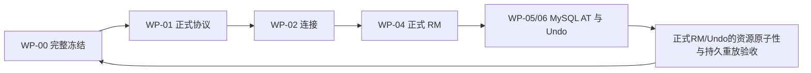
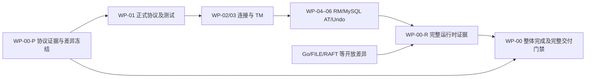

# WP-00 分阶段实施顺序（V2已接受）

状态：**Accepted — V2 applied**。用户于2026-11-13明确回复“批准修订版及首期范围”。已应用V2实施顺序并确认首期allowlist；不代表外部TC风险已接受、P已自动完成、WP-00整体或最终交付通过。下面保留提案背景及原审查记录，当前有效约束以已更新的[验收清单](v1-implementation-acceptance-checklist.md)为准。

## 当前依赖问题

WP-01明确依赖整个WP-00。早期提案形成时，REC-TIMEOUT-008–009还缺真实Undo补偿/持久重放调查；2026-11-13已取得所选参考链路证据，并按原任务完成[调查或明确受阻项](wp00-recovery-investigation-closure.md)，不能继续把调查缺失当作当前事实。

当前实施依赖仍未解除：原any-mismatch任务包含补充差异/合并消息及完整候选覆盖；原FILE/RAFT问题、生产RM/Undo与完整运行时退出条件继续开放。[原语料最新复核](evidence/local-wp00-vector-audit/README.md)只认证29/6，不关闭这些门禁。正式Rust自身的资源原子性、持久幂等与故障验收又需要后续WP-04–06，不能由参考Go业务替代。

箭头表示实施前置依赖向后推进；最后一条闭环使得只增加诊断探针也无法完成生产实现。FILE/RAFT上游恢复缺陷与固定Go差异也不能通过修改原始样例或把诊断标绿消除。

## 已接受的最小调整（V2）

只调整实施顺序，保留原来的完整验收目标：

1. 建立WP-00-P协议冻结子门禁：固定Java/Go提交；逐消息记录已认证字段/字节、明确差异及不支持项；保留原样例和来源哈希；落实已确认的ADR-0003/0007/0008；为目标API列出正常与拒绝测试。
2. WP-01改为依赖WP-00-P，不再等待WP-00全部运行时退出项。可以创建正式Cargo workspace、协议类型及严格编解码，并逐项执行原WP-01验收。新增组件不因为参考实现存在缺陷而获得兼容性豁免。
3. WP-02/03在正式协议验收通过后推进；WP-04–06具备真实资源能力后，对正式Rust重新执行008–009、故障重放与补偿测试；不重复把现有参考链路说成未调查，也不把其通过转记为Rust通过。
4. WP-00-R运行时冻结继续维护全部未通过项：Go失败码/合并缺口、FILE/RAFT恢复异常、真实Undo与持久重放、自然超时、状态/空报告/指标及认证边界。每项仍须修复/适配并取得原要求范围的证据，或通过单独明确评审作出后续决定；本提案不预先批准任何豁免。
5. 只有WP-00-P与WP-00-R的原要求全部满足时，才将WP-00整体标记完成。完整V1/生产交付与Phase4–7仍按原验收，不删除功能、不降低测试要求，不把阶段性可用等同完整兼容。

## 已批准的改动范围

- 在`v1-implementation-acceptance-checklist.md`为WP-00增加P/R子门禁，并仅将WP-01的直接前置改为WP-00-P；保留现有各测试、验收和总体目标。
- 同步`validation-ledger.md`、`wp00-freeze-readiness-audit.md`与`delivery-progress.md`的依赖和状态；未完成项保持开放。
- 以现有Markdown/ADR为规格事实源；不安装工具、不初始化Spec Kit/OpenSpec、不切换分支。正式Cargo组件在用户确认后才按调整后的顺序实施。

该调整曾按项目规则请求明确确认；2026-11-13已收到“批准修订版及首期范围”，授权范围以V2及首期allowlist为准。

## 可审查的具体变更

[修订版待应用补丁](proposals/wp00-protocol-first-v2.patch)及[基线/目标摘要](proposals/wp00-protocol-first-v2.json)增加P/R实施子门禁，将WP-01直接依赖从WP-00改为WP-00-P，并明确修订§7的阶段归属：协议证据、消息allowlist及已接受ADR/错误语义仍是启动前置；恢复风险处置条件由WP-01启动前置移至完整Phase0/WP00退出门禁，原要求逐字保留，仍需满足。批准顺序调整不代表接受外部TC风险。

[首期协议allowlist](proposals/v1-protocol-allowlist.md)给出本次另需确认的实际范围。§7的allowlist项在明确确认前仍未完成；批准旧版依赖补丁本身不能视为额外批准allowlist或外部TC风险。P本身也不自动完成，不把WP-00整体标绿，不减少完整V1或Phase4–7范围。修订补丁已在D盘副本检查和验证，并按明确确认应用到有效清单；原补丁与摘要保留作审查记录。

初版[补丁](proposals/wp00-protocol-first.patch)/[摘要](proposals/wp00-protocol-first.json)保留供追溯；它没有处理§7前置冲突，不能作为完成启动授权的最终版本。本次修订明确补齐该遗漏，不修改已有效的条件。

确认后的首个动作是核对并完成WP-00-P记录，然后在同一仓库创建正式Cargo workspace及seata-protocol组件，按原WP-01做TDD和三方认证。已接受ADR-0003/0007/0008不重复征求确认；其他未接受决策不借本提案视为接受。共享锁保持延期且不计为通过。
