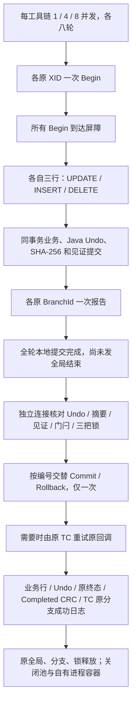

# 正式 AT 双 Rust 并发负载（选定有限矩阵已验证）

对应[并发负载契约](../../at-concurrent-load-contract.md)、原架构 Phase 3 和 WP07。使用原 Java TC commit `cba73e180fd8896a99df6415b859d275122feaa7`（JAR SHA-256 `aef2e8386c97deb78b45c6ad662ad601447def6f5c23537b7d5b1a314654c5d5`）、MySQL 8.4.13 固定镜像及正式 TM/RM/MySQL AT API。生产代码、迁移、依赖及默认功能开关未改变；有变化提交显式启用原实验特性。

六个现场共 208 笔原事务、624 条业务语句和 48 轮同时存续观察。最大选定并发 8 的每轮同时见到八条 Normal Undo、八条对应原 SHA 的提交见证、八个报告门闩和 24 条全局锁。每笔业务在独立行上进行：提交保留 UPDATE/INSERT 并删除目标；回滚恢复 UPDATE/DELETE 原值并删除 INSERT。原 Undo、正式分支终态与日志 Completed 联合验证；Finished 或 TC 查无记录不单独作为成功证明。

原始帧逐笔核对一次 Begin、一次成功登记、一次 PhaseOneDone/成功 ACK、一次指定方向的全局结束；原 TC 回调、原身份、方向、完整资源和响应关联号不变。28 笔初始返回 RollbackRetrying，全部等待原 TC 后续成功回调和物理终态，客户端不重发全局结束。初次四并发试运行因错误要求立即 Rollbacked 失败，原始诊断保留；按既有 TC 重试契约修正测试后完整重跑。未修改生产语义。

| Rust | 并发 | 事务 | 事务/秒 | p50 ms | p95 ms | p99 ms | 初始 RollbackRetrying |
|---|---:|---:|---:|---:|---:|---:|---:|
| 1.99 | 1 | 8 | 0.94 | 994 | 1529 | 1529 | 0 |
| 1.99 | 4 | 32 | 2.24 | 1736 | 2264 | 2266 | 0 |
| 1.99 | 8 | 64 | 2.72 | 2807 | 3168 | 3351 | 13 |
| 1.85 | 1 | 8 | 0.87 | 1102 | 1906 | 1906 | 0 |
| 1.85 | 4 | 32 | 2.14 | 1893 | 2125 | 2128 | 2 |
| 1.85 | 8 | 64 | 3.01 | 2534 | 3173 | 3181 | 13 |

时间从每笔 Begin 前计算，包含有意屏障、独立观察和等待 TC 清理；wall time 还包括本轮关闭。两个工具链的现场并行运行，共享宿主资源，结果用于描述此次受控负载，不能比较工具链性能，也不是生产吞吐、长期容量或 SLA 结论。

独立核验拒绝 120 项证据削弱，包括缺 Begin/结束/登记/报告/回调、错误成功 ACK、反转方向、提前释放屏障、锁不足、物理业务/Undo/终态/TC 不一致、破损日志与缺原 TC 成功日志。每个工具链全工作区 801 passed / 396 ignored（180 个成功摘要），严格 MySQL/可观测性全目标全功能 Clippy 通过。该 ignored 负载函数由本运行器另外显式执行六次，不把忽略计作通过。固定原 JAR、原认证覆盖白名单、实际 DefaultCore 类来源、构建产物、全 crates 源码、容器 ID/镜像/绑定目录/退出状态及原始 SQL/帧均在证据中绑定。

[最终核验](validation_20261128_final)、[机器 ledger](../../at-concurrent-load.json)。此前失败和单级试运行是诊断，最终权威仅为 ledger 绑定的两个全矩阵现场和本轮工作区回归。WP05、完整 WP07、原兼容门槛及 Phase 5–7 继续开放。
