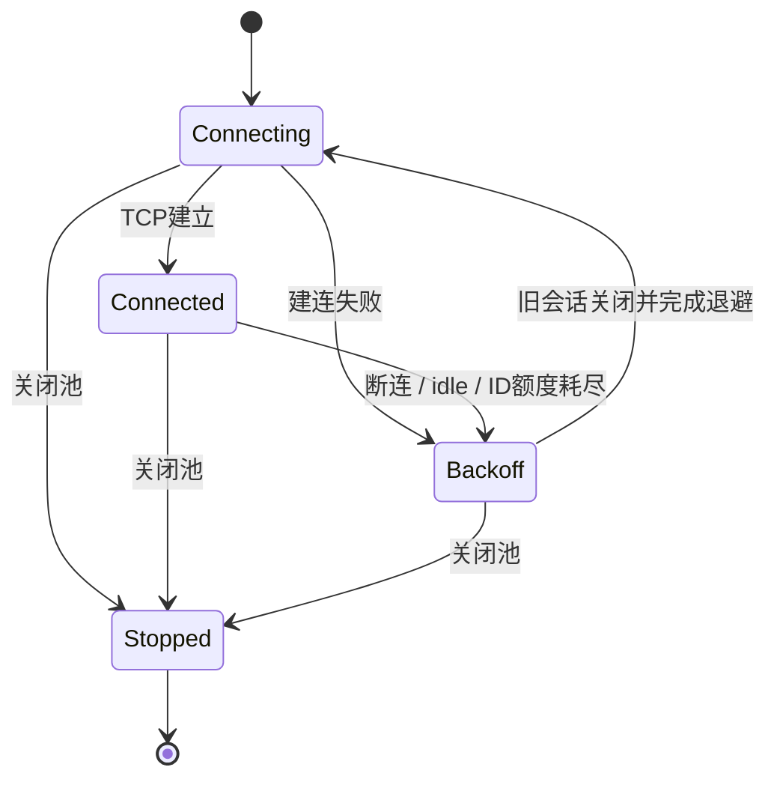
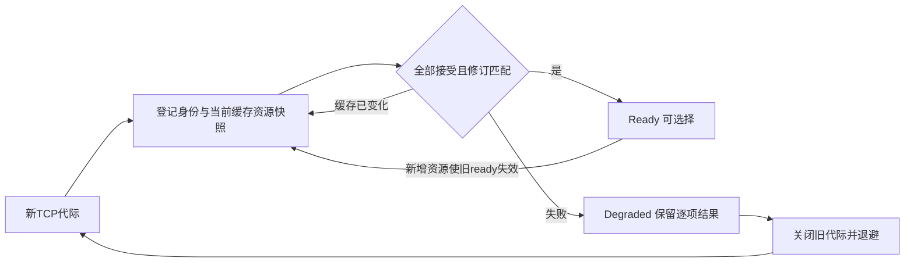
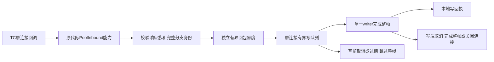

# seata-transport

正式原生V1连接层：增量FrameDecoder、每连接独占的RequestIdAllocator、真实异步TcpConnection、可克隆ConnectionHandle及有界等待表。复用seata-protocol/thiserror，并锁定Tokio1.54.1；最低Rust1.85已实际验证。

FrameDecoder一次只交付一帧，保留调用方切片中的后续帧，只缓存当前残片。协议组件的frame_length负责同一套固定头规则：部分有效头返回None，错误magic/version/长度/能力尽早拒绝，完整有效固定头给出整帧长度；之后才按已验证预算分配正文空间。空片段表示暂无新字节，finish才表示EOF；错误或EOF后必须创建新连接的新解码器。

```rust
use seata_protocol::protocol::RpcMessage;
use seata_transport::{FrameDecoder, TransportError};

fn received(
    decoder: &mut FrameDecoder,
    mut bytes: &[u8],
    mut on_frame: impl FnMut(RpcMessage),
) -> Result<(), TransportError> {
    while !bytes.is_empty() {
        if let Some(frame) = decoder.decode(&mut bytes)? {
            on_frame(frame);
        }
    }
    Ok(())
}
```

RequestIdAllocator按完整Java signed-int线缆位模式发号，可经过正负边界及零。first_id与每连接quota显式提供，quota在1..=2^32。无Clone、无release/reset；同一连接内已分配的编号永不回收，达到额度只返回RequestIdRotationRequired。独立ConnectionGeneration与每个socket的私有等待表隔离旧连接；同一wire ID可在不同连接同时使用，不能跨连接完成。

TcpConnection拥有独立读写任务和有界入站/出站队列。ConnectionConfig显式设置帧预算、最大等待数、建连/单帧写入期限；request单独提供传输期限，不修改载荷中的TC事务期限。普通请求和平面59请求批次可等待完整类型匹配的响应；显式Failed响应仍作为原始RpcMessage返回，供TM/RM解释业务结果。嵌套59仍由协议codec支持，但不是本期关联调用API的形状。

调用先注册等待项，再进入发送队列。首次轮询写入前标记attempted：此前错误为LocalFailureBeforeSend，此后超时/断连为UnknownOutcome。取消同步移除等待项；已开始的帧会写完或关闭socket，不会留下半帧再复用连接。响应、期限和关闭共用一个完成仲裁锁，不跨await；接收方也检查绝对期限，不能因调用者未poll timer就把迟到响应当成功。未知/重复响应只计数，不保存无界响应历史。

显式shutdown等待两个任务；所有者Drop关闭等待表并abort任务。旧handle保持原代际、不能重连迁移。3/4控制心跳与普通pending隔离，可自动回复PING；next_inbound只提供有界的入站请求交付，尚未执行RM业务或提供其回包接口。已连接不等于已认证或资源ready。

[33项连接层测试及封存证据](../../docs/phase-1/evidence/transport-session/README.md)在Rust1.99/最低1.85分别通过：14个真实loopback TCP测试函数、9个unit、10个流/编号集成测试。包含原46条Java认证帧与1000连续帧、真实掉响应/取消/重复/关闭、两个socket同ID、并发signed wrap、批末类型/数量、明确Failed字段保留、写前本地校验及确定性期限仲裁。完整32位空间测试仅模拟已完成2^32-2次发号状态的尾两次，没有实际循环四十亿次。Debug不展示原始帧或请求内容。

后续[定时心跳/读idle门禁](../../docs/phase-1/evidence/transport-heartbeat/README.md)已通过：47项在Rust1.99/最低1.85分别通过，其中22个真实TCP函数；4项隔离行为变异控制均被实际运行断言拦截。上一节33项是此前单会话检查点，保留原范围和证据。

`ConnectionIdleConfig::new(writer_idle,reader_idle)`显式配置正数且read>write的间隔；`ConnectionConfig::with_idle`开启，省略则保持原调用无定时心跳/idle。现有writer在没有完整帧写出的writer_idle窗口后发送空原生V1 PING3，复用同一ID空间但不占pending；普通写与PONG4写会刷新窗口，跳过已取消队列项不会刷新。成功PING重新从当前时间计时，无追赶burst。reader在完整有效帧到来时刷新reader_idle，部分TCP字节不刷新，过期以ReadIdleTimeout关闭并按每项write marker清理；PONG并不表示认证/资源ready。

后续[raw连接池/重连门禁](../../docs/phase-1/evidence/transport-pool/README.md)通过：62项在Rust1.99/最低1.85分别通过（31真实TCP函数、19unit、10stream、2config），5项隔离行为变异控制触发实际断言。之前的33/47项为历史检查点。

ConnectionPool所有者维护固定单端点槽位与有界入站队列，PoolHandle轮转复用开放通道，获取不会新增socket或独占租赁。每个槽位只有一个监督器，先撤回旧句柄并join会话，再按ReconnectPolicy正指数退避建立新代际；短暂连通不重置退避，达到稳定窗口才重置。ID额度耗尽会关闭旧代际并返回原本地错误，不替失败请求重发。获取、锁等待和单次发送使用同一个绝对deadline。



PoolInbound保留原代际句柄与消息；队列满会关闭该会话而不是静默丢弃回调。显式shutdown关闭通道、停止获取/重连并join监督器；owner Drop同步关闭池状态与当前代际，再abort任务。PoolHandle.request只调用一个通道一次，不隐式重试任何业务错误。

Connected仅代表raw TCP。认证/每新会话RM重新注册、业务回包分发与恢复协调尚未实现；本层不持久保存XID/BranchId，不等同WP-02完整门禁或NET-008–012业务验收。发现地址/TLS/抖动及生产调优保持后续WP-07范围，协议peer门禁仍按seata-protocol包隔离74项计数。

后续[原生会话登记门禁](../../docs/phase-1/evidence/session-registration/README.md)已验证每新会话的身份/缓存资源登记：76测试在Rust1.99/最低1.85分别通过，固定原JavaTC＋公共认证SPI fixture六个现场用例通过。上一段的62项及“尚未实现登记”保留其历史检查点范围；当前只有业务回包分发/事务恢复及生产认证策略等后续工作未完成。

`ConnectionPool::start_registered(config, registration)`启用单角色策略，`SessionRegistration::tm`发送101，`SessionRegistration::rm`逐typed资源发送103。非空RM缓存的首资源请求同时承担身份登记，两份报告视图对应同一个wire attempt；不强加额外空资源身份请求。空缓存才发送RM(None)，合法TC策略可以拒绝。成功必须是原生`identified=true`，不能用普通事务ResultCode代替；整轮登记共享绝对期限。



ResourceRegistry按(BranchType,精确resource_id)有界缓存、幂等insert和checked修订。新增资源立即使旧ready记录不再被选择，监督器重新登记同一活会话；每次重连都从完整当前集合开始。ResourceKey拒绝空ID/ASCII逗号，防止Java资源列表拆分器把一个ID变成多个；协议载荷codec本身仍支持完整Java多资源字符串。资源删除和持久分支完成记录留在RM生命周期工作。

每槽位保存完整SessionRegistrationReport，区分NotAttempted/Accepted/Rejected/LocalFailureBeforeSend/UnknownOutcome，首失败后的资源不假装成功。Registering/Degraded不会用于池业务请求；低层acquire返回的ConnectionHandle只是原代际运输句柄，不能当作永不失效的ready凭证。ConnectionHandle.close只关闭本代际以触发受监督轮换，不重发事务。

原生登记确认代表配置的TC hook接受了该请求；不等同生产认证/TLS或RM补偿可用。身份/资源Debug隐藏字段内容，但原JavaTC可能记录extraData（JAVA-AUTH-EXTRADATA-001仍开放）；现场只使用既有公共fixture凭据。NET008/009登记组件已验证，NET010–012事务协调、业务回包和完整WP02/V1仍未完成。

后续[响应回包与NET001–012组合验收](../../docs/phase-1/evidence/transport-recovery/README.md)完成87项正式transport测试及另3项联调辅助测试，在Rust1.99/最低1.85分别通过。新7个真实TCP回包测试、关闭/完整写仲裁、部分写取消、无运行时写前失败都有实际断言；14隔离行为负控及13Python观察器测试通过。上述76项及未完成回包的表述保留其历史检查点含义。

`PoolInbound::respond(self, body, timeout)`消费一次原入站能力；直接会话的`TcpConnection::next_request`返回相同能力。回包保留原signed ID、有序nullable头及精确分支身份，平面批次逐项验证。旧回调永远不向池取得替换连接；独立回包额度允许普通请求等待表已满时仍处理回调，同wire ID不会互相完成。完整本地写完才返回成功，不能当作TC或业务确认。



关闭与写成功通过同一代际锁仲裁；无Tokio上下文在入队前返回Local。写前过期/取消不能写出，已开始的写入不因调用future取消而遗留可复用的半帧；会话关闭保留Unknown分类。显式关闭、worker/队列释放都只完成一次回执，不占普通pending表。

固定原JavaTC的新六登记用例和三个Begin/Commit/BranchRegister成功响应丢失用例通过。NET010的实际Finished15/15保留提交未知，NET011不盲目再次Begin，NET012仅从真实匹配回调学习原BranchId；没有运输层自动事务重放。分支动作仅内存模拟，生产TM/RM、持久幂等、MySQL补偿和完整V1仍须后续完成。共享锁继续延期、外部TC风险未接受、原Go默认兼容/WP00-R仍开放。
