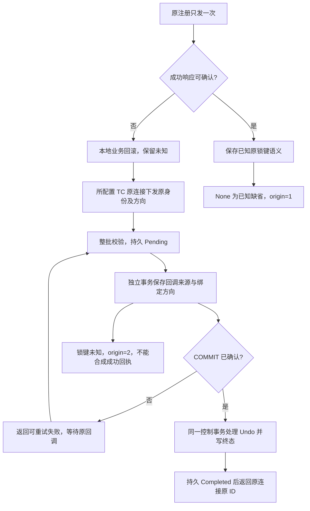

# 注册未知后的回调归属交接

沿用 [WP05 增量契约](../../mysql-callback-ownership-contract.md)和 ADR-0008。[对象映射](../../mysql-callback-ownership-file-map.csv)保留三个原 Java 对象的 PARTIAL 状态；本步不是完整 Java 对象或 JUnit 迁移完成证明。

## 当前有效证据

最终目录：[run_20261117_145639_40c3447e](run_20261117_145639_40c3447e/result.json)。catalog SHA256：

```text
07435a2698a06f42ed3e9e28c70ca007dbdc915476f9b138ec1114b24bed5db6
```

11983 个源输入、12188 个封存成员。消费的六个现场包由根目录 `explicit-packets.json` 精确指定，逐个核对完整 catalog、当前源、实际运行程序及原报文，不通过最新目录推断角色。早期失败与中间通过包均保留，不能替代该最终当前源集合。相同内容可共用经摘要核验的硬链接；最终检查均在本次执行。

| 检查 | Rust 1.99 | Rust 1.85 |
|---|---:|---:|
| 普通测试实际通过 | 339 | 339 |
| 实际测试程序 | 68 | 68 |
| 外部不能构造两种回执的文档测试 | 2 | 2 |
| 自有数据库 native 检查，含 11 项旧回滚回归 | 18 | 18 |
| 来源登记 COMMIT 原包故障：阻断／丢确认／延迟确认 | 3 | 3 |
| 固定原 Java TC＋正式 TM/RM＋实际 MySQL | 1 | 1 |
| 实际数据库执行合计 | 22 | 22 |
| 实际编译的 registry 依赖 | 150 | 150 |

fmt、全目标／全 features Clippy、文档及完整测试通过；185 个 registry 候选版本保持原锁定集合。每套工具链另实际运行旧读取器拒绝一次、当前数据库恢复子进程两次；原 RM 的六个进程恢复子进程回归保持。没有执行原 Java JUnit；本步新编译的是自有精确资源认证夹具。

## 已验证的行为



- 不公开构造的回调能力仅由整批校验后的正式网络回调入口产生；公共手工 dispatch 不能登记未知分支。取消观察器时，资源动作尚未发生且 Pending 已持久化。
- 回调先到时，迟到的真实成功回执返回 `CallbackObserved`；同连接的另一个正常 None 回执可重复登记为 origin=1。两者数据库中的锁键都是 NULL，但来源和可继续操作的含义不同。
- 旧 11 列表仍支持已登记分支；缺行的回调要求显式迁移 002。迁移保留旧行全部 11 个字段及微秒时间；实际封存旧程序拒绝扩展形状并保留 Pending，当前子进程随后恢复。异常来源／版本／方向／终态／锁键知识和默认值均拒绝。
- 三种来源登记 COMMIT 故障都保留 Pending；独立数据库观察确认阻断时没有登记行，丢／延迟成功响应时已有来源但没有终态及 Undo 围栏。原回调重试完成，未重发 BranchRegister 或重放业务。
- 两次实际原 Java TC 运行分别将真实成功 BranchRegisterResponse 原包丢弃，随后通过原回调学习真实分支号。原 TC 类加载来自固定 JAR；新认证夹具只接收当前实例的单个完整 JDBC 资源名，并委托已封存身份夹具校验身份与凭据。生产认证／TLS 未因此认证。

本次注册未知场景中，调用方收到未知结果后主动回滚本地事务。

原始 MySQL 与 Java 包、同连接 ID、AT 类型、None 应用数据、完整身份、原 BEGIN／COMMIT／ACK、实际超过期限的迟到 ACK、文件 CRC 及 Pending→Completed、数据库事实均独立绑定。118 项原包负控（每版 14＋14＋16＋15）和 6 项角色负控均被拒绝。

## 迁移及范围

只在自有夹具数据库执行了迁移。部署前先停止旧 RM 写入器，再显式执行 002 并启用新版本；原 version=1 行保持原值，新增来源列默认 1。不承诺混合版本写入，不提供删列或清数据回退。

[全部尝试的运行环境审计](../mysql-callback-ownership/all-attempt-runtime-audit-final-20261117.json)实际确认 27 个已记录自有数据库容器不存在、8 组已记录 Java 运行停止，全部 D 盘数据现场保留。根包另核对最终六个数据库容器不存在。

公开一阶段业务 COMMIT、业务／Undo 原子提交、所有旧一阶段尝试围栏、提交方向、原 TC 锁覆盖、完整 WP05／WP06／V1、完整原 Java 对象／测试／资产迁移、生产 TLS／多节点及 GC 仍 OPEN。外部 TC 风险没有被接受，共享锁问题继续按用户决定暂缓。下一步推进一阶段事务准备与 TC 锁覆盖缺口处理，保持公开 COMMIT 门禁。
