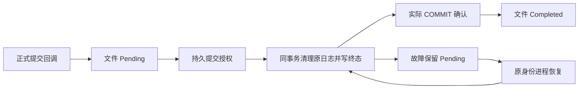

# WP05：正式提交回调的持久清理验收

本组件已验证：正式 TC 提交回调持久授权后，原 root／子片清理与提交终态在同一控制事务完成；实际 COMMIT 确认后才发布完成。业务值不变。公开一阶段业务 COMMIT、完整异步批调度、完整 WP05／WP06／V1 继续 OPEN。

沿用 [WP05](../../wp05-mysql-at-plan.md)、[契约](../../mysql-commit-direction-contract.md)和 [Java 文件映射](../../mysql-commit-direction-file-map.csv)。首期范围包含显式003迁移、原身份保护、重复／并发回调、真实锁等待／取消／期限、权限回滚及实际进程恢复。

| Rust | 普通测试 | 实际 harness | 文档测试 | 本轮 DB 执行 |
|---|---:|---:|---:|---:|
| 1.99 | 339 | 77 | 4 | 53 |
| 1.85 | 339 | 77 | 4 | 53 |

每版资格化的53次 DB 执行由12项新增 native、8项提交前仲裁、10项准备、18项回调／受管理回归、4种故障及1个固定原 Java TC 场景组成；新增 native 具有38个具体观察。native 的受控 TCP 对端与真实 Java TC 场景分别记录。四种故障为提交请求阻断、确认丢失、确认延迟和终态语句阻断，均由实际数据库、原报文、文件日志和独立子进程核验。权限场景保留 MySQL 预编译事件的空 SQL_TEXT，以实际 DELETE 计数、同线程先后事件及回滚／恢复事实验收，不冒称提供该场景的原包 SQL 文本。

双版累计 244 项原包／日志反例、10 项角色反例及 574 项必需成员缺失反例均拒绝。185个依赖候选与150个实际编译依赖保持原固定闭包；fmt、Clippy警告即错误、文档警告即错误及完整测试通过。固定原 JAR 和原 Java TC 已运行，新编译内容为认证测试夹具；原 JUnit 尚未执行。一次1.85终态阻断测试虽通过数据库断言，但授权ACK转发后的记账时间戳与下一COMMIT接收出现倒序，被原有严格报文验收拒绝；未放宽检查，仅重跑该角色，拒绝原包与退出记录保留且不计入通过数量。

14列恢复表须先停旧写入器再显式迁移；原七列 Undo 不变，旧行版本及原字段保留，新读取器继续兼容11／12列。14列的旧 phase1 行仍须新正式提交回调授权。真实旧程序拒绝扩展表且不修改 Pending；原回滚路径仍受回归验证。完整 AsyncWorker 队列／批调度、189份原Java测试源码及1135个静态测试方法声明的完整迁移仍未完成。

原 TC 排他锁覆盖风险未接受，共享锁按用户要求暂缓；业务提交未知恢复、任意旧尝试围栏、生产认证／TLS、多节点和 GC 仍未验收。本轮隔离夹具通过不关闭这些门槛。

证据根：[run_20261117_235911_9cb6c3df](run_20261117_235911_9cb6c3df/result.json)，catalog SHA-256 `d4b415c88e994de03ae546968c9343594728663617132f1b5038bc499bccdc98`；24067个输入、24293个成员。[独立只读审查](readonly-review-20261117.json)无未解决P1/P2。[全部记录尝试的运行审计](../mysql-commit-direction/all-attempt-runtime-audit-20261117.json)确认40个数据库容器不存在、3组Java运行停止，D盘现场保留；只读状态查询的额外诊断容器另有独立退出审计，不计资格化实例。[机器状态](../../wp05-mysql-commit-direction.json)保留全部开放项。
