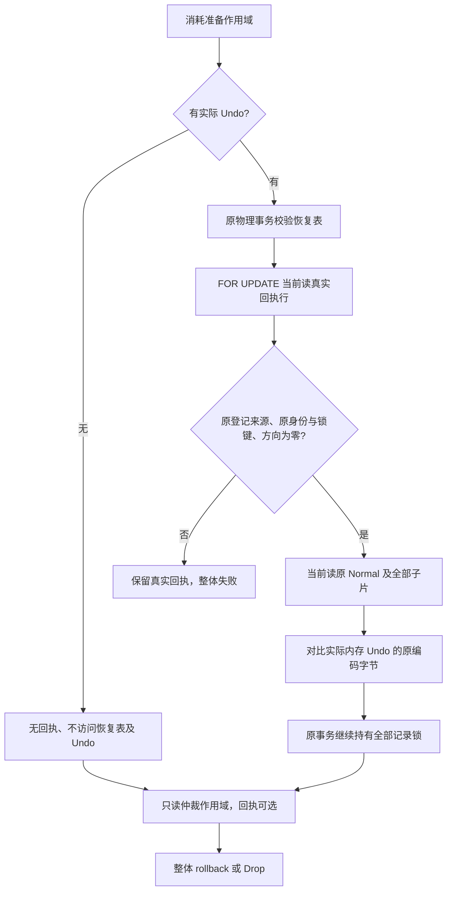

# 原业务事务提交前仲裁

沿用 [WP05 仲裁契约](../../mysql-commit-preconditions-contract.md)、[对象映射](../../mysql-commit-preconditions-file-map.csv)及 ADR-0008。[最终根包](run_20261117_174713_97b962fb/result.json)只认证本提交前组件，完整原 Java 对象仍 PARTIAL。

## 本次执行

catalog SHA256：

```text
6e8267381250dba51f680a162287cf7dbd62b32b46f40cc23bf085ce375b708d
```

12008 个当前输入、12224 个封存成员；8 个现场角色由显式 manifest 和各自 catalog 摘要绑定，不根据目录时间选择结果。

| 实际检查 | Rust 1.99 | Rust 1.85 |
|---|---:|---:|
| 普通测试通过 | 339 | 339 |
| 实际测试程序 | 73 | 73 |
| 文档测试 | 4 | 4 |
| 提交前仲裁 native 测试 | 8 | 8 |
| native 具体观测 | 21 | 21 |
| 原事务准备回归 | 10 | 10 |
| 回调归属／受管理回滚回归 | 18 | 18 |
| 固定原 Java TC＋正式 TM/RM＋MySQL | 1 | 1 |
| 数据库执行合计 | 37 | 37 |
| 实际编译 registry 依赖 | 150 | 150 |

fmt、全 workspace／全目标／全 features Clippy、文档构建及测试全部通过。185 个 registry 候选保持原版本；未安装或升级依赖。每版另执行六个既有 RM 文件恢复子进程；回调回归包含实际旧读取器拒绝与当前 MySQL 子进程恢复。原 Java JUnit 未执行；新编译的是精确资源认证夹具。

## 原事务与锁



`lock_commit_preconditions` 不借独立控制连接。独立 MySQL 引擎查询实际观察到业务、Undo、恢复行三组 RECORD 锁共用一个 ENGINE_TRANSACTION_ID 和 THREAD_ID，并从线程表取得实际 PROCESSLIST_ID；另一事务实际等待恢复行，只有原作用域整体回滚后才能修改。普通独立读始终看不到业务与 Normal Undo，最终两者均为零。

八项 native 测试的 21 个具体观测为：原事务持锁 1；缺行、两方向、终态、应用数据／资源／JDBC／锁键／来源／schema 拒绝 10；实际锁等待期限／取消 2；已仲裁 Drop／未轮询检查 Future Drop 2；空事务／零行 DML 2；原 11 列／迁移后 version1 行 2；正式 RM 接收的受控 TCP 回调两种先后顺序 2。

所有关键状态使用锁定当前读取；Normal root／子片、精确原身份、上下文、孤儿片和有界正文沿用既有读取器，再与原作用域编码逐字节核对。没有新迁移、业务／Undo／恢复行修改或自行 COMMIT。无实际变化案例实际暂时移走日志／恢复两张表，仍不注册、不访问它们；检查结束后仅由自有夹具恢复表名。

native 场景使用受控 TCP 发送原协议回调，区别于下文原 Java TC 现场。准备阶段的业务／Undo 锁与回调的恢复行→Undo 锁可能形成死锁环。契约允许数据库选择受害者，但失败必须消耗整个事务，不能重试原业务或返回仲裁成功。回调先持久绑定 phase=2 后，测试只允许原 RecoveryConflict 或 MySQL 1213，本地不能得到成功作用域；随后原回调仍沿同一身份收敛。反向顺序实际观察回调等待原恢复行锁，直到本地回滚。

期限案例使用 1.5 秒预算并要求实际记录锁等待、返回小于 2 秒且保留真实 BranchId；取消、失败或丢弃不留下可继续写入的旧作用域。入口期限不限制成功对象的持有时长，调用方仍须及时结束持锁作用域。并发改表时原旧事务实际产生 MySQL 1412，精确拒绝，不笼统接受任意驱动错误。

## 原 TC 与证据约束

两版各启动一次固定原 Java TC，实际成功 BranchId 进入提交前仲裁作用域；本地先回滚，再由正式 TM 结束全局事务，原 RM 回调完成 Guard／终态及文件 Completed。原 JAR／类加载、精确资源 SPI、原帧、原文件 CRC 与独立数据库事实全部核对。这里只认证所配置原对端的实际场景，不认证生产 TLS／认证或 TC 的完整锁覆盖。

30 项原 Java 报文／文件副本负控、6 项角色负控及 106 项必需成员缺失负控均拒绝。最终只读审查发现的验收器 P2 已修复：角色观察、Java 原帧／原 journal／认证 class／加载日志等实际消费文件必须属于各自 catalog；测试摘要还须匹配实际执行日志，并绑定恰好一个指定测试程序构建记录。106 项负控逐一移除真实包中的必需成员，不执行额外数据库测试。

新增 API 的 E0599 仅作为编译 RED。早期夹具事务控制协议及重试响应预期修正、1412 精确诊断包均保留，不把这些夹具诊断称为生产逻辑运行 RED→GREEN。

[前序准备根包](../mysql-first-phase-preparation-gate/README.md)的原 MySQL 报文和三种独立登记 COMMIT 故障为继承证据，本次没有重跑，未计入上述 30 项或 37 次。首个仲裁聚合尝试因验收器 P2 在执行 Cargo／数据库前停止，空目录保留且没有 catalog，不作为成功证据。

## 现场与剩余工作

[全部尝试运行审计](../mysql-commit-preconditions/all-attempt-runtime-audit-20261117.json)独立确认 12 个已记录自有数据库容器不存在、2 组 Java 运行已停止；根包另确认最终八个实例不存在。D 盘数据库数据全部保留，已停普通文件的透明压缩前后摘要一致，重解析／socket 对象排除。迁移、压缩已停用编译缓存用于腾出磁盘空间，不作为业务验证。

当前完成提交前仲裁组件。公开业务 COMMIT、业务／Undo 原子提交及未知提交恢复、任意旧一阶段尝试围栏、二阶段提交方向、原 TC 排他锁覆盖、完整 WP05／WP06／V1、完整 Java 源／JUnit／资产迁移、生产 TLS／多节点与 GC 仍 OPEN。外部 TC 风险未接受；共享锁继续按用户决定暂缓。后续推进二阶段提交方向及完整提交链路所需门槛，不以本组件代替完整 V1。
