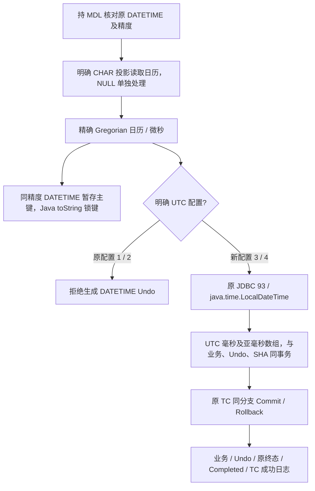

# MySQL DATETIME：显式 UTC、原 Java Undo 与正式 AT

对应[契约](../../mysql-datetime-contract.md)和原架构 9.3。新增有界 `LocalDateTime` 日历值、独立列域/原生身份、0–6 位精度、主键暂存/Java 锁键及真实补偿；没有新增依赖或迁移。SQL 语法和默认有变化提交开关保持原状态。

固定原 Java `cba73e180fd8896a99df6415b859d275122feaa7` 的选定 18 个源码和独立对照类重新编译，依赖使用封存的 Connector/J 8.0.27、Jackson 2.18.3。原驱动现场为 JDBC 93 / `java.time.LocalDateTime`。原 parser 明确 `setZoneOffset(UTC)`；Rust 不猜 Java JVM 时区。实际类加载来源、原 TC JAR、认证覆盖白名单、全部输入和构建产物均保留哈希绑定；不是完整 Java 模块重新构建。

使用 `MySqlJdbcProfile::Connector8DefaultUtc` 或 `Connector8NumericTinyIntUtc`，持久编号为 3/4。旧 1/2 编号、Boolean/数字 TINYINT 语义及旧记录保持。所有共享写入器和 RM 须采用同一序列化约定；按原规则排空旧分支后再切换配置。错误旧配置读取新尝试或恢复原分支均被实际数据库身份核对拒绝，原 phase 仍为 0，Normal Undo、见证及六条全局锁保留。

日历转换按 Gregorian 400 年周期计算，与 `LocalDateTime#ofEpochSecond` / `toEpochSecond(UTC)` 对照，不依赖宿主时区。每个工具链逐日验证 1000–9999 全部 3,287,182 个合法日期的纪元逆变换；另测闰年、无效日历、负纪元、极端输入和亚微秒拒绝。实际数据库使用明确字符投影，避开 SQLx 将零日期解释为 NULL 的行为；投影类型、长度预算和字段日历分别核对。DATETIME 采用固定 26 字节日历上界参与镜像预算。普通 SQL 赋值的数据库量化由真实 after image 记录。

两个 Rust 版本、两种 UTC 配置、Commit/Rollback 共八笔原事务。每笔先对九行日期表和两行日期主键表生成三类镜像，Rust 完整 Undo 对象图与原 Java 输出一致。覆盖全部 0–6 精度、1000/9999 边界、1582 年、1900/2000 闰年、1969.999999 与 1970 纪元。每笔再执行六条真实业务 SQL，包含两表的 UPDATE/INSERT/DELETE，日期主键经过原暂存、登记、回调和补偿；逐原 XID/BranchId 核对一次 Begin/登记/报告/结束、完整锁键、持久配置、SHA、原业务与日期主键、Undo 删除/围栏和 Completed CRC。原 TC 原分支成功日志与独立 SQL 联合证明，Finished 不单独作结果。

非法日期实际返回 MySQL 1292，后续执行 Poisoned；自有夹具按原服务器方式存入零日期，再由正式镜像路径明确拒绝，未转成 SQL NULL。源码反例分别放开 UTC 约束、错误截断负纪元、放开亚微秒和破坏 Java 主键秒省略规则；双工具链八次均命中目标断言，源文件恢复后重新绑定执行。

八笔 DATETIME 的 160 项证据削弱拒绝。共享代码的四笔 JSON 原 TC 回归和 64 笔普通 AT 并发回归另拒绝 62/40 项削弱。每版本全工作区 808 passed / 398 ignored、184 个摘要；受影响 MySQL、AT、数据源及可观测性全目标全功能严格 Clippy 通过。ignored 原生函数由运行器另行显式执行，不把忽略当通过。修复前真实 `Unsupported column type`、单笔试运行及构建诊断均保留。

[最终核验](validation_20261128_final) · [ledger](../../wp05-mysql-datetime.json)。为保留磁盘空间，已停止的修复前/单笔诊断夹具普通数据文件转存 D 盘，逐文件 SHA-256 核对；原运行路径仍为历史挂载事实，实际保留位置及原位置保留的运行时 socket 节点见[转存清单](data-retention-relocation_20261128.json)。正式八笔矩阵数据未移动。

本项只认证上述 DATETIME / UTC / 默认 Jackson 配置。DATE、TIME、TIMESTAMP、其他时区与序列化组合继续实施；完整 WP05、生产和 Phase 5–7 仍开放。
