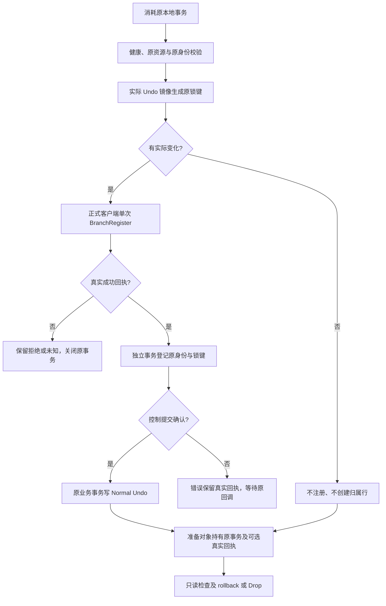

# 一阶段事务准备交接

本组件延续 [WP05 准备契约](../../mysql-first-phase-preparation-contract.md)及 ADR-0008。[对象映射](../../mysql-first-phase-preparation-file-map.csv)保留原 Java 对象的 PARTIAL 状态；原完整对象、JUnit 和资产迁移仍未完成。

## 当前证据

[最终根包](run_20261117_165622_ee38f20f/result.json)的 catalog SHA256：

```text
2d705af619ab9bd0ea68eb3c22ed2eaffc10f2f68086dc313a735a188facba03
```

11994 个源输入、12205 个封存成员。14 个现场包通过 `explicit-packets.json` 精确绑定角色与工具链，全部成员、当前源、实际程序和原报文逐项核对。内容完全相同的存储字节可共享经摘要核验的硬链接，旧结果不代替本次执行。

| 本次检查 | Rust 1.99 | Rust 1.85 |
|---|---:|---:|
| 普通测试实际通过 | 339 | 339 |
| 实际测试程序 | 71 | 71 |
| 文档测试 | 3 | 3 |
| 准备接口 native 测试 | 10 | 10 |
| 旧回调归属／受管理回滚回归 | 18 | 18 |
| 原 MySQL 报文同事务检查 | 1 | 1 |
| 原登记 COMMIT 阻断／丢确认／延迟确认 | 3 | 3 |
| 固定原 Java TC＋正式 TM/RM＋实际 MySQL | 1 | 1 |
| 实际数据库执行合计 | 33 | 33 |
| 实际编译的 registry 依赖 | 150 | 150 |

fmt、全目标／全 features Clippy、文档及完整测试通过。185 个 registry 候选保持原版本，未安装或升级依赖。三项文档测试验证两类回执不能由外部构造，以及准备对象没有可直接调用的 COMMIT。每套工具链仍执行六个原 RM 恢复子进程；回调回归另执行实际旧读取器拒绝和当前数据库恢复子进程。原 Java JUnit 没有执行；本次新编译的是自有精确资源认证夹具。

## 实现及失败边界



- `prepare_transaction` 消耗原作用域；准备结果不能解封事务或执行业务 COMMIT。失败、取消和未轮询 Future 的丢弃都会释放原作用域，禁止取回继续写入。
- 资源名在本地事务中以可选记录保存，新增准备接口要求精确绑定；原低层 begin 不因新增 JDBC 名称渲染而增加失败路径。锁键、原 Undo、归属记录共用管理器固定的 JDBC 配置。
- 空作用域和零行 DML 不申请分支。非法 XID／可选数据、错资源、poison 及已低层封存状态在网络申请之前拒绝。明确 TC 拒绝和响应未知保持原分类，均不补造回执或重新申请编号。
- 真实成功回执在独立登记及原 Undo 写入之前保存；登记期限／提交未知、Undo 失败及 Guard 竞争发生后，错误仍能借用该回执。外层期限与更具体的控制期限错误保留各自分类，不把注册已知说成注册未知。
- 实际锁等待覆盖归属表与 Undo 唯一键，分别验证取消和 1.5 秒绝对期限；四项观测都有实际 data_lock_waits，期限返回保留原 BranchId，耗时小于 2 秒。没有通过延长各阶段预算取得成功。
- 早到真实回调使迟到一阶段交接被 CallbackObserved 拒绝。Normal 写入与已有 Guard 冲突时，原事务回滚，真实回执与独立归属行保留供原回调处理。

## 原报文及真实 TC

原 MySQL 报文独立证明：内部临时键表 CREATE／INSERT／DROP、业务写入和 Normal Undo 共用原 BEGIN／ROLLBACK；登记使用另一个物理连接，其 COMMIT 确认早于 Undo 写入。原七列 Undo 的身份、上下文、Java 集合类型标签、完整本案例 before／after 镜像均从原绑定字节核对。独立脏读仅用于证明未提交写入确实发生，最终正常隔离观察者确认业务／Undo 已回滚而归属行保留。

内部临时 DDL 不被称为可回滚。依据 [MySQL 8.4 的隐式提交规则](https://dev.mysql.com/doc/refman/8.4/en/implicit-commit.html)和[原错误定义](https://dev.mysql.com/doc/mysql-errors/8.4/en/server-error-reference.html)，该固定案例的原 ROLLBACK 带有两条临时表警告；另一原 mysql 客户端独立复现 1751／1752。校验同时要求临时表生命周期完整、各原语句 ACK 的 IN_TRANS 标志、精确的两条警告及最终业务／Undo 行数，不忽略任意 warnings。

三种登记 COMMIT 故障都发生在原成功分支回执之后：准备失败且未写入 Normal Undo；阻断时归属未提交，原回调创建 origin=2；丢／延迟确认时 origin=1 已持久存在。回调归属确认必须早于 Guard／终态事务的 BEGIN，独立跨连接负控覆盖该先后关系。

两套工具链各启动一次固定原 Java TC；真实成功回执与原回调的分支号、原 XID／资源／AT 类型／None 应用数据一致。调用方准备后先主动回滚本地事务，再由 TM 发起全局回滚，原回调完成 Guard／终态和持久 Completed。原 JAR／核心类加载来源、原 TM/RM 报文和文件 CRC 均核对；新认证夹具只允许本实例的单个完整 JDBC 资源名，身份仍委托原封存夹具，生产认证／TLS 未因此认证。

172 项原包负控均拒绝：每版原准备事务 19 项、登记提交故障 17／17／18 项、原 Java TC 15 项；另有 6 项角色负控。初始缺少 API 的 E0599 是编译 RED，明确不称为运行 RED；另保留了具体控制期限分类的真实失败诊断包。

## 现场保留与剩余工作

[全部尝试审计](../mysql-first-phase-preparation/all-attempt-runtime-audit-20261117.json)独立确认 26 个已记录自有容器不存在、3 组已记录 Java 运行停止；根包另确认最终 14 个数据库容器不存在。全部 D 盘数据库现场保留；只对已停自有普通数据文件进行透明压缩，前后内容摘要一致，运行时 socket 等重解析对象未处理。已停用编译缓存的移动／透明压缩不作为数据库业务验证。

当前完成的是未提交的一阶段准备交接。公开业务 COMMIT、业务／Undo 原子提交及未知提交恢复、所有旧一阶段尝试围栏、提交方向、原 TC 锁覆盖、完整 WP05／WP06／V1、完整原 Java 对象／测试／资产、生产 TLS／多节点和 GC 仍 OPEN。外部 TC 风险未接受，共享锁按用户决定继续暂缓；后续推进提交前仲裁、提交方向与 TC 排他锁覆盖问题。
