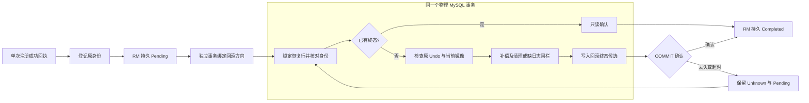

# 受管理 MySQL RM 回滚恢复验收

2026-11-17：本步限定范围通过。规格事实源为既有 [WP05 计划](../../wp05-mysql-at-plan.md)、[恢复契约](../../mysql-rm-recovery-contract.md)及 ADR-0008；未初始化其他规格体系。完整 WP05、WP06 和 V1 继续 OPEN。

已接通单次注册成功回执、独立版本恢复表、不可逆方向绑定，以及同物理事务内的补偿、原 Undo 清理/缺日志围栏和回滚终态。重复调用先读持久终态；没有终态时，锁内证明本适配器尚未提交补偿，再执行原 Undo 的检查与收敛。不会返回 NotApplied 或重放原业务 SQL。取消留下 Pending 后，由独立进程打开真实文件日志完成恢复。

修复了原围栏查找中的身份缺口：不区分大小写/重音的 MySQL 比较命中，不能替代 XID 字节及 BranchId 核对。真实 RED 已重现错误 Applied；最终双版本大小写/重音测试均保持 Unknown、无错误终态。

| 实际验证 | Rust 1.99 | Rust 1.85 |
|---|---:|---:|
| 普通测试（330 lib/integration + 6 既有 example） | 336 | 336 |
| 实际测试产物 / 文档测试 | 64 / 1 | 64 / 1 |
| 数据库执行次数 / 不同测试角色 | 38 / 36 | 38 / 36 |
| 新 MySQL 恢复子进程 / 既有 RM 子进程 | 1 / 6 | 1 / 6 |
| 实际编译的 registry 包 / 候选包 | 150 / 185 | 150 / 185 |

每版本使用 8 个独立自有 MySQL 8.4.13 库：11 项恢复主套件、三种 COMMIT 故障各一项、权限拒绝和并发争锁各重跑一项、既有围栏 9 项、既有 Normal 补偿 13 项。两项重跑已有主套件覆盖，因此是 38 次执行、36 种角色。两版本的 fmt、完整 Clippy、文档生成与测试通过，实际 rustc 和 Clippy 版本相符。

原始报文验证补偿、Undo 删除、终态更新、同连接 BEGIN/事务状态、实际成功响应和 COMMIT 确认。中途 BEGIN/ROLLBACK、预编译 COMMIT、遗漏命令、截断/缺失确认及伪造故障标签等 92 个错误副本全部拒绝，另 6 个角色反例拒绝。延迟确认场景中取消后排队的清理 ROLLBACK 只能位于唯一 COMMIT 之后。

正式聚合：[结果](run_20261117_125220_94d33cc1/result.json)、[完整目录](run_20261117_125220_94d33cc1/catalog.json)、[显式现场清单](run_20261117_125220_94d33cc1/explicit-packets.json)。目录 SHA-256：`76eb459a59986e96d29fc51cfa21d4029f9b969014f6f76326f3b69b5a9310e5`；7378 个当前源输入、7585 个成员。

[独立复核](readonly-review-20261117.json)确认本范围无未解决 P1/P2。[全部尝试审计](all-attempt-runtime-audit-20261117.json)实际确认本组件 53 个历史记录容器均不存在；4 次建库前快照失败已转存 D 盘，所有 D 盘数据库目录保留。重复快照仅对字节相同的数据使用硬链接，成员摘要不变。

兼容边界：原七列 Undo schema 与原低层注册签名保持；新增接口、错误类型及 `DbError::RecoveryConflict` 变体，下游穷举错误匹配需要覆盖该分支。新恢复表只通过[显式迁移](../../../../crates/seata_db_mysql/migrations/001_seata_rs_at_branch_v1.sql)创建，生产连接不自动建表、授权、回填或清理历史。

本轮注册现场使用受控 TCP 对端；原 Java 的 24 项方法观察仅继承既有证据，未重跑 Java JUnit 或 Java TC＋SQL 端到端。单主机 JDBC 资源标识、Loopback 非 TLS 和当前类型/JDBC 配置属于本次范围，未认证全部 JDBC URL、历史有损 TINYINT 日志、复制切换或生产 TLS。

公开一阶段业务 COMMIT、提交方向、所有旧一阶段尝试围栏、注册响应丢失后的完整业务交接、TC 安全、完整 Java 对象/测试/资产迁移均未完成。[对象映射](../../mysql-rm-recovery-file-map.csv)保持 PARTIAL/RUST_EXTENSION。外部 TC 风险未接受，共享锁继续按用户要求暂缓。下一步继续一阶段 SQL＋Undo 与正式 TC 归属/恢复接入。

内聚性复核：`live_rm_recovery.rs` 超过 500 行但低于 800 行，集中表达 11 个完整数据库断言序列，通用建库/回执/快照已拆入 support；`control` 保留单函数以审查同一个绝对期限、事务所有权和 COMMIT 未知边界，未把关键提交状态分散到多个异步片段。
