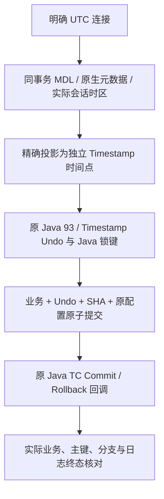

# TIMESTAMP：独立时间点、UTC 会话与原 Java TC

对应 [TIMESTAMP 契约](../../mysql-timestamp-contract.md)与 [ledger](../../wp05-mysql-timestamp.json)。已实现选定 UTC 配置的正式原生路径；专门跨进程重启恢复尚待验证，不能据此关闭 TIMESTAMP 完整门禁、DATE/TIME、完整 WP05 或生产门禁。



`Timestamp` 保存 UTC 时间点，和 DATETIME 的 `LocalDateTime` 保持独立身份。实际范围为非零纪元秒 1–2147483647、0–6 位小数秒。已验证最小秒、最大秒 `.999999`、闰日、SQL NULL 及精度；四个边界外/零秒输入和非法日期均被目标 MySQL 以 1292 拒绝。历史零日期由正式镜像路径拒绝，未转换成 SQL NULL。

连接明确配置 `+00:00`，读取 TIMESTAMP 元数据的同一事务还检查实际 `@@session.time_zone`。每个正式案例前实际执行 UTC、+08:00、SYSTEM 三个会话的准入测试，总计 24 次、16 次明确拒绝。选定 Java 资源端 JVM 必须 UTC，不能仅设置 Jackson parser 的 zone；否则 `Timestamp#toString` 锁键仍可能偏移。

默认 Jackson Undo 对应原 JDBC 93 和 `java.sql.Timestamp`，保留原毫秒整数/`[millis,nanos]`，恢复采用覆盖完整纳秒的原语义。时间点绑定、同精度主键暂存和 Java `.0`/尾零规则均有真实数据库路径。旧编号 1/2 保留；本路径使用已有显式 UTC 编号 3/4，错误旧配置拒绝原分支。没有新增依赖或数据库迁移，默认有变化 COMMIT 仍关闭。

## 验证结果

固定 Java 源码 `cba73e180fd8896a99df6415b859d275122feaa7`、原 TC JAR、Connector/J 8.0.27、Jackson 2.18.3、JDK 17.0.12 和 MySQL 8.4.13。18 个原源码与观测入口重新编译，实际类加载路径受绑定；只使用原有三个认证入口覆盖，不替换 TC 协调逻辑。

| 验证 | 实际结果 |
|---|---|
| TIMESTAMP 原 TC | Rust 1.99/1.85 × 两种 UTC 配置 × Commit/Rollback，共 8 笔全局事务、48 条业务 DML |
| 原 Java 格式 | 每例九行主表、两行 TIMESTAMP(6) 主键表，比较完整原对象图，覆盖所有小数精度及 SQL NULL |
| 持久身份 | 原事务 Undo、SHA、见证、尝试记录及配置；六个精确主键锁；错误旧配置拒绝 |
| 二阶段 | 原 TC 帧与响应关联、实际补偿/保留业务值、Undo/分支终态、持久日志 Completed |
| DATETIME 回归 | 双 Rust、两种配置及两个方向，共 8 笔事务 |
| JSON 回归 | 双 Rust、两个方向，共 4 笔事务 |
| 普通 AT 并发回归 | 双 Rust、并发 4、各 8 轮，共 64 笔事务 |
| 工作区与严格 Clippy | 每个 Rust 812 通过、400 忽略、186 个成功测试汇总；严格检查受影响 crate 的全部目标及特性 |
| 独立证据削弱 | TIMESTAMP 160、DATETIME 160、JSON 62、普通 AT 40，共 422 项被拒绝 |

忽略项通过各自运行器执行的选定现场另行核对，400 个忽略不等于 400 个通过。上述总计 84 笔全局事务；实际时区准入测试不是全局事务，也不混入该数量。

权威入口为 [validation_20261128_final](validation_20261128_final/result.json)，catalog SHA-256：`aeddab8b74b55db96c98ba4ce6248f40f5e3eb7a2427e45cdd34ae1b769a4396`。其 `authority.json` 绑定四类事务原始现场、双 Rust 回归和 TDD 证据；`validator-inputs.zip` 保存实际核验代码。

TIMESTAMP 原始现场为 [java_20261128_094447_15187547](java_20261128_094447_15187547/result.json)，catalog SHA-256：`61c26d40263f8428cba84f5b002567f61276952469524ef833240edbac8160d9`。复验：

```powershell
python -B tools/formal-source-junit/validate_timestamp_column.py `
  docs/phase-2/evidence/mysql-timestamp/java_20261128_094447_15187547 `
  61c26d40263f8428cba84f5b002567f61276952469524ef833240edbac8160d9 --weakenings
```

[TDD 原始记录](tdd_20261128/red.stdout)证明旧元数据的原生 TIMESTAMP 识别运行失败，退出 101 且目标断言失败，随后双 Rust 工作区对应测试通过；这是原生类型识别单元测试，不声称旧 MySQL 全局事务现场失败。[首笔回滚探索](java_20261128_094141_44d723ed/result.json)保留为诊断，不能替代最终源码与完整矩阵。

为留出运行空间，仅对两个容器已移除的旧 DATETIME 夹具数据做 NTFS 无损压缩，逐文件 SHA 前后及最终复核一致；没有删除缓存、数据或改变逻辑字节。记录见 [retained-data-compression_20261128.json](retained-data-compression_20261128.json)。本轮新 MySQL 数据均在 D 盘专属目录，所有专属容器都已移除。

## 尚未完成

下一步需实际运行独立进程的 TIMESTAMP 重启恢复，验证新进程从数据库 Undo 和持久配置重建时间点、恢复主键并完成同一分支。现有回调证据不能代替此项。DATE/TIME 的完整值域、其他时区/驱动/序列化格式、完整 SQL 与写入器准入、WP07 及 Phase 5–7 保持原计划范围。
