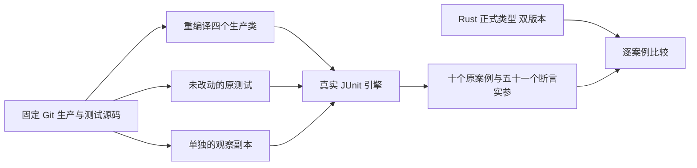

# RM 元数据四类原测试对照（2026-11-27）

规格事实源为 [原 Java 测试迁移契约](../../source-junit-contract.md)。本轮增加十个原案例的实际对照，不重算全量原测试的 MATCH 总数，不关闭 WP05、TC 或公开业务 COMMIT 门禁。

## 选择范围与原断言

四个类均来自固定 Git cba73e180fd8896a99df6415b859d275122feaa7 的 rm-datasource/src/test/java/org/apache/seata/rm/datasource/sql/struct，保留整个原类，不是挑选其中通过的方法。

| 原测试类 | 原案例 | 原断言位置 | Rust 文件 |
|---|---:|---:|---|
| ColumnMetaTest | 1 | 21 | [column_meta_test.rs](../../../../crates/seata_test/tests/rm/struct/column_meta_test.rs) |
| IndexMetaTest | 1 | 10 | [index_meta_test.rs](../../../../crates/seata_test/tests/rm/struct/index_meta_test.rs) |
| IndexTypeTest | 1 | 2 | [index_type_test.rs](../../../../crates/seata_test/tests/rm/struct/index_type_test.rs) |
| TableMetaTest | 7 | 18 | [table_meta_test.rs](../../../../crates/seata_test/tests/rm/struct/table_meta_test.rs) |
| 合计 | 10 | 51 | 四个独立 Cargo 测试目标 |

四个 Rust 文件各对应一个 Java 测试类，共用的记录/夹具辅助不计为新迁移对象。测试调用正式 seata-sqlparser 类型；没有为这些用例另建替代元数据实现。



原类先在未改动的 JUnit 上执行。另一个独立副本仅将 Assertions 调用替换为记录器，然后仍委托原 JUnit；原生产/测试源码和 Java oracle 不修改。记录器针对本轮无自定义回调的普通元数据比较记录实参；不宣称可用于任意带副作用的 equals。

Rust 保留大小写 Yes/YES、null 与空字符串、装箱 int、索引变更顺序、两个主键名的无序包含断言、带引号列名不匹配，以及缺主键异常的原类名和完整消息。Rust 不可空成功类型通过 Result::Ok 对应原非空断言；不伪造 JVM 引用。非法枚举保留 IndexType/4 的具体错误类型和值，映射原 IllegalArgumentException。

## 当前权威结果

- [最终独立 portable Java 重放](seata_rm_metadata_zmgo604h/result.json)：原 JUnit 十例全部通过，观察副本同样十例通过，51 处实参齐全；不是二十种不同案例。
- [Java 实参序列](seata_rm_metadata_zmgo604h/java-assertions.json)、[原逐案结果](seata_rm_metadata_zmgo604h/original-junit-events.jsonl)、[实际加载来源](seata_rm_metadata_zmgo604h/class-origins.json)。
- [最终 Rust 对照](seata_rm_metadata_rust_27v5cgnb/result.json)：Rust 1.99/1.85 各十例、51 处顺序实参一致。[原身份绑定](seata_rm_metadata_rust_27v5cgnb/source-case-bindings.json)。
- 三个真实源码错误变体被目标断言拒绝：取消大小写匹配、接受非法枚举 4、擅自删除列名引号。[结果](seata_rm_metadata_rust_27v5cgnb/mutations.json)。finally 恢复原字节后十例全通过，生产元数据源码与 HEAD 一致。
- 每个 Rust 版本另拒绝八种证据削弱：缺案例、重复行、错误异常、错误消息、断言顺序、两端同时缺断言、混用 sqlparser-core 同名类、原 Java 案例失败。
- 双版本全工作区全功能各 717 passed / 0 failed / 318 ignored：[1.99](seata_rm_metadata_rust_27v5cgnb/1.99-workspace.log)、[1.85](seata_rm_metadata_rust_27v5cgnb/1.85-workspace.log)。ignored 仍不算通过。
- seata-test / seata-sqlparser 全目标严格 Clippy：[1.99](seata_rm_metadata_rust_27v5cgnb/1.99-clippy.log)、[1.85](seata_rm_metadata_rust_27v5cgnb/1.85-clippy.log)。路径与可信摘要检查的 [三个 Python 用例](seata_rm_metadata_rust_27v5cgnb/python-path-tests.log)。
- [独立程序只读复核](seata_rm_metadata_rust_27v5cgnb/readonly-audit.json) 比对固定 Git 字节、原案例集合、编译产物、加载来源、portable 可信输入和双 Rust 记录。未冒充独立人工/另一 Agent 审查；该审查门禁继续开放。

## 依赖重建与可重放输入

旧完整 source-junit/source-junit-gate/source-junit-literal 物理目录仍缺失。后续封存清单与 catalog 可读，但原 1079 个 classpath 输入快照均已不在原位置。按其固定摘要从 C 盘只读 Maven 缓存和已有 E 盘 Java 构建输出找到 930 项完全相同的字节，149 项未恢复，其中 60 项是 JAR。没有修改 C 盘缓存、安装/升级工具或声称恢复全部基线。

本轮需要的四个生产类和四个原测试类从 Git blob 重新导出、编译。已验证的实际运行类和编译期依赖另封存为 [十三个 portable 输入](seata_rm_metadata_zmgo604h/portable-manifest.json)，共约 4.65 MB；JAR 保留原字节及内含许可证，class 保留封存摘要。路径拒绝绝对地址、其他驱动器、反斜线、空段和遍历，写入限定于新建 D 盘工作目录。

Portable 模式不相信包内自报摘要：原 classpath 清单的固定 SHA-256 写在工具中，每个成员还须符合该可信清单。改变载荷再自报新摘要会被拒绝。最终 Java 重放仅使用已封存的十三项依赖，不访问旧临时 classpath；不是恢复全部 1079 项。

## 诊断与早期记录

- vamx8j91 是第一轮原 Java 执行。只收集运行时加载类，portable 的十二项少了编译期所需 ColumnUtils。
- dooqzr5q 因上述缺失在 javac 失败，尚未执行 JUnit，不能计成功。7lo5ztne / t_330w65 补齐编译依赖后重放通过。
- vg3qhiss / zmgo604h 增加固定清单锚定；zmgo604h 为当前权威 portable 运行。
- Rust fixd61nf / s_f2ynhg 为分文件前的对照；27v5cgnb 为符合单类单文件规则的最终对照。共享辅助漏接的 unused Arc 在严格 Clippy 被拒绝，已删除，诊断保留。
- 各早期目录是可核验历史，不与最终结果混合凑数。

## 复现

需要已有 D 盘 JDK 17.0.12、两套 Rust 工具链和固定 Git oracle。现有封存包可绕过缺失的旧临时依赖目录：

```powershell
python -B tools/formal-source-junit/rm_metadata_source.py --portable docs/phase-2/evidence/rm-metadata-source/seata_rm_metadata_vg3qhiss
python -B tools/formal-source-junit/rm_metadata_rust.py <上一步打印的新证据目录>
python -B tools/formal-source-junit/validate_rm_metadata.py <Java证据目录> <Rust证据目录> <新的复核输出文件>
```

Rust 对照脚本会依次执行两个工具链、三个受控生产错误变体并在 finally 恢复原字节。不要与其他 Rust 构建并发使用变异脚本。其余原案例、完整 JDK/模块环境、独立审查以及 WP05/WP06/全计划仍开放。
