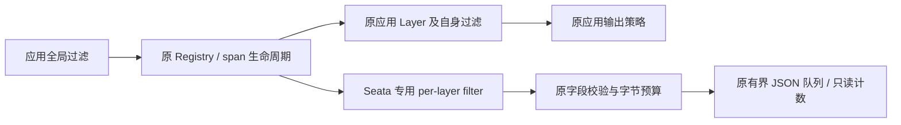

# 结构化日志与原应用 Layer 栈组合

规格事实源：[WP07 契约](../../wp07-observability-contract.md)中“与应用日志栈组合的可选 Layer”。[机器总账](../../wp07-structured-log-layer.json)固定最终路径与摘要。选定 Registry 组合入口已验证，完整 WP07、V1 与 Phase0–7 继续开放。

## 接口与数据边界

默认关闭的 structured_log_layer 包含 structured_logs，固定 tracing-subscriber 0.3.23 并仅开启 registry。已有 StructuredLogSubscriber 可消费转换为 into_layer<S>()，与底层包含 Registry 的应用 LookupSpan 栈组合；不安装或替换全局值，不接管任意手写 subscriber 的 span 实现。原独立订阅器和仅 structured_logs 行为保留。

依据官方 [Layer 组合接口](https://docs.rs/tracing-subscriber/0.3.23/tracing_subscriber/layer/index.html)，Seata 分支使用独立 per-layer filter，只接收已支持的 Seata 事件命名空间。七种模板的字段校验、预算、try_send、丢弃及六计数复用原实现；不把应用 span 字段附加到 JSON。应用分支仍按自身策略记录事件、原字段和 span 生命周期，应用全局过滤仍可拒绝 Seata 事件。

图示为概念分支，不声明具体回调执行先后。Seata 预算和非阻塞入队仅约束自己的分支，不限制应用原有 I/O 或保证其输出脱敏。跨线程/进程上下文不会自动传播；本轮验证同任务显式 instrument 的原上下文，不宣称全链路追踪或生产采集部署完成。

## 实际验证

Rust 1.99/1.85 各五项目标通过：

- 动态应用过滤从 false→true→false，同一调用点仅一次进入应用输出；原栈与组合栈的 Registry span 状态对照一致，Seata 事件独立接纳。应用私有 payload 保留在原应用分支，未进入 Seata JSON。
- 原 root/child 身份、父子关系、record 更新、follows_from、enter/exit、克隆后的最终关闭全部按真实回调核对；根在最后克隆销毁前不关闭。原 span 密码字段保留给应用 Layer，Seata JSON 不含这些字段。
- 七种正式模板各一条，原应用事件同时存在；没有遗漏或重复 Seata 转发。
- 原应用全局 WARN 过滤仍拒绝 INFO，并允许真实路由的 WARN 模板，不被 Seata 分支绕过。
- 两个真实 TCP TM Status 请求在显式 instrument 的应用 future 中完成 Rollbacking；原应用上下文正确关闭一次，原应用事件保留 parent 身份。单槽 JSON 队列实际接纳一条、丢弃一条；第一 JSON 保留第一个原请求编号且不附加应用 span 字段。

双版本另各一项原 MySQL Undo DDL 的实际接入，明确 layer_mode=true。新建围栏、同身份只读观察及关闭池后的控制错误三事件经新 Layer 到达原消费者；独立 SQL 确认原围栏 4242/log_status=1，原 JSON 与自有文件写入/sync_all/回读判据保留。本轮不新增原 Java TC 联试结论。

三个正式源反例（把 per-layer filter 错接成全局过滤、漏转发、重复转发）双版本共六次被实际目标断言拒绝，精确恢复后通过。独立 Python 对照原应用字段/生命周期、实际请求、七模板、原 SQL 观察和新依赖发布归档，每版本十三项证据削弱均拒绝。它是程序复核，不是外部人工/另一 Agent 审查。

最终全工作区各 766 passed / 347 ignored（含 162 个测试/文档测试摘要及新接口 doctest）。观测组件全目标全功能、默认、仅日志、仅 MySQL、仅 Layer 严格 Clippy 和默认测试通过。默认及原仅日志的 normal 依赖树无 tracing-subscriber；所有仅日志模式无 SQLx。ignored 不视为通过，本节实际 MySQL 目标已单独执行。

## 依赖与诊断边界

新依赖只增加 tracing-subscriber 0.3.23、sharded-slab 0.1.7、thread_local 1.1.10 三包和观测组件所需可选边。Cargo 一次解析改变了无关 errno 的 Windows 依赖边，已恢复为原锁文件；独立核对旧包及其他边均保持。三个发布 .crate 的 registry checksum 与 Cargo.lock 一致，逐项比对实际解包目录的 138 个文件，并保留归档与摘要；没有安装 CLI/Skill 或初始化规格体系。上游 [固定清单](https://raw.githubusercontent.com/tokio-rs/tracing/tracing-subscriber-0.3.23/tracing-subscriber/Cargo.toml)声明的 Rust 下限和特性仅作选型依据，实际双版本执行才是本轮证明。

最初对 Span::is_disabled 的绝对断言与原 Registry 自身行为不一致，不能独立用作生产缺陷证明。动态夹具也曾误用静态 filter_fn，使其条件被缓存；现采用 dynamic_filter_fn 并保存无 Seata 层的同条件基线。原 Registry 即使未把某 span 交给应用层，也可能分配其内部状态；本轮明确核对原状态是否改变以及实际应用输出。真正的应用事件丢失反例由 .with_filter 错接 .and_then 的实际目标失败证明，路径列于账本。

早期失败/成功原型、旧输入及诊断全部保留，不能冒充最终当前字节。最后保留原未改代码行的换行字节后，源反例、双版本目标、实际数据库和工作区重新执行；最终生产/夹具/接口文档输入全部匹配当前字节，无最终源码漂移豁免。

生产 sink、保留、抓取/告警、远端认证、线程/进程传播、其他状态事件、完整安全/负载及后续 WP05–07/Phase4–7 仍开放。

## 复核

按机器总账路径及 catalog 摘要执行 tools/formal-source-junit/validate_structured_log_layer.py：--rust199/--rust199-sha、--rust185/--rust185-sha、--mysql/--mysql-sha、--mutations/--mutations-sha、--dependencies/--dependencies-sha。校验只读原现场，新结果及自身副本另存。

- rust199: [rust_/20261127_183207_c07fb3eb](rust_/20261127_183207_c07fb3eb/catalog.json)，SHA-256 `642af64d40a8db158af51ab40b7c691a8d59e0bfa92f00ff9ba7fcf900c0cbcc`。
- rust185: [rust_/20261127_183214_1a98063f](rust_/20261127_183214_1a98063f/catalog.json)，SHA-256 `e7ada89fd1c91479b16b4d9d23f929c371fd97830167b1e31d9d625b92d78e2e`。
- mysql: [mysql_20261127_183207_f250b04c](mysql_20261127_183207_f250b04c/catalog.json)，SHA-256 `e80e99549faad35ce7aecd346df1f42463c6cbcded76444c19eddd8f292dba2f`。
- source_mutations: [mutations_20261127_182954_655c9c0f](mutations_20261127_182954_655c9c0f/catalog.json)，SHA-256 `d4e690e698284bdeb69d749dc4adea75cafbcae66cf3f9590dddca85fc9556e3`。
- dependencies: [dependency-inputs](dependency-inputs/catalog.json)，SHA-256 `9158ad25a6e879cd4077cfe8454af4a2e30a1ee5ea377d7697f6ec4c71fed957`。
- raw_validation: [validation_20261127_183536_39dfb472](validation_20261127_183536_39dfb472/catalog.json)，SHA-256 `e08ce28e6f4710b26f3ee0e7b5a0cfdb36b577f12bcb2ffc63bbfc067fbfa831`。
- default: [default_20261127_183218_39724364](default_20261127_183218_39724364/catalog.json)，SHA-256 `8145ac324459d2b269b5362e269f160f3588065aef34e8924eb838cb533dad82`。
- regression_199: [regression_1.99_20261127_183207_ec852e61](regression_1.99_20261127_183207_ec852e61/catalog.json)，SHA-256 `adbe209a34df6b512fcbd505740076dd98a8dad9ea3eb824e421f8eee9ca3538`。
- regression_185: [regression_1.85_20261127_183207_df4457bc](regression_1.85_20261127_183207_df4457bc/catalog.json)，SHA-256 `b1a33edf1041a4616bf992c73f8c25a07a2d68a1afb59cb1b2f9353f9ab4cecf`。
- application_output_counterexample: [mutation_/20261127_182954_f30394c6](mutation_/20261127_182954_f30394c6/catalog.json)，SHA-256 `682a46d72eefaa3dd19e73d45e7538408d9eca0e6b55d1cafbde8dba9135000f`。
