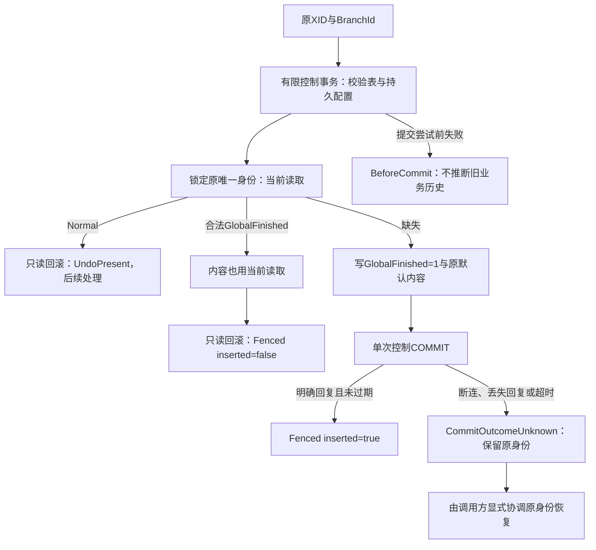

# 原唯一身份的持久防悬挂组件

沿用[既有契约](../../mysql-undo-fence-contract.md)，本步完成独立控制事务的原 GlobalFinished 记录、迟到 Normal 写入仲裁与控制提交结果未知处理。[机器状态](../../wp05-undo-fence.json)记录范围；Java 原对象仍为部分实现。

`Fenced`证明在控制记录保持期间，同一原身份的迟到 Normal 插入受唯一键阻止；它不区分“从未提交”和“已经补偿”，不直接映射成通用 RM 的 Applied/NotApplied。当前未提供自动删除、过期或控制重发。业务提交入口、正式 TC 登记绑定和二阶段补偿继续原计划。

[最终资格包](run_20261116_043811_c001f6c1/result.json)与[成员清单](run_20261116_043811_c001f6c1/catalog.json)的 SHA-256 为 `e679996e3feca7b1662c910fe6bada812992ad6eeacb87b03d15c52f9de43fdd`。7,550 成员、7,362 输入快照绑定当前源码、实际执行文件及明确指定的已完成子包。

| 每个版本的实际执行 | Rust 1.99 | Rust 1.85 |
|---|---:|---:|
| 工作区普通/示例测试 | 331 | 331 |
| 新围栏：九行为、三包故障、旧快照定向测试 | 13 | 13 |
| 同事务写入与 Ready 期限回归 | 11 | 11 |
| 本次真实数据库检查合计 | 24 | 24 |
| 原 Java guard / 存储方法对照 | 2 / 4 | 2 / 4 |
| 实际归档测试程序 | 58 | 58 |
| 实际 RM 恢复子进程 | 6 | 6 |

两个真实 RED→GREEN：最初缺少围栏写入，以及 RR 旧快照漏读后来提交的 guard。后者先验证旧快照仍无行，再读取同一原身份；状态和内容均改用锁定的当前读取。取消测试使用三秒预算，期限等待使用 1,500ms，仍必须先在 performance_schema 观察到实际锁等待；生产默认预算不变。

三种故障分别阻断原 COMMIT、丢弃服务器成功回复和持有回复超过期限。独立解码原 PREPARE、参数、COMMIT 和 OK，绑定 XID/BranchId、同一物理连接、原服务端编号与处理顺序；30 项实际原始包副本负控及六项角色副本负控命中目标拒绝。没有自动业务重放。

工作区 fmt、全部目标 clippy、全部功能组合与文档检查通过。185 个候选依赖归档及 150 个实际编译包保持既有版本/集合，原数据源和 Normal 写入方法体不变。此前其他 39 项数据库检查明确[继承上一组件](../undo-store-gate/README.md)，不是本次执行；原 TC 网络覆盖观察也未在本步重跑。

15 个本次资格检查容器（14 个角色包及一个观察器停止异常控制）均已确认删除；异常控制的业务目标先实际通过，停止错误随后被明确报告，清理仍完成。[本轮全部尝试审计](all-attempt-runtime-audit-20261116.json)另核对 37 个精确容器均不存在，D 盘数据保留。最终只读复核见[记录](readonly-review-20261116.json)。

限定 MySQL 8.4.13 原 DDL、本机非 TLS 与明确的 InnoDB 持久配置。完整原 undo/manager/JUnit、生产 TLS/多节点、控制记录 GC、bin 文本读取、原 TC 锁覆盖缺口、业务/Undo 原子提交及 WP06 保持未完成；外部 TC 风险未接受，共享锁继续暂缓。WP05 原十四项仍 0/14，完整 V1 与其余全部 Phase 继续。
