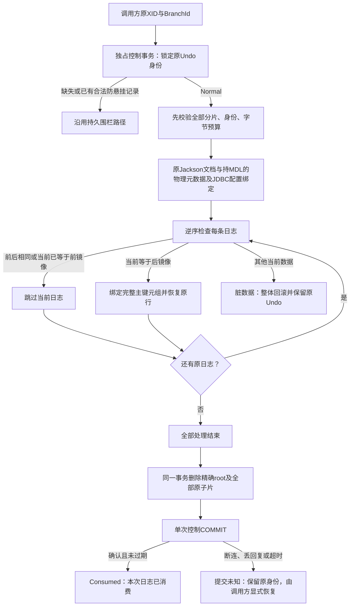

# 原Normal Undo真实补偿组件

[实施契约](../../mysql-undo-rollback-contract.md)、[部分对象对照](../../mysql-undo-rollback-file-map.csv)与[机器状态](../../wp05-undo-rollback.json)记录本步范围。新增原身份补偿入口、严格类型恢复、三个原生执行器及独立阶段错误；所有原对象仍明确PARTIAL。

本步验证补偿DML与原Undo删除共用一个控制事务。`Consumed`描述本次处理事实；原Normal成功路径按来源删除日志，缺失路径才写GlobalFinished，不能由此推断所有旧尝试已永久阻断或直接返回通用RM Applied/NotApplied。

[最终资格结果](run_20261117_111348_259e729e/result.json)与[成员清单](run_20261117_111348_259e729e/catalog.json)绑定7,554成员、7,370输入。catalog SHA-256：`cb577013e36b5bf13def0a35718e650c34e6a35763cf76e37b2ea9abe102b8a7`。

| 每个版本实际执行 | Rust 1.99 | Rust 1.85 |
|---|---:|---:|
| 普通/示例回归 | 333 | 333 |
| 真实Normal补偿检查 | 13 | 13 |
| 真实控制COMMIT故障检查 | 3 | 3 |
| 本轮实库测试合计 | 16 | 16 |
| 原Java观察 / 原生输入组 | 24 / 10 | 24 / 10 |
| 原Java清理/保留的实际JVM负控 | 2 | 2 |
| 实际封存测试程序 | 60 | 60 |
| 实际RM恢复子进程 | 6 | 6 |

真实数据库覆盖INSERT/UPDATE/DELETE、逆序混合日志、复合PK避免笛卡尔积、NULL/binary/精确DECIMAL、数字tinyint恢复2、已恢复/无变化、后续脏数据撤销此前补偿、实际packet分片及六种破坏、四种不安全schema/压缩、真实锁等待取消/期限和并发重复。最初缺少补偿有实际RED→GREEN；未修改已有围栏/写入/本地事务方法体。

三种故障分别阻断COMMIT、丢失已提交回复和延迟原OK。独立原包记录全部客户端命令，绑定BEGIN及IN_TRANS确认、每次EXECUTE的原PREPARE、完整原PK和Undo身份、同一物理session内的DML/日志删除及唯一末尾COMMIT/原OK。认证类命令不保存认证体，并由限定profile拒绝。60项实际包副本负控覆盖错身份、错PK、错COMMIT/连接/prepare、转发ERR、中间ROLLBACK、事务内/提前prepare后执行的autocommit及连接重置；六项角色副本负控拒绝错版本/重复角色/单例冒充全组。

原Java固定七份源文件实际编译，原执行器、DataCompareUtils、JDBC读取和删除方法参与24项观察；成功后逐七列确认root/子片删除且另一分支sentinel不变，Dirty回滚逐七列确认原Undo保留。两个独立JVM负控分别故意省略清理、删除本该保留的日志，并命中相应实际断言。固定原TC包自带fastjson1.2.83仅用于Java编译依赖，未安装或升级；原JDBC8.0.27、Jackson及实际类加载来源保留绑定。没有执行完整原manager入口或原JUnit。

工作区fmt、全部目标clippy、全部功能组合和文档检查通过。185个候选依赖归档、150个实际编译包保持既有版本/集合；此前每版63项DB检查明确继承[上一组件](../undo-fence-gate/README.md)，不是本轮执行。八个资格容器均确认不存在；[全部尝试审计](all-attempt-runtime-audit-20261117.json)另确认27个精确测试容器均已删除，D盘数据保留。[最终只读复核](readonly-review-20261117.json)无剩余可确认P1/P2。

验证限于固定MySQL8.4.13镜像、本机非TLS、既有完整镜像/原生类型与声明的JDBC配置。历史Java将tinyint2有损编码为true后无法恢复原信息，本步不认证任意历史Java日志。终态记录、正式资源适配器/TC所有权、所有旧尝试围栏、业务第一阶段COMMIT、原完整对象/JUnit、其他类型/投影/压缩、生产TLS/多节点/GC及原TC覆盖/bin文本缺口继续原计划。WP05原十四项仍0/14，WP06、完整V1与后续全部Phase保持OPEN；外部TC风险未接受，共享锁仍暂缓。
