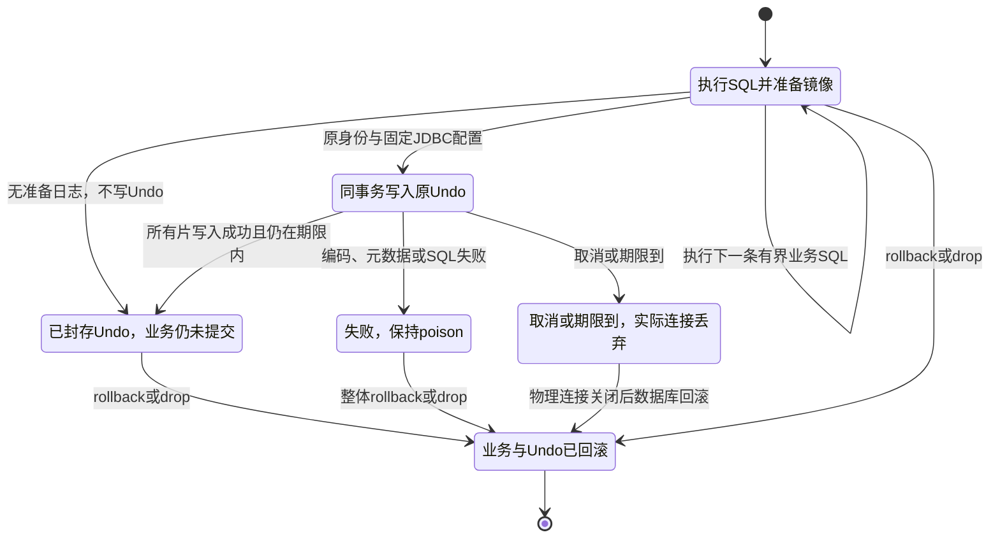

# WP05 同事务Undo写入与回滚

沿用[WP05存储契约](../../mysql-undo-store-contract.md)与[对象映射](../../mysql-undo-store-file-map.csv)。新增`MySqlLocalTransaction::flush_undo_logs`在原独占SQLx事务内写原Normal Undo行和packet分片；写前核对原表结构、唯一身份与元数据可见性，拒绝双向外键、触发器及非事务引擎。成功后封存作用域，失败保持poison，取消/期限到时丢弃实际事务连接。已有Normal或GlobalFinished身份不会被覆盖。

**本步验证同事务写入与回滚，不是业务/Undo原子提交、TC登记或提交未知恢复的验收。公开COMMIT仍未提供，WP05原十四项仍0/14。**

## 最终证据

[最终整体验证](run_20261116_032443_ec53c018/result.json)，catalog `fa6199466c5eb6e81b24907532509f0024b0b23aa43b19a8b19847aeb83b8314`：7350个冻结输入、7524个父包成员；显式绑定[两版最终现场清单](run_20261116_032443_ec53c018/explicit-packets.json)。源码在首编译前冻结、执行后再次逐SHA核对；185个归档候选、150个实际编译依赖包与此前合格组件保持版本/集合一致。

| 实际验证 | Rust1.99 | Rust1.85 |
|---|---:|---:|
| 原普通lib/integration测试 | 325 | 325 |
| 原示例测试（本轮all-targets包含） | 6 | 6 |
| 实际测试产物 | 56 | 56 |
| 新存储集成测试 | 10 | 10 |
| 实际写入Ready后的期限发布边界 | 1 | 1 |
| 原元数据/镜像/竞态/执行/类型现场回归 | 38 | 38 |
| 实际codec/锁键现场 | 1 | 1 |
| 原Java存储方法对照 | 4 | 4 |
| 原行子片XID/状态负控 | 2 | 2 |
| 实际RM恢复子进程 | 6 | 6 |

每版50个DB现场来自结构整理后的相同源码，不继承旧路径的运行结果。共16个独立MySQL容器均按随机owner、镜像及精确ID核对后清理；数据留在D盘。112个实际测试产物与12个RM恢复子进程的原证据已封存，fmt、all-features、全workspace clippy及doc均通过。

独立READ COMMITTED/READ UNCOMMITTED观察者核对真实业务/Undo行，performance_schema实际事务号证明同一本地事务。覆盖已有Normal/GlobalFinished、空日志与封存、五种坏表形状、入向外键、无效身份、真实唯一键等待中的取消/超时、80%实际packet切片重组及context容量。Ready测试先实际写入数据库，再显式延后方法状态交接；它只证明最终发布处的期限门槛，不伪称网络丢包或完整调度竞态矩阵。

每版Java对照重新编译固定原AbstractUndoLogManager及MySQLUndoLogManager，用JDBC8.0.27实际调用原Normal写入、取子片、删除方法；随后用Rust采样七列原行重插为独立夹具，由原方法读取/重组和原parser解码。每行XID、状态、时间均被保存并核对，不从根记录补造子片身份。范围是选定方法，原完整`flushUndoLogs`入口、整个manager及JUnit尚未迁移。新增对象归入原末级`mysql`包，旧`undo/`实现位置已移除。

[三项真实RED](run_20261116_032443_ec53c018/result.json)分别记录原先缺少存储、入向外键漏检、过期Ready被发布成功的问题，均在最终同用例得到GREEN。另有[10项实际证据副本角色负控](run_20261116_032443_ec53c018/packet-role-negative-controls.json)：版本/目标错配、缺版本、重复或错误RED/legacy角色、race单例冒充codec、缺第九锁日志或第二配置均准确拒绝。最终[只读审查](readonly-review-20261116.json)无剩余P1/P2。

共用Java运行绑定新增undo_store family后，原文档40/40双向、原锁方法1029例和原TC来源方法15例均已重跑。原TC的实际网络/存储8例沿用[上一轮观察](../tc-lock-live/README.md)，本轮没有伪称重新运行该TC链路。

## 剩余门槛

当前明确使用NONE压缩。UUID_SHORT只是本机MySQL分片身份适配，不是原UUIDGenerator/全节点身份策略迁移；原128字符context及有界编码仍适用。原JUnit具体案例/资产、完整manager、其他压缩配置、生产TLS、bin文本collation读取缺口仍继续原矩阵。

后续继续绑定真实TC登记身份与同一JDBC配置，实施业务/Undo原子提交、持久围栏和提交未知恢复，再接入WP06真实二阶段补偿。原TC空白/分号漏锁等覆盖问题没有被接受或通过；不转义/hash原键隐藏差异。共享锁暂缓，完整V1、原生RustTC与全部后续Phase保持原范围。
