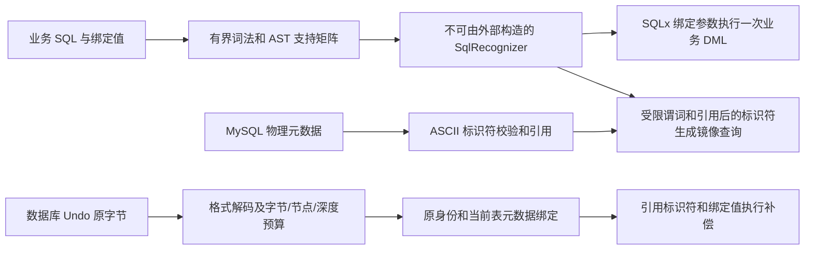

# WP07 SQL 与 Undo 安全审查增量（2026-11-25）

范围：当前工作树的 `seata-at` SQL 识别及 Undo 解码、`seata-db-mysql` 中从识别结果到业务 SQL、镜像 SQL、补偿 SQL 的主要数据路径。这是源码边界审查和离线测试记录，不是 WP07 安全 Gate 的完成证明。

| 输入到执行路径 | 当前源码事实 | 本次审查结论 |
|---|---|---|
| 业务 SQL → `StatementCallback::execute` | `SqlRecognizerFactory::recognize` 限 64 KiB、拒绝注释和反斜线、只接受单个有界 DML AST，并逐 token 核对 AST 重建；`SqlRecognizer` 字段为 `pub(crate)`；执行使用 `sqlx::query_with` 和完整原参数数量校验。 | 所追踪路径未发现调用方可绕过工厂构造任意业务 SQL 或以参数值拼接 SQL。原 SQL 仍作为 SQL 文本执行，安全性依赖工厂完整支持矩阵。 |
| 元数据/镜像/INSERT 主键暂存 → 动态查询 | `TableMeta::quote_identifier` 只接受长度 ≤64 的 ASCII 字母、数字、下划线和美元符号，首字节不为数字；镜像条件来自受限 AST 或引用后的主键列；INSERT 暂存单元表达式来自工厂验证的 `InsertValueTemplate`，业务值使用绑定参数。 | 所追踪标识符插值有校验入口；尚未证明所有 MySQL 模式、元数据变化及执行期约束均安全。 |
| Undo 原字节 → 补偿 SQL | `UndoCodecLimits` 约束编码字节、节点、深度及 scalar；Jackson JSON 路径使用 `StrictJson` 拒绝重复键并逐层记账，JSONB、Protostuff、Kryo、Fory 读取器分别显式限制长度/引用；`AbstractUndoLogManager` 按 XID/BranchId、当前表约束及元数据恢复；补偿列名引用并以 `query_with` 绑定值。 | 已核对主要信任边界，但不能据此签发所有编码格式或脏数据竞态的安全证明。 |

实际验证：Rust 1.99.0 与 1.85.0 各执行 `cargo test -p seata-at --quiet`，所有非忽略测试通过；两工具链各执行 `cargo clippy -p seata-at --all-targets -- -D warnings`，退出码 0。测试包括现有 SQL 识别的注释、限定名、重复列、参数预算及确定性局部变异，以及 Undo 的重复 JSON 键、格式截断、引用和预算负例。忽略测试没有随该命令执行；Clippy 只证明静态规则通过。

后续增量：`tests/undo_parser_mutation_safety.rs` 对六种解析器的默认内容和非空分支分别执行截断、均匀分布的单字节损坏；Fastjson、Jackson 和 Fastjson2 还加入固定 Java 原字节语料。每个语料先核对可正常解码，再检查变异输入不会引发 panic，总变异数门槛为至少 1000。Rust 1.99.0 与 1.85.0 的该目标测试各通过 1/1，随后两工具链的完整 `cargo test -p seata-at --quiet` 和全目标严格 Clippy 均退出 0，`cargo +1.85.0 fmt --all -- --check` 通过。这是固定种子的负向回归，不是覆盖全部输入状态的持续模糊测试，也不证明解码结果具有可执行 Undo 的语义安全性。

未验证的门槛：所有受支持 SQL 在真实 MySQL 模式/元数据竞态下的安全执行；所有 Undo 格式的持续模糊测试和异常资源消耗；真实 Java TC 上损坏 Undo 与二阶段重复/乱序指令的全链路结果；依赖 CVE、凭据配置和部署安全。这些仍需独立证据，WP07 原安全审查条目保持未完成。
