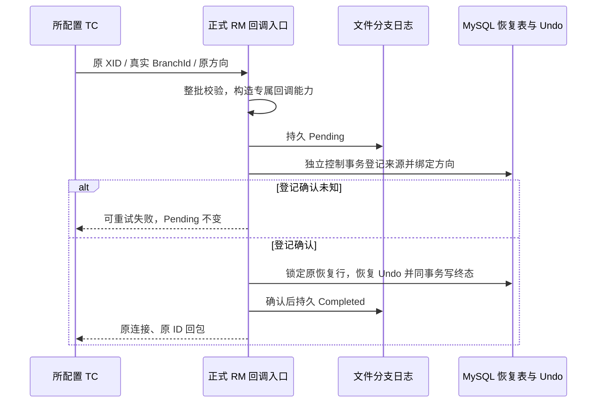

# WP05：注册未知与回调归属交接

现有 WP05 及 ADR-0008 的增量实施契约。前序 [回滚恢复](mysql-rm-recovery-contract.md)仍是已有回执路径的事实源；本文件增加原 TC 回调先于成功回执的交接，不删除原验收项。公开一阶段 COMMIT、提交方向、TC 锁覆盖和完整 WP05/WP06/V1 门禁不因此关闭。

## 权威来源

正式 RM 连接收到同步二阶段请求、整批形状/模式/身份校验通过后，才构造不公开提供构造器/反序列化的 `BranchCallbackReceipt`。它只带原身份与方向，不含原消息不存在的锁键，不可转换为 `RegisteredBranch`。信任前提仍是所配置 TC 连接；生产认证/TLS 尚未认证，不把受控 TCP 夹具称为原 Java TC。

公共 `BranchDispatcher::dispatch` 不产生该能力。仅网络回调内部入口在持久 Pending 后调用资源可选的登记观察器，再按原状态执行 apply/recover。Completed/Rejected 仍由已有文件记录返回；登记未知或失败保留 Pending，禁止业务重放和自动 BranchRegister 重发。

## 原登记信息与未知信息

新增显式扩展迁移 `002_seata_rs_at_registration_origin.sql`，仅向独立恢复表增加 `registration_origin TINYINT UNSIGNED NOT NULL DEFAULT 1`，原七列 Undo 及既有身份、方向、终态均不改写。

| 物理形状 / 行版本 | 来源 | 锁键含义 |
|---|---|---|
| 旧 11 列 / version=1 | 成功注册回执 | NULL 为原请求 None；非空为原锁键 |
| 扩展 12 列 / 旧 version=1、origin=1 | 迁移保留的成功回执行 | 原值逐字节不变 |
| 扩展 12 列 / 新 version=2、origin=1 | 成功注册回执 | 保留原请求的 None / 非空值 |
| 扩展 12 列 / version=2、origin=2 | 正式回调能力 | 原消息无锁键，NULL 表示未知；不能冒充原请求 None |

回调新建行必须在同事务绑定原方向，不能存在 origin=2、phase=0 的行。收到回调前已成功登记的行保留 origin 和原锁键，只核对身份/配置并绑定方向。回调先建的行不允许迟到成功回执变成可提交的一阶段登记：返回独立的 CallbackObserved 错误；重复的已知成功回执路径仍保持原有幂等核对。

旧物理形状继续支持原已登记分支；缺失行的回调登记要求显式扩展迁移。新读取器同时接受两种精确物理形状；旧读取器在扩展形状下拒绝操作。部署前停止旧写入器并保留在途状态，新版本验证迁移后再恢复流量；不承诺新旧写入器同时处理同一分支。原 schema_version=1 行不批量重写，不提供丢列或清数据的自动回退。

## 顺序和故障

所有控制事务沿用独占连接、取消关闭、同一绝对期限及 COMMIT 开始后未知分类。来源登记失败不得提前执行补偿；登记提交丢响应时，下次原回调先核对持久来源，不重新注册。应用的本地业务事务在注册未知时回滚；原回调缺日志路径仍由 GlobalFinished 防悬挂和恢复终态共同提交，不把未知响应合成为成功回执。

## 本步验收

- 真实 TCP＋真实 MySQL：注册响应丢失后，原回调能登记来源、持久回滚；原申请仅一次；本地业务没有提交。
- 公共手工 dispatch 不能创建回调归属；未匹配资源、无效批次、应用数据/方向冲突不能被登记绕过。
- 锁键确认为 None 与回调未知分别由 origin 标识；迟到成功回执被阻止，已知回执幂等保持。
- 原 11 列向扩展 12 列迁移保留身份、锁键、应用数据、方向、终态与时间；异常来源、版本、默认值、表约束均拒绝。
- 来源登记的提交丢失/阻断/延迟确认保持 Pending；后续回调不重放注册/原业务，所有旧尝试仍受方向和终态仲裁。
- 固定原 Java TC＋正式 RM＋实际数据库验证注册丢响应后的回调交接，独立检查真实 TC 分支号和数据库事实；未执行部分不得称为完成。
- 两套 Rust 工具链、完整回归、实际源/程序/原报文绑定与独立审查；沿用原完整 Java 测试账本，不把本步新增测试当完整源迁移。
