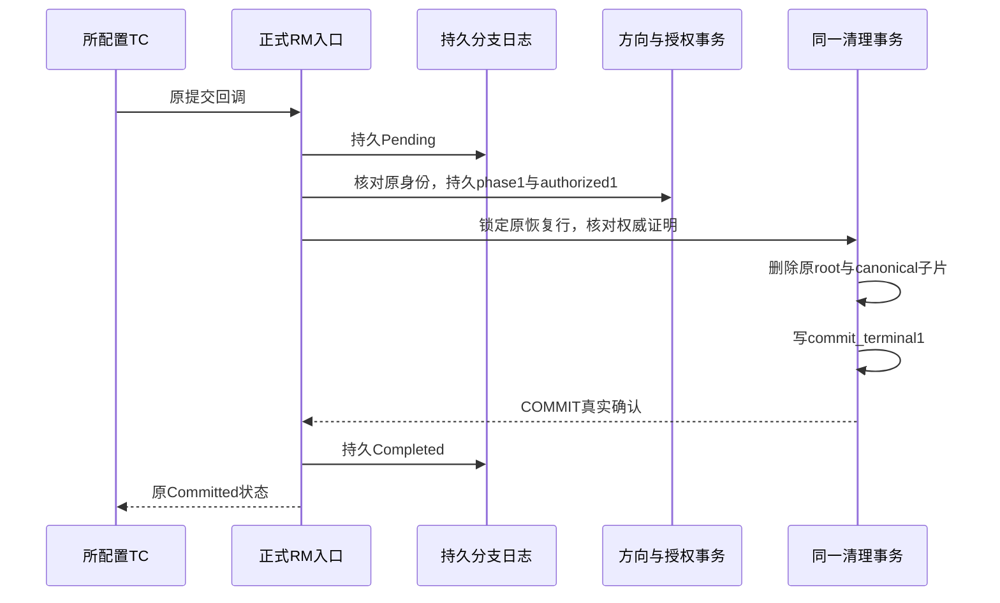

# WP05：正式提交回调的持久清理

沿用 [WP05](wp05-mysql-at-plan.md)、ADR-0008、[回调归属](mysql-callback-ownership-contract.md)及[提交前仲裁](mysql-commit-preconditions-contract.md)。本步实现二阶段提交清理，不提供一阶段业务 COMMIT，不关闭原 TC 锁覆盖、未知业务提交恢复、任意旧尝试围栏或完整 WP05／WP06／V1。

## 提交决定来源与显式升级

原 `terminal` 继续只表示回滚效果已提交。新增显式 [003 迁移](../../crates/seata_db_mysql/migrations/003_seata_rs_at_commit_decision.sql)，只向独立恢复表增加 `commit_authorized` 与 `commit_terminal`，均为非空 unsigned tinyint、默认零；原七列 Undo、原身份、schema_version、注册来源、方向、终态和时间均保留。

新的 14 列能力为 version3；新读取器继续接受原 11 列、扩展 12 列。14 列中旧 version1 成功注册行、旧 version2 登记／回调行继续有效且不改写行版本。原旧读取器拒绝 14 列，禁止新旧写入器并发处理同一分支；部署先停旧写入器、显式执行迁移、使用运行权限验证后恢复，应用回退也必须保留新表及全部在途／终态。不得自动建表、删列、重置证明或 GC。

只有正式网络回调入口产生的 `BranchCallbackReceipt(Commit)` 可以在观察事务中持久设置 `phase=1,commit_authorized=1`；回调来源的新行同时获得该证明。已有 phase1／authorized0 行须由一次新的真实提交回调授权，不从旧方向推断 TC 决定。公开 apply／recover／手工分派不能创建该证明；14 列未授权 phase0／phase1 保持 Unknown、不进行清理。原 11／12 列提交方向继续 Unknown，不隐式升级。

| 方向 | 原 rollback terminal | commit authorized | commit terminal |
|---|---:|---:|---:|
| 0 未绑定 | 0 | 0 | 0 |
| 1 提交 | 0 | 0 或 1 | 0；仅 authorized1 可以为 1 |
| 2 回滚 | 0 或 1 | 0 | 0 |

来源为 callback 的行不能 phase0。任何非法组合、非布尔标记、身份／资源／配置／应用数据差异均拒绝，不以默认值掩盖畸形状态。

## 顺序与清理范围

方向／授权确认之后，清理、commit_terminal 候选共用同一物理控制事务。根行按原 XID／BranchId 锁定，子片按原 `branchId=<原号>` context 分批最多64行当前读取，逐字节核对 XID／context 和原主键后删除，检查实际影响行数；循环至全部原子清理完成。根行缺失仍清理 canonical 子片；不能跨 XID／其他原分支删除，也不能跳过排序规则别名后伪报空。根身份不得冒充另一个根的子片。

提交清理不补偿业务、不读取或解码 rollback_info，不要求当前 serializer／压缩器／类型支持，保留原 Java 删除路径对 Normal／GlobalFinished 的范围。未知或坏正文不影响只删除原日志；原身份和结构不安全时仍整体未决。业务数据在清理前后保持原值。缺日志在持久 TC 决定下可以完成清理，但不证明业务历史提交或任意旧写入器永远不能迟到。

只有清理事务 COMMIT 有效确认后返回 Applied；提交请求阻断／响应丢失／延迟、取消或期限不发布部分效果，原身份、方向和 Pending 保留。之后原回调／恢复锁定读取已有 commit_terminal，即可确认本次清理已持久完成；没有终态时按锁内事实继续，不重发注册、不重放业务。恢复操作内部的 Bind／清理两个控制事务沿用共同绝对期限；死锁受害者整体未决，不重试业务。

## Java 映射与验收

来源为固定 Java `DataSourceManager#branchCommit`、`AsyncWorker#branchCommit`、`AbstractUndoLogManager#deleteUndoLog/batchDeleteUndoLog`。原 Java 先入异步队列即回 Committed；本 Rust 组件选择在持久清理完成后才发布状态，不声称已经迁移完整异步批队列／调度器／全部原对象或测试。TC 仍负责重试。

- 真实正式成功回执和原协议回调：提交清理原 root／Guard／分片／超过64片／缺根子片，其他分支 sentinel 与业务值不变；重复回调与重启恢复不重复清理。
- 公开手工调用不能授权；迁移前旧 phase1、version1／2 行需真实回调授权，版本／旧回滚终态／原身份保留；实际旧读取器在扩展表拒绝且不修改状态。
- 字节别名、根子片身份冲突、坏 schema／权限／非法标记、方向冲突、实际锁等待／取消／期限均整体未决；并发重复只完成同一原效果。
- 原清理 COMMIT 阻断、丢确认、延迟确认必须由独立数据库事实、原报文和后续恢复证明；正式 RM 文件 Pending／Completed 边界真实核对。
- 固定原 Java TC＋正式 TM／RM＋MySQL、两 Rust 工具链、受影响准备／回调／提交前回归、完整检查、源／程序／原报文绑定及独立只读审查。未执行的原 JUnit、生产认证／TLS、多节点和原全部后续计划继续可见。

正式回调由既有 callback_timeout 覆盖解析及整个分派；数据库 Observe 另有一次 operation_timeout，随后 reconcile 的 Bind／清理共享另一次 operation_timeout。两层预算不可混称整条回调只消耗一个数据库操作预算。

权限回滚验收结合实际全局 DELETE 计数增量1、同一数据库线程的成功 Execute 影响1行、其后唯一拒绝 Prepare 的1142、回滚后原Undo／授权／业务值保留，以及授权后同身份恢复。此 MySQL 的预编译事件 SQL_TEXT 为空，保留原空值，不冒称该权限场景已提供原包SQL文本；四种独立故障场景另以真实报文核对原SQL身份及提交边界。
