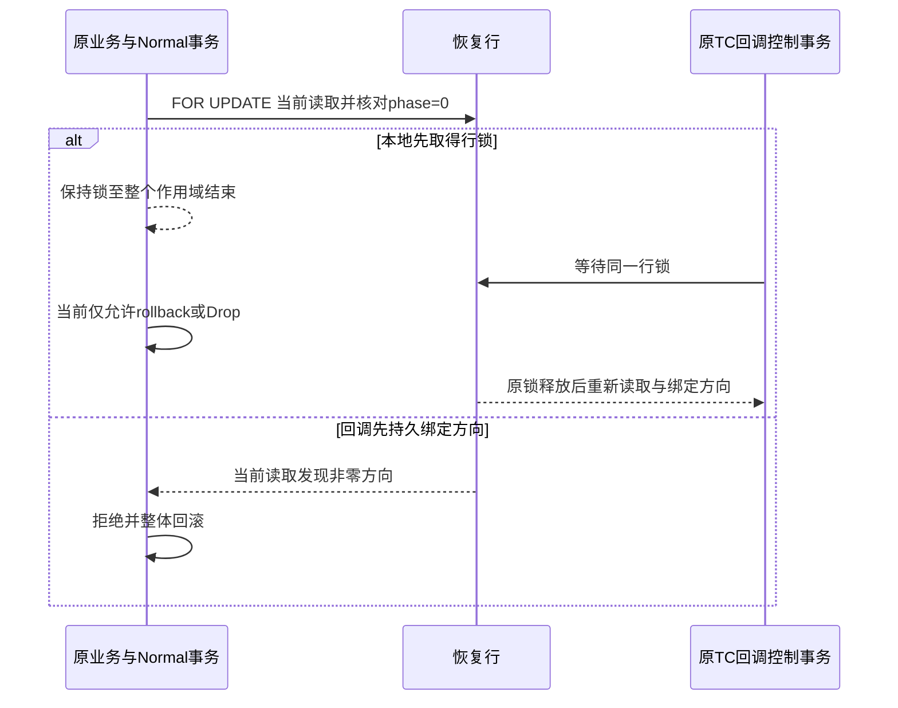

# WP05：原业务事务的提交前仲裁

沿用 [WP05](wp05-mysql-at-plan.md)、ADR-0008 和[事务准备契约](mysql-first-phase-preparation-contract.md)。本步补齐完整一阶段提交必须使用的数据库仲裁；不关闭公开业务 COMMIT、原 TC 锁覆盖、未知业务提交恢复、提交方向或完整 WP05／WP06／V1 门禁。

## 原事务与权威身份

`MySqlPreparedTransaction::lock_commit_preconditions` 消耗已准备作用域，返回不可公开构造的 `MySqlCommitCheckedTransaction`。原业务、Normal Undo 和恢复行锁必须属于同一个原物理事务，不能在独立连接上检查后释放锁。有变化分支只允许只读检查与整体回滚／Drop；明确无变化、无登记分支的作用域另有消费式本地提交。没有有变化业务 COMMIT、解封或继续写业务的公开入口。

有真实变更时，必须以原成功注册回执锁定恢复表的精确原身份，使用当前读取核对资源、应用数据、JDBC 配置、注册来源及原锁键；仅允许成功注册来源、未绑定方向、未完成状态。缺行、回调来源、已绑定提交／回滚方向或身份差异均不能获得提交前仲裁。不得新建恢复行、重新登记或将已有方向重置为零。

恢复表的精确结构、元数据可见性和持久提交配置沿用已有校验。原 Undo 结构再次在同一事务 MDL 下校验，原 root／子片按已有有界当前读取重组，Normal 原字节必须与该作用域的真实内存 Undo／原 XID／BranchId／固定 JDBC 编码一致。检查不删除、更改或自行提交任何业务、Undo 或恢复记录。

恢复表的既有结构规范还须在同身份、同实例/schema 的新元数据事务中复核，原事务继续持有目标 MDL。原字典能力版本与新事务版本不一致时拒绝原作用域；不把在线增加的新迁移列静默解释成旧能力。辅助事务只做元数据校验并回滚，连接、查询、回滚及关闭共享原操作期限。失败保留真实登记回执并关闭原业务事务，不写入一阶段见证。恢复控制和独立见证观察同样使用该入口，稳定单主路由及池外连接预算要求保持。

无实际变化且没有回执的作用域不访问恢复表或 Undo，不制造分支。发生任何失败、期限或取消时原事务被消耗并关闭；返回错误保留已经真实取得的成功回执，不把注册已知改为未知。一次调用采用一个绝对期限，期限后不得发布成功。

## 与二阶段竞争

准备阶段已经持有业务／Undo 锁，回调可能按恢复行→Undo 的顺序竞争。因此并发中允许数据库选择死锁受害者；受害者必须整体失败，不能自动重试业务或把 SQL 1213 当成功。成功仲裁只覆盖遵守相同恢复行协议的尝试；不证明任意旧写入器永远不能迟到、不证明 TC 已覆盖全部原锁键，也不授权业务提交。

## 验收与兼容

- 真实正式注册回执＋固定 MySQL：原恢复行锁在成功结果存续期间实际阻止另一事务修改，rollback／Drop 后解除；业务／Undo 始终未提交。
- 缺行、两种既有方向、终态、应用数据／资源／配置／锁键冲突、来源和异常 schema 均拒绝，真实回执与独立控制状态保留。
- 真实恢复行锁等待覆盖绝对期限、取消和未轮询 Future 丢弃；原业务／Undo 清理后不留可复用的半完成事务。
- 原 TC 回调与本地仲裁两种先后顺序；回调先绑定时拒绝，本地先锁定时回调不能提前完成；后续沿原身份收敛，不重复注册或重放业务。
- 两 Rust 工具链、原准备／受管理回滚回归、完整静态检查、实际源／程序绑定及独立只读审查；编译 API RED 与运行行为 RED 分开记录。

原仲裁继续兼容旧物理表。下文的 004 见证扩展保留原七列 Undo、既有恢复行版本和终态含义。旧准备与回滚接口保持。原 Java `ConnectionProxy#processGlobalTransactionCommit` 是一阶段边界来源，恢复行仲裁与消费式检查作用域属于 Rust 扩展，完整原对象仍 PARTIAL。

入口绝对期限只约束取得仲裁的过程，不是返回对象的持有期限。调用方必须及时结束作用域；持有期间原 TC 回调及相关 DDL 可能等待。并发改表在旧事务中也可能由 MySQL 以原错误 1412 拒绝，不能将其误判为仲裁成功。

## 一阶段提交见证

后续 [004 显式迁移](../../crates/seata_db_mysql/migrations/004_seata_rs_at_first_phase_witness.sql) 在 003 扩展表追加 `first_phase_committed`，非空、默认零。部署前停止旧写入器。旧逻辑行版本与二阶段字段保持原有含义，旧物理表仍可用于原提交前仲裁。

对已登记的分支，只有原业务事务成功核对恢复行和 Normal Undo 后才写入值 1。候选位与业务和 Undo 共同受原事务提交或回滚约束，既有值 1 拒绝再次仲裁。回调来源不能带值 1。二阶段方向、授权和终态继续使用原字段。

观察端用同一登记回执校验精确资源、XID、分支、应用数据、JDBC 配置及锁键，使用独立事务读取当前锁定值。值 1 是该原本地事务的持久见证；二阶段未终结时还必须锁定并完整读取原 Normal Undo，缺行、非法状态或分片结构错误不能返回成功。读取后须按固定 Jackson 格式解码正文，核对其中 XID、BranchId 与原回执一致且日志非空；正文错误不能当作成功。该读取不重新绑定业务表元数据或逐行核对业务镜像。二阶段终结后原回调可合法清理 Undo，历史见证仍可观察。值 0 或缺行只表示未确认。老物理表和非法值显式报错。见证不提供 TC 锁覆盖、旧尝试围栏或取消后的否定证明，公开业务提交入口继续受现有验收门槛约束。

## 当前恢复表定义回归证据

[恢复表当前规范证据](wp05-recovery-current-schema.json) 记录 MyISAM 伪一阶段见证的真实失败基线，以及七类迟到结构变更和合法 003→004 跨快照迁移的安全拒绝。两 Rust 工具链各通过 13 项提交前置、11 项准备、11 项恢复、1 项受控清理回归及 635 项工作区测试与严格 Clippy。原始失败、夹具冲突及重跑日志均保留；独立审查未发现阻断项。此局部修复未关闭原 WP05/WP06 或公开业务 COMMIT 门槛。

后续提交能力门槛：已仲裁作用域显式区分旧恢复表和 004 见证表。仅当原事务内成功暂存 004 见证时，`require_first_phase_commit_witness` 才返回成功；旧表仍允许原有的回滚仲裁，但不能作为有见证业务提交的依据。无变化分支也不伪称持有 004 见证。该检查不执行 COMMIT，不能证明持久提交或 TC 锁安全。
