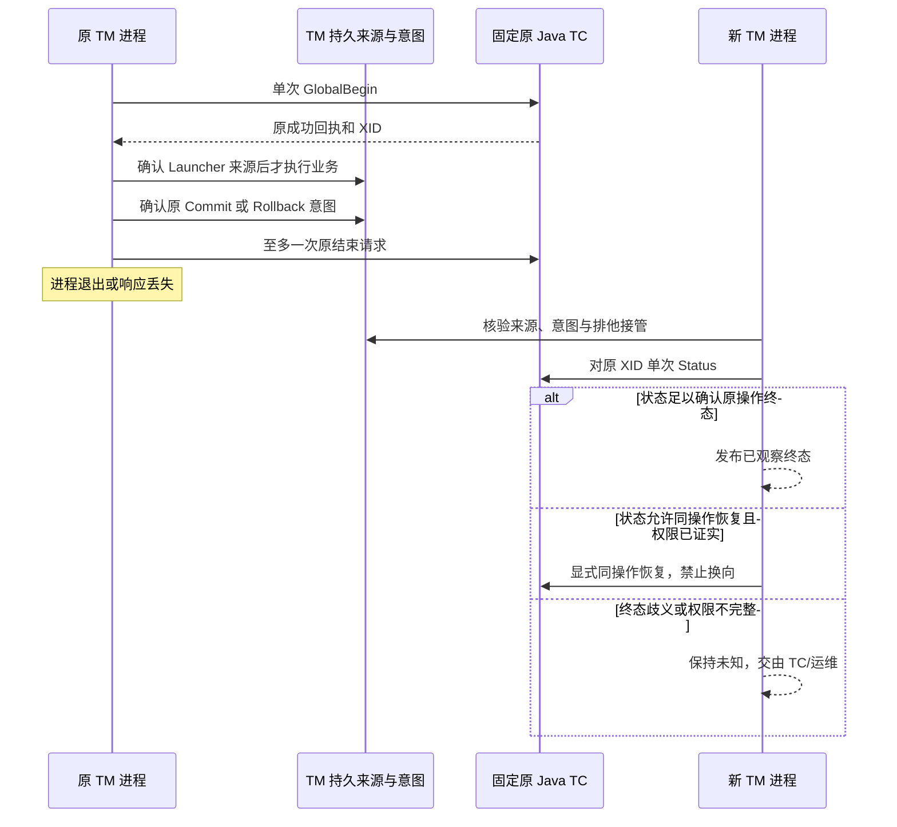
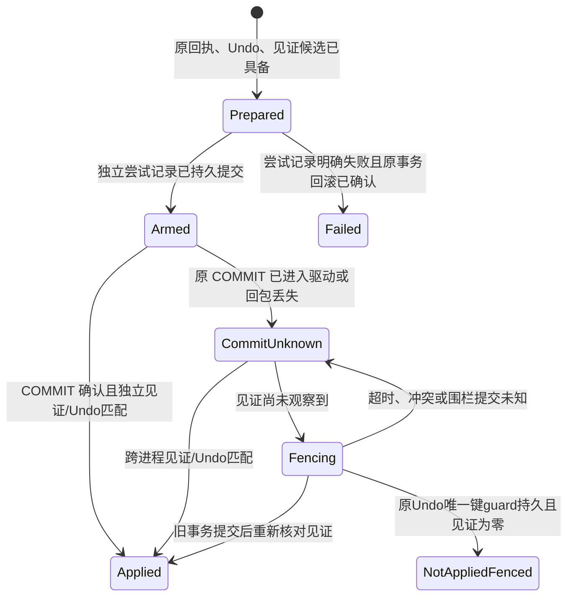
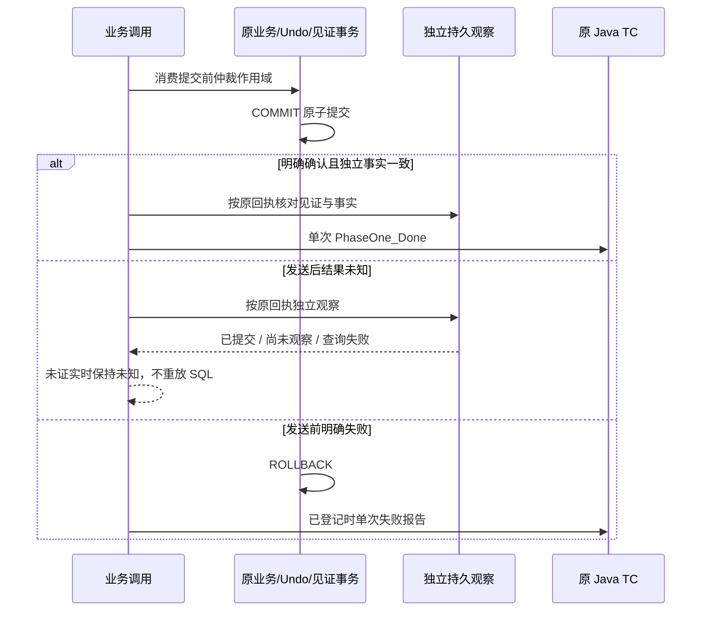
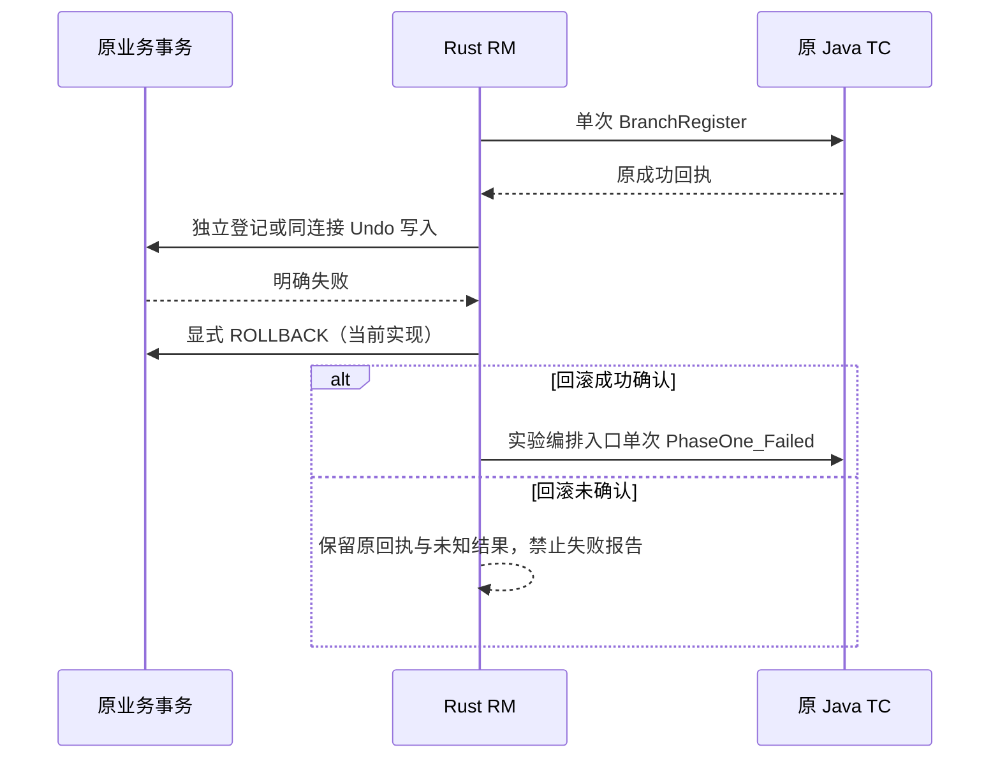

# WP05：原业务事务一阶段提交与结果分类

本文件从 [WP05 实施契约](wp05-mysql-at-plan.md)、[准备交接](mysql-first-phase-preparation-contract.md)、[提交前仲裁](mysql-commit-preconditions-contract.md)、ADR-0008 和原十四项验收继续。它定义待实现的有变化业务 COMMIT 行为，不降低原 TC 排他锁与旧尝试围栏门槛。`MySqlCommitCheckedTransaction` 已有明确无变化、无登记分支的 `commit_no_change`；默认生产构建仍无有变化业务 COMMIT 入口。显式实验特性可运行本地提交与独立见证，不代表公开生产 Gate 已通过。

## 消费式接口与原子事实

公开提交仅能消费成功的 `MySqlCommitCheckedTransaction`；不能从 `MySqlPreparedTransaction`、普通本地事务、回执或恢复行直接构造。需要实际变化时，原成功登记回执、原 XID/BranchId/JDBC 配置、Undo 原字节和 004 见证能力必须在原事务内通过现有提交前仲裁。无变化分支不创建 TC 分支，其提交结果单独分类。检查作用域拥有原 SQLx 事务直到 COMMIT 发送或明确回滚，不能先释放恢复行锁再提交。

业务、Normal Undo 和候选 `first_phase_committed=1` 必须在同一个原物理 MySQL 事务 COMMIT。成功的依据是 COMMIT 有效确认，并由独立连接按原回执看到持久见证和业务/Undo 对应事实；仅靠客户端返回、Undo 缺行或恢复行登记状态都不够。见证为零表示尚未观察到提交，不能否定已发送 COMMIT 的后续生效。

| 边界 | 对外结果 | 后续动作 |
|---|---|---|
| COMMIT 未开始且原事务回滚已确认 | 明确本地失败，保留真实回执 | 有分支时按原协议单次报告一阶段失败；无分支不报告 |
| COMMIT 确认且持久事实一致 | 本地提交成功 | 之后单次报告 `PhaseOne_Done`；报告结果另行分类 |
| COMMIT 可能已发送、响应丢失或期限/取消跨越发送边界 | 本地结果未知，保留原回执 | 独立连接按原身份观察；未观察到见证时继续保持未知，等待旧尝试围栏/原 TC 决定 |
| 持久见证与业务/Undo、回执身份不一致，或恢复查询失败 | 冲突或未知 | 保留原身份和诊断；禁止重放业务、重新注册或宣称提交失败 |

COMMIT 尝试状态须在可能发送前持久地与原事务所有权关联；取消 Future、Drop 或池连接关闭不能把已发送尝试重新归类为“未发送”。成功报告不能早于本地提交确认；报告响应丢失不能改写本地提交事实，也不能自动再次报告。TC 负责事务重试。没有任何路径盲重放业务 SQL。

### 跨进程成功报告的持久门闩

006 原身份记录只能证明曾经取得真实 TC 回执，不能证明 `PhaseOne_Done` 未发送。对同一 `(xid, branch_id)` 的正常提交报告和恢复报告，应共用单一持久 `report_started` 门闩：仅在已确认本地提交及 004/Normal Undo 一致后，先以独立 InnoDB 事务把门闩从 0 原子改为 1，并确认该控制 COMMIT，再允许发送一次原 `BranchReportRequest`。门闩提交不确定时不发送；后续读取到 1 也不重发。报告响应丢失、调用取消或进程退出均不得把 1 清回 0。门闩为 1 只表示可能已发送，不能推断 TC 已收到。此设计优先保证原 RM 不重复报告；若进程恰在门闩确认后、网络发送前退出，恢复者返回报告结果未知，由原 TC 的事务终态与运维处理，不能把它伪装成成功报告。新迁移 007 为 006 增加该字段；既有行默认置 1 保守禁止重发，新写入器明确置 0。升级前须停写并排空旧实验写入器。

### TM 重建与 Launcher 权限边界（待实现）

固定原 TC 的当前跨进程联试只重建 RM：父进程在整个测试中持有 `TransactionManager` 与原 `GlobalTransaction`，最后由该原 Launcher 发出 GlobalCommit。正式 TM 的 `recover_unknown` 凭证是与原管理器 `Arc` 身份绑定的内存能力；新进程即使知道真实 XID，也只能通过 `get_status` 查询，`participant(xid)` 无全局结束权。因此现有证据不能证明 TM 进程退出后的安全结束、未知结束恢复或整笔事务终态。不得把 006/007 RM 身份记录升级为 TM Launcher 权限，也不得用 `Finished` 状态反推原 Commit 成功。

若 V1 要支持 TM 重建结束，须先设计独立的持久 Launcher 来源与结束意图：原 Begin 的成功回执、TC 端点/应用身份、XID、事务期限和所属业务意图在业务副作用之前持久确认；发送 GlobalCommit/GlobalRollback 前持久确认原结束操作及发送状态。持久写入不确定时不得发起业务或结束请求；新进程只能接管已确认来源且原所有者已停止的意图，先查询原 TC，再依据同一原操作的明确状态决定是否允许一次显式恢复调用。持久记录不得由调用方凭 XID 或 RM 006 行伪造；不同应用、端点、意图、过期事务和损坏记录必须拒绝。若恢复查询返回 `Finished`、重试超时、stop 或互相矛盾的状态，只能保留未知并交由原 TC/运维核验。

[TM 持久 Launcher 设计](tm-durable-launcher-design.md)已细化来源、发送门闩、接管条件和故障矩阵；其首个[真实 MySQL 008 结构门禁](evidence/tm-launcher-schema/README.md)仅验证表形状与 CAS 竞争。正式 TM 尚未接入该表，不能据此跨进程结束全局事务。

实施门禁：用两个真正独立的 TM 进程及固定原 Java TC 证明原 Begin、持久来源、原业务分支、RM 报告、GlobalCommit/GlobalRollback、TC 回调与数据库终态；覆盖旧 TM 在持久来源前、意图确认前、发送前、发送后回包丢失四处退出，以及两个接管者竞争、错误身份、记录损坏、查询失败、`Finished` 歧义和原意图换向。逐案核对原 TM 帧次数及原 TC 状态。当前没有该持久 TM 实现或现场证据，此节是后续实施边界，不改变已验收 WP03 的进程内恢复 API。

### 旧尝试围栏与跨进程恢复的实施边界

实验入口现已在 `MySqlCommitCheckedTransaction::commit_changed` 可能发送原连接 COMMIT 前，经独立控制事务持久确认 006 `Armed` 记录，再读取独立见证；该记录保存原回执身份和 JDBC 配置，结构不安全或身份冲突时明确回滚原事务。`MySqlDataSourceManager::recover_commit_attempt` 现从 006 重新核对原身份，不构造 `RegisteredBranch`；先核对 004 见证，未见提交时使用原 Undo 唯一键围栏，再核对见证，仅在 guard 已持久且见证仍为零时给出 `NotAppliedFenced`。`MySqlChangedCommitError::Unknown` 仍只存在于提交调用 Future 的返回值；恢复者必须凭持久记录主动重查。现有 `FileBranchStore` 用于二阶段回调状态，不能代替此交接。恢复故障矩阵、固定原 TC 联试和完整外部锁安全尚未验收，因此实验入口仍不能作为生产接口。

实施时在原业务事务之外增加显式迁移的提交尝试记录，按原 `xid`/`branch_id` 唯一索引保存真实 BranchRegister 回执的精确资源 ID、锁键、应用数据、原成功响应前缀和 JDBC 配置，以及 `Armed` 状态。成功准备与提交前仲裁之后、**可能发送物理 COMMIT 之前**，独立控制事务必须先持久确认该行；记录失败或提交结果未知时绝不发送业务 COMMIT。记录不得从 TC 回调推造原成功回执，不得覆盖不同身份，也不得用新申请代替旧编号。现有 `RegisteredBranch` 无公开构造或反序列化入口，恢复接口必须通过经持久身份核验的专用类型读取记录，不能放开任意调用方伪造回执。升级时停写并排空不写此记录的旧写入器，否则恢复路径不得声称覆盖它们。

恢复者持原尝试身份先读取原 004 见证；见证及其 Normal Undo 与原身份一致时可确认 `Applied`。原 004 恢复行缺失必须保持 `Unknown`，不能当成见证零。已确认原行存在但未见见证时，必须用同一原 Undo `(xid, branch_id)` 唯一键执行现有持久围栏：旧事务若仍持有未提交 Undo，围栏等待它终结；Normal Undo 胜出则重新核对见证，guard 胜出并持久确认后再重新核对见证。只有**已持久确认 guard、原 004 行仍在且见证仍为零**，才允许发布 `NotAppliedFenced`；Normal Undo 与零见证不一致、围栏 COMMIT/查询未知、身份冲突、期限到达或取消均保持 `Unknown`。`NotAppliedFenced` 不授权重放业务 SQL 或重新注册，由 TC 的原事务决定后续动作。

验收需以固定原 Java TC、自有真实 MySQL 和双 Rust 工具链分别阻断：尝试记录提交前、记录提交后物理 COMMIT 前、COMMIT 发出未生效、服务器已 COMMIT 但响应丢失、围栏等待旧事务提交/回滚、围栏自身回包丢失及恢复查询故障。另以独立子进程在上述关键点退出并由新进程读取持久记录恢复；对每例核对原帧一次性、原身份、尝试记录、见证、Undo/guard、业务行、TC 终态和回调。必须加入能让错误 `NotAppliedFenced` 判定失败的有效削弱对照。只有这些证据与外部锁覆盖同时满足，才可考虑公开有变化 COMMIT。

## TDD 与现场门禁

无变化路径已单独落地：原事务经准备和仲裁后，无回执、无 Undo、无候选见证才允许消费式 `commit_no_change`。它向 MySQL 发送一次 COMMIT，不向 TC 报告。驱动失败、操作期限或期限后完成保守返回结果未知；有变化分支在发送前拒绝并保留原登记回执。真实 MySQL general_log 证明一次 COMMIT，断开原连接和[服务端 OK 被截留](evidence/mysql-no-change-commit-loss/README.md)分别证明未知分类与有界等待。无变化提交不能用来证明业务/Undo 原子提交，两工具链回归与完整有变化分支的故障门禁分别追踪。

固定原 Java TC 已补齐无变化路径双工具链默认构建联试。零行 UPDATE 后只发送一次本地 COMMIT。原 OK 正常送达时本地确认成功，原 TM 完成 GlobalCommit。MySQL OK 被截留时本地保持未知，原 TM 完成 GlobalRollback。两侧均核对原 XID、零分支报文与持久表终态。[现场证据](evidence/java-tc-changed-commit-report/README.md#无变化本地提交与确认丢失)。

[影响行与镜像保护](evidence/mysql-affected-image-guard/README.md)另保证驱动报告有受影响行时，空 before/after 镜像不会让作用域被归为无变化。该保护已通过纯形状反例和双工具链真实 DML 正向回归，尚未注入“真实驱动错误返回正影响数但空镜像”的负向现场故障。

默认关闭的 `experimental_changed_commit` Cargo 特性现已提供消费式有变化本地 COMMIT：必须持原成功回执、非空 Undo、004 候选见证及匹配的独立观察者，在原连接一次 COMMIT 确认后按原回执读取持久见证。发送前缺前提返回明确拒绝并保留回执；驱动失败、独立观察失败或未见见证保守返回带原回执的未知结果。现有 `commit_changed` 只提交本地事务，不发送 TC 一阶段报告，也不重放业务 SQL。真实 MySQL 已验证业务/Undo/见证同时持久化、一次 COMMIT、旧表拒绝、原连接断开和提交后观察者不可用；详见[实验现场证据](evidence/mysql-changed-commit-lab/README.md)。新增代理在服务器已回 OK 后扣留原 COMMIT 响应，实验接口保守返回携原回执的 Unknown，而独立连接仍观察到业务、Undo 和持久见证；详见[OK 丢失证据](evidence/mysql-changed-commit-ok-loss/README.md)。实验特性不能替代原 TC 排他锁完整覆盖、旧尝试围栏和报告故障矩阵；默认生产构建仍不暴露有变化提交，验收门槛不变。

实验报告编排沿用同一特性：消费式 `commit_changed_and_report` 已实现，只有本地 COMMIT 确认且独立见证匹配后才按原登记身份发送一次 `PhaseOne_Done`。报告明确拒绝、发送前失败、响应丢失保留原 `RmCallError`，同时携带已确认的本地提交事实和原回执；报告失败不能改写本地提交成功，也不能自动重发报告。提交未确认不得发送 `PhaseOne_Done`。本步不把隐式 Drop 回滚当作已确认回滚。受控原报文对端现场已覆盖报告成功、收到请求后断连以及本地结果未知不报告，双工具链各 23 项现场回归通过；详见[实验报告证据](evidence/mysql-changed-commit-report/README.md)。

同一默认关闭特性新增 `rollback_and_report_failure`，分别接受已准备及已仲裁作用域：消费原事务，只有驱动明确确认回滚、且存在真实分支回执时，才单次发送 `PhaseOne_Failed`。无分支回滚返回 `None`；回滚未确认绝不报告，报告失败保留原回执、本地回滚事实和原 `RmCallError`。三个真实 MySQL 用例已在自有 Windows MySQL 8.4.13 上由 Rust 1.85/1.99 分别实际通过：报告到达前业务/Undo 不可见、报告响应丢失仍保留回滚事实、回滚前断开原连接禁止失败报告；原始日志见[现场证据](evidence/mysql-native-prepare-20261124/README.md)。固定原 Java TC 的已登记本地明确回滚／失败报告单例也在双工具链通过，见[原 TC 报告证据](evidence/java-tc-changed-commit-report/README.md)；准备内部错误、报告响应丢失、回调竞争及跨进程恢复仍属原门禁。

准备阶段还有一个独立窗口：`MySqlTransactionPreparer::prepare` 在成功取得原回执后，独立 `enroll` 或同连接 Undo 写入可以失败。现已在这两个明确错误路径中按原入口绝对期限显式回滚原事务，`Enrollment`/`Undo` 错误同时保存真实回执和回滚结果；只有驱动返回 `Ok(())` 才提供 `local_rollback_confirmed=true`。回滚错误、期限取消、进程退出均不能合成确认；最外层期限取消仍返回携已知回执的 `Deadline`。

默认关闭的实验特性提供 `prepare_transaction_and_report_failure` 编排入口：调用方传入空错误槽，`BranchRegister` 等待开始前记录“申请可能生效、回执未知”，取得真实回执后更新原身份；准备等待取消仍保留该保守状态。已登记且显式回滚成功的准备错误触发一次原 `PhaseOne_Failed`；报告等待被取消时，错误槽保留原回执与已尝试门闩，禁止再次报告。正常返回时 `MySqlPrepareReportedError` 同时保留原准备错误、原回执与独立报告结果。原 `prepare_transaction` 继续提供显式 `report_failure_after_rollback` 调用方式。回滚未确认时不报告。受控原 TCP 测试验证了两个登记进度阶段、报告字段、成功响应、取消后的回执与单次约束、TC 明确拒绝，以及编排入口的已确认与未确认路径。Rust 1.99/1.85 各五项目标测试及完整库测试（各 45 通过、4 项需外部 MySQL 而忽略）实际通过；实验特性严格 Clippy 通过。自有 MySQL 现场现验证了 Undo 冲突触发显式回滚与失败报告、断开原连接后不伪报回滚成功，以及注册等待取消的保守状态；原 `BranchRegister` 绝不重发，也不能以独立连接暂未看到业务行代替旧事务已终结。固定原 Java TC 的 Undo 表与控制表安全检查拒绝／显式回滚／自动失败报告，以及真实 Undo 唯一键冲突后的自动失败报告，现均由双工具链运行并独立核对原报告响应与终态，见[原 TC 联试证据](evidence/java-tc-changed-commit-report/README.md)。触发器用例在写入前拒绝；唯一键冲突用例则以 TC 实际分配的 BranchId 预置冲突，在 `Undo insert` 收到 SQLSTATE `23000` / MySQL 1062，回滚后保留预置 Undo 而无业务行。原 TC 的控制登记真实写入故障、回滚丢响应、报告丢响应、回调竞争及更多故障点仍未完成。

默认构建另提供 `prepare_transaction_with_progress`，把相同的注册前“可能生效”状态和已取得的真实回执写入调用方空错误槽。正常返回后清空中间态，以原 `Result` 提供最终分类；外部取消 Future 后槽内状态仍可读取。原 `prepare_transaction` 保持兼容，但不会在外部取消时保全调用方可见的中间进度。该默认接口的真实 MySQL 注册等待取消用例已由 Rust 1.85/1.99 在自有实例上分别通过；进度槽不替代原事务回滚确认或持久恢复围栏。

新增两条自有 MySQL 现场测试：实验特性用例预置原 Undo 唯一键冲突，在原 TCP 对端收到 `PhaseOne_Failed` 时独立查询业务行已回滚、冲突 Undo 仍在、控制登记已持久，并核对报告原身份和一次性；默认构建用例在真实业务事务已发出注册申请但 TC 不回包时取消准备 Future，检查调用方错误槽保留“登记可能生效”而没有伪造回执。Rust 1.99/1.85 在自有 Windows MySQL 8.4.13 上分别实际通过两例，并完成准备目标各 15 项与提交前置条件目标各 26 项普通回归；另用原 OK 截留代理各通过 1 项故障单例。详见[现场证据](evidence/mysql-native-prepare-20261124/README.md)。随后固定原 Java TC 的选定有变化 COMMIT／成功报告路径也在双工具链通过，见[原 TC 证据](evidence/java-tc-changed-commit-report/README.md)；全局锁完整覆盖、旧尝试围栏、失败与未知报告及 WP05 完整门禁继续开放。

固定原 Java TC 的后续现场又覆盖了已登记明确回滚、Undo/控制表安全拒绝、原真实 BranchId 的 Undo 唯一键冲突，以及已准备分支的成功与失败报告原成功回包丢失。代理分别记录并截留原 `BranchReportResponse`；失败路径保留本地回滚确认和原回执，随后 GlobalRollback；成功路径保留独立确认的本地 COMMIT 与原回执，随后 GlobalCommit 和原 TC 回调完成。两者均把报告结果分类为未知且没有第二次报告，数据库终态与原帧已独立核对。Rust 1.99/1.85 各运行选定故障单例通过，详见[原 TC 联试证据](evidence/java-tc-changed-commit-report/README.md)。准备错误后的报告丢失、回滚确认丢失、跨进程恢复和完整锁安全仍未验证。

其后又以固定原 TC 双工具链补验 `Undo` 准备安全拒绝后的自动失败报告回包丢失：准备错误保留原回执和已确认的本地回滚，报告结果分类为未知；单次门闩阻止重复发送，GlobalRollback 后七项终态计数全零。触发器由元数据检查在实际 Undo INSERT 前拒绝，因此本证据不代表真实数据库写入错误的报告丢失。控制登记真实写入故障、回滚确认丢失、跨进程恢复和完整锁安全仍待验证；原始记录见[固定原 TC 证据](evidence/java-tc-changed-commit-report/README.md)。

控制登记 INSERT 的真实 1062／23000 现有双工具链固定原 TC 证据：只使用原 TC 实际分配的 BranchId 预置同身份回调归属行，独立 MySQL Execute 错误事件证明发生实际写入冲突。恢复层对重复键后的既有行作 `CallbackObserved` 分类，准备层保留原回执、确认本地回滚后单次失败报告；全局回滚前清除测试预置行，最终七项计数为零。此场景不证明其他控制写入故障、该路径报告回包丢失、跨进程恢复或完整锁安全。详见[固定原 TC 证据](evidence/java-tc-changed-commit-report/README.md)。

该控制登记重复键冲突现又覆盖原 TC 成功报告回包丢失：MySQL 独立记录实际 1062／23000，原 TC 接收唯一一次 `PhaseOne_Failed` 并发成功回包，代理截留后 Rust 保留原 `CallbackObserved` 错误、真实回执和已确认回滚，报告结果为未知且重发被拒绝。双工具链 GlobalRollback 后七项终态计数全零。此为特定真实重复键场景；其他写入错误、跨进程恢复及完整锁安全仍需验证。见[原始证据](evidence/java-tc-changed-commit-report/README.md)。

RM 原 TCP 控制面另有已执行的 `PhaseOne_Failed` 明确拒绝用例：受控对端读取一次原报告，返回 `BranchReportFailed`，客户端保留原请求/响应、隐藏服务端错误文本并分类为明确拒绝；对端检查没有第二次报告。Rust1.99/1.85各运行该测试目标6项通过，严格Clippy与格式检查通过。该用例不触及MySQL本地回滚或固定原Java TC，不能填补上述现场门禁。

先用自有 MySQL 和固定原 Java TC 写失败用例：受控 COMMIT 前拒绝、COMMIT 后断开、服务器已持久化但确认丢失、COMMIT 阻断与取消、报告丢失、旧事务迟到、回调先后竞争。每例独立核对业务/Undo/见证/恢复行、原报文和 TC 锁行；注入错误后测试必须会失败。真实数据库原子提交、旧尝试围栏和原排他锁覆盖均需现场证据。Rust 1.99/1.85、原 Java TC、严格静态检查及受影响恢复回归齐备后，才能审计 WP05 十四项和公开 COMMIT Gate。已有受控协议对端、回调清理及只读见证测试不能代替这些证据。

固定原 Java TC 的 007 报告门闩 COMMIT 回包丢失在 Rust 1.99/1.85 均通过。门闩更新生效、原 COMMIT OK 未送达的情况下，恢复返回 `Claim` 未知，后续调用只返回 `AlreadyStarted`。TC 原始帧无分支报告，原 GlobalRollback 最终补偿业务并保留防悬挂记录。[原 TC 证据](evidence/java-tc-changed-commit-report/README.md#007-报告门闩-commit-回包丢失)。

007 门闩确认后发包前退出的固定原 TC 场景，Rust 1.99/1.85 均验证原 MySQL OK 已送达、子进程终止前没有 BranchReport、按同一原身份恢复返回 `AlreadyStarted`。原 TC 在父进程发起 GlobalRollback 后完成补偿及防悬挂记录写入。[现场证据](evidence/java-tc-changed-commit-report/README.md#007-门闩确认后发包前退出)。

### 006/007 授权检查

提交尝试存储须在原控制事务持有 006 表的元数据锁时确认触发器与跨库外键可见性。账号可通过表级直接 `TRIGGER` 满足 006 触发器检查。全局 `PROCESS` 仍用于跨库外键字典。可读写 006 但缺少触发器可见性时，读取、持久化尝试及报告门闩均在元数据校验阶段失败，不能将结果解释成缺失记录或安全可写。

旧实现的缺权对照返回 `MissingAttempt`。修复后，读取仍保持观察错误，指明 006 触发器不可见。独立 SQL 确认该探查未创建原事务、006 行或 Undo，也未触碰业务行。只新增 006 表直接 `TRIGGER` 授权后，同一 Rust 账号完成实际有变化提交及报告。提交前独立连接只看到原全局锁，业务余额仍为原值，Normal Undo 和 006 无行，004 见证仍为零。提交后业务、Normal Undo、004 见证和 007 门闩一同可核对。原 TC 收到一次 `PhaseOneDone`，与后续同分支的提交回调及 SQL 终态一致。

同一资源的受限 Java 写入器在 Rust 持锁期间收到原 TC 锁冲突，原 JDBC 连接核对本地回滚。Rust 全局提交释放锁与 Normal Undo 后，配置匹配的 Java 新 XID 成功登记和提交。两端都对 005/011 绑定只读。Rust 006/007 表级授权和全局 `PROCESS` 属于选定账户配置。公开业务 COMMIT 及完整外部写入器门槛继续开放。

[缺权对照](evidence/at-writer-permissions/seata_original_guard_i_0md8km/client-stdout.log) · [Rust 1.99](evidence/at-writer-permissions/seata_original_guard_yps9wiz6/result.json) · [Rust 1.85](evidence/at-writer-permissions/seata_original_guard_8sv4j8zf/result.json)

固定原 Java TC 下，006 持久后原业务 COMMIT 被截留，独立业务进程随后退出，Rust 1.99/1.85 都完成了恢复围栏与原分支回调验证。恢复直到原 MySQL 会话终止并确认围栏后才返回 `NotAppliedFenced`，原报文没有成功报告。见[请求截留证据](evidence/java-tc-changed-commit-report/README.md#006-已持久化且业务-commit-被截留后进程退出)。

原 MySQL 已返回 COMMIT OK、业务进程未收到响应就退出的固定原 TC 场景也在 Rust 1.99/1.85 各通过。独立连接在原物理会话退出前看到 006、004、业务和 Normal Undo，且 007 为零。确认原会话终止后，恢复端返回 `Applied`，通过替换 RM 单次报告并完成原分支提交。见[响应截留证据](evidence/java-tc-changed-commit-report/README.md#业务-commit-已持久化且-ok-交付前进程退出)。

Rust 1.99/1.85 也验证了 MySQL 正在执行原 COMMIT 时原业务进程退出。服务端在子进程被回收后仍报告同一原物理会话在执行 COMMIT，此时独立查询仍看不到业务、Normal Undo 与 004。原会话消失后观察到三者持久化，恢复按原身份返回 `Applied` 并单次报告，原 TC 完成同一分支提交。[执行中退出证据](evidence/java-tc-changed-commit-report/README.md#mysql-执行原业务-commit-期间进程退出)。

原业务进程退出后，围栏 COMMIT 已生效但确认丢失的场景已在固定原 Java TC 和 Rust 1.99/1.85 通过。第一次返回围栏 COMMIT 未知并保留原身份。重新锁定读取已持久围栏才得到 `NotAppliedFenced`，原 TC 完成回滚而未收到 BranchReport。[现场证据](evidence/java-tc-changed-commit-report/README.md#undo-围栏-commit-确认丢失)。

固定原 Java TC 已覆盖原 004 见证查询超时。Rust 1.99/1.85 读取同一原分支主键时，观察到真实行锁等待与服务端查询错误。首次保持 `Observation` 未知，独立 SQL 验证未写围栏。只有解除行锁并重新读取原见证，才持久化围栏并得出 `NotAppliedFenced`。原 TC 完成回滚且收到零分支报告。[现场证据](evidence/java-tc-changed-commit-report/README.md#004-恢复查询超时)。

固定原 Java TC 已覆盖 006 控制 COMMIT 成功但确认丢失的场景。Rust 1.99/1.85 均返回携原成功回执的 `Arming`，其控制结果保持未知，业务回滚已确认。原业务连接零 COMMIT 请求，独立 SQL 在断连前已观察到持久 006，后续按同一原身份持久围栏并完成原 TC 回滚。[现场证据](evidence/java-tc-changed-commit-report/README.md#006-控制提交确认丢失)。

006 控制 COMMIT 尚未抵达 MySQL 的窗口也已通过固定原 Java TC 双版本联试。原业务连接明确回滚且零 COMMIT。恢复端查不到 006，按原身份保持 `MissingAttempt`，无围栏或成功报告。原 TC 的回滚回调随后原子提交同一原分支的防悬挂记录与回滚终态。[现场证据](evidence/java-tc-changed-commit-report/README.md#006-控制提交请求未到达-mysql)。

原业务会话仍持有事务时，固定原 Java TC 的两侧并发恢复均已在 Rust 1.99/1.85 实际验证。恢复连接先在原分支 004 主键行上等待，原事务结束后使用同一次恢复查询判定。原业务回滚产生一次围栏与 `NotAppliedFenced`，原业务提交得到 `Applied` 并单次报告成功。两侧完成对应的原 TC 回调。[现场证据](evidence/java-tc-changed-commit-report/README.md#原业务会话持锁时并发恢复)。

有变化 COMMIT 在 MySQL 生效且确认滞留时，Rust 1.99/1.85 均验证了业务结果未知、池内旧物理会话退出以及同一池的两个槽位可同时借出。独立 SQL 在新事务显式回滚后核对业务、Normal Undo 与 004 持久状态，按原 XID 和 BranchId 恢复得到 `Applied`。固定原 TC 只收到一次成功报告并完成原分支提交。[现场证据](evidence/java-tc-changed-commit-report/README.md#有变化-commit-超时后的连接池回收)。

### 持久 Undo SHA-256

显式应用 013 后，新登记行使用版本 4。在原业务事务校验精确 Undo 字节后，将 SHA-256 写入恢复行，再写入一阶段见证。摘要与业务、原 Java Undo 及 004 见证共用物理提交。原 Undo 表和 Jackson 格式保持原定义。

独立恢复校验当前 Undo 与持久摘要。不匹配返回 UndoChecksumMismatch 并保持未知。原 TC 的提交和回滚回调在使用 Undo 前校验，失败保持可重试，修复原字节后可继续。历史版本 1 至 3 的行保持原读取语义，迁移不会填充或推造历史摘要。升级需要停写并排空旧写入器，旧程序无法识别新增物理列。

SHA-256 用于发现 Undo 内容变化。具有同时修改 Undo、摘要及版本字段权限的管理员仍可改写两者，生产角色必须隔离恢复表写权限。

回滚方向的现场用例使用同一已报告分支，改写 Undo 后由原 TM 发出 GlobalRollback。原 TC 收到可重试状态 9。独立 SQL 在恢复原字节前核对持久摘要仍对应原内容，随后原 TC 重试并完成补偿和防悬挂终态。迁移兼容用例先用版本 3 提交真实业务和 Undo，再应用 013，确认原行版本仍为 3、摘要为 NULL，按原身份恢复并完成提交。
