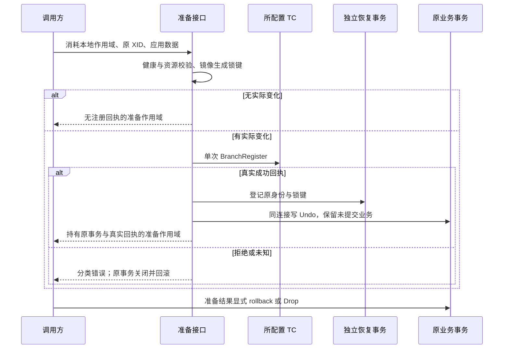

# WP05：一阶段事务准备交接

延续 [WP05](wp05-mysql-at-plan.md)、[回调归属契约](mysql-callback-ownership-contract.md)及 ADR-0008。本文件细化既有一阶段链路的准备步骤，完整原范围与验收门禁保持。

## API 与顺序

`MySqlDataSourceManager::prepare_transaction` 消耗一个原 `MySqlLocalTransaction`，参数为正式 `ResourceClient`、原 XID 与原可选应用数据，返回不可公开构造的 `MySqlPreparedTransaction`。它拥有原事务、已取得时的真实 `RegisteredBranch` 及固定 JDBC 配置，只允许检查身份／日志数量与回滚；没有 COMMIT 或取出原事务的入口。

1. 校验原事务仍健康、尚未封存、资源与管理器精确一致；校验 XID 和 None／Some 应用数据，不规范化原值。
2. 从该事务已经产生的实际 Undo 镜像，按管理器固定 JDBC 配置构建完整原锁键集合。保持既有格式，不转义／hash／改写原主键，不以白名单缩小完整 TC 安全门禁。
3. 没有实际变化时，不向 TC 注册，也不创建恢复行；仍将原作用域封装为只能回滚的准备结果。
4. 有变化时按管理器选定的 TC 存储配置校验原锁表字段长度。任一端启用 `MySqlOptions::require_at_resource_binding()` 时，在原业务事务锁定和核对预置的 JDBC 资源 ID。通过后，正式客户端只申请一次 BranchRegister。明确拒绝和可能已生效但响应丢失分开保留；未知时不重发、不合成编号。
5. 取得真实成功回执后，调用既有受管理登记保存原身份／锁键／配置。回调先到时沿用 CallbackObserved 拒绝迟到一阶段交接。
6. 在原物理业务事务中写入原七列 Undo。唯一键与 GlobalFinished 围栏竞争保持原行为；失败不得返回准备成功。

## 失败、取消与期限

准备步骤共享一个从入口起计算的绝对期限。取得成功回执后发生登记／Undo 失败时，错误保留该真实回执，允许后续核对原控制状态，不授权重放原业务或重新注册。外层期限到期而注册可能已发送时保留未知；若已经取得编号则保留真实回执。失败或取消消耗并关闭原本地作用域，不能取回继续写入；独立恢复行即使已提交仍供原 TC 回调恢复，不清除它来伪造无副作用。

已有低层 `flush_undo_logs` 保持兼容：它不证明 TC 登记，也不能自行提交。准备结果不证明 TC 锁覆盖安全、业务与 Undo 已提交或所有旧一阶段尝试均已围栏。所有公开业务 COMMIT、提交方向和完整 WP05／WP06／V1 门禁继续 OPEN。

## 本步验收

- 真实 MySQL＋原包受控 TCP：实际镜像生成原请求锁键；成功编号及可选数据被保留，独立恢复行与未提交业务／Undo 分属正确物理事务；准备 rollback／Drop 后业务和 Undo 不可见。
- 空作用域和零行 DML 不注册；错资源、poison、已低层封存、非法可选值在网络申请前拒绝。
- 明确 TC 拒绝、响应丢失、早到回调、Undo 写入失败与实际 Guard 竞争保持分类及原真实身份；不自动重发或重放。
- 取消或绝对期限覆盖等待注册、登记锁等待和 Undo 锁等待；来源登记可能已经提交时不虚报无效应。
- 独立登记 COMMIT 请求阻断、成功响应丢失和延迟响应均保留真实已知回执；不写入 Normal Undo 或提交业务，后续原回调分别核对已知来源／创建回调来源并完成回滚。
- 固定原 Java TC＋正式 TM/RM＋实际数据库验证准备后主动回滚，再由原 TC 回调恢复／结束；检查真实 BranchId、原包、原文件和独立数据库事实。
- 两 Rust 工具链的受影响测试、完整检查、源／程序／报文绑定与只读审查；原 Java JUnit 与完整源迁移未执行部分继续保留。

## 内部临时键表与原回滚警告

插入器既有内部临时键表的 CREATE／INSERT／DROP 也必须纳入原物理事务报文检查，不扩展用户 SQL 的 DDL 支持矩阵。依据 [MySQL 8.4 隐式提交说明](https://dev.mysql.com/doc/refman/8.4/en/implicit-commit.html)，CREATE／DROP TEMPORARY TABLE 不隐式提交，但临时表创建／删除本身不能由 ROLLBACK 撤销；[原错误说明](https://dev.mysql.com/doc/mysql-errors/8.4/en/server-error-reference.html)区分 1751／1752 与非事务业务数据的回滚警告。

本次固定版本正向案例允许原 ROLLBACK 的两个临时 DDL 警告，前提是完整原表生命周期、各语句 IN_TRANS 回包、业务／Undo 同物理 BEGIN／ROLLBACK、独立最终行数及另一原 mysql 客户端的真实 1751／1752 探针全部吻合。不得笼统忽略 warnings，不把临时 DDL 宣称为可回滚，不据此关闭一阶段业务 COMMIT 或完整原子性门禁。
