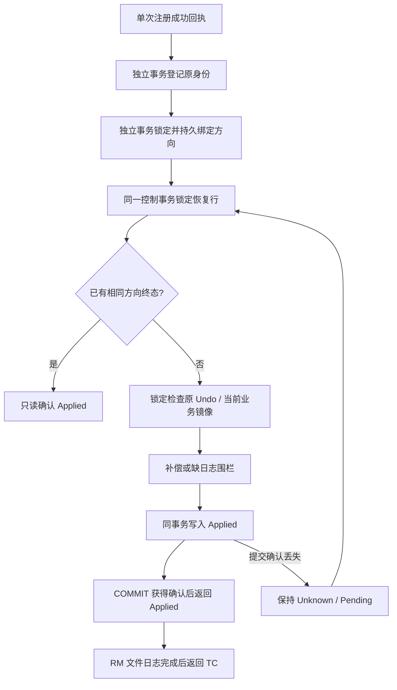

# WP05：MySQL RM 持久恢复记录

既有 WP05 契约的实施细化，沿用 ADR-0008。Java 基线为 `cba73e180fd8896a99df6415b859d275122feaa7`。不改变原七列 `undo_log`，不关闭 WP05/WP06、TC 锁覆盖或公开业务提交门禁。

## 身份与迁移

- 注册回执只能由正式 `ResourceClient` 在单次、匹配的成功 BranchRegister 响应后产生。保留原 XID、资源、模式、应用数据、锁键和精确正 i64 BranchId；不从回调、调用方填写的身份或丢失响应合成回执。已有低层注册 API 保持兼容。
- 独立版本化表 `seata_rs_at_branch_v1` 保存原身份、JDBC 配置、不可逆的二阶段方向和终态。迁移由部署者显式执行；生产接口只校验，不建表、不修表、不清理历史记录。表名保留，不能作为 AT 业务表。
- 本步只接通受管理分支的回滚恢复。提交方向返回 Unknown；公开一阶段业务 COMMIT 继续不可用。测试中的已提交业务/Normal 日志由自有夹具重建，不冒充正式一阶段提交。
- MySQL 身份以字节比较；XID 为 1..128 字节，原 BranchId > 0，资源及应用数据保持已有 RM 上限和 None 语义。回执证明所配置 TC 的实际响应，不提供密码学远端认证，已有生产认证/TLS 门禁不变。

## 事务与恢复事实

1. 所有适配器尝试先锁定同一恢复行；身份、配置或已绑定方向不匹配时不执行补偿。方向独立持久化，补偿失败也不能由另一个实例切换方向。
2. 补偿、原日志清理（或缺日志 GlobalFinished 围栏）和恢复终态必须在同一物理 MySQL 事务中提交。禁止调用会自行提交的 `rollback_undo_log` 再另写终态。
3. `recover` 首先锁定读取。已有终态提供权威 Applied；无终态证明本适配器的旧补偿没有提交，才允许在锁内继续原 Undo 的检查与收敛。迟到尝试只能在锁后观察终态，不能重复补偿。这是有持久前置证明的恢复，不重放原业务 SQL，不返回 NotApplied。
4. 缺少登记行、未知提交、脏数据、异常 schema/权限均保持未决；不能把“无 Undo”单独解释为历史成功或所有旧一阶段已围栏。当前保证覆盖遵守恢复行锁协议的适配器尝试；未来正式一阶段入口也必须在业务+Undo 提交前检查同一行。

   对应固定 Java 的脏数据检查，只有在控制 COMMIT 尚未开始且回滚镜像明确不匹配时，适配器才报告需要人工处理，RM 返回 `PhaseTwoRollbackFailedUnretryable`。已绑定的回滚方向、业务和原 Undo 保留，文件日志继续为 Pending。运维校准后，按原身份显式执行恢复可继续检查和补偿。连接、权限、元数据和 COMMIT 确认不确定仍保持可重试未知。
5. 独立控制调用采用一个绝对期限，取消时关闭连接；COMMIT 开始后没有有效确认一律 Unknown，之后通过原身份读取持久终态。不得自动重发 BranchRegister 或原业务 SQL。
6. 固定表必须为无触发器/双向外键/额外约束的 InnoDB 基表，精确列/唯一主键与版本，`innodb_flush_log_at_trx_commit=1`；在同事务 MDL 下校验，拒绝不可见元数据。部署者不得绕过协议修改已登记身份/终态，或并发使用不受管理的一阶段提交入口。

## 验收

真实 TCP 覆盖回执成功、失败、丢失、非法编号、可选字段与不可伪造边界。真实固定 MySQL 覆盖显式迁移、错误 schema、重复登记、身份冲突、方向持久性、Normal 补偿与终态原子性、缺日志围栏、并发重复、脏数据保留、取消与重启后的恢复；提交响应丢失必须有独立数据库事实。两套 Rust 工具链与现有回归、静态检查均提供实际执行结果，未执行项继续可见。

## 部署兼容与回退

显式前向迁移为 [001_seata_rs_at_branch_v1.sql](../../crates/seata_db_mysql/migrations/001_seata_rs_at_branch_v1.sql)。它只创建新表，原日志无回填、无修改；已有 Java 分支不能靠扫描 Undo 自动变成受管理身份。首次部署在启用适配器之前执行，建表锁只作用于新对象，禁止夹带到业务事务或启动时隐式执行。随后使用与生产相同权限的连接核对结构、InnoDB 持久配置与元数据可见性。

新旧客户端可继续使用各自未托管资源；同一受管理分支不得混用绕过恢复行协议的旧适配器或外部写入器。停止启用新适配器可作为应用回退，但必须保留恢复表和所有未决/已完成记录，继续处理在途原身份；不得自动 DROP、截断、GC 或清空终态。需要删除迁移对象时必须先另行完成停流、分支清账和人工核对，不提供带数据删除的自动回退脚本。

当前主机只验证固定 MySQL 8.4.13 单机、显式 loopback 非 TLS 夹具；复制切换、灾备、生产认证/TLS、保留期/容量运维及完整原 Java 测试迁移继续开放，不从单机提交确认推导跨节点持久性。
