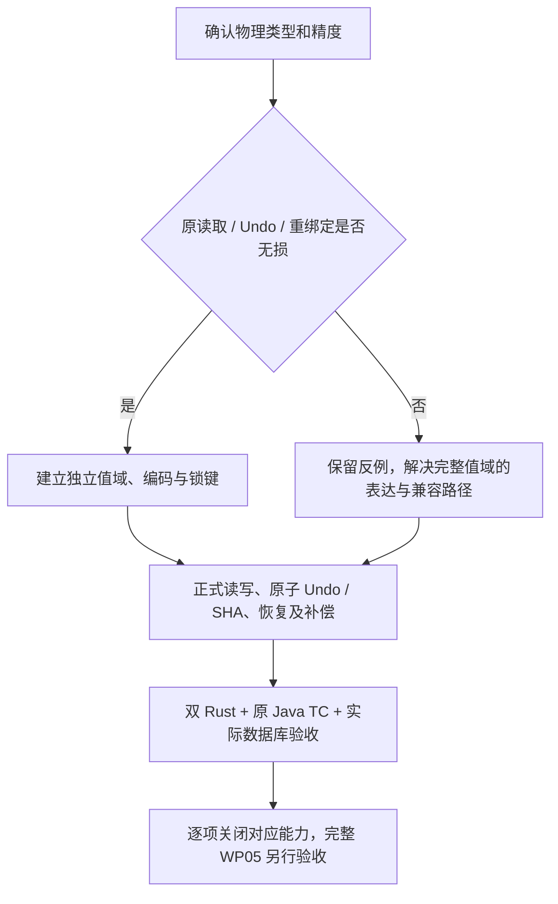

# WP05：DATE、TIME、TIMESTAMP 兼容性与后续实施

这是原架构 9.3 和现有 WP05 的增量实施依据，不修改完整时间类型要求，也不关闭任何 V1 门禁。DATETIME 的实现和已验证范围仍以 [DATETIME 契约](mysql-datetime-contract.md)为准。本契约记录其余三类的原实现事实与待完成验收。

## 真实原实现参考

固定 Java 提交 `cba73e180fd8896a99df6415b859d275122feaa7`、Connector/J 8.0.27、Jackson 2.18.3、JDK 17.0.12、MySQL 8.4.13。重新编译 18 个原源码与一个只用于观测的 Java 入口，使用原 `MysqlTableMetaCache`、`TableRecords.buildRecords` 和 `JacksonUndoLogParser`。在 JVM UTC/Asia/Shanghai × 匹配的驱动/数据库会话 UTC/+08:00 四种组合中，分别读取、原编码、原解码、JDBC `setObject` 重绑定并核对数据库实际文本。Undo parser 明确设为 UTC。

权威现场见[时间类型原实现参考](evidence/mysql-temporal-reference/README.md)。每组 29 个合法数据库行，共 116 次观测。非法 TIMESTAMP 另由服务器返回 1292。异常、精度丢失和类型信息均保留，不能把运行器成功退出解释为全部兼容。

| 物理类型 | 实测 JDBC / Java 值 | 原 Undo 值 | 实施必须处理的问题 |
|---|---|---|---|
| DATE | 91 / `java.sql.Date` | 带类名的毫秒整数 | 原 JDBC 使用 JDK 混合日历；1582-10-05、10、14 是合法 MySQL 日期，原读取抛异常。1000 年纪元不能套用 DATETIME 的 proleptic Gregorian 公式；纪元还受 JVM 默认时区影响。 |
| TIME(6) | 92 / `java.sql.Time` | 带类名的 `HH:mm:ss` 文本 | 原驱动先丢失亚毫秒和微小负号；Jackson 进一步丢失毫秒。负时长及 ≥24 小时的样本读取抛异常。只证明秒精度、日内时间通过，不能代表完整 MySQL TIME 域。 |
| TIMESTAMP(6) | 93 / `java.sql.Timestamp` | 带类名的毫秒整数，亚毫秒时为 `[millis,nanos]` | 这是带纪元的时间点，和 JDBC 同为 93 的 DATETIME/LocalDateTime 必须保持独立物理身份。四组实测能保留微秒；显示日历随会话/JVM 变化，纪元不变。 |

`JavaCompareTemporal` 当前用于原 Fastjson 文本比较的 JDBC `valueOf` 兼容逻辑，允许 JDK 日历进位；它不等于原驱动的严格取值工厂，不能直接用来承诺物理镜像无损。

## 实施和完成标准

先实现 TIMESTAMP 的独立原生身份、精度和值域，避免与已完成的 DATETIME 混淆。必须验证业务连接、恢复连接和回调连接的会话时区；不能根据 Undo 配置名猜测数据库连接状态。绑定和补偿保持同一时间点，不使用浮点、宿主默认时区或仅比较格式化文本。覆盖 0–6 精度、SQL NULL、上下界、非法/零值及主键；实际边界以目标 MySQL 为准。

DATE 必须对照原 JDBC 的日历和时区纪元处理，明确解决数据库合法值与 Java 无法读取值之间的差异。TIME 必须保留有符号时长及微秒，解决原 JDBC/Undo 格式中的实际信息丢失。不能以拒绝整个类型、缩减成秒精度或跳过样本来宣称完整时间类型完成。涉及原 Java 扩展协议或已确认公开契约的变化，应先形成具体可审查方案，再按既有授权边界处理。

每类均须有能暴露原缺口的失败测试、正式生产逻辑、原格式对照、主键锁键、真实第一阶段提交和回调/跨进程恢复证据。Rust 1.99 与 1.85 联试、旧 DATETIME/JSON/普通 AT 回归及独立原始证据核验通过后，才可标记该能力完成。旧配置编号、旧记录和 Undo SHA 原事务原子性保持现有契约。原实现诊断不替代这些验证。

当前状态：原实现参考已取得；TIMESTAMP 已新增[独立原生值域和显式 UTC 正式回调](mysql-timestamp-contract.md)，专门跨进程重启恢复已通过[原 TC 下的独立进程补验](evidence/mysql-timestamp-restart/README.md)。DATE、TIME 的正式物理资源实施与验收尚未完成。完整 WP05、V1 生产门禁和 Phase 0–7 总计划保持开放。

## 2026-11-28 增量：无损 DATE/TIME 表达组件

已完成 [显式 JDBC 装饰器与 Rust 值模型](evidence/mysql-exact-temporal-adapter/README.md)组件验证：固定 Connector/J 8.0.27 的文本/二进制原始行无损读取，DATE 保留 Gregorian 日期，TIME 保留完整有符号微秒与实际物理精度。正式装饰器经原 Jackson 编码/解码及 JDBC 重绑定验证；原 Java 核心/parser 无改动。

显式模式保留 Undo 对象图及 JDBC 91/92，但值类采用 String，不能称作原 java.sql.Date/Time 表示不变。旧配置 1–4 和默认记录不变；尚未发布新的 Rust 物理资源配置。后续接入须绑定精确模式、统一写入器、排空旧分支，并验证正式镜像/锁键、原子 Undo/SHA、回调及跨进程恢复。Fastjson 原比较器会转换字符串，本轮不认证该路径。此组件完成不关闭 DATE/TIME 能力或总门禁。

### 正式接入的增量设计

新增稳定配置码 5（Connector8 默认 TINYINT Boolean + UTC + 精确 DATE/TIME String）和 6（数字 TINYINT + UTC + 精确 DATE/TIME String）。它们是显式选择的同资源完整表示约定，不重解释 1–4。恢复和回调继续使用已持久化的精确配置；旧配置拒绝新 DATE/TIME 列（包括 NULL），避免把相同 JDBC 编号误读成原 sql.Date/Time。新配置仍使用原 Jackson 对象图，DATE/TIME 的值为规范字符串，JDBC 编号 91/92；恢复后重新编码校验原表示，拒绝包装类、非规范精度及错误 JDBC 编号。

DATE 和 TIME 分别具有独立 ColumnType、ColumnDomain、MySqlType 和 FieldValue。TIME 域保留物理 FSP 0–6；镜像经受控 CAST 获取原日历/时长文本，严格解析后检查列精度。主键采用 Java 精确 String 的文本，TIME 必须固定为物理 FSP；临时 INSERT 键表保持 DATE/TIME(fsp) 原类型。现有原子 Undo/SHA、配置绑定、资源身份和恢复门禁沿用既有实现。此设计不把单元验证视为真实 TC 或重启验收，后者仍需独立现场。

### 2026-11-28 正式路径增量现场

配置码 5/6 已接入正式 Rust SQL/Undo 路径，并取得[原 Java TC 八笔全局事务现场](evidence/mysql-exact_date_time/README.md)：双 Rust、两种 TINYINT 映射、提交/回滚；TIME FSP 0–6 镜像和 DATE 主键的三类 DML 已验证。此状态更新先前“仅组件阶段、尚未发布编号”的描述；旧码 1–4 仍保持原含义。专门 TIME 主键、DATE 普通列完整矩阵及新配置的跨进程恢复/篡改恢复现场尚待补齐，不关闭完整能力与总门禁。
