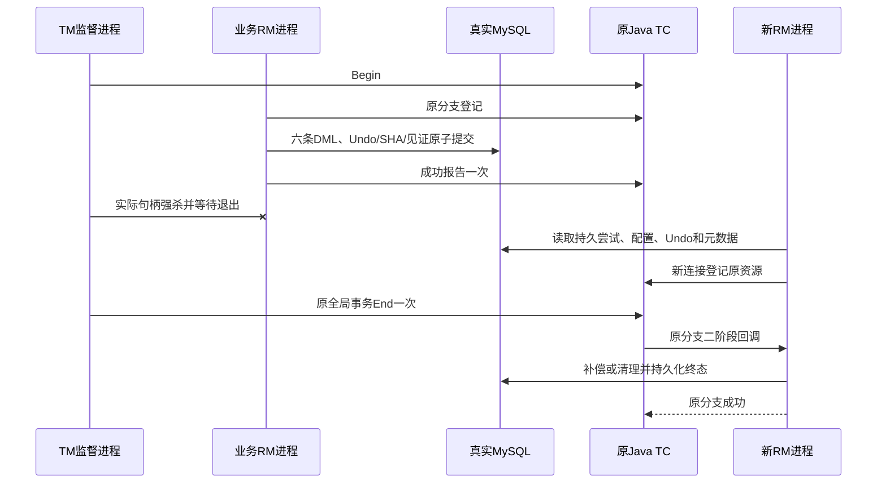

# WP05：TIMESTAMP 独立进程恢复补验

本补验落实 [TIMESTAMP 契约](mysql-timestamp-contract.md)与[时间类型兼容契约](mysql-temporal-compatibility-contract.md)中尚未验证的跨进程要求，不修改生产协议、Undo 格式、已确认需求或默认有变化 COMMIT 开关。

## 场景与身份

TM 由监督进程持有。独立业务进程执行 TIMESTAMP 主表和 TIMESTAMP 主键表的六条 DML，登记一个原 AT 分支，原事务写入 Normal Undo、SHA、见证、提交尝试及配置，并成功报告第一阶段。到达该持久化切点后，监督进程用操作系统进程句柄强制终止业务进程并等待其实际退出；不能以关闭 RM 对象、状态文件或模拟错误代替进程死亡。

全新 RM 进程从数据库尝试记录、见证、Undo、匹配的显式配置及原日志重建恢复上下文，重新向原 Java TC 登记资源。只有新进程资源登记 ready 且外部观察者确认实际父子关系后，原 TM 才发送唯一的 Commit 或 Rollback。原 TC 回调必须到达新连接并携带原 XID、BranchId、资源和分支类型，不能产生第二个业务分支或报告。

Windows CIM 从外部取得实际 PID、父 PID、可执行文件、命令行和创建时间；观察者保留已核实子进程的句柄并读取实际退出码。业务进程须非成功退出，新 RM 和监督进程须成功退出。创建时间和不同 PID 不能单独证明恢复，还须核对帧连接、原对象图、数据库业务/主键值、Undo/见证/终态和日志 CRC/Completed。

## 受控强杀的连接复位

强杀可能产生 10054 复位。只在实际存活的业务子进程已经从 OS 核实后，写入限定该业务 PID、监督 PID、固定阶段及单调时钟的授权，再允许监督进程强杀。观察器只识别十秒内的 socket reset/abort；独立核验还要求该事件属于旧业务连接，并绑定授权原字节 SHA。普通异常、缺失/过期/未来授权、错误阶段、所有者或结构均不能当作预期事件。不能修改已有普通观察器的全局错误语义来掩盖故障。

所有新连接登记都必须成功，旧连接仅登记/报告一次业务分支，所有二阶段回调均使用新连接。外部观察的强杀授权、新 RM 登记、放行新进程及 TM End 的单调时钟顺序须一致。两个方向都核对原 TC 全局、分支和锁行最终清空。

## 验收和保留范围

使用已有 Rust 1.99/1.85 × UTC 配置 3/4 × Commit/Rollback 矩阵，共八笔真实事务。每例包含新的监督、业务和恢复进程；原格式与 0–6 精度、SQL NULL、上下界及 TIMESTAMP 主键沿用已批准现场。保存生产者死亡、新进程重建、真实回调和物理终态证据，执行双 Rust 工作区及严格 Clippy。独立证据验证须拒绝相同 PID、错误父子关系、程序/哈希替换、假死亡、错误持久身份/配置和旧连接回调。

本补验不声称 TC 同时宕机、跨主机、其他时区/驱动/序列化格式或完整时间类型已经通过。DATE/TIME、完整 SQL/写入器准入、WP07 与 Phase 5–7 保持原计划要求。

选定 UTC 进程恢复补验已通过：[现场与验证](evidence/mysql-timestamp-restart/README.md)、[ledger](wp05-mysql-timestamp-restart.json)。保留原阶段范围，不关闭 DATE/TIME、完整 WP05 或全计划。
