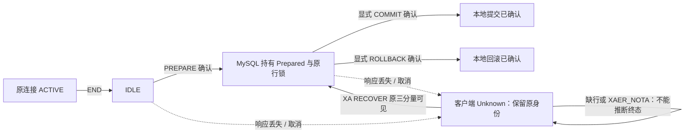

# Phase 4：Java 兼容 XA 标识与 MySQL 原生两阶段

事实源为架构计划 Phase 4 的 XA Resource 与两阶段提交。本增量开始独立 XA 引擎及 MySQL 原生驱动，不关闭 AT WP05、WP06 或完整 XA RM Gate，不移除剩余 TCC、Fence、空回滚、悬挂及 Phase 5–7。

## 标识与状态

`seata-xa` 对齐固定 Java `org.apache.seata.rm.datasource.xa.XAXid`、`XABranchXid`：格式号 9752，globalTransactionId 为原 XID 的 UTF-8，branchQualifier 非零时为 `-` 加十进制原 long，零为空。保留值对象 null/空串与有符号 long 语义，不授予 TC 登记或结束权限。恢复字节入口只接纳有效 UTF-8 和规范分支文本；不模拟 Java 对损坏字节的有损替换。MySQL 出站要求非空且不超过 64 字节的 gtrid、正原 BranchId，以及不超过 64 字节的 bqual。

MySQL XID 使用由原字节生成的十六进制字面量及固定格式号，禁止直接插入原 XID 文本。支持路径为 START → 单次参数化 DML → END → PREPARE，然后由显式原身份 COMMIT 或 ROLLBACK；不提供 ONE PHASE、JOIN、RESUME 或换向重放。DML 沿用现有有界 SQL 识别/参数预算，目标须为当前物理 InnoDB 基表；元数据锁期间用新同实例/schema 会话检查触发器和双向外键，保留当前明确拒绝矩阵，拒绝 Undo/内部控制表。XA 不生成 AT 镜像或 Undo。

每个活动作用域独占物理连接且关闭后不回池。DML 首次 await 前移走连接并中毒；失败或取消不得继续 DML/Prepare。消费式 Prepare 从原连接发送 END、PREPARE；成功后关闭原连接，Prepared 仍由 MySQL 持有。Drop 关闭活动会话，不宣称 Prepared 已回滚。所有操作共享各自绝对期限；驱动错误脱敏，不含 SQL、参数、凭据或 XID 内容。

复用原 MySQL TLS/实例/schema 校验，要求 `xa_detach_on_prepare=ON`。恢复在独立连接执行真正 XA RECOVER，以最多 256 行、原两分量长度、固定格式号和完整原字节比较精确目标；格式相同但损坏的目标结构拒绝，其他 XA 格式不得误认。查询只返回当前是否可见 Prepared，不返回 Applied/NotApplied，也不赋予盲重试权。首次写控制命令前的连接/配置失败与命令可能发送后的未知分开；PREPARE、COMMIT 或 ROLLBACK 响应丢失/期限/取消都不能因后续未见 Prepared 而猜终态。

## 本增量验收

1. 固定原 Java 三个标识源文件实际编译，生成正常/null/零/有符号 long/UTF-8 字节向量，与 Rust 逐字节比较；数据库严格入口另测空/64 字节边界和恶意文本安全编码。
2. 真实 MySQL 验证 Prepared 的数据在普通连接不可见、行锁仍持有；显式 Commit 后可见、Rollback 后不出现；同源不同分支精确区分，重复未知不能冒充成功。
3. 活动作用域丢弃/驱动错误/参数错误后没有提交；失败作用域拒绝后续执行及 Prepare；非 InnoDB/触发器/内部表在 DML 前拒绝。
4. 原写入进程退出与 MySQL 重启后，新进程通过真正 XA RECOVER 找到同一字节身份，再显式完成两方向；独立 SQL 与原生 XA RECOVER 核对前后状态。
5. 双 Rust、必要回归、严格检查、源输入/命令输出归档及有效生产源反例。

完整 XA Resource 仍须接入 TC 的原 XA BranchRegister/Report、RM Pending/权威恢复、取消/回包丢失/并发回调及固定 Java TC 整笔全局事务门禁。当前值对象和原生驱动不能替代上述原登记/结果权限；特别是 XAER_NOTA 和恢复缺行始终不能直接当作已有成功。部署写入器权限、XA_RECOVER_ADMIN、故障/性能与运维继续验收。

原生语法、64 字节限制及恢复列形状依据 [MySQL 8.4 XA SQL](https://dev.mysql.com/doc/refman/8.4/en/xa-statements.html)；跨连接 Prepared 边界依据 [XA 状态](https://dev.mysql.com/doc/refman/8.4/en/xa-states.html)。该文档为已有总计划的实施细化，不改变原 AT 生产安全门槛。

## 当前实施证据

标识和原生 MySQL 两阶段增量已通过上述选定场景：原 Java 实际 8 向量、双 Rust 各 5 身份目标/8 原生现场、三种原 OK 截留、真实行锁等待后取消、不同进程与同一 MySQL 重启后的原身份恢复。七类源码反例共十四次及每版本十二项证据削弱拒绝。全工作区各 785 passed / 356 ignored，生产字节与当前一致；最终 native 条件测试的观察补强后重跑目标/严格检查与源封存。见 [固定证据与诊断](../phase-4/evidence/mysql-xa/README.md) 和 [machine ledger](../phase-4/mysql-xa-native.json)。完整 XA Resource/RM/原 TC Gate、AT 和其余所有阶段继续开放。
