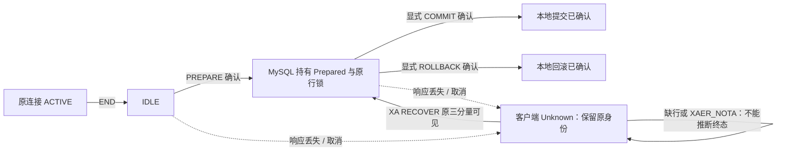

# Phase 4：Java 兼容 XA 标识与 MySQL 原生两阶段

事实源为架构计划 Phase 4 的 XA Resource 与两阶段提交。本增量开始独立 XA 引擎及 MySQL 原生驱动，不关闭 AT WP05、WP06 或完整 XA RM Gate，不移除剩余 TCC、Fence、空回滚、悬挂及 Phase 5–7。

## 标识与状态

`seata-xa` 对齐固定 Java `org.apache.seata.rm.datasource.xa.XAXid`、`XABranchXid`：格式号 9752，globalTransactionId 为原 XID 的 UTF-8，branchQualifier 非零时为 `-` 加十进制原 long，零为空。保留值对象 null/空串与有符号 long 语义，不授予 TC 登记或结束权限。恢复字节入口只接纳有效 UTF-8 和规范分支文本；不模拟 Java 对损坏字节的有损替换。MySQL 出站要求非空且不超过 64 字节的 gtrid、正原 BranchId，以及不超过 64 字节的 bqual。

MySQL XID 使用由原字节生成的十六进制字面量及固定格式号，禁止直接插入原 XID 文本。支持路径为 START → 单次参数化 DML → END → PREPARE，然后由显式原身份 COMMIT 或 ROLLBACK；不提供 ONE PHASE、JOIN、RESUME 或换向重放。DML 沿用现有有界 SQL 识别/参数预算，目标须为当前物理 InnoDB 基表；元数据锁期间用新同实例/schema 会话检查触发器和双向外键，保留当前明确拒绝矩阵，拒绝 Undo/内部控制表。XA 不生成 AT 镜像或 Undo。

每个活动作用域独占物理连接且关闭后不回池。DML 首次 await 前移走连接并中毒；失败或取消不得继续 DML/Prepare。消费式 Prepare 从原连接发送 END、PREPARE；成功后关闭原连接，Prepared 仍由 MySQL 持有。Drop 关闭活动会话，不宣称 Prepared 已回滚。所有操作共享各自绝对期限；驱动错误脱敏，不含 SQL、参数、凭据或 XID 内容。

复用原 MySQL TLS/实例/schema 校验，要求 `xa_detach_on_prepare=ON`。恢复在独立连接执行真正 XA RECOVER，以最多 256 行、原两分量长度、固定格式号和完整原字节比较精确目标；格式相同但损坏的目标结构拒绝，其他 XA 格式不得误认。查询只返回当前是否可见 Prepared，不返回 Applied/NotApplied，也不赋予盲重试权。首次写控制命令前的连接/配置失败与命令可能发送后的未知分开；PREPARE、COMMIT 或 ROLLBACK 响应丢失/期限/取消都不能因后续未见 Prepared 而猜终态。

## 本增量验收

1. 固定原 Java 三个标识源文件实际编译，生成正常/null/零/有符号 long/UTF-8 字节向量，与 Rust 逐字节比较；数据库严格入口另测空/64 字节边界和恶意文本安全编码。
2. 真实 MySQL 验证 Prepared 的数据在普通连接不可见、行锁仍持有；显式 Commit 后可见、Rollback 后不出现；同源不同分支精确区分，重复未知不能冒充成功。
3. 活动作用域丢弃/驱动错误/参数错误后没有提交；失败作用域拒绝后续执行及 Prepare；非 InnoDB/触发器/内部表在 DML 前拒绝。
4. 原写入进程退出与 MySQL 重启后，新进程通过真正 XA RECOVER 找到同一字节身份，再显式完成两方向；独立 SQL 与原生 XA RECOVER 核对前后状态。
5. 双 Rust、必要回归、严格检查、源输入/命令输出归档及有效生产源反例。

完整 XA Resource 仍须接入 TC 的原 XA BranchRegister/Report、RM Pending/权威恢复、取消/回包丢失/并发回调及固定 Java TC 整笔全局事务门禁。当前值对象和原生驱动不能替代上述原登记/结果权限；特别是 XAER_NOTA 和恢复缺行始终不能直接当作已有成功。部署写入器权限、XA_RECOVER_ADMIN、故障/性能与运维继续验收。

原生语法、64 字节限制及恢复列形状依据 [MySQL 8.4 XA SQL](https://dev.mysql.com/doc/refman/8.4/en/xa-statements.html)；跨连接 Prepared 边界依据 [XA 状态](https://dev.mysql.com/doc/refman/8.4/en/xa-states.html)。该文档为已有总计划的实施细化，不改变原 AT 生产安全门槛。

## 当前实施证据

标识和原生 MySQL 两阶段增量已通过上述选定场景：原 Java 实际 8 向量、双 Rust 各 5 身份目标/8 原生现场、三种原 OK 截留、真实行锁等待后取消、不同进程与同一 MySQL 重启后的原身份恢复。七类源码反例共十四次及每版本十二项证据削弱拒绝。全工作区各 785 passed / 356 ignored，生产字节与当前一致；最终 native 条件测试的观察补强后重跑目标/严格检查与源封存。见 [固定证据与诊断](../phase-4/evidence/mysql-xa/README.md) 和 [machine ledger](../phase-4/mysql-xa-native.json)。完整 XA Resource/RM/原 TC Gate、AT 和其余所有阶段继续开放。

## 正式登记与 RM 接入的实施顺序

当前继续实施第一阶段：正式 `ResourceClient` 单次 XA BranchRegister（原 lock_key 为 None），仅匹配成功响应签发的 `RegisteredBranch` 能启动受管理事务。原 XID 必须先满足 MySQL 64 字节限制，不允许登记后截断、hash 或重新申请分支。原资源模式、JDBC ID、可选应用数据和 TC 签发编号原样保留。普通 MySQL Prepare 成功沿用原 Java XA 流程，不自动发送 AT 的 PhaseOne_Done；未知注册/数据库结果均不合成成功回执或重发报告。

014 显式新表保存不可变原登记身份、格式版本、单向二阶段决定和确认终态。运行时不建表或升级，不改变原七列 Undo/AT 恢复表。必须在任何 XA START 前，先提交一条仅能插入一次的原登记记录；任何校验、写入、重复身份或控制 COMMIT 未确认都不启动 XA。同一原回执的克隆也不能再次启动该分支，终态后不删除该防重放记录。

受管理 DML 和 Prepare 持原登记行锁核对 phase=0；回调在独立事务中先将原方向从 0 持久绑定为 Commit/Rollback，再执行原三分量 XA 控制，不能换向。跨进程使用不同 RM 日志时，数据库决定仍必须一致。成功控制响应后另行持久确认终态，再允许 RM 发布 Applied。后续同方向的终态读取不再次调用原生控制；错误/取消/期限均保留 Pending 或未知。

首次 apply 与 Pending recover 都先核对精确原身份和方向。仅真正 XA RECOVER 中精确可见的原 Prepared 才可执行已绑定的同方向结束动作；MySQL 对不可复用的同一 XA 三分量负责单次 Prepared→终态转换。不会把此条件返回成 NotApplied，旧未知结果也不授权重新 START、登记或重放业务。不存在登记行或 Prepared、驱动失败、XAER_NOTA、方向/身份冲突均不得猜成功。

第一阶段验证正式 XA 登记、无原生动作的登记拒绝/回包丢失、单次持久登记后原始 Prepare、RM 正常两方向回调与重复、独立恢复行的方向拒绝、日志重建及全局 TC 正常路径。本阶段仍有明确缺口：原生结束已生效而终态行尚未确认时，缺 Prepared 继续 Unknown；登记/START/Prepare 的进程退出以及旧活动会话的否定证明需要下一阶段的持久生产者/结束意图、同 XA 提交见证和旧会话围栏。它们继续作为完整 XA RM Gate 的必要验收，不能因第一阶段通过删除。所有错误必须保留已经真实取得的原登记回执；消费式 Prepare 前调用方也须保留该原身份，取消 Future 不能从数据库缺行重造回执。

第一阶段的最终选定证据见 [受管理 XA 记录](../phase-4/evidence/xa-managed/README.md) 和 [machine ledger](../phase-4/mysql-xa-managed.json)：Rust 1.99/1.85 每版八项受管理真实 MySQL 场景、八项原生回归以及原 Java TC 的 Commit/Rollback 全局事务。双版本工作区各 785 passed / 366 ignored，严格 XA/MySQL Clippy 通过；ignored 场景由独立现场工具明确执行，不能把忽略本身计作通过。独立校验核对封存源码、原始 V1 帧、数据库状态与实际清理结果。原生 COMMIT OK 丢失现场仍为 Pending，保留上述恢复缺口；此处只确认第一阶段，不关闭完整 XA Gate 或总计划。

## XA 同事务提交见证：恢复增量

015 显式部署独立 InnoDB 提交见证表。受管理 Prepare 在原 ACTIVE XA、原物理连接写入精确原身份见证，再 END/PREPARE；正常业务入口继续禁止写内部表。见证与业务只在同一 XA COMMIT 后共同可见，Rollback 不留下见证。写见证之前持控制行锁核对原方向尚未绑定，校验精确表结构、实例、约束和持久性，失败/取消封闭原作用域。

回调先持久绑定原方向。原 Prepared 可见时沿用原生结束；Commit 响应未知后保留 Pending。后续同方向恢复仅在原 Prepared 不可见且实际读到精确原身份、同实例/schema/version 的已提交见证时，可持久确认原 Commit 终态；不重发原生 COMMIT、不重放业务。缺见证仍为 Unknown，不能证明回滚。原 014 登记和既有 Prepared 不合成见证；旧分支若原生响应已丢失且无见证，继续保持未知。

验收先复现原 COMMIT OK 截留后的 Pending，再由同一原分支回调通过已提交见证完成；双版本真实 MySQL、原 TC 正常两方向、完整受影响回归、见证身份/结构篡改及缺行拒绝。该增量不关闭旧活动会话围栏、持久生产者/结束意图、Rollback ACK 丢失恢复、完整故障矩阵或总计划。

## Prepared 回滚结束意图与响应丢失恢复

016 显式保存与原登记逐字段一致的生产者见证写入证据及 Prepared 回滚结束意图。原 ACTIVE 连接实际插入 015 见证后、END/PREPARE 前，在控制事务持久插入 016 phase=0/completed=0；确认控制提交后重新获取原分支门闩并核对仍未绑定二阶段，才允许单次 END/PREPARE。取消或相反回调不授权重新 START 或重做业务。

Rollback RM 只在实际观察原完整 Prepared 后，将匹配的原生产者证据升级为 phase=2/completed=0，并在任何原生 ROLLBACK 前确认控制提交。再次取得原分支门闩与实际状态后执行同方向结束。后续恢复仅当原登记仍绑定 Rollback、原 Prepared 已不可见、016 的原身份与已持久 Prepared 回滚意图匹配、且原 015 提交见证确实缺失时，才确认原回滚；发现提交见证应拒绝换向结果。没有 016 或只有 phase=0 不能从缺行认定回滚。

依据为原 XA 已进入不可重启的 Prepared、生产者已写入同事务见证、持久决定单向且登记不可复用；回滚释放事务内见证锁后，缺提交见证才排除 Commit。外部绕过受管理身份/权限的写入器、管理员破坏或恢复拓扑仍属于完整生产门禁。旧分支没有生产者证据时，原生 ACK 正常仍可确认；ACK 丢失仍未知。未 Prepared 的活动会话恢复及完整旧会话围栏继续开放。验收必须实际截留原 ROLLBACK OK，首次 Pending，后续原分支恢复完成且只发一次 ROLLBACK；删改结束意图和仅缺 Prepared 均不得确认。

该增量最终证据见 [Prepared 回滚恢复](../phase-4/evidence/xa-managed/PREPARED_ROLLBACK.md) 及 [machine ledger](../phase-4/mysql-xa-prepared-rollback.json)。双 Rust 各九项受管理真实 MySQL、原 Java TC 两方向、全工作区各 785 passed / 367 ignored 和严格 XA/MySQL Clippy 通过；连续两个原 OK 截留、原身份意图损坏和缺失、冲突提交见证及新管理器恢复均有实际现场证据。完整生产和总计划仍开放。

## ACTIVE 作用域资源围栏

017 在原唯一登记控制事务中明确签发 guard 协议登记，不回填旧 014 分支。018 是相同原身份的事务内 guard：新生产者必须在原 XA START 后、任何业务及对外返回作用域之前，唯一插入 phase=0/completed=0 guard。原连接失败/取消关闭后 guard 与业务共同回滚；Prepared 或 Commit 持有/提交该唯一键。

受管理作用域使用可取消的独占本地会话槽。仅关闭本库实际持有的连接，不按外部连接号执行 KILL。监视器在独立有界连接读取原物理实例/身份的持久决定，方向已绑定、原登记缺失或观察失败时封闭原槽；退出即关闭的原连接不能回池。取消覆盖等待门闩与在途业务/Prepare，不能在决定绑定后恢复旧作用域。

Rollback 在无 Prepared、也没有既有 Prepared 回滚证明时，只能对匹配的 017 协议分支，持原门闩在 018 唯一键写 phase=2/completed=1 屏障。写入必须等待旧事务 guard 释放，旧已提交 guard 则拒绝；屏障竞争成功后再次确认无原 Prepared/提交见证，再将屏障与原 Rollback 终态同事务提交。迟到的原 guard 插入不能成功，故不能继续业务。没有协议登记不能套用该证明；被暂停/分区或未结束的旧会话不能取得 guard 时继续 Pending，不宣称可强制终止任意远程会话。

验收：保留旧 ACTIVE 对象并已执行真实未提交业务，由独立数据源/正式回调完成原回滚；旧作用域后续 DML/Prepare 拒绝，原事务实际释放，屏障持久，无原生 END/PREPARE/ROLLBACK 或远程 KILL。缺协议、结构/身份冲突、等待失败不能确认；既有 Prepared 两方向及连续响应丢失回归继续通过。完整进程崩溃、网络分区强制清理、生产部署/权限和其余总计划继续开放。

该增量最终选定证据见 [ACTIVE guard 围栏](../phase-4/evidence/xa-managed/ACTIVE_GUARD.md) 和 [machine ledger](../phase-4/mysql-xa-active-guard.json)。双版本十项真实 MySQL、原 Java TC 两方向通过，工作区每版各 785 passed / 368 ignored；最终存储负例改用独立常规期限管理器并核对 IdentityConflict 后，重跑双版本现场、源封存和严格 Clippy。健康作用域经过至少两次真实监视查询仍可更新，正式回调后实际回滚，后续业务/Prepare 拒绝。完整生产和总计划继续开放。
