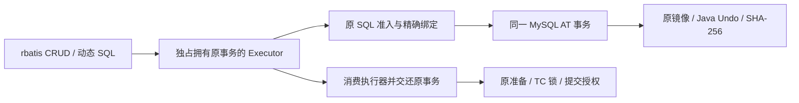

# rbatis 独立 MySQL AT 适配契约

延续原架构计划的数据库核心独立与“更多 ORM”要求。保留已有 SeaORM；新增 rbatis 适配必须复用正式 MySQL AT 事务，不为 ORM 引入另一业务连接、独立 COMMIT 或不同的 Undo 格式。当前先完成依赖兼容基线，本文后续实施与现场验收要求仍开放，不能将无数据库探针计为正式适配器交付。

## 接入与事务约束

rbatis 的 `Executor: RBatisRef`、`RBatisRef: Any` 要求执行器拥有静态生命周期，因此适配执行器拥有原 `MySqlLocalTransaction`，用互斥量串行化访问；消费适配器后显式交还同一个事务，继续原 prepare/锁/提交授权/回滚/恢复流程。禁止复制原连接、发布原始连接或创建独立事务入口。丢弃未交还的执行器沿用原事务关闭语义。

原 `exec` 回执必须返回原语句的影响行数和完整 u64 插入 ID。读取复用原密封 SELECT/COUNT、RR 快照、元数据锁、预算、取消/超时和 poison 边界。浮点数不得冒充 DECIMAL，NULL 与 JSON null 独立，未知扩展值、深嵌套容器、控制语句和未认证 SQL 必须拒绝。事务核心不得依赖 rbatis。初始化使用无池、无默认参数日志的元数据引擎；首期拦截器准入要显式定义，不能静默忽略用户配置。

## 当前发布版兼容基线

核对发布包而非浮动 master：rbatis/rbdc 4.9.11、宏驱动/codegen 4.9.8、rbs 4.8.4。原始依赖解析在 Rust 1.85 下失败；兼容解析仍不能避开上游未声明的语法/库特性要求。降级的已检查候选也出现同类依赖问题，不能仅凭版本号认定兼容。

以具备原许可证和逐文件来源摘要的独立维护补丁验证当前发布版：

- scraper 0.27.0：将三个 let-chain 条件改写为保留原条件顺序和短路语义的嵌套条件。
- rbdc 4.9.11：通过 blanket 实现的对象安全 Any 桥保留原连接选项的共享/可变 downcast，避免 trait upcasting；不要求第三方驱动新增实现方法。
- rbatis 4.9.11：用同类 Any 桥保留原拦截器 lookup；原分页零大小分支不变，在其后用余数判断替换新版本标准库方法。
- 宏驱动 4.9.8：py_sql/html_sql 从传入 Executor 查询方言，替代直接进入其元数据引擎查询方言，避免为了方言构造虚假连接池。真实 CRUD/动态 SQL 测试先复现原报错再验证补丁。移除 Rust 1.85 不识别的新 lint 名称。

`third_party/*/SEATA_PROVENANCE.json` 绑定原发布包 SHA-256、每个上游文件与维护后文件；`SEATA.patch` 给出完整差异。补丁首先仅由独立 `tools/rbatis-compatibility` 的 patch/lock 使用，不修改正式工作区的依赖图。正式适配器接入及发布时必须显式集成这些补丁；下游不会自动继承本仓库根 patch。

## 验收与未完成范围

兼容探针必须在 Rust 1.85/1.99、同一 lock 与源码下实际编译运行：原生 CRUD 四操作、自定义执行器不建池、py_sql/html_sql/sql 的分派与原序绑定、精确 DECIMAL/JSON/u64/NULL、downcast 身份/可变性/类型拒绝、拦截器类型及分页边界。捕获执行器只证明宏调用路径，不能证明数据库行为。

正式适配器仍须补齐：精确输入/输出及拒绝路径单测、真实 MySQL CRUD 和原 TC 提交/补偿、同事务 Undo/SHA 原子持久化、原 Java parser 重读、锁/回调、原事务交还、取消/丢弃后的连接关闭与恢复。两版全工作区和受影响包检查通过后才能声称首期 adapter 完成。全部 rbatis 分页/插件/迁移/关联和其他模式按原生态范围继续交付。

依赖审计使用现有 RustSec 快照且保留全部发现。兼容补丁不构成生产安全准入；尤其需核对 rbatis 依赖是否使原先不在正常图中的 time 告警变为实际依赖。WP05/WP07 和 Phase 5–7 总门禁不因此关闭。
