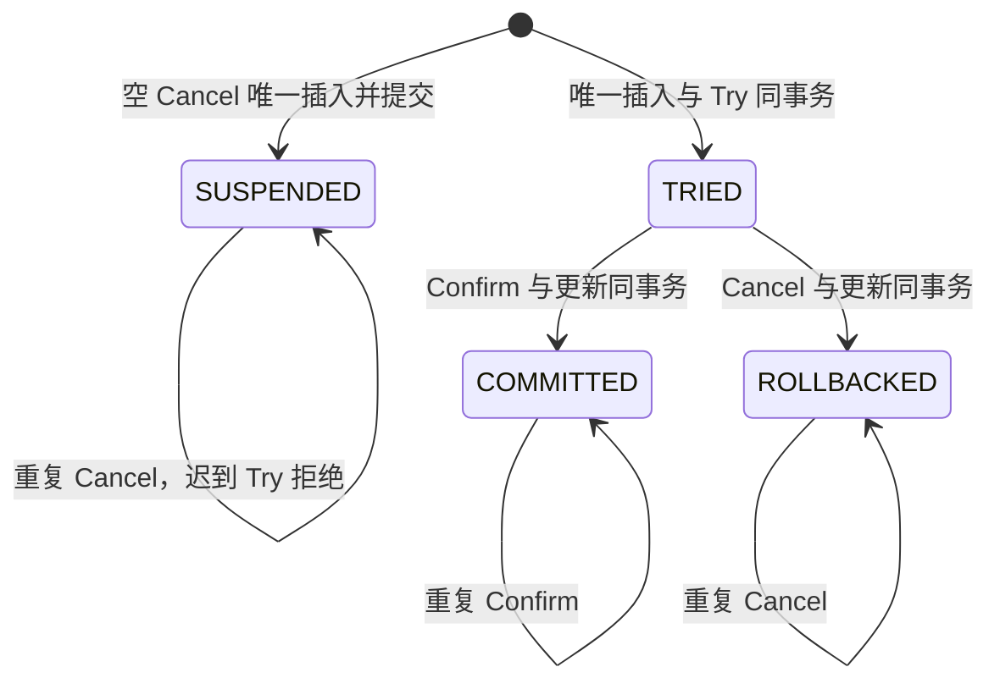

# Phase 4：TCC 与持久 Fence

事实源延续 [总架构计划 Phase 4](../architecture/SEATA_RUST_ARCHITECTURE_PLAN.md#phase-4xa--tcc)，固定 Java `cba73e180fd8896a99df6415b859d275122feaa7`。本变更不扩展 MySQL AT 的 V1 发布声明；TCC 只有完成下述执行、持久化、正式 TC 和故障门禁后才可声明支持。

## 核心与兼容行为

独立 `seata-tcc` 承载 `BusinessActionContext` 和 Fence 决策。TC 原 XID、BranchId 和精确资源名来自原登记/回调，不接受应用数据覆盖。外层应用 JSON 的 `actionContext` 对象包含业务参数；Java 的 null、缺失和空白应用数据构造空上下文，缺失或 null 的 actionContext 同样为空。非对象 actionContext 和非法 JSON 拒绝。只有 JSON 布尔 true 的 `useTCCFence` 启用原标志，不把字符串或数字转成 true。动态上下文更新与 BranchReport 必须另行实施，不通过解析器冒充已支持。

参数保存为已验证的原 JSON 值字节，避免把 Java long、任意精度整数/小数或指数先转 f64 后损坏。字符串键保持 JSON 解码语义；同键按原 Java parser 的最后值处理。输入总字节有界、嵌套解析有界；Debug/错误不能带业务值、原 XID 或资源文本。

### 动态上下文的核心依赖

按固定 Java `BusinessActionContext` 增加可选 updated/delayReport、初始化后的变更跟踪、受控 put/remove/clear/set 和 addActionContext；原 XID/BranchId/动作名继续只读。新增键（包括 JSON null）、删除已有 null、清空非空映射都应标记变更；同值替换、删除不存在键和清空空映射不标记。`addActionContext` 忽略 null；直接 put 可保存 null。setActionContext 替换映射但不自行标记，跟踪仍开启；失败/超预算的变更必须原子拒绝，不破坏原状态。

相等性按固定 Java 实际 JSON Provider 的类型执行：Integer/Long/BigInteger 不相互强转，小数/指数的 Double 比较保留正负零区别；对象比较忽略键顺序，数组保留顺序。浮点转换仅用于该兼容比较，不用于保存、序列化或重建业务值。updated 仅是 Java 可变状态，不能作为 TC 已收到报告、原参数相同、数据库已提交或回调获授权的证明。

该核心依赖不自动发送网络报告。后续持久报告仍须解决原登记身份与更新应用数据的区分、Registered 状态单次报告、未知响应、报告版本/原字节、旧 Pending 与新参数回调的一致性，以及 Try 的可变业务上下文交接；不能放宽既有身份冲突校验来伪装已支持完整动态报告。

### 持久报告实施约束

报告路径必须显式启用并部署独立迁移，默认静态 TCC 不要求新增表。原成功登记回执不改写；独立持久清单保存原登记数据及有界、不可覆盖的完整报告版本，原实例、物理结构、连续版本和每版原字节摘要均须核验。清单是报告来源元数据，不证明 Try 或二阶段完成。

可变 Try 使用兼容的显式业务入口；立即报告通过事务内的异步能力调用，延迟报告在业务返回后统一提交完整上下文。每次报告只发送一个 Registered 状态请求；确认报告后才能发送本次业务 COMMIT。未知、拒绝、超时、取消或被业务捕获的报告错误均封闭业务事务，保留原回执及报告错误/可能发送边界；不盲重发报告或业务。报告清单可独立于未提交业务存活，以便原 TC 回调在旧进程退出后核验原身份。

只有经过原连接能力校验的回调才能请求资源提供稳定日志身份，且不得改变 XID、BranchId、模式或精确资源键。该校验先于日志终态复用，只读核验报告清单及 Fence，不授予写控制行权限；Pending 之后的原 observer 仍独占空 Cancel 来源。Fence 持原登记数据，业务参数来自经过清单验证的实际回调；已有 TRIED/业务终态只允许最新报告参数，旧已知版本保持重试未决，未知改写拒绝。空 Cancel 可确认没有 Try 业务的已知版本，但不能伪造登记回执。手工裸身份入口和其他 AT/XA 资源维持原严格身份规则。

Fence 固定码为 TRIED=1、COMMITTED=2、ROLLBACKED=3、SUSPENDED=4；未知码拒绝。Try 只允许唯一插入 TRIED 后执行业务，任何已有记录都不能重复 Try。Confirm 仅 TRIED 可原子迁移 COMMITTED 并执行；COMMITTED 返回已完成；缺失保持失败，ROLLBACKED/SUSPENDED 不换向。Cancel 对缺失记录唯一插入 SUSPENDED 并跳过业务，对 TRIED 原子迁移 ROLLBACKED 并执行，对 ROLLBACKED/SUSPENDED 复用完成，对 COMMITTED 不换向。

核心决策仅描述持锁事务内应执行的动作，不证明提交成功、TC 授权或缺行已被围栏。缺行 Cancel 的成功必须等 SUSPENDED 唯一插入与提交确认；并发 Try 胜出时重新读取，不能凭一次缺行查询宣布空回滚。

## 实施与完成门禁

1. 固定原 Java 上下文/常量执行向量，双 Rust 差分、全部 Fence 状态/动作与损坏输入测试。
2. 正式 TCC Resource 注册、原回执交接、RM apply/recover，Try/Confirm/Cancel 显式业务契约。
3. 显式 MySQL Fence 与业务同事务；方向、原身份、实例与当前物理结构校验；取消、回包丢失和持久恢复。不能仅靠内存状态或文件日志宣布业务已完成。
4. 实际唯一键竞态、空回滚、迟到 Try、幂等、并发、旧未知结果恢复及进程/数据库故障。
5. 固定原 Java TC 整笔 Commit/Rollback、重复回调与重连、上下文参数核对；双版本回归与独立 SQL/原始协议证据。
6. 动态参数报告、生产权限、清理保留策略、负载与运维另行完成，不能删除 Fence 后允许原身份再次 Try。

第 1 项核心增量已取得 [固定执行与源码反例证据](../phase-4/evidence/tcc-core/README.md) 和 [machine ledger](../phase-4/tcc-core.json)：原 Java 实际 21 项上下文、4 个 Fence 码，双 Rust 每版 6 项组件测试/63,488 个 BMP 标量/15 格 Fence 矩阵，七类源码反例每版实际七次行为失败。完整工作区各 791 passed / 372 ignored，TCC/XA/MySQL 严格 Clippy 通过。该结果不证明数据库 Fence；第 2–6 项及全部计划继续开放。不创建第二套 Spec Kit/OpenSpec 事实源。

## 正式登记与 MySQL Fence 执行

显式 `tcc` feature 使用独立 `seata_rs_tcc_fence_v1`，不改变 Java Undo、原 Fence 表或 AT/XA 表。列为原 XID/BranchId、精确动作资源名、原可选应用数据、原实例 UUID、schema_version 和 Fence status，主键为原 XID/BranchId。运行时不建表、不迁移、不删除终态。XID 当前限定非空 UTF-8 至多 128 字节，资源名至多 512 字节，应用数据沿用核心预算；超限在正式登记前拒绝，不截断或 hash。

业务以 `TccBusinessAction` 显式提供 Try/Confirm/Cancel，接收原上下文及仅允许当前有界参数化 DML 的事务能力。该能力不暴露原连接、COMMIT、DDL 或内部表写入；每次 DML 持 MDL 检查当前 InnoDB、触发器与双向外键。失败或取消后作用域封闭，即使业务捕获错误也不能继续或提交。业务返回 false/错误时 Fence 和同库业务一起回滚；外部网络、其他数据库或应用自行产生的副作用不由本地事务能力协调。

Try 必须持正式 ResourceClient 单次成功登记签发的原回执，原模式为 TCC、lock_key=None，原 actionContext 带布尔 useTCCFence=true。唯一插入 TRIED 与 Try 业务同事务提交，已有 Fence 不得重复执行。登记、数据库失败或期限必须保留已取得的原回执；未知登记不合成编号、不重发登记，未知提交不盲重试业务。

Try 错误按 ADR-0008 区分：Refused 表示本次未发送 COMMIT，不否定其他尝试已有的 Fence，也不授权重放；UnknownCommit 表示本次提交命令可能已发送而响应未确认；Deadline 单独保留登记和 Try COMMIT 的发送边界。提交边界只在最终实例/持久性检查之后、即将发送原 COMMIT 前置位，取消不能回退该事实。

RM apply/recover 都先核对当前物理表、持久原身份和实例；在持原行锁的同一事务中比较 TRIED、写原终态并调用对应业务。未知旧尝试只能在同一原行锁排除旧事务、核对真实状态后恢复；已持久同方向终态只返回 Applied，不重复调用业务。相反终态、Confirm 缺行、身份/结构冲突或驱动失败保持 Pending/失败，不能猜成功或换向。

空 Cancel 仅由正式连接产生的不可伪造 BranchCallbackReceipt 经 Pending 之后的 observer 入口仲裁。缺行时唯一插入 SUSPENDED 并确认提交，随后 apply/recover 才能复用该终态。手工裸身份 apply/recover 不能创建空回滚屏障；并发 Try/Cancel 靠原唯一键和行锁仲裁，任何死锁/重复键/未知提交均保留未决，由原 TC 重试同一身份。迟到原登记回执不能穿过已提交 SUSPENDED。

本增量选定实现已取得 [正式 MySQL TCC 验收证据](../phase-4/evidence/tcc-managed/README.md) 和 [machine ledger](../phase-4/mysql-tcc-managed.json)：双版本每版六项真实 MySQL、两项原 TC 全局事务，覆盖实际行锁等待、空 Cancel/迟到 Try、五类身份与四类结构拒绝、三阶段 COMMIT 原 OK 丢失和旧 Pending 恢复，无业务 DML 重放；134 项证据削弱拒绝。工作区各 791 passed / 380 ignored，严格检查通过。完整登记/TC 故障矩阵、进程/数据库恢复、动态报告和生产保留/权限/负载仍未完成，不能据本增量关闭第 2–6 项全部门禁或总计划。

## 原 Java TC 的回调重复与重连

在固定原 TC、原数据库 Session Store 和实际原 TCC 分支上，对 Confirm/Cancel 分别精确复制一次原回调，或扣留一次真实分支终态响应并关闭原 RM 会话。原 TC 自行重试同一原分支；RM 重连后重新登记同一资源。客户端不重发全局 End，不调用状态查询猜方向，不从 Finished 或 TC 行缺失推断成功。普通未注入路径继续要求原全局结束响应明确成功。

故障下必须保留初次客户端结果，最终另以固定原 TC 的分支/全局成功日志、原始终态包、原 TCC 模式/动作/应用数据、Fence 和业务效果联合证明。general_log 必须显示 Try 和原二阶段业务各一次；重复/重连不能重放已提交业务。双 Rust 两方向各两种故障，源码封存、独立 SQL/原始包校验和有效证据削弱拒绝共同验收。这只是完整 TC 故障矩阵的一部分，不关闭生产或总计划。

## 登记未决与主动取消

非法原身份、超限和未显式启用 Fence 在登记前拒绝；TC 明确拒绝与已发送后无响应保持不同错误类型。二者都不能签发原成功回执或启动 Try。登记请求已实际到达后取消调用，迟到的成功响应不能继续已取消的 Try；原 TC 仍可回调同一原分支，原连接能力才允许空 Cancel 持久屏障。

`try_registered` 的调用方须事先保留原回执，取消 Future 没有返回值，不能事后从裸字段重造回执。实际 Try/业务已持锁但尚未 COMMIT 时取消，旧事务释放后原 Cancel 才能确认 SUSPENDED，不能在旧会话仍持锁时猜空回滚。原 COMMIT OK 已真实到达代理而未交给调用方时取消，已提交的 TRIED/业务必须保留，由原 TC 的 Cancel 决定补偿；取消本身不证明事务未提交。两种边界均以实际独立 SQL/锁等待或原包核验，原回执晚到或克隆不能再次 Try。

本轮选定边界已经取得 [原回调故障、登记和取消验收证据](../phase-4/evidence/tcc-managed/CALLBACK_REGISTRATION_CANCELLATION.md) 与 [本轮 ledger](../phase-4/mysql-tcc-callback-registration-cancellation.json)：双版本共 16 项真实 MySQL、4 项正常原 TC、8 项原 TC 回调故障事务，250 项证据削弱拒绝；工作区每版 791 passed / 382 ignored，严格检查通过。该证据补充上述六用例基线，完整 TCC 门禁及总计划保持未完成。

## 写入进程强制终止与同实例数据库恢复

验收须使用父夹具实际创建的操作系统子进程句柄，在真实业务 DML 未提交、TRIED 已提交、Try/Confirm/Cancel 原 COMMIT OK 被截留、Confirm/Cancel DML 未提交及空 Cancel 原 OK 被截留时强制终止写入者。现场 PID、存活句柄、原成功登记回执、原 COMMIT/OK 字节或实际 InnoDB 排他锁分别证明对应边界；状态文件不能替代进程存活或提交证明。

写入者真实退出后，分别保持数据库运行、正常重启或 SIGKILL 后启动同一自有 MySQL 数据目录。核对原 UUID 与原 Fence/业务，不能重建数据库、补写状态或换身份。新 RM/新连接重开旧持久日志，仅处理同一原回调，旧 Pending 在终态提交确认前不能变 Completed。未提交 Try 必须回滚后由原 Cancel 建立 SUSPENDED；已提交 TRIED 继续原 Confirm/Cancel，已提交终态复用完成。独立 general_log 应分别记录未提交尝试和恢复实际执行，重复回调不能再次执行已经提交的业务。原实例变化/损坏及更广生产拓扑仍按独立门禁处理。

上述选定边界已取得 [进程与同库恢复证据](../phase-4/evidence/tcc-managed/PROCESS_DATABASE_RECOVERY.md) 及 [本轮 ledger](../phase-4/mysql-tcc-process-database-recovery.json)：双版本 54 个实际强杀/数据库恢复场景，16 项 MySQL、4 项正常原 TC、8 项原 TC 回调故障回归通过，902 项证据削弱被拒绝；每版工作区 791 passed / 384 ignored，严格检查通过。原 TC 的一次自然旧连接重试重叠按原身份、关联号及关闭时序校验，不把未答复请求算成功。完整 TCC 与总计划继续开放。

动态上下文的核心依赖已取得 [变更跟踪证据](../phase-4/evidence/tcc-core/CONTEXT_MUTATION.md) 和 [本轮 ledger](../phase-4/tcc-context-mutation.json)：固定 Java 46 项观察中 Rust 核心比较 45 项，1 项 util 自动报告后续基线保留；双版本各 17 次源码行为反例被拒绝，工作区各 795 passed / 384 ignored，严格检查通过。当前源码重跑 54 项进程/数据库恢复、16 项 MySQL、4 项正常原 TC 和 8 项原 TC 故障事务通过，924 项证据削弱被拒绝。可变 Try、持久报告版本与回调身份交接未接通，不能把本地 updated 状态宣称为完整动态报告。

动态路径在既有 019 Fence 的 schema_version 中显式写入协议 2，静态路径保持协议 1；不改变表结构、不回写旧记录。当前静态配置必须拒绝新动态记录，不能在缺少报告校验时执行旧参数；动态配置同样不猜测旧协议。原登记回执及 Fence 应用数据仍为原字节。020 报告清单自身保持 schema_version=1。

TCC 的原连接回调复用 Completed 前还须重新验证当前 Fence 的同方向真实终态；TRIED、缺行、协议不符、清单损坏或实例/结构未知均不能仅凭文件日志返回成功，也不能重新执行业务补造终态。静态路径也执行该终态校验，保持协议 1 和旧数据规则；只读作用域以 ROLLBACK 释放，不改变原业务 COMMIT 次数。

## TCC 持久动态报告验收（2026-11-28）

本节更新前文核心依赖增量的未接通状态：显式启用 MySQL 可变 Try、立即/最终报告、020 原字节版本与 SHA-256、类型化未知响应及旧 Pending/新参数真实回调协调已接通。双版本 32 个动态分支场景、12 个原 Java TC 动态全局事务通过；静态 16 项 MySQL、4 项正常/8 项故障原 TC、54 项进程/数据库恢复回归通过。工作区每版 796 passed / 388 ignored，严格检查通过；46 次错误源码实际行为失败和 1130 项证据削弱拒绝。详见 [动态报告证据](../phase-4/evidence/tcc-managed/DYNAMIC_CONTEXT_REPORTS.md) 与 [ledger](../phase-4/tcc-dynamic-context-reports.json)。Java util 自动便捷 API、动态故障/并发/拓扑及生产门禁尚未完成，完整 TCC 和总计划继续开放。

### util 参数合并与自动报告入口（JSON 边界已验收）

BusinessActionContextUtil 以显式借用当前上下文和事务能力代替 Java ThreadLocal，避免异步任务迁移或交叉调用串用上下文；不提供全局可伪造的报告客户端。单值 null、缺失值、空/缺失批量映射不修改也不报告；批量忽略 null，Java 相等性判定没有变化时返回 false，不能顺便发送此前积累的 updated。真正变化后 updated=true；delayReport 仅 Some(true) 延迟并返回 false，None/Some(false) 自动等待一次正式报告。报告成功才清除 updated；错误保持原错误/可能发送事实，不捕获后伪装成功、不重试。显式 util reportContext 也遵守 updated==true 的 Java 门槛；资源管理器最终原字节变化检查继续独立存在。

ActionContextUtil 的 JSON 边界区分标量与复合值：字符串、布尔、数字保持原值；对象/数组成为 JSON 字符串，便于二阶段类型转换。Rust 输入本来就是经过验证的 RawValue，字符串内保留调用方提供的复合 JSON 原字节，不将任意精度数值转换成 Double 或添加 Java 类型元数据。预算或输入拒绝必须在任何参数合并/报告前原子完成，不能留下半批更新。参数键/身份边界、原回执及持久报告格式沿用上节。

验收使用固定 Java 原 util 与 ActionContextUtil 实际执行的无变化、延迟、立即、批量、复合值和异常观察；用受控原 Java ResourceManager 出口观察报告调用，不冒充网络验收。另须让真实 MySQL 与原 Java TC 的动态业务通过新 util 入口执行，核对实际 Registered/TCC 包、持久完整版本、原身份和 Commit/Cancel 业务结果。Rust 双版本验证取消/失败封闭和预算原子性；尚未实际执行前不标记完成。

### 动态报告与原 TC 故障联合验收（选定矩阵已验收）

选定矩阵将延迟、立即、原字节精度三种动态路径与原 TC 回调精确重复、终态回包丢失并关闭原会话组合；Commit/Cancel 各执行，双 Rust 共 24 笔原全局事务。完整原登记保持不变，报告只发送一次每版 Registered/TCC；回调及重连重试必须携带最新完整参数。同一原日志身份和当前真实 Fence 联合确认终态，Try 与实际二阶段业务各一次。同步 TM 结果未决保持未决，以原 TC 分支/全局成功日志、原终态帧和 SQL 证明最终结果，不从 Finished 或查不到 TC 行推断成功。

另以双 Rust 三路径各执行原报告成功响应丢失及报告等待时主动取消，均由原 TC Rollback 结束，共 12 笔事务。代理先观察原 Registered 报告及 TC 已真实生成的成功响应；丢失模式扣留该响应并关闭原 RM 会话，Try 须保留类型化 UnknownOutcome 及原回执，不能提交业务。取消模式在原成功响应已被扣留、Try Future 尚在运行时，以调用方预先保留的正式登记回执取消原 Try，确认实际任务取消；独立 SQL 核对原 TC 已保存新参数、版本摘要及尚未提交的业务，再关闭原响应所在会话。取消不等同明确拒绝，不假称扣留的响应已交付。

恢复必须通过原 TC 的同一原分支 Cancel 建立真实 SUSPENDED，跳过取消业务；不能重新登记、改分支号、重发报告/全局结束，或把无 Fence 的 Confirm 宣称成功。报告清单与原 TC 新参数保持，原成功登记和原日志身份不改写。原始帧关联、进程/代理清理、报告前后实际 TC/业务/控制状态、DML 和源码字节联合核验；晚到响应交付、更广 TC/数据库崩溃、并发/拓扑与生产门禁仍保持独立要求。

## TCC util 自动报告验收（2026-11-28）

已接通 JSON 边界的 BusinessActionContextUtil 批量/单值共享与立即/延迟自动报告，显式借用当前上下文和受控事务，预算拒绝保持原状态。固定原 Java util 19 项观察与 7 次原 dispatcher 出口调用核验，先前保留的 util 对象观察也完成比较；出口不计作网络证明。实际 8 个 util 原 TC 事务加 4 个原字节精度事务通过，双版本 32 个动态分支场景及 16 项静态 MySQL、4/8 项正常/故障原 TC、54 项进程/同库恢复回归通过。工作区每版 801 passed / 388 ignored，179 个成功摘要，严格检查通过；60 次错误生产源码实际行为失败，1260 项证据削弱拒绝。[自动报告证据](../phase-4/evidence/tcc-managed/AUTOMATIC_CONTEXT_UTIL.md)、[ledger](../phase-4/tcc-context-util.json)。Java 任意对象/反射注解、动态专用故障/并发/拓扑与生产门禁仍开放，完整计划未完成。

## 动态报告与原 TC 故障验收结果（2026-11-28）

双 Rust 的三种动态路径联合原 TC 回调重复/终态丢失，共 24 笔 Commit/Rollback；原报告成功响应丢失和报告等待中实际取消各 6 笔，由唯一原 Rollback 建立 SUSPENDED，合计 36 笔原全局事务。原完整参数、关联、重新登记、原 TC 终态日志、持久版本/SHA-256、原身份 Fence 和 DML 联合核验通过，报告未确认不提交 Try，空 Cancel 不执行业务。当前源码同时通过 32 个动态分支场景、12 个原 TC 正常动态事务、16 项静态 MySQL、4/8 项正常/故障静态原 TC、54 项进程/同库恢复回归；工作区每版 801 passed / 388 ignored，179 个成功摘要，严格检查通过。60 次错误生产源码实际行为失败，2326 项证据削弱拒绝。[联合故障证据](../phase-4/evidence/tcc-managed/DYNAMIC_ORIGINAL_TC_FAULTS.md)、[ledger](../phase-4/tcc-dynamic-original-tc-faults.json)。本次只扩展夹具与核验，生产代码/协议/迁移未改变；动态进程/数据库崩溃、并发/跨实例配置与生产门禁，以及 AT/XA 和 Phase 5–7 仍未完成。
